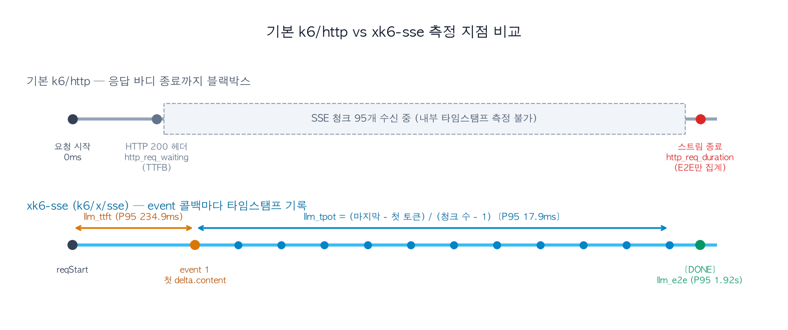
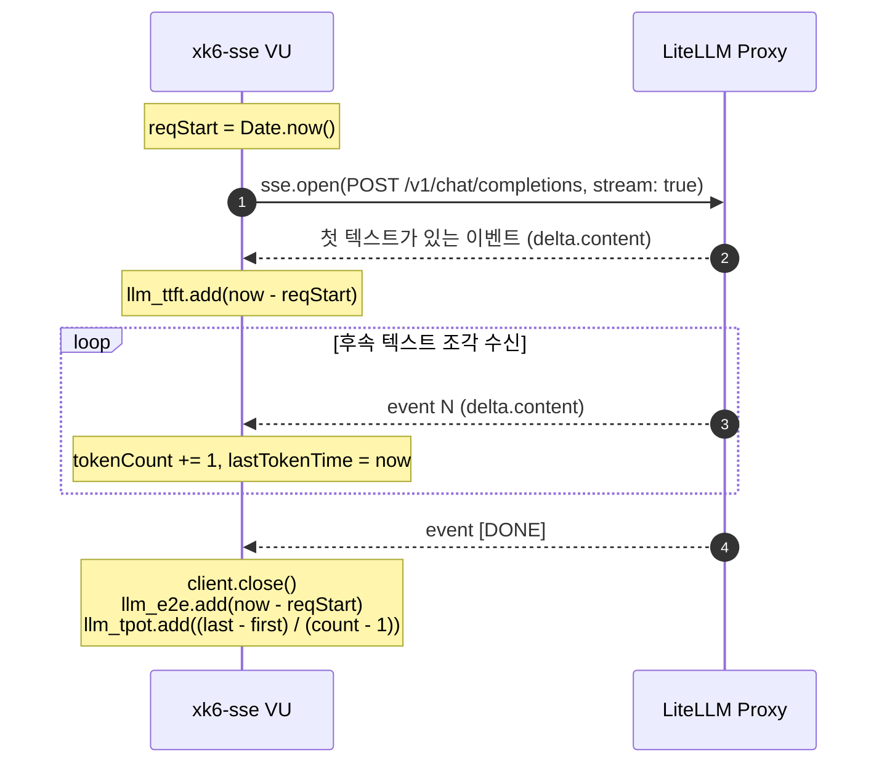

# 시나리오 4. xk6-sse로 k6에서 TTFT·TPOT 보완 측정하기

이 문서는 Go 확장 플러그인인 `xk6-sse`를 빌드해 k6에서도 SSE 청크 단위로 TTFT와 TPOT를 측정하는 방법과, 실무에서 k6가 맡아야 할 역할 경계를 정리합니다.

## 이 시나리오의 목표

| 항목 | 내용 |
| --- | --- |
| 기능 | `xk6-sse` (`k6/x/sse`)와 `constant-arrival-rate` 조합으로 k6에서 SSE TTFT·TPOT·E2E 분리 측정 |
| 쓰는 도구 | `./k6-sse` (`k6 v0.54.0` + `xk6-sse v0.1.3`), [04-xk6-sse-ttft.js](../k6/04-xk6-sse-ttft.js) |
| 입력 | 개방 루프 `0.5 req/s` (`12s`), 매 요청 고유 프리픽스 포함 Chat SSE 요청 |
| 작업 | `./k6-sse run k6/04-xk6-sse-ttft.js` 실행 후 커스텀 메트릭 확인 |
| 달성할 것 | 기본 `k6/http`에서 못 재던 `llm_ttft`·`llm_tpot`·`llm_e2e`를 분리하고, 여전히 남는 한계(토크나이저·Goodput)를 확인 |

## 이 기능이 무엇인가

`xk6-sse`는 k6의 확장 빌드 도구(`xk6`)로 Go 기반 SSE 클라이언트를 내장한 커스텀 바이너리입니다. 기본 `k6/http`와 달리 `sse.open()`이 연결을 연 상태에서 `client.on('event', ...)` 콜백으로 서버가 보내는 `data:` 이벤트를 실시간으로 하나씩 받습니다.

첫 번째 텍스트 조각(`delta.content`)이 도착한 시각에서 요청 시작 시각을 빼면 **TTFT(`llm_ttft`)**가 나옵니다. 이 코드에서 **`llm_tpot`**은 첫 텍스트와 마지막 텍스트 사이의 시간을 `(텍스트 조각 수 - 1)`로 나눈 값입니다. 두 값은 k6의 `Trend` 메트릭으로 집계됩니다.



### 용어

| 용어 | 뜻 | 이 실습의 예 |
| --- | --- | --- |
| `xk6` | Go로 k6 확장 모듈을 묶어 커스텀 `k6` 바이너리를 빌드하는 도구 | `xk6 build v0.54.0 --with github.com/phymbert/xk6-sse@v0.1.3` |
| `k6/x/sse` | `xk6-sse`가 제공하는 JavaScript import 경로 | `import sse from 'k6/x/sse';` |
| `Trend` 메트릭 | k6에서 avg, min, med, p90, p95를 자동 통계내는 커스텀 지연 지표 | `llm_ttft`, `llm_tpot`, `llm_e2e` |

## 이 기능을 사용하는 이유와 역할 경계

LLM 전용 도구(AIPerf, GuideLLM)가 있는데도 `xk6-sse`를 알아야 하는 이유는 **전체 서비스 E2E 통합 부하테스트** 때문입니다.

실제 운영 서비스는 클라이언트 -> 백엔드 API 서버 -> DB·인증·RAG 벡터 검색 -> LiteLLM -> LLM 엔진 순서로 흐릅니다. LLM 전용 벤치마크 도구는 `/v1/chat/completions` 같은 OpenAI 호환 엔드포인트만 호출할 수 있어, 로그인 토큰 발급이나 DB 커넥션 풀, 장시간 SSE 연결 유지 시 백엔드 스레드·메모리 고갈 여부는 검증하지 못합니다. 이때 `constant-arrival-rate`와 `xk6-sse`를 조합한 k6가 전체 애플리케이션 경로를 검증하는 역할을 맡습니다.

## 대안 비교

| 테스트 목적 | 권장 도구 | 주요 검증 포인트 |
| --- | --- | --- |
| LLM 모델·인프라 성능 튜닝 및 쿼터 산정 | NVIDIA AIPerf, GuideLLM, vLLM Bench | 정확한 TTFT·TPOT(P95), Goodput, KV 캐시 한계, 토크나이저 기반 TPS, 429 쿼터 한계 |
| 전체 서비스 E2E 통합 부하테스트 | k6 (`constant-arrival-rate` + `xk6-sse`) | 백엔드 API, DB 커넥션 풀, RAG 벡터 검색, 프록시 타임아웃, 장시간 SSE 연결 시 백엔드 리소스 고갈 |

## 컴포넌트 역할

| 컴포넌트 | 역할 |
| --- | --- |
| `./k6-sse` | `constant-arrival-rate`(개방 루프)로 SSE 연결을 열고 `event` 콜백마다 타임스탬프를 기록 |
| LiteLLM Proxy (`localhost:4000`) | SSE 청크를 버퍼링 없이 클라이언트로 전달 |
| Ollama (`qwen2.5:1.5b`) | 요청별 추론 수행 및 토큰 스트림 반환 |

## 흐름

아래 시퀀스는 `xk6-sse`가 단일 SSE 연결에서 TTFT, TPOT, E2E 세 지표를 어느 시점에 기록하는지 보여줍니다.



## 실습

[setup.md](setup.md)의 3단계에서 `./k6-sse` 바이너리를 빌드해 두어야 합니다.

부하 전에 [2.3의 SSE curl 응답](2.3-sse-vs-http.md#1-curl로-sse-응답-한-건-확인)에서 첫 `delta.content`와 `[DONE]`을 확인합니다. 두 지점이 아래 스크립트의 첫 텍스트 측정과 이벤트 수신 종료에 어떻게 연결되는지 읽어 보세요. [xk6-sse 이벤트 처리](../k6/04-xk6-sse-ttft.js#L50-L89)

### 1. xk6-sse로 개방 루프 TTFT·TPOT 측정 실행

**`curl -N`으로 확인한 것과 같은 API에 k6도 HTTP `POST` 한 건을 보냅니다.** `stream: true`를 JSON 본문에 넣어 SSE 응답을 요청하고, `sse.open()`으로 그 응답을 읽습니다. 여러 `data:` 이벤트가 와도 모두 같은 `POST`의 응답입니다. [요청 본문과 `sse.open()`](../k6/04-xk6-sse-ttft.js#L27-L56)

1. **요청을 시작합니다.** k6는 12초 동안 2초마다 다음 `POST`의 시작을 예약합니다. 이전 응답을 읽는 중이라도 가용 VU가 있으면 그 VU가 새 요청을 시작합니다. [Open loop 설정](../k6/04-xk6-sse-ttft.js#L14-L25)
2. **텍스트가 도착할 때 시간을 잽니다.** `client.on('event', ...)`는 SSE 이벤트를 하나 받을 때마다 실행됩니다. `curl -N`에서 `data:` 뒤에 보였던 내용이 코드의 `event.data`입니다. 요청 시작 후 첫 번째 비어 있지 않은 `delta.content`를 받을 때까지의 시간이 `llm_ttft`입니다. [이벤트 읽기와 TTFT 기록](../k6/04-xk6-sse-ttft.js#L50-L73)
3. **스트림을 닫고 지표를 기록합니다.** 정상 응답에서는 `[DONE]`을 받으면 스트림을 닫습니다. 텍스트 조각이 두 개 이상 있었다면, 첫 조각부터 마지막 조각까지 걸린 시간을 조각 사이 간격 수로 나눠 `llm_tpot`으로 기록합니다. 예를 들어 요청 후 `200ms`, `220ms`, `250ms`에 텍스트가 왔다면 TTFT는 `200ms`, 평균 조각 간격은 `(250 - 200) ÷ 2 = 25ms`입니다. [스트림 종료](../k6/04-xk6-sse-ttft.js#L55-L60) · [평균 조각 간격 계산](../k6/04-xk6-sse-ttft.js#L85-L89)

아래 명령으로 SSE 부하테스트를 실행합니다.

```bash
cd computer_science/ai/litellm-sse-load-test
./k6-sse run k6/04-xk6-sse-ttft.js
```

실행 결과에서 기본 `k6/http`에는 없던 `llm_ttft`와 `llm_tpot`가 깔끔하게 분리되어 출력됩니다.

```text
     ✓ status is 200

     checks...............: 100.00% 7 out of 7
     http_req_duration....: avg=1.88s    min=1.84s    med=1.88s    max=1.92s    p(90)=1.91s    p(95)=1.92s
     http_reqs............: 7       0.50509/s
     llm_e2e..............: avg=1.88s    min=1.84s    med=1.88s    max=1.92s    p(90)=1.91s    p(95)=1.92s
     llm_token_chunks.....: 675     48.705115/s
     llm_tpot.............: avg=17.27ms  min=16.69ms  med=17.26ms  max=18.13ms  p(90)=17.73ms  p(95)=17.93ms
     llm_ttft.............: avg=200.57ms min=168ms    med=199ms    max=246ms    p(90)=223.8ms  p(95)=234.89ms
     sse_event............: 689     49.715295/s
```

기본 `k6/http` 실행(시나리오 3)에서는 E2E(`1.88s`~`3.90s`)만 보였지만, `xk6-sse`에서는 실제 사용자 체감 지표인 **TTFT P95 `234.89ms`**와 **TPOT P95 `17.93ms`**(초당 약 48.7 청크)를 분리해서 확인할 수 있습니다.

## 부록. 실무에서 얻는 것

- **xk6-sse를 써도 여전히 남는 3가지 한계가 있습니다.**
  1. **청크 수 ≠ 정확한 토큰 수**: 서버 구현이나 다국어 UTF-8 경계에 따라 SSE 청크 1개가 반드시 모델 토크나이저 기준 1토큰과 일치하지 않습니다.
  2. **ISL/OSL 자동 통제 부재**: 원하는 정확한 입력 토큰 길이(예: 4,000토큰 RAG 시나리오)를 모델 토크나이저에 맞춰 생성하거나, EOS 조기 종료(`ignore_eos`)를 검증하는 기능이 없습니다.
  3. **자동 한계점 탐색(Sweep)과 Goodput 부재**: 동시성을 단계별로 올려가며 SLO(TTFT 1.0초 이하, TPOT 50ms 이하) 통과율 95%가 깨지는 지점을 자동으로 찾아주지 않습니다.
- **빌드 유지보수 비용**: Go 버전과 k6 코어 버전이 올라갈 때마다 `xk6-sse` 호환 버전을 맞춰 다시 빌드해야 합니다. 모델 자체 성능 기준선과 쿼터 산정이 목적이라면 시나리오 5의 LLM 전용 도구를 쓰는 편이 훨씬 정확하고 유지보수 비용이 적습니다.

## 참고 문서

1. [phymbert/xk6-sse GitHub 저장소](https://github.com/phymbert/xk6-sse)
2. [Grafana k6 - Build k6 with extensions (xk6)](https://grafana.com/docs/k6/latest/extensions/build-k6-bundle-using-xk6/)
