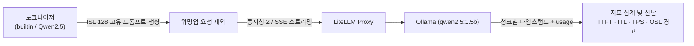
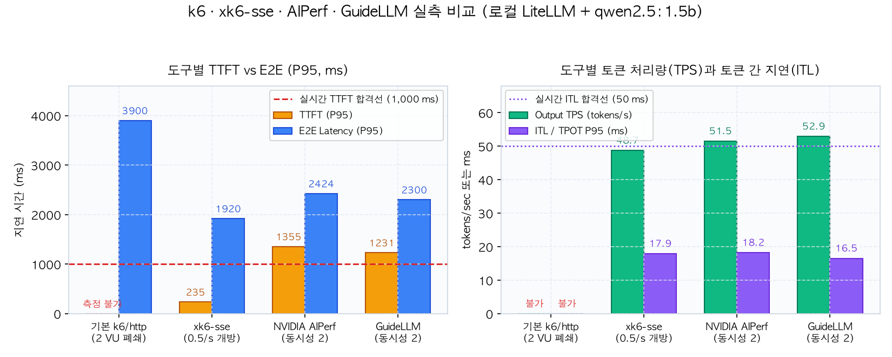

# 시나리오 5. LLM 전용 벤치마크 도구(AIPerf, GuideLLM)로 측정하고 k6와 비교하기

이 문서는 과거 표준이었던 LLMPerf가 지원 중단(Archived)된 이후 현역 표준으로 자리 잡은 NVIDIA AIPerf와 GuideLLM으로 LiteLLM Proxy를 측정하고, 시나리오 3·4의 k6 결과와 무엇이 다른지 대조합니다.

## 이 시나리오의 목표

| 항목 | 내용 |
| --- | --- |
| 기능 | OpenAI 호환 LiteLLM Proxy를 대상으로 토크나이저 기반 ISL/OSL 고정 스트리밍 벤치마크 실행 |
| 쓰는 도구 | NVIDIA AIPerf (`v0.13.0`), GuideLLM (`v0.8.1`), [run-aiperf.sh](../benchmarks/run-aiperf.sh), [run-guidellm.sh](../benchmarks/run-guidellm.sh) |
| 입력 | 동시성 2, 요청 10건, 입력 128토큰(ISL) / 출력 64토큰(OSL) 고정 프로파일 |
| 작업 | 1. AIPerf 실행 및 CSV 리포트 확인 -> 2. GuideLLM 실행 및 콘솔 리포트 확인 -> 3. k6 결과와 비교 |
| 달성할 것 | 토크나이저 불일치·EOS 조기 종료 경고까지 자동 감지하며 P95 TTFT·ITL·TPS를 안정적으로 산출 |

## 이 기능이 무엇인가

LLM 전용 벤치마크 도구는 단순 HTTP 부하 생성기가 아니라, **모델 토크나이저로 입출력 토큰 길이를 통제하고 SSE 청크마다 타임스탬프를 기록해 LLM 핵심 지표(TTFT, ITL/TPOT, TPS, Goodput)를 자동 계산하는 도구**입니다.

관리형 API(AWS Bedrock, GCP Vertex AI)와 자체 서빙(vLLM, Ollama)을 같은 잣대로 비교하려면 앞단에 LiteLLM Proxy를 두어 OpenAI 호환 API(`/v1/chat/completions`)로 통일한 뒤 단일 도구로 측정하는 것이 표준입니다.

### 용어

| 용어 | 뜻 | 이 실습의 예 |
| --- | --- | --- |
| ISL (Input Sequence Length) | 요청 프롬프트의 입력 토큰 수 | `--isl 128` / `prompt_tokens=128` |
| OSL (Output Sequence Length) | 모델이 생성할 목표 출력 토큰 수 | `--osl 64` / `output_tokens=64` |
| Goodput (유효 처리율) | TTFT·TPOT SLO 기준을 모두 통과한 요청의 비율 | 실시간 서비스 합격선 95% 이상 |
| Sweep | 동시 접속자 수나 요청률을 자동으로 단계별 증가시켜 한계점을 찾는 기능 | GuideLLM `--profile kind=sweep` |
| `ignore_eos` | 모델이 EOS(종료) 토큰을 일찍 내도 목표 OSL까지 생성을 강제하는 서빙 옵션 | vLLM·TensorRT-LLM에서 OSL 고정 시 사용 |

## LLMPerf 대신 AIPerf·GuideLLM을 쓰는 이유

2026년 11월 기준 LLM 성능 벤치마크 생태계는 기존 **LLMPerf가 저장소 아카이브(Archived)로 지원 중단**되고, NVIDIA GenAI-Perf가 **AIPerf**로 세대교체되면서 아래 3강 체제로 재편되었습니다.

| 도구명 | 현재 상태 | 추천 적용 대상 | 특징 및 선정 이유 |
| --- | --- | --- | --- |
| NVIDIA AIPerf | 현역 표준 | vLLM, LiteLLM 프록시 (Bedrock/Vertex/Ollama) | GenAI-Perf의 공식 후속작으로, 멀티프로세스(ZMQ) 구조로 부하 생성기 병목을 제거하고 추론(Reasoning) 모델의 사고 토큰까지 분리 측정(TTFT vs TTFO)함 |
| GuideLLM | 현역 표준 | vLLM, OpenAI 호환 엔드포인트 | vLLM 프로젝트에서 관리하며, 동시성을 자동 단계별 증가(Sweep)시켜 한계점을 찾고 HTML/JSON/CSV 보고서를 자동 생성해 LLMPerf의 실질적 대체재로 쓰임 |
| vLLM Bench (`vllm bench serve`) | 현역 표준 | 자체 서빙 vLLM | 별도 설치 없이 즉시 실행 가능하며 Goodput 측정과 서버 튜닝 전후 빠른 비교에 최적화됨 |
| LLMPerf | 지원 중단 | 신규 도입 비권장 | 과거 널리 쓰였으나 저장소가 아카이브되어 신규 환경에서는 AIPerf 또는 GuideLLM 사용 권장 |

## 컴포넌트 역할

| 컴포넌트 | 역할 |
| --- | --- |
| NVIDIA AIPerf (`uvx --from aiperf`) | 멀티프로세스 워커로 워밍업 제외, ISL/OSL 고정, CSV/JSON 아티팩트 자동 저장 |
| GuideLLM (`uvx --from guidellm`) | HuggingFace 토크나이저로 정확한 토큰 길이 생성, 동시성·Sweep 기반 요약 표 출력 |
| LiteLLM Proxy (`localhost:4000`) | OpenAI 호환 엔드포인트 제공 및 인증(`sk-local-litellm-test`) 처리 |
| Ollama (`qwen2.5:1.5b`) | 로컬 모델 추론 실행 |

## 흐름

아래 다이어그램은 전용 벤치마크 도구가 요청 생성부터 결과 판정까지 어떤 파이프라인을 거치는지 보여줍니다.



## NVIDIA AIPerf 예제

고동시성 부하에서 클라이언트(부하 생성기) 병목을 없애야 하거나, JSON/CSV 원시 아티팩트를 CI/CD 파이프라인에 자동 저장해야 할 때 AIPerf를 선택합니다.

### 1. AIPerf 실행

실행 전에 [2.3의 SSE curl 응답](2.3-sse-vs-http.md#1-curl로-sse-응답-한-건-확인)을 확인합니다. AIPerf도 같은 Chat Completions API의 `data:` 이벤트를 받습니다. 아래 스크립트에서는 합성 프롬프트와 토큰 길이 목표가 적용됩니다.

[run-aiperf.sh](../benchmarks/run-aiperf.sh)는 오프라인 `builtin` 토크나이저(tiktoken)를 사용해 HuggingFace 다운로드 없이 워밍업 2건, 본 측정 10건을 실행합니다.

```bash
cd computer_science/ai/litellm-sse-load-test
./benchmarks/run-aiperf.sh
```

AIPerf는 Chat Completions를 SSE로 호출합니다. 워밍업 두 건과 본 측정 열 건을 따로 요청하고, 입력·출력 길이 목표와 동시성을 CLI에 넘깁니다. [스트리밍과 부하 조건](../benchmarks/run-aiperf.sh#L7-L20)

실행이 끝나면 `benchmarks/output/aiperf/profile_export_aiperf.csv`와 `.json`이 자동 저장됩니다. 핵심 지표 실측 결과는 다음과 같습니다.

| 지표 | Avg | P50 | P95 | P99 |
| --- | --- | --- | --- | --- |
| Time to First Token (TTFT) | `1183.3 ms` | `1271.5 ms` | `1355.2 ms` | `1388.8 ms` |
| Inter Token Latency (ITL) | `17.5 ms` | `17.7 ms` | `18.2 ms` | `18.5 ms` |
| Request Latency (E2E) | `2251.6 ms` | `2347.8 ms` | `2424.1 ms` | `2452.3 ms` |
| Output Token Throughput | `51.54 tokens/sec` (요청 처리량 `0.83 req/s`, 에러율 `0.00%`) | - | - | - |

실행 도중 AIPerf가 출력하는 두 가지 경고는 실무에서 매우 유용합니다.

- **Usage Discrepancy 경고**: 클라이언트 `--tokenizer builtin`(tiktoken)과 서버(`qwen2.5:1.5b`)의 프롬프트 토큰 계산 차이를 `23.67%`로 감지해 알립니다. 정확한 모델 토크나이저를 쓰려면 `--tokenizer Qwen/Qwen2.5-1.5B-Instruct`로 바꾸거나 `--use-server-token-count`를 지정합니다.
- **OSL Mismatch 경고**: 10건 중 1건이 목표 64토큰 전에 EOS 토큰을 만나 조기 종료되었음을 감지하고, vLLM 등에서는 `--extra-inputs ignore_eos:true`를 쓰라고 안내합니다.

## GuideLLM 예제

동시성을 단계별로 올려가며 SLO 한계점을 자동으로 찾고(Sweep), 사업팀과 공유할 깔끔한 리포트를 빠르게 뽑아야 할 때 GuideLLM을 선택합니다.

### 1. GuideLLM 실행

GuideLLM의 요청·응답 형식도 [같은 SSE curl 예제](2.3-sse-vs-http.md#1-curl로-sse-응답-한-건-확인)에서 확인할 수 있습니다. AIPerf 실행 전에 응답을 이미 확인했다면 해당 결과를 사용합니다.

[run-guidellm.sh](../benchmarks/run-guidellm.sh)는 LiteLLM의 모델 별칭(`local-qwen`)과 별도로 실제 HuggingFace 토크나이저(`Qwen/Qwen2.5-1.5B-Instruct`)를 명시해 실행합니다.

```bash
cd computer_science/ai/litellm-sse-load-test
./benchmarks/run-guidellm.sh
```

GuideLLM은 OpenAI 호환 백엔드의 `local-qwen`과 토큰 계산에 쓸 Qwen 토크나이저를 각각 지정합니다. 합성 입력 길이를 맞춘 뒤 동시성 두 건을 유지하며 열 건을 요청합니다. [백엔드·토크나이저·부하 조건](../benchmarks/run-guidellm.sh#L7-L14)

콘솔 요약 표에서 실제 Qwen 토크나이저 기준의 TTFT, ITL, TPOT, 토큰 처리량이 한 번에 출력됩니다.

```text
ℹ Request Latency Statistics (Completed Requests)
| Benchmark    | Request Latency (Sec)  | TTFT (ms)              | ITL (ms)        | TPOT (ms)       |
| Strategy     | Mean      | Mdn | p95  | Mean     | Mdn  | p95  | Mean | Mdn | p95| Mean | Mdn | p95|
| concurrent@2 | 1.8 ± 0.4 | 1.8 | 2.3* | 936.9    | 1203 | 1231 | 16.2 | 16.4|16.5| 34.4 | 34.9|52.3|

ℹ Server Throughput Statistics (All Requests)
| Strategy     | Concurrency (Mean) | Requests/sec | Input Tokens/sec | Output Tokens/sec | Total Tokens/sec |
| concurrent@2 | 1.9                | 1.0          | 163.7            | 52.9              | 216.6            |
```

> [!TIP]
기본 스크립트는 콘솔 표와 함께 `benchmarks/output/guidellm/concurrent-2.html`을 저장합니다. 동시성을 단계별로 높여 비교하려면 [시나리오 6의 동시성 스윕](6-guidellm-handson.md)을 실행합니다. [기본 스크립트의 출력 설정](../benchmarks/run-guidellm.sh#L15-L17)

## k6 · xk6-sse · AIPerf · GuideLLM 실측 비교

지금까지 같은 로컬 LiteLLM + Ollama(`qwen2.5:1.5b`) 환경에서 네 가지 방식으로 측정한 결과를 한 표로 비교합니다.



| 도구 | 부하 조건 | TTFT (P95) | ITL / TPOT (P95) | E2E (P95) | Output TPS | 토큰 길이 통제 |
| --- | --- | --- | --- | --- | --- | --- |
| 기본 `k6/http` | 2 VU 폐쇄 루프, 6건 | 측정 불가 (TTFB만 존재) | 측정 불가 | `3.90s` | 측정 불가 | 불가 |
| `xk6-sse` | 개방 루프 `0.5/s`, 7건 | `234.9 ms` | `17.9 ms` (청크 기준) | `1.92s` | `48.7 chunks/s` | 불가 |
| NVIDIA AIPerf | 동시성 2, 10건 (워밍업 2건 제외) | `1355.2 ms` | `18.2 ms` | `2.42s` | `51.5 tokens/s` | ISL 128 / OSL 64 + 경고 |
| GuideLLM | 동시성 2, 10건 | `1230.7 ms` | `16.5 ms` (ITL) | `2.30s` | `52.9 tokens/s` | ISL 128 / OSL 64 (Qwen 토크나이저) |

`xk6-sse`는 Open loop로 2초마다 요청 시작을 예약합니다. 이 실행에서 E2E P95는 `1.92s`였으므로 대부분의 요청은 다음 예약 시각 전에 완료됐습니다. AIPerf와 GuideLLM은 이 표의 실행에서 Closed loop로 동시성 2를 유지했습니다. 입력 생성과 토큰 길이 조건도 달랐으므로 TTFT 차이에는 여러 요인이 섞여 있습니다. Provider 내부의 Prefill 대기 시간은 이 결과로 확인하기 어렵습니다. TTFT를 비교할 때는 입력 데이터, 출력 상한, 부하 방식과 워밍업 조건을 맞춥니다. [xk6-sse 도착률 설정](../k6/04-xk6-sse-ttft.js#L14-L25) · [AIPerf 설정](../benchmarks/run-aiperf.sh#L14-L18) · [GuideLLM 설정](../benchmarks/run-guidellm.sh#L7-L14)

### 관리형 API의 분당 quota와 응답 성능

Bedrock의 quota는 사용하는 endpoint, 모델 또는 inference profile, Region 기준으로 확인합니다. `bedrock-runtime`은 입력과 출력을 합산하고 모델별 output burndown과 일부 모델의 RPM을 적용합니다. `bedrock-mantle`은 공개 quota가 있는 모델에서 입력·출력 TPM을 따로 적용합니다. 요청 수락 시에는 `max_tokens`도 토큰 예약에 영향을 주므로 입력 길이, 출력 상한, 실제 사용량을 함께 기록합니다. [Amazon Bedrock quota와 throttle 동작](https://docs.aws.amazon.com/bedrock/latest/userguide/scaling-throughput-best-practices.html)

quota 검증에는 Open loop로 요청 도착률을 여러 단계로 올리고 각 단계에서 여러 분 동안 실제 전송량, 분당 토큰 사용량, 응답의 오류 유형을 확인합니다. `429 ThrottlingException`은 quota나 rate limit에 도달했을 때의 신호이고, `503`은 일시적인 서비스 용량 문제로 해석합니다. k6의 `dropped_iterations`는 부하 생성기에서 시작하지 못한 반복입니다. 성능 검증에는 같은 실행에서 TTFT P95, 전체 완료 P95, 성공 처리량을 함께 봅니다. [Amazon Bedrock 부하 검증 가이드](https://docs.aws.amazon.com/bedrock/latest/userguide/scaling-throughput-best-practices.html)

AIPerf는 `--request-rate`와 `--arrival-pattern constant`, GuideLLM은 `--profile kind=constant,rate=…`로 Open loop 부하를 줄 수 있습니다. 이 실습 스크립트는 로컬 Chat Completions를 호출하므로 Bedrock을 시험할 때는 사용하는 API 형식과 인증에 맞춰 호출 경로를 구성해야 합니다. Gateway를 거친다면 Provider가 반환한 오류 유형과 재시도 횟수를 확인할 수 있어야 합니다. [AIPerf 부하 옵션](https://docs.nvidia.com/aiperf/benchmark-modes/load-generator-options-reference) · [GuideLLM 프로필](https://vllm-project.github.io/guidellm/latest/getting-started/benchmark/)

## 부록. 실무 결과 판정 및 액션 가이드

벤치마크에서 [1.1의 SLO 기준](1.1-overview.md#실습용-성능-목표-예시-slo)을 초과(Fail)했을 때 인프라 유형에 따라 취할 조치입니다.

| 테스트 결과 증상 | Bedrock / Vertex (관리형 API) 조치 | 자체 서빙 vLLM 조치 |
| --- | --- | --- |
| 429 에러 발생 / RPS 정체 | 오류 유형과 적용 RPM·TPM, 실제 전송률을 확인하고 quota 증설 필요 여부 판단 | 타임아웃·OOM 로그 확인 |
| TTFT만 1초 이상 급증 | Cross-Region Inference 활성화, Prompt Caching 적용 | `max-num-batched-tokens` 조정, Prefix Caching·Chunked Prefill 튜닝 |
| TPOT가 50ms 초과로 저하 | 더 가벼운 모델(Flash/Haiku/Mini 계열)로 라우팅 분리 | Concurrency Cap 설정, FP8/AWQ 양자화, GPU 증설 |
| SLO 충족률 95% 미만 도달 | 직전 통과 부하를 해당 워크로드의 성능 기준으로 기록하고 quota 소진 여부는 별도 확인 | 직전 통과 부하를 해당 워크로드의 성능 기준으로 기록하고 HPA 기준치 검토 |

지속적인 부하테스트를 운영할 때는 세 가지 원칙을 고정합니다.

1. **워밍업 구간 제외**: 본 측정 전 최소 10~20건(로컬 실습은 2건)의 워밍업 요청을 먼저 흘려보냅니다.
2. **단일 변수 변경 원칙**: 서버 파라미터나 쿼터를 조정할 때 한 번에 한 가지 변수만 바꾸고 재측정합니다.
3. **메타데이터 자동 기록**: 모델 버전, 양자화 방식, 하드웨어 스펙, ISL/OSL 설정을 JSON/CSV 결과 파일과 함께 보관합니다.

## 참고 문서

1. [NVIDIA AIPerf 공식 문서](https://github.com/ai-dynamo/aiperf)
2. [vLLM GuideLLM 공식 문서](https://github.com/vllm-project/guidellm)
3. [Ray Project LLMPerf (Archived)](https://github.com/ray-project/llmperf)
