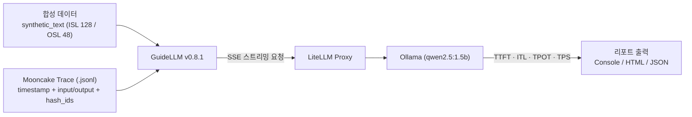
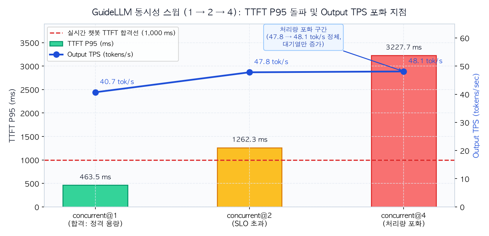

# 시나리오 6. GuideLLM 실전 핸즈온과 Mooncake Trace 리플레이

이 문서는 입문자와 실무자가 가장 먼저 쓰기 좋은 GuideLLM(`v0.8.1`)으로 동시성 한계점을 단계별로 찾고 HTML·JSON 리포트를 뽑는 방법, 그리고 Mooncake Trace 데이터셋과의 관계 및 리플레이 실습을 다룹니다.

## 이 시나리오의 목표

| 항목 | 내용 |
| --- | --- |
| 기능 | GuideLLM 동시성 단계별 스윕(1→2→4), HTML·JSON 리포트 생성, Mooncake Trace 리플레이 |
| 쓰는 도구 | GuideLLM (`v0.8.1`), [run-guidellm-sweep.sh](../benchmarks/run-guidellm-sweep.sh), [run-guidellm-mooncake.sh](../benchmarks/run-guidellm-mooncake.sh), [sample-mooncake-trace.jsonl](../benchmarks/sample-mooncake-trace.jsonl) |
| 입력 | 고정 합성 데이터(ISL 128 / OSL 48) 및 Mooncake JSONL 트레이스 6건 |
| 작업 | 1. 동시성 스윕과 리포트 출력 -> 2. Mooncake Trace 리플레이 실행 -> 3. 결과 판정 |
| 달성할 것 | SLO 합격선이 깨지는 동시성 지점을 찾고, 합성 부하와 실제 트레이스 리플레이의 차이를 확인 |

## GuideLLM과 Mooncake Trace는 다른 도구인가

**둘은 경쟁하는 별개의 도구가 아니라, "실행 도구"와 "입력 데이터셋 형식"의 관계입니다.**

- **GuideLLM**: OpenAI 호환 서버(LiteLLM, vLLM 등)에 요청을 쏘고 TTFT·ITL·TPOT·TPS를 집계해 표와 HTML 리포트를 만들어 주는 **벤치마크 실행 도구**입니다.
- **Mooncake Trace**: 실제 프로덕션 LLM 서비스(Moonshot AI Kimi)의 트래픽 패턴을 기록한 **JSONL 데이터셋 형식**입니다. 각 줄에 요청 도착 시각(`timestamp`), 입력 길이(`input_length`), 출력 길이(`output_length`), Prefix 캐시 블록 ID 목록(`hash_ids`)이 들어 있습니다.

GuideLLM(그리고 NVIDIA AIPerf)은 이 Mooncake Trace 파일을 `--data` 입력으로 받아, 실제 운영 환경의 트래픽 파형과 Prefix 캐시 공유율까지 그대로 재현(Replay)합니다.

### 용어

| 용어 | 뜻 | 이 실습의 예 |
| --- | --- | --- |
| `synthetic_text` | 지정한 입력·출력 토큰 수에 맞춰 GuideLLM이 무작위 프롬프트를 합성하는 데이터셋 | `prompt_tokens=128,output_tokens=48` |
| `mooncake` (Trace) | 실제 트래픽의 시각·토큰 길이·Prefix 블록 해시를 담은 JSONL 포맷 | [sample-mooncake-trace.jsonl](../benchmarks/sample-mooncake-trace.jsonl) |
| `hash_ids` | 512토큰 단위 Prefix 블록 식별자 목록. 같은 ID를 공유하는 요청은 Prefix Cache 적중을 모사 | `[1, 2]` (600토큰 = 512블록 2개) |
| `profile.streams` | `concurrent` 프로파일에서 순차 실행할 동시성 단계 목록 | `--override 'profile.streams' 1,2,4` |

## 합성 부하(Synthetic)와 Mooncake Trace 리플레이 비교

| 구분 | 합성 부하 (`synthetic_text`) | Mooncake Trace 리플레이 (`mooncake` + `replay`) |
| --- | --- | --- |
| 요청 간격 | 일정 동시성, 고정 RPS, Poisson 분포 | 트레이스의 `timestamp` 그대로 재현(버스트 포함) |
| 입출력 길이 | 지정한 고정 길이(예: 512/512) | 요청마다 실제 서비스처럼 길이가 다양함 |
| Prefix 캐시 검증 | 매 요청 고유 텍스트라 캐시 미스 위주 | `hash_ids`를 공유하는 요청으로 실제 Prefix Cache 적중률 재현 |
| 적합한 용도 | 초기 쿼터 산정, 모델·버전 간 공정 비교(A/B) | 운영 트래픽 패턴 반영, vLLM Prefix Caching 튜닝 검증 |

## 컴포넌트 역할

| 컴포넌트 | 역할 |
| --- | --- |
| GuideLLM (`uvx --from guidellm`) | 동시성 스윕·트레이스 리플레이 실행 및 콘솔·HTML·JSON 리포트 생성 |
| `Qwen/Qwen2.5-1.5B-Instruct` 토크나이저 | LiteLLM 별칭(`local-qwen`) 대신 실제 토큰 수를 정확히 계산 |
| LiteLLM Proxy + Ollama | OpenAI 호환 엔드포인트 중계 및 로컬 추론 |

## 흐름

아래 흐름은 GuideLLM이 합성 데이터와 Mooncake Trace 두 가지 입력을 받아 동일한 리포트 파이프라인으로 측정하는 구조를 보여줍니다.



## 실습

[setup.md](setup.md)의 1~2단계를 마쳐 LiteLLM Proxy가 `localhost:4000`에서 실행 중이어야 합니다.

동시성 스윕이나 트레이스 리플레이 전에 [2.3의 SSE curl 요청 한 건](2.3-sse-vs-http.md#1-curl로-sse-응답-한-건-확인)을 확인합니다. 두 실험은 같은 Chat Completions API와 SSE 응답 형식을 사용합니다. 스윕은 합성 토큰 길이를 지정하고, 리플레이는 트레이스에서 요청별 길이와 도착 시각을 가져옵니다. 앞서 수동 응답을 확인했다면 그 결과를 사용합니다.

### 1. 동시성 단계별 스윕(1→2→4)과 HTML·JSON 리포트 생성

GuideLLM은 Qwen 토크나이저로 길이를 맞춘 합성 요청을 쓰고, `profile.streams`의 동시성 `1 → 2 → 4`를 순서대로 적용합니다. 각 단계에서 6건씩 측정하고 콘솔 표와 함께 HTML·JSON 보고서를 저장합니다. [요청 조건](../benchmarks/run-guidellm-sweep.sh#L8-L14) · [보고서 출력 설정](../benchmarks/run-guidellm-sweep.sh#L15-L18)

```bash
cd computer_science/ai/litellm-sse-load-test
./benchmarks/run-guidellm-sweep.sh
```

실측 결과에서 동시성이 올라갈 때 TTFT가 어디서 SLO 합격선(1,000ms)을 넘는지 한눈에 보입니다.

| 동시성 (`streams`) | Request Latency (P95) | TTFT (P95) | ITL (P95) | Output TPS | 실시간 SLO 판정 (TTFT ≤ 1s) |
| --- | --- | --- | --- | --- | --- |
| `concurrent@1` | `1.1s` | **`463.5 ms`** | `17.4 ms` | `40.7 tokens/s` | 합격 |
| `concurrent@2` | `2.1s` | **`1262.3 ms`** | `18.2 ms` | `47.8 tokens/s` | 불합격 (1초 초과) |
| `concurrent@4` | `4.1s` | **`3227.7 ms`** | `18.2 ms` | `48.1 tokens/s` | 불합격 (처리량 포화) |

이 실행에서는 동시성 2에서 처음으로 TTFT P95가 1초를 넘었습니다. 동시성 4의 처리량은 2와 비슷하지만 TTFT P95는 3.2초까지 늘어납니다. PostgreSQL을 연결한 M3 Pro 재측정에서도 동시성 1→2→4의 TTFT P95는 각각 320.7, 1,223.1, 2,732.6ms였고, 출력 처리량은 44~46 tokens/s에 머물렀습니다. 단계당 6건은 동시성을 올릴 때의 경향을 보는 데 쓰고, 정격 용량을 정할 때는 더 많은 요청으로 측정합니다.



```bash
open benchmarks/output/guidellm/report.html
```

### 2. Mooncake Trace 파일 구조 확인과 리플레이 실행

[sample-mooncake-trace.jsonl](../benchmarks/sample-mooncake-trace.jsonl)은 6건의 요청으로 만든 축소 Mooncake 트레이스입니다. GuideLLM `v0.8.1`에서 주의할 스펙은 두 가지입니다.

- **Prefix 블록 크기**: 기본 `hash_id_block_size`가 **512토큰**이므로, 각 줄의 `hash_ids` 개수는 `ceil(input_length / 512)`와 일치해야 합니다(예: `600`토큰은 2개 `[1, 2]`, `1100`토큰은 3개 `[1, 2, 3]`).
- **타임스탬프 단위**: `time_scale=1.0` 기본값에서는 `timestamp`를 **초(seconds)** 단위로 해석합니다. 밀리초(ms) 원본 트레이스를 쓸 때는 `time_scale: 0.001`을 함께 지정합니다.

```json
{"timestamp": 0.0, "input_length": 600, "output_length": 48, "hash_ids": [1, 2]}
{"timestamp": 0.5, "input_length": 600, "output_length": 48, "hash_ids": [1, 2]}
{"timestamp": 1.0, "input_length": 1100, "output_length": 64, "hash_ids": [1, 2, 3]}
```

스크립트의 `replay` 프로파일은 JSONL에 기록된 요청 시각을 따릅니다. `max_requests`는 실행을 샘플 6건으로 제한합니다. [리플레이 코드](../benchmarks/run-guidellm-mooncake.sh#L6-L13)

```bash
cd computer_science/ai/litellm-sse-load-test
./benchmarks/run-guidellm-mooncake.sh
```

실측 결과에서 6건의 가변 길이 요청이 `trace@1.00` 전략으로 5.9초 동안 리플레이된 지표가 출력됩니다.

```text
ℹ Request Latency Statistics (Completed Requests)
| Strategy   | Request Latency (Sec) | TTFT (ms)               | ITL (ms)         | TPOT (ms)         |
|            | Mean      | Mdn | p95 | Mean     | Mdn  | p95   | Mean | Mdn | p95 | Mean | Mdn | p95  |
| trace@1.00 | 2.1 ± 0.6 | 1.9 | 3.1 | 1343.0   | 1287 | 1987  | 17.3 | 17.4| 17.7| 48.6 | 48.1| 118.9|

ℹ Server Throughput Statistics (All Requests)
| Strategy   | Concurrency (Mean) | Requests/sec | Input Tokens/sec | Output Tokens/sec | Total Tokens/sec |
| trace@1.00 | 2.1                | 1.0          | 606.0            | 43.0              | 649.0            |
```

합성 테스트(ISL 128)보다 입력이 600~1,100토큰으로 길고 0.5~0.6초 간격으로 겹쳐 들어오기 때문에, TTFT P95가 `1986.5 ms`까지 올라가는 반면 토큰 간 지연(ITL P95 `17.7 ms`)은 안정적으로 유지되는 특성을 확인할 수 있습니다.

## 부록. 실무에서 얻는 것

- **프로덕션 기준선은 1단계(합성 스윕)로 잡고, 최적화 검증은 2단계(트레이스 리플레이)로 합니다.** 처음부터 트레이스를 만들려 하지 말고, 먼저 `synthetic_text`로 표준 시나리오(512/512, 4000/256)의 정격 용량을 확정한 뒤, 서비스 오픈 후 수집한 실제 로그를 Mooncake JSONL로 변환해 재현 테스트를 고도화합니다.
- **GuideLLM에서 `mooncake` 소스를 넘길 때는 JSON 형식을 씁니다.** `--data kind=mooncake,source=파일경로`처럼 문자열로 넘기면 검증 오류가 나며, `--data '{"kind":"mooncake","source":{"kind":"json_file","path":"..."}}'`처럼 중첩 객체로 지정해야 합니다.

## 참고 문서

1. [vLLM GuideLLM 공식 저장소](https://github.com/vllm-project/guidellm)
2. [Mooncake FAST'25 Public Traces (kvcache-ai/Mooncake)](https://github.com/kvcache-ai/Mooncake)
