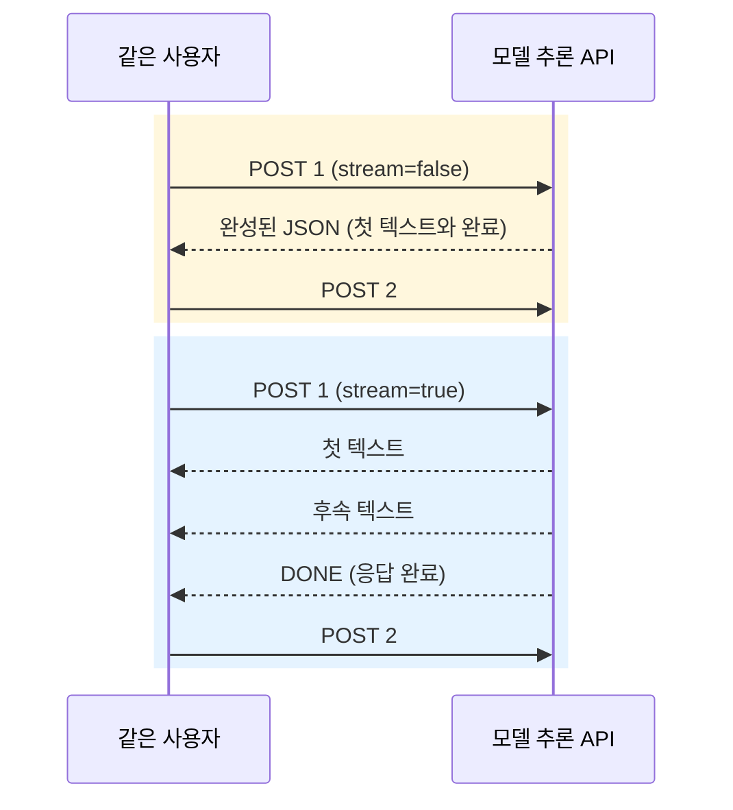

# 부록 B. Grafana로 비스트리밍과 SSE 비교

같은 모델에 HTTP POST를 보내고, 전체 응답을 받는 시간과 첫 텍스트를 받는 시간을 대조합니다. [Grafana 확장 실습 준비](setup.md#grafana-확장-실습-준비)를 마친 뒤 아래 명령을 핸즈온 디렉터리에서 실행합니다.

부하 전에 [비스트리밍 curl 요청](1.2-http-baseline.md#1-curl로-요청-한-건-확인)과 [SSE curl 요청](2.3-sse-vs-http.md#1-curl로-sse-응답-한-건-확인)을 확인합니다. Grafana 비교가 호출하는 API도 같습니다. 완성된 `message.content`와 순차적으로 도착하는 `delta.content`를 직접 보고 측정 결과와 대조합니다. 이미 두 응답을 확인했다면 이어서 진행합니다.

## 한 사용자의 연속 요청 흐름

한 사용자가 첫 답변을 다 읽은 뒤 두 번째 질문을 보내는 상황을 가정합니다. 그림 속 추론 API는 Ollama에서 실행하는 모델의 엔드포인트입니다. 실습에서는 같은 API를 LiteLLM 경유로 호출해 게이트웨이 계측도 수집합니다.



[사용자 한 명의 요청 흐름 그림 (PNG)](../imgs/http-sse-one-user.png)

SSE에서는 첫 텍스트부터 읽을 수 있습니다. 이 시나리오에서는 사용자 한 명이 이전 응답을 끝까지 받은 뒤 다음 요청을 보내므로, 첫 텍스트가 빨라진 만큼 다음 요청도 빨라지는지 **응답 완료 P95**와 **요청 처리량**을 보고 판단합니다.

먼저 아래의 단건 확인을 한 번 실행해 모델을 워밍업합니다. 그다음 가상 사용자 한 명이 모드마다 같은 요청 10건을 순서대로 보내게 합니다. [사용자별 요청 흐름](../scripts/compare_http_sse_load.py#L50-L62)

```bash
uv run scripts/compare_http_sse_load.py --vus 1 --requests 10
```

## 여러 사용자의 10건·100건 비교

가상 사용자 4명에게 총 10건과 총 100건을 각각 배분합니다. HTTP JSON과 SSE마다 같은 요청 목록을 사용하며, 모델·프롬프트·최대 출력 32토큰을 맞춥니다. 각 사용자는 응답 완료 후 다음 요청을 보냅니다. 모드마다 총 110건이며, 두 모드를 합치면 총 220건입니다.

```bash
uv run scripts/compare_http_sse_load.py --vus 4 --requests 10 100
```

[모델 응답 비교 대시보드](http://localhost:3100/d/model-response-modes)의 상단은 VU 수와 요청 수별 P95 첫 텍스트, P95 완료 시간, 요청 처리량, 실패율을 비교합니다. P95는 성공 요청에서 계산합니다. SSE 응답은 텍스트와 Chat Completions의 `[DONE]`을 모두 받아야 성공으로 집계합니다. 10건의 P95는 느린 한 건에 가까우므로 관찰값으로 해석합니다.

하단 **LiteLLM** 패널에는 Chat Completions의 요청·실패·누적 요청을 `stream`별로, 입력·출력 토큰 처리량은 프록시 전체로 표시합니다. 이 실습의 LiteLLM·Ollama 조합은 비스트리밍 요청에 `None` 라벨을 붙이므로 HTTP JSON 집계에는 `False`와 `None`을 포함합니다. 초당 처리량 그래프는 최근 1분을 집계합니다.

## M3 Pro 실측 예시

| 부하 | 첫 텍스트 P95 (JSON / SSE) | 응답 완료 P95 (JSON / SSE) | 요청 처리량 (JSON / SSE) |
| --- | --- | --- | --- |
| 사용자 1명, 모드당 10건 | 0.78초 / 0.12초 | 0.78초 / 0.74초 | 1.50 / 1.50건/초 |
| 사용자 4명, 모드당 10건 | 2.56초 / 1.83초 | 2.56초 / 2.42초 | 1.64 / 1.70건/초 |
| 사용자 4명, 모드당 100건 | 2.39초 / 1.96초 | 2.39초 / 2.61초 | 1.75 / 1.68건/초 |

이 실행에서는 각 모드에서 모든 요청이 성공했습니다. 사용자 한 명의 처리량은 비슷했지만 SSE에서 훨씬 빨리 읽기 시작했습니다. 다중 사용자에서는 SSE의 첫 텍스트 지연도 늘었습니다. 같은 수의 요청이라도 겹쳐 보내면 추론 서버가 처리해야 하는 동시 부하가 달라집니다.

## 단건 확인과 모델 서버 직접 호출

헤더 도착과 첫 텍스트, 완료 시간을 단건에서 먼저 확인할 수 있습니다. 이 명령으로 모델을 워밍업하고 다시 실행하면, 대시보드의 **단건** 패널에서 모델이 이미 로드된 상태의 응답 한 쌍을 볼 수 있습니다. [측정값 전송 코드](../scripts/compare_http_sse.py#L176-L204)

```bash
PROMETHEUS_PUSHGATEWAY_URL=http://localhost:9091 uv run scripts/compare_http_sse.py
```

Ollama에 직접 비교하려면 먼저 위의 curl 예제에서 포트를 `11434`로, 본문의 모델 이름을 `qwen2.5:1.5b`로 바꿔 한 건을 확인합니다. 비교 스크립트에는 `LITELLM_BASE_URL=http://localhost:11434`와 `LITELLM_MODEL=qwen2.5:1.5b`를 추가합니다. 이 경로의 요청은 클라이언트 측 패널에서 볼 수 있습니다.

| 패널 | 관찰할 값 |
| --- | --- |
| 첫 텍스트까지 | HTTP JSON은 전체 본문을 받아야 텍스트가 보입니다. HTTP SSE는 비어 있지 않은 첫 텍스트 이벤트가 기준입니다. |
| 응답 완료까지 | 두 모드 모두 본문을 끝까지 읽은 시각입니다. |
| 헤더 도착까지 | HTTP 헤더가 먼저 도착하고도 텍스트는 늦을 수 있습니다. |
| 평균 텍스트 청크 간격 | 텍스트 청크가 두 개 이상인 SSE 값입니다. 청크와 모델 토큰은 별도 단위입니다. |

## 요청을 200건으로 늘릴 때

두 모드 모두 HTTP POST 200건입니다. 비교하려면 같은 모델과 입력 길이, 출력 상한을 사용하고, 도착률이나 동시 사용자 수 중 하나를 기준으로 부하를 맞춥니다. 예를 들어 VU 10명이 이전 요청을 끝낸 뒤 계속 보내는 경우와 초당 20건을 예약하는 경우에는 서버가 느려졌을 때 대기열이 다르게 움직입니다. 출력 상한까지 생성했는지도 실제 출력 토큰 수로 확인합니다.

운영용 SSE 검사는 HTTP 200 이후 스트림 중단과 정상 종료를 구분하고, 취소 후 서버가 생성을 정리하는지도 확인합니다. 토큰 길이를 통제한 동시성 한계는 [GuideLLM 스윕](6-guidellm-handson.md)으로 이어서 측정합니다.

## 참고 문서

1. [Ollama의 OpenAI 호환 API](https://docs.ollama.com/api/openai-compatibility)
2. [Grafana 대시보드와 데이터 소스 프로비저닝](https://grafana.com/docs/grafana/latest/administration/provisioning/)
3. [Prometheus Pushgateway](https://prometheus.io/docs/instrumenting/pushing/)
4. [k6의 개방·폐쇄 부하 모델](https://grafana.com/docs/k6/latest/using-k6/scenarios/concepts/open-vs-closed/)
5. [LiteLLM Prometheus 메트릭](https://docs.litellm.ai/docs/proxy/prometheus)
