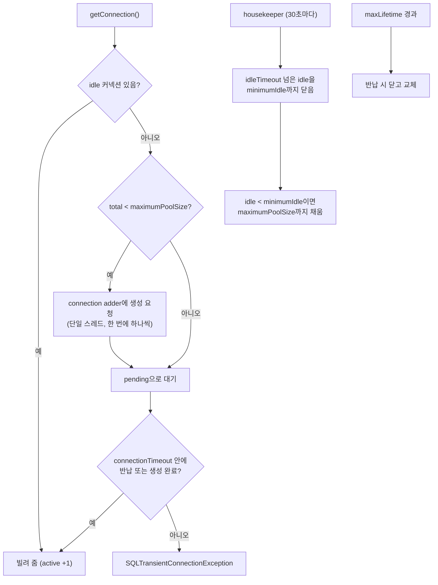

# 1. 기능 지도: 커넥션풀에는 desired가 없다

## 이 시나리오의 목표

| 항목 | 내용 |
| --- | --- |
| 기능 | 커넥션풀의 크기 조절 기능 전체(사전 생성, 수요 기반 증가, 상한 대기, 유휴 축소, 수명 교체) |
| 쓰는 도구 | HikariCP 5.x(Spring Boot 3.x 기본 풀), PostgreSQL 16 |
| 입력 | 없음(이론 시나리오) |
| 작업 | 1. AWS Auto Scaling Group의 min/desired/max와 커넥션풀 설정 비교 2. HikariCP가 커넥션을 늘리고 줄이는 판단 규칙 정리 3. 시나리오 2~5와 기능 연결 |
| 달성할 것 | "풀이 스스로 판단해 늘어난다"의 판단 기준이 무엇인지 설정 키 이름으로 설명할 수 있다 |

## 커넥션풀은 Auto Scaling Group과 비슷하지만 목표값이 없다

커넥션풀의 크기 설정은 AWS Auto Scaling Group(ASG)의 min, desired, max와 닮았습니다. 평소에는 최소 개수만 유지하다가 요청이 몰리면 늘어나고, 상한을 넘지 않으며, 한가해지면 다시 줄어듭니다.

차이는 desired에 있습니다. ASG는 scaling policy가 CPU 사용률 같은 지표를 보고 desired 값을 계산하고, ASG는 실제 인스턴스 수를 그 값에 맞춥니다. 판단(desired 계산)과 실행(인스턴스 증감)이 나뉘어 있습니다. HikariCP에는 desired에 해당하는 값이 없습니다. 지표를 보고 목표 크기를 계산하는 로직도 없습니다. HikariCP가 커넥션을 새로 만드는 이유는 두 가지뿐입니다.

1. `getConnection()`을 호출한 스레드가 빌릴 유휴 커넥션을 찾지 못하고 기다리고 있다.
2. 유휴(idle) 커넥션 수가 `minimumIdle`보다 적다.

두 경우 모두 전체 커넥션 수가 `maximumPoolSize`보다 적을 때만 만듭니다. 줄이는 이유도 두 가지입니다. 유휴 상태로 `idleTimeout`을 넘긴 커넥션은 `minimumIdle`이 남을 때까지 닫고, 생성 후 `maxLifetime`을 넘긴 커넥션은 반납되는 대로 닫고 새로 만듭니다.

"스스로 판단한다"는 표현은 맞지만, 그 판단은 예측이 아니라 반응입니다. 풀은 다음 1초에 요청이 몰릴지 예상하지 않습니다. 지금 기다리는 스레드가 있으면 하나씩 만들고, 지금 놀고 있는 커넥션이 오래됐으면 닫습니다. 그래서 풀의 현재 크기는 누가 정한 목표값이 아니라 최근 동시 요청 수와 타이머가 만든 결과입니다.

### 용어

| 용어 | 뜻 | 이 실습의 예 |
| --- | --- | --- |
| active | 애플리케이션 스레드가 빌려 가서 쓰고 있는 커넥션 | `/hold?seconds=2` 요청 하나가 커넥션 1개를 2초 동안 active로 만든다 |
| idle | 풀 안에서 빌려 가기를 기다리는 커넥션 | 부하가 없을 때 `minimumIdle=2`만큼 남는 커넥션 |
| total | active + idle. DB 입장에서 열려 있는 세션 수 | `pg_stat_activity`에서 `application_name='pool-lab'`인 행 수 |
| pending | 커넥션을 받지 못하고 기다리는 애플리케이션 스레드 수 | 동시 요청 20개, `maximumPoolSize=10`이면 최대 10 |
| `maximumPoolSize` | total의 상한. 기본값 10 | 모든 시나리오에서 10 |
| `minimumIdle` | 유지할 idle의 하한. total의 하한이 아니다. 기본값은 `maximumPoolSize`와 같음 | 시나리오 3에서 2 |
| `connectionTimeout` | pending 스레드가 기다리는 최대 시간. 기본값 30000ms | 시나리오 4에서 1000ms |
| `idleTimeout` | idle 커넥션을 닫기까지의 유휴 시간. `minimumIdle < maximumPoolSize`일 때만 동작. 기본값 600000ms, 최솟값 10000ms | 시나리오 5에서 10000ms |
| `maxLifetime` | 커넥션의 최대 수명. 기본값 1800000ms, 최솟값 30000ms | 시나리오 5에서 60000ms |
| housekeeper | 30초마다 돌며 오래된 idle을 닫고 부족한 idle을 채우는 HikariCP 내부 작업 | 축소가 `idleTimeout`보다 최대 30초 늦게 일어나는 원인 |

## minimumIdle은 최솟값이 아니라 여유분이다

ASG의 min은 인스턴스 수의 하한입니다. HikariCP의 `minimumIdle`은 idle 커넥션 수의 하한입니다. 이 차이 때문에 `minimumIdle`을 "최소 커넥션 수"로 이해하면 풀 크기를 잘못 예측합니다.

`maximumPoolSize=10`, `minimumIdle=2`인 풀에 동시 요청 8개가 들어와 active가 8이 되면, idle이 0이므로 housekeeper는 idle 2개를 더 만들려고 합니다. total은 `min(maximumPoolSize, active + minimumIdle)` = 10이 됩니다. 즉 `minimumIdle`은 다음 요청이 기다리지 않도록 남겨 두는 여유분이고, 부하가 클수록 total을 위로 밀어 올립니다. 시나리오 3에서 이 값을 관측합니다.

## HikariCP가 커넥션을 늘리고 줄이는 흐름

아래 흐름은 `getConnection()` 호출 한 번과 housekeeper 한 주기에서 HikariCP가 내리는 판단을 나타냅니다.

흐름에서 실무에 영향을 주는 지점은 세 곳입니다.

- **생성은 직렬입니다.** HikariCP는 커넥션 생성을 `connection adder`라는 단일 스레드 executor에 맡깁니다. 동시 요청 8개가 한꺼번에 들어와도 커넥션은 하나씩 생깁니다. 커넥션 하나를 여는 데 TCP, TLS, 인증까지 20ms가 걸린다면 마지막 스레드는 160ms 가까이 기다립니다. `hikaricp_connections_creation_seconds`가 이 비용을 보여 줍니다.
- **새로 만든 커넥션이 그 스레드에게 간다는 보장은 없습니다.** 기다리던 스레드는 새 커넥션이든, 다른 스레드가 반납한 커넥션이든 먼저 손에 들어오는 것을 받습니다. 그래서 요청이 짧으면 pending이 생겨도 total이 거의 늘지 않습니다.
- **축소는 늦습니다.** idle 커넥션은 `idleTimeout`이 지난 직후가 아니라 그다음 housekeeper 주기에 닫힙니다. 최악의 경우 `idleTimeout + 30초`입니다.

## 왜 풀이 크기를 스스로 조절해야 할까?

커넥션을 요청마다 열고 닫으면, 요청마다 TCP handshake, TLS handshake, DB 인증, PostgreSQL backend 프로세스 fork 비용을 냅니다. 반대로 커넥션을 무한정 늘리면 DB의 `max_connections`(PostgreSQL 기본값 100)를 넘기고, 그 전에 backend 프로세스마다 쓰는 메모리와 lock 경쟁 때문에 DB 처리량이 떨어집니다. 풀은 이 둘 사이에서 커넥션을 재사용하면서 상한을 지킵니다.

크기를 고정하지 않고 조절하는 이유는 DB 쪽 자원 때문입니다. 애플리케이션 인스턴스 20개가 각자 커넥션 10개를 항상 열어 두면, 새벽에 요청이 거의 없어도 PostgreSQL은 backend 200개를 유지합니다. 유휴 축소는 이 비용을 줄입니다. 다만 HikariCP 문서는 고정 크기 풀(`minimumIdle`을 지정하지 않음)을 권장합니다. 축소한 커넥션을 급증 시점에 다시 만드는 지연이, 유지 비용보다 더 아프다고 보기 때문입니다. 어느 쪽이 맞는지는 DB가 감당할 세션 수와 급증의 빈도로 정합니다. 시나리오 2와 3이 이 Trade-off를 같은 부하로 비교합니다.

## 다른 커넥션풀과의 크기 설정 비교

같은 "min/desired/max" 직관을 풀마다 다른 키로 표현합니다. desired에 가까운 값을 가진 풀은 PgBouncer와 SQLAlchemy이고, 둘 다 평소 상한과 급증용 상한을 나눕니다.

| 풀 | 최소 | 평소 상한(desired에 가까움) | 급증 상한(max) | 축소 기준 |
| --- | --- | --- | --- | --- |
| HikariCP | `minimumIdle`(idle 기준) | 없음 | `maximumPoolSize` | `idleTimeout`, `maxLifetime` |
| Tomcat JDBC, DBCP2 | `minIdle` | `maxIdle`(반납 시 이 수를 넘는 idle은 닫음) | `maxActive`, `maxTotal` | evictor 주기와 `minEvictableIdleTimeMillis` |
| SQLAlchemy `QueuePool` | 없음 | `pool_size` | `pool_size + max_overflow`(overflow 커넥션은 반납 즉시 닫음) | 반납 시점 |
| Go `database/sql` | 없음 | `SetMaxIdleConns` | `SetMaxOpenConns` | `SetConnMaxIdleTime`, `SetConnMaxLifetime` |
| PgBouncer | `min_pool_size` | `default_pool_size` | `default_pool_size + reserve_pool_size`(`reserve_pool_timeout` 넘게 기다린 클라이언트가 있을 때만) | `server_idle_timeout`, `server_lifetime` |

PgBouncer는 애플리케이션 밖에서 여러 인스턴스의 커넥션을 모으는 프록시라 역할이 다릅니다. [부록 A](./appendix-a-pgbouncer.md)에서 같은 부하로 비교하는 설계를 둡니다.

## 기능과 시나리오 연결

시나리오는 "평소에 몇 개를 들고 있나 → 몰리면 어떻게 늘어나나 → 상한에서 무슨 일이 생기나 → 끝나면 어떻게 줄어드나" 순서로 따라갑니다.

| 기능 | 설정 키 | 관측 지표 | 시나리오 |
| --- | --- | --- | --- |
| 사전 생성(고정 풀) | `maximumPoolSize`, `minimumIdle` 미지정 | total, `pg_stat_activity` 행 수 | [2. 고정 풀](./2-fixed-pool.md) |
| 수요 기반 증가 | `minimumIdle < maximumPoolSize` | total, pending, creation 시간 | [3. 수요에 따른 증가](./3-grow-on-demand.md) |
| 상한 대기와 타임아웃 | `maximumPoolSize`, `connectionTimeout` | pending, acquire 시간, timeout 횟수 | [4. 상한 대기와 타임아웃](./4-max-and-timeout.md) |
| 유휴 축소와 수명 교체 | `idleTimeout`, `maxLifetime` | total, `backend_start`, pid | [5. 유휴 축소와 수명 교체](./5-shrink-and-lifetime.md) |

## 참고 문서

1. [HikariCP README - Configuration](https://github.com/brettwooldridge/HikariCP#gear-configuration-knobs-baby)
2. [HikariCP Wiki - About Pool Sizing](https://github.com/brettwooldridge/HikariCP/wiki/About-Pool-Sizing)
3. [HikariCP 소스 - HikariPool.java](https://github.com/brettwooldridge/HikariCP/blob/dev/src/main/java/com/zaxxer/hikari/pool/HikariPool.java)
4. [PgBouncer Configuration](https://www.pgbouncer.org/config.html)
5. [SQLAlchemy Connection Pooling](https://docs.sqlalchemy.org/en/20/core/pooling.html)
