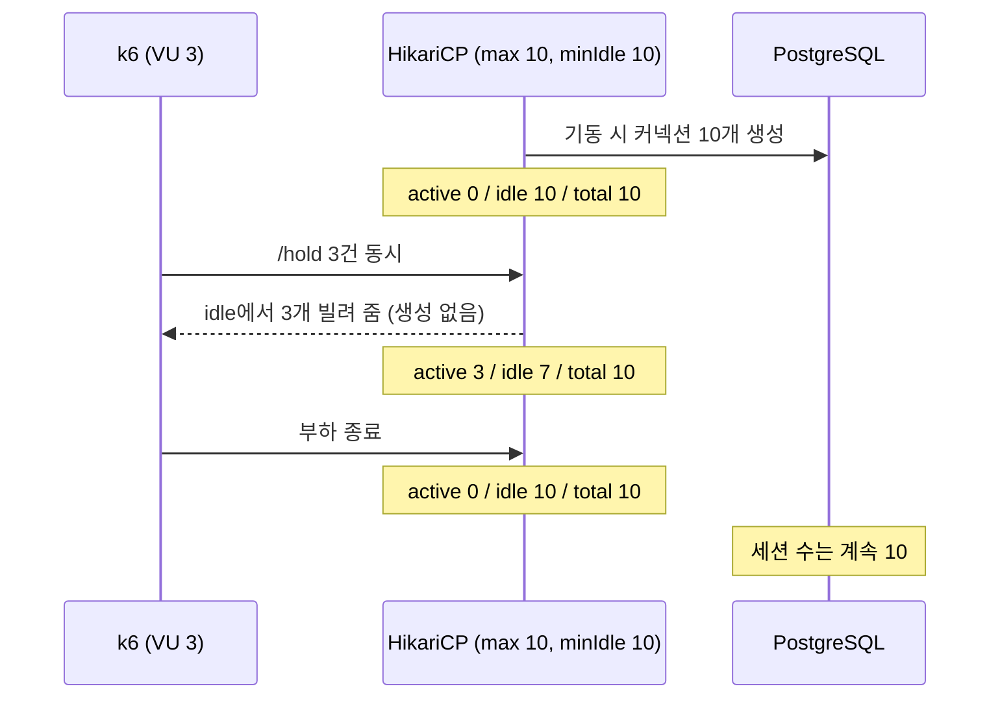

# 2. 고정 풀: HikariCP 기본값은 처음부터 max개를 연다

> 실습 설계 문서입니다. 출력은 HikariCP 동작 규칙으로 계산한 예상값이며, 구현 후 실측값으로 바꿉니다.

## 이 시나리오의 목표

| 항목 | 내용 |
| --- | --- |
| 기능 | 고정 크기 풀(`minimumIdle` = `maximumPoolSize`) |
| 쓰는 도구 | HikariCP, PostgreSQL, k6 |
| 입력 | `profiles/fixed.env`(max 10, minIdle 10) |
| 작업 | 1. 고정 풀로 기동 2. 부하 중 DB 세션 수 비교 |
| 달성할 것 | 부하와 상관없이 DB 세션 수가 `maximumPoolSize`로 유지되는 것을 확인하고, 그 비용을 인스턴스 수로 계산할 수 있다 |

## HikariCP는 크기를 조절하지 않는 풀을 기본으로 둔다

`minimumIdle`을 지정하지 않으면 HikariCP는 `minimumIdle`을 `maximumPoolSize`와 같게 둡니다. 이때 idle을 `maximumPoolSize`개 유지하려면 total이 항상 상한이어야 하므로, 풀은 기동 직후 커넥션 10개를 모두 열고 줄이지 않습니다. `idleTimeout`은 `minimumIdle < maximumPoolSize`일 때만 동작하므로 고정 풀에서는 무시됩니다.

HikariCP가 고정 풀을 권장하는 근거는 급증 시점의 지연입니다. 수요 기반 증가는 커넥션이 필요한 순간에 생성 비용을 내고, 그 비용은 단일 스레드로 직렬화되어 쌓입니다([1. 기능 지도](./1-feature-map.md#hikaricp가-커넥션을-늘리고-줄이는-흐름)). 고정 풀은 그 비용을 기동 시점에 미리 냅니다. 대신 DB는 요청이 없을 때도 세션을 유지합니다.

## 흐름

아래 흐름은 고정 풀에서 부하 전후의 커넥션 상태 변화를 나타냅니다.



## 실습

환경은 [실습 환경 준비](./setup.md)로 띄웁니다.

### 1. 고정 풀 프로필로 앱 재생성과 기동 직후 세션 수 확인

`fixed.env`로 앱을 다시 만들고, 왼쪽 터미널의 `watch-pool.sh`에서 total과 db 값이 10으로 올라가는지 봅니다.

```bash
docker compose --env-file profiles/fixed.env up -d --force-recreate app
scripts/watch-pool.sh
```

예상 관측입니다. 기동 직후 HikariCP는 fail-fast 검사용으로 커넥션 1개를 먼저 열고, 나머지는 `connection adder`가 하나씩 채웁니다.

```text
time      active idle pending total db
00:00:01  0      1    0       1     1
00:00:02  0      10   0       10    10
```

- `total`과 `db`가 같아야 합니다. 다르면 다른 앱이 `pool-lab` 이름을 쓰고 있거나 이전 컨테이너의 세션이 남은 것입니다.

### 2. 동시 요청 3개를 넣고 DB 세션 수 변화 확인

VU 3개가 2초짜리 `/hold`를 20초 동안 반복합니다. 고정 풀은 이미 열린 idle을 빌려 주므로 total이 변하지 않아야 합니다.

```bash
scripts/load.sh 3 2 20
```

예상 관측입니다.

```text
time      active idle pending total db
00:00:05  3      7    0       10    10
```

- `active`만 0에서 3으로 바뀌고 `total`과 `db`는 10으로 그대로입니다. 고정 풀에서 DB 세션 수는 부하가 아니라 `maximumPoolSize`가 정합니다.
- 앱 로그에 `Added connection`이 새로 찍히지 않습니다.

## 부록. 실무에서 얻는 것

고정 풀의 DB 비용은 `인스턴스 수 × maximumPoolSize`로 바로 계산됩니다. Kubernetes HPA가 Pod를 3개에서 12개로 늘리면, 요청이 늘었는지와 상관없이 PostgreSQL 세션은 30개에서 120개가 되고 기본 `max_connections=100`을 넘깁니다. 고정 풀을 고를 때는 HPA의 `maxReplicas × maximumPoolSize`가 DB `max_connections - superuser_reserved_connections`(기본값 3)보다 작은지 먼저 계산합니다. 이 곱이 감당되지 않으면 [3. 수요에 따른 증가](./3-grow-on-demand.md)나 [부록 A. PgBouncer](./appendix-a-pgbouncer.md)를 검토합니다.

## 참고 문서

1. [HikariCP README - minimumIdle](https://github.com/brettwooldridge/HikariCP#gear-configuration-knobs-baby)
2. [PostgreSQL - max_connections](https://www.postgresql.org/docs/16/runtime-config-connection.html)
