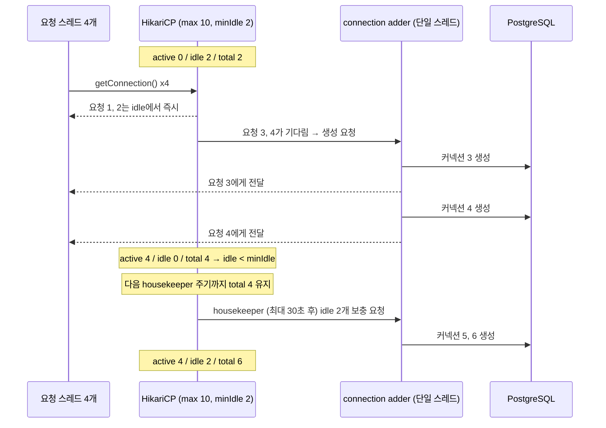

# 3. 수요에 따른 증가: 풀은 기다리는 스레드를 보고 하나씩 늘린다

> 실습 설계 문서입니다. 출력은 HikariCP 동작 규칙으로 계산한 예상값이며, 구현 후 실측값으로 바꿉니다.

## 이 시나리오의 목표

| 항목 | 내용 |
| --- | --- |
| 기능 | 수요 기반 증가(`minimumIdle < maximumPoolSize`) |
| 쓰는 도구 | HikariCP, PostgreSQL, k6 |
| 입력 | `profiles/grow.env`(max 10, minIdle 2) |
| 작업 | 1. 부하 없이 기동 2. 동시 요청 4개 3. 동시 요청 8개 4. 생성 순서와 생성 시간 확인 |
| 달성할 것 | 부하에 따른 total을 `min(maximumPoolSize, active + minimumIdle)`로 예측하고, 커넥션이 직렬로 생성되는 것을 로그로 확인한다 |

## 풀이 늘어나는 기준은 두 가지다

[1. 기능 지도](./1-feature-map.md#커넥션풀은-auto-scaling-group과-비슷하지만-목표값이-없다)에서 정리한 대로 HikariCP가 커넥션을 만드는 경우는 두 가지입니다. 하나는 `getConnection()`에서 idle을 찾지 못한 스레드가 기다릴 때이고, 다른 하나는 housekeeper가 idle이 `minimumIdle`보다 적다고 판단할 때입니다. 앞의 것은 요청 경로에서 기다리는 스레드 1개당 커넥션 1개를 즉시 만들고, 뒤의 것은 30초마다 도는 housekeeper나 커넥션을 닫은 직후에만 `minimumIdle`까지 채웁니다. 커넥션 반납은 보충을 일으키지 않습니다.

두 기준이 합쳐지면 housekeeper가 한 번 이상 돈 뒤 부하가 안정된 상태의 total은 `min(maximumPoolSize, active + minimumIdle)`로 수렴합니다. 동시 요청이 4개면 6, 8개면 10입니다. `minimumIdle`을 "평소 최소 2개"로 이해했다면, 동시 요청 4개에서 total 4를 예상하고 6을 보게 됩니다.

### 용어

| 용어 | 뜻 | 이 실습의 예 |
| --- | --- | --- |
| 정상 상태 total | 같은 동시 요청이 계속될 때 total이 멈추는 값 | VU 4개에서 6, VU 8개에서 10 |
| creation 시간 | 커넥션 하나를 여는 데 걸린 시간 | `hikaricp_connections_creation_seconds_max` |
| acquire 시간 | `getConnection()` 호출부터 커넥션을 받을 때까지의 시간 | `hikaricp_connections_acquire_seconds_max`, `/hold` 응답 본문의 대기 시간 |

## 흐름

아래 흐름은 idle 2개인 풀에 동시 요청 4개가 들어왔을 때 커넥션이 생기는 순서를 나타냅니다.



## 실습

환경은 [실습 환경 준비](./setup.md)로 띄웁니다. 왼쪽 터미널에 `scripts/watch-pool.sh`, 세 번째 터미널에 앱 로그를 띄워 둡니다.

### 1. grow 프로필로 앱 재생성과 대기 상태 확인

```bash
docker compose --env-file profiles/grow.env up -d --force-recreate app
```

예상 관측입니다. [2. 고정 풀](./2-fixed-pool.md#1-고정-풀-프로필로-앱-재생성과-기동-직후-세션-수-확인)의 10과 비교해 DB 세션이 2개만 열립니다.

```text
time      active idle pending total db
00:00:02  0      2    0       2     2
```

### 2. 동시 요청 4개로 total 증가 확인

```bash
scripts/load.sh 4 2 60
```

예상 관측입니다. total은 먼저 4가 되고, 다음 housekeeper 주기(부하 시작 후 최대 30초)에 6이 됩니다. 부하를 60초 동안 거는 이유는 housekeeper가 적어도 한 번 돌게 하기 위해서입니다. 6이 되는 시각은 housekeeper 주기와의 위상에 따라 실행마다 달라집니다.

```text
time      active idle pending total db
00:00:01  4      0    0       4     4
00:00:20  4      2    0       6     6
```

- 4에서 6으로 바뀌는 시각에 앱 로그의 `After cleanup stats`가 함께 찍혀야 합니다. 보충 주체가 요청 경로가 아니라 housekeeper라는 증거입니다.
- pending은 커넥션 생성 시간(수십 ms) 동안만 0보다 크므로 1초 간격 샘플에는 잡히지 않을 수 있습니다. 대기 여부는 4단계의 acquire 시간으로 확인합니다.

### 3. 동시 요청 8개로 상한까지 증가 확인

```bash
scripts/load.sh 8 2 60
```

예상 관측입니다. 2단계에서 남은 total 6에 기다리는 스레드 2개만큼 생성되어 8이 되고, 다음 housekeeper 주기에 `active + minimumIdle` = 10이 `maximumPoolSize`와 같아 상한에서 멈춥니다.

```text
time      active idle pending total db
00:00:01  8      0    0       8     8
00:00:25  8      2    0       10    10
```

- 부하를 끝내도 total은 10으로 남습니다. `idleTimeout` 기본값이 600000ms(10분)이기 때문이며, 축소는 [5. 유휴 축소와 수명 교체](./5-shrink-and-lifetime.md)에서 다룹니다.

### 4. 커넥션 생성 순서와 생성 시간 확인

앱 로그의 `Added connection` 시각으로 커넥션이 동시에가 아니라 하나씩 생겼는지 확인합니다.

```bash
docker compose logs app | grep 'Added connection'
```

예상 관측입니다. 시각과 커넥션 주소는 실행마다 달라집니다. 간격이 creation 시간과 비슷하면 생성이 직렬로 일어난 것입니다.

```text
HikariPool-1 - Added connection org.postgresql.jdbc.PgConnection@1a2b3c (00:00:00.012)
HikariPool-1 - Added connection org.postgresql.jdbc.PgConnection@4d5e6f (00:00:00.031)
```

생성 시간과 대기 시간의 최댓값은 Prometheus 지표로 봅니다.

```bash
curl -s localhost:8080/actuator/prometheus | grep -E 'hikaricp_connections_(creation|acquire)_seconds_max'
```

- 로컬 compose에서는 creation이 수 ms라 acquire도 작습니다. 원격 DB나 TLS를 쓰면 creation이 커지고, 동시에 기다리는 스레드 수만큼 acquire가 길어집니다.

## 부록. 실무에서 얻는 것

`minimumIdle`은 "평소 들고 있을 수"가 아니라 "다음 요청이 기다리지 않도록 남길 여유분"으로 정합니다. 1초 안에 몰리는 동시 요청 증가폭이 보통 3이라면 `minimumIdle=3`이 급증 첫 요청들의 생성 대기를 없앱니다. 증가폭이 그보다 크면 넘는 만큼은 직렬 생성 비용을 냅니다.

수요 기반 증가는 DB 세션을 아끼지만, 원격 DB에서 creation이 100ms라면 동시 요청 8개가 한꺼번에 들어올 때 마지막 요청은 약 600ms를 기다립니다. 이 지연이 SLO를 넘으면 고정 풀이 더 맞습니다.

## 참고 문서

1. [HikariCP 소스 - HikariPool.java (`addBagItem`, `fillPool`)](https://github.com/brettwooldridge/HikariCP/blob/dev/src/main/java/com/zaxxer/hikari/pool/HikariPool.java)
2. [HikariCP Wiki - MBean (JMX) Monitoring and Management](https://github.com/brettwooldridge/HikariCP/wiki/MBean-(JMX)-Monitoring-and-Management)
