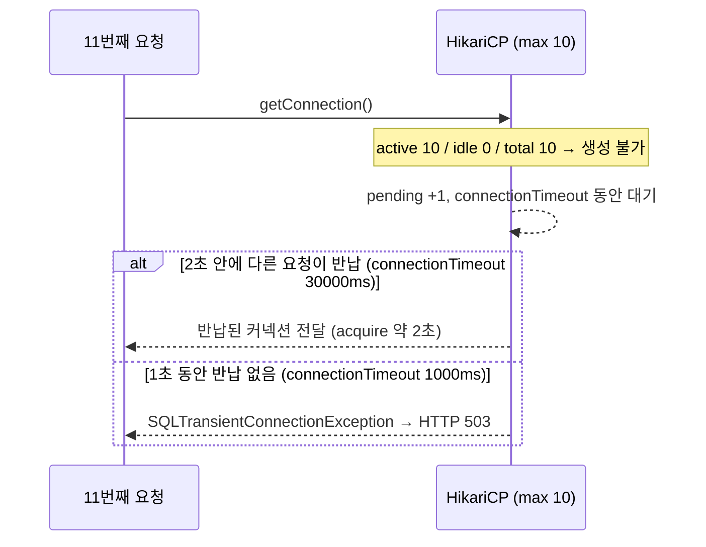

# 4. 상한 대기와 타임아웃: max를 넘는 요청은 기다리거나 실패한다

> 실습 설계 문서입니다. 출력은 HikariCP 동작 규칙과 Little's Law로 계산한 예상값이며, 구현 후 실측값으로 바꿉니다.

## 이 시나리오의 목표

| 항목 | 내용 |
| --- | --- |
| 기능 | `maximumPoolSize` 상한에서의 대기와 `connectionTimeout` |
| 쓰는 도구 | HikariCP, PostgreSQL, k6 |
| 입력 | `profiles/timeout.env`(connectionTimeout 1000ms), `profiles/grow.env`(30000ms) |
| 작업 | 1. 동시 요청 20개, 타임아웃 1초 2. 같은 부하, 타임아웃 30초 3. 타임아웃 지표 확인 |
| 달성할 것 | `connectionTimeout`이 처리량을 바꾸지 않고 초과 요청을 "대기"와 "빠른 실패" 중 어느 쪽으로 보낼지만 정한다는 것을 수치로 설명한다 |

## 풀의 처리량은 max와 커넥션 점유 시간이 정한다

커넥션 하나가 요청 하나를 2초 동안 붙잡으면, 커넥션 10개로 처리할 수 있는 요청은 초당 10 / 2 = 5건입니다. Little's Law(L = λW, 동시 처리 수 = 도착률 × 체류 시간)를 풀에 적용하면, 동시 처리 수 L의 상한이 `maximumPoolSize`이므로 처리량 λ의 상한은 `maximumPoolSize / 점유 시간`입니다.

동시 요청이 상한을 넘으면 넘는 스레드는 pending이 되고 `connectionTimeout`까지 기다립니다. `connectionTimeout`이 길면 요청은 늦게라도 성공하고, 짧으면 빨리 실패합니다. 어느 쪽이든 초당 성공 건수는 5건을 넘지 못합니다. 타임아웃을 늘려 "에러를 없애는" 조치는 처리량을 늘리지 않고 지연을 사용자에게 넘깁니다.

## 흐름

아래 흐름은 커넥션 10개가 모두 active일 때 11번째 요청이 겪는 두 갈래 결과를 나타냅니다.



## 실습

환경은 [실습 환경 준비](./setup.md)로 띄웁니다.

### 1. 타임아웃 1초 프로필에서 동시 요청 20개 실행

```bash
docker compose --env-file profiles/timeout.env up -d --force-recreate app
scripts/load.sh 20 2 30
```

예상 관측입니다. VU 수는 20이지만 total은 10에서 멈추고, 나머지 10은 pending이 됩니다.

```text
time      active idle pending total db
00:00:03  10     0    10      10    10
```

k6 결과의 예상값입니다. 성공 건수는 5건/초 × 30초 = 약 150건입니다. 503 건수는 실패한 VU가 1초 만에 돌아와 다시 요청하므로 성공 건수보다 많아질 수 있습니다.

```text
requests  success  503   p50     p95     max
약 450    약 150   약 300 1.0s    2.0s    2.1s
```

- 503 응답 본문에 `Connection is not available, request timed out after 1000ms`가 들어 있어야 합니다.

### 2. 타임아웃 30초 프로필에서 같은 부하 실행

```bash
docker compose --env-file profiles/grow.env up -d --force-recreate app
scripts/load.sh 20 2 30
```

예상 관측입니다. 503은 사라지지만 성공 건수는 1단계와 같은 약 150건이고, 요청의 절반은 2초를 기다린 뒤 2초를 점유해 약 4초가 걸립니다.

```text
requests  success  503   p50     p95     max
약 150    약 150   0     4.0s    4.0s    4.1s
```

- 1단계와 2단계의 success가 같으면 `connectionTimeout`이 처리량에 영향을 주지 않는다는 것을 확인한 것입니다.

### 3. 타임아웃 누적 횟수와 대기 시간 지표 확인

1단계 직후에 실행하면 누적 타임아웃 횟수가 k6의 503 건수와 같아야 합니다.

```bash
curl -s localhost:8080/actuator/prometheus | grep -E 'hikaricp_connections_(timeout_total|pending|acquire_seconds_max)'
```

## 부록. 실무에서 얻는 것

`hikaricp_connections_pending`이 0보다 큰 상태가 이어지면 풀이 상한에 붙어 있다는 뜻입니다. 이때 할 수 있는 조치는 세 가지이고, 효과가 다릅니다.

| 조치 | 처리량 | 지연 | DB 영향 |
| --- | --- | --- | --- |
| `connectionTimeout` 증가 | 변화 없음 | 늘어남 | 없음 |
| `maximumPoolSize` 증가 | DB가 감당하는 범위에서 늘어남 | 줄어듦 | 세션과 동시 쿼리 증가 |
| 커넥션 점유 시간 감소(쿼리 튜닝, 트랜잭션 안의 외부 호출 제거) | 늘어남 | 줄어듦 | 줄어듦 |

`connectionTimeout`은 상위 계층의 타임아웃보다 짧게 둡니다. HTTP 요청 타임아웃이 5초인데 `connectionTimeout`이 기본값 30초면, 클라이언트는 이미 떠났는데 서버 스레드는 25초를 더 기다리며 Tomcat 스레드를 붙잡습니다.

## 참고 문서

1. [HikariCP README - connectionTimeout](https://github.com/brettwooldridge/HikariCP#gear-configuration-knobs-baby)
2. [HikariCP Wiki - About Pool Sizing](https://github.com/brettwooldridge/HikariCP/wiki/About-Pool-Sizing)
