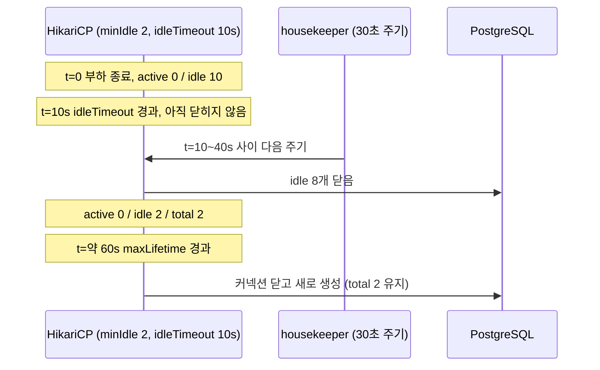

# 5. 유휴 축소와 수명 교체: 줄어드는 시점은 타이머와 housekeeper가 정한다

> 실습 설계 문서입니다. 출력은 HikariCP 동작 규칙으로 계산한 예상값이며, 구현 후 실측값으로 바꿉니다.

## 이 시나리오의 목표

| 항목 | 내용 |
| --- | --- |
| 기능 | `idleTimeout`에 의한 축소, `maxLifetime`에 의한 교체 |
| 쓰는 도구 | HikariCP, PostgreSQL, k6, psql |
| 입력 | `profiles/shrink.env`(minIdle 2, idleTimeout 10000ms, maxLifetime 60000ms) |
| 작업 | 1. total 10까지 증가 2. 부하 종료 후 축소 시점 측정 3. 커넥션 교체를 pid로 확인 |
| 달성할 것 | 축소가 `idleTimeout`부터 `idleTimeout + 30초` 사이에 일어나는 이유와, `maxLifetime`이 total을 줄이지 않고 커넥션을 바꾸기만 한다는 것을 설명한다 |

## 줄이는 판단은 요청 경로가 아니라 housekeeper가 한다

커넥션을 늘리는 판단은 `getConnection()` 호출에서 즉시 일어나지만, 줄이는 판단은 30초마다 도는 housekeeper만 내립니다. housekeeper는 idle 중 `idleTimeout`을 넘긴 커넥션을 찾아 idle이 `minimumIdle`이 될 때까지 닫습니다. 그래서 부하가 끝난 뒤 total이 줄어드는 시점은 `idleTimeout`이 지난 직후가 아니라 그다음 housekeeper 주기이며, 최대 `idleTimeout + 30초`까지 늦어집니다.

`maxLifetime`은 축소가 아니라 교체입니다. 커넥션마다 생성 시점부터 `maxLifetime`(HikariCP가 최대 2.5%를 빼서 커넥션마다 조금씩 다르게 둠)이 지나면 퇴출 대상으로 표시하고, 쓰는 중이면 반납될 때 닫습니다. 닫힌 뒤 idle이 `minimumIdle`보다 적으면 새 커넥션을 만들기 때문에 total은 그대로이고 DB 세션의 pid만 바뀝니다. `maxLifetime`은 DB나 네트워크 장비가 오래된 세션을 먼저 끊기 전에 풀이 스스로 바꾸게 하려는 설정입니다.

### 용어

| 용어 | 뜻 | 이 실습의 예 |
| --- | --- | --- |
| 축소 | idle 커넥션을 닫아 total을 줄임 | total 10 → 2 |
| 교체 | 커넥션을 닫고 새로 만들어 total은 유지 | pid가 약 60초마다 바뀜 |
| `backend_start` | PostgreSQL backend 프로세스가 시작된 시각 | `pg_stat_activity.backend_start` |

## 흐름

아래 흐름은 부하가 끝난 시점부터 total이 `minimumIdle`로 돌아오기까지의 타임라인을 나타냅니다.



## 실습

환경은 [실습 환경 준비](./setup.md)로 띄웁니다.

### 1. shrink 프로필에서 total을 10까지 증가

[3. 수요에 따른 증가](./3-grow-on-demand.md#3-동시-요청-8개로-상한까지-증가-확인)와 같은 부하로 total을 상한까지 올립니다.

```bash
docker compose --env-file profiles/shrink.env up -d --force-recreate app
scripts/load.sh 8 2 60
```

예상 관측입니다. 기다리는 스레드만큼 생성되어 total 8이 되고, 다음 housekeeper 주기에 idle 2개가 보충되어 10이 됩니다. 부하를 60초 거는 이유는 housekeeper가 적어도 한 번 돌게 하기 위해서입니다. total이 10이 되기 전에 부하가 끝나면 2단계에서 닫히는 커넥션 수가 8개보다 적어집니다.

```text
time      active idle pending total db
00:00:01  8      0    0       8     8
00:00:25  8      2    0       10    10
```

- `maxLifetime`이 60초라 부하 중에도 커넥션이 교체될 수 있습니다. 교체는 total을 바꾸지 않으므로 이 단계의 관측에는 영향이 없습니다.

### 2. 부하 종료 후 total이 줄어드는 시점 측정

k6가 끝난 시각을 기록하고 `watch-pool.sh`에서 total이 2가 되는 시각과 비교합니다. 앱 로그의 `After cleanup stats`가 언제 찍히는지도 함께 봅니다.

```bash
docker compose logs -f app | grep -E 'cleanup stats|Closing connection'
```

예상 관측입니다. 축소 시점은 housekeeper 주기와의 위상에 따라 부하 종료 후 10~40초 사이로 실행마다 달라집니다.

```text
HikariPool-1 - Before cleanup stats (total=10, active=0, idle=10, waiting=0)
HikariPool-1 - After cleanup stats (total=2, active=0, idle=2, waiting=0)
```

- 부하 종료 후 10초가 지나도 total이 10이면 정상입니다. 다음 housekeeper 주기를 기다리는 중입니다.

### 3. maxLifetime에 의한 커넥션 교체를 pid로 확인

10초마다 `pool-lab` 세션의 pid와 시작 시각을 조회합니다. total은 2로 유지되면서 pid가 약 60초마다 바뀌어야 합니다.

```bash
watch -n 10 "docker compose exec -T postgres psql -U postgres -Atc \"SELECT pid, backend_start FROM pg_stat_activity WHERE application_name='pool-lab' ORDER BY backend_start\""
```

예상 관측입니다. pid와 시각은 실행마다 달라집니다. 두 커넥션의 교체 시각이 1~2초 어긋나는 이유는 HikariCP가 커넥션마다 수명을 최대 2.5% 줄여 동시에 교체되지 않게 하기 때문입니다.

```text
312|12:00:05
313|12:00:05
---- 약 60초 후 ----
341|12:01:04
342|12:01:05
```

## 부록. 실무에서 얻는 것

`maxLifetime`은 DB와 중간 장비의 세션 제한보다 몇 초 이상 짧게 둡니다. AWS NLB의 TCP idle timeout(기본 350초)이나 PostgreSQL `idle_session_timeout`이 먼저 세션을 끊으면, 풀은 끊긴 커넥션을 idle로 들고 있다가 빌려 줄 때 검증에 실패하고 다시 만듭니다. 그 비용은 요청 경로의 지연으로 나타납니다.

축소를 너무 공격적으로 잡으면(`idleTimeout`을 짧게) 부하가 주기적으로 오르내리는 서비스에서 커넥션을 닫았다 여는 일을 반복합니다. 축소 후 다시 늘어나는 간격이 `idleTimeout`보다 짧은 패턴이 보이면 `minimumIdle`을 올리거나 고정 풀로 바꿉니다.

## 참고 문서

1. [HikariCP README - idleTimeout, maxLifetime](https://github.com/brettwooldridge/HikariCP#gear-configuration-knobs-baby)
2. [PostgreSQL - pg_stat_activity](https://www.postgresql.org/docs/16/monitoring-stats.html#MONITORING-PG-STAT-ACTIVITY-VIEW)
