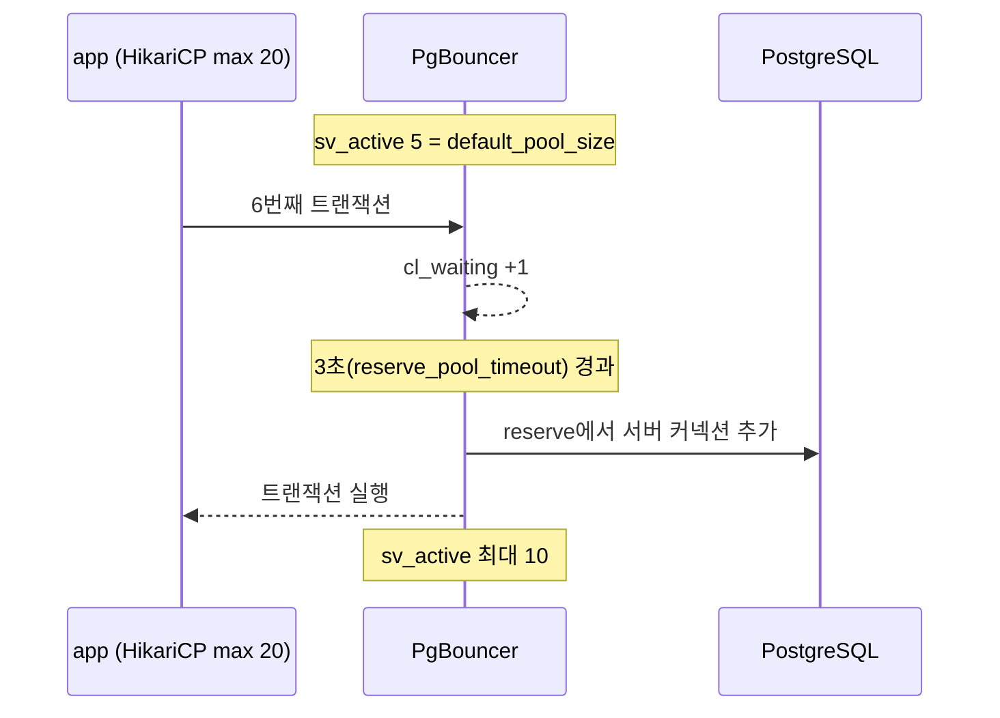

# 부록 A. PgBouncer: min, default, reserve로 나뉜 프록시 풀

> 실습 설계 문서입니다. 출력은 PgBouncer 설정 규칙으로 계산한 예상값이며, 구현 후 실측값으로 바꿉니다.

## 이 시나리오의 목표

| 항목 | 내용 |
| --- | --- |
| 기능 | 프록시 풀의 평소 상한(`default_pool_size`)과 급증 상한(`reserve_pool_size`) |
| 쓰는 도구 | PgBouncer(`pool_mode=transaction`), HikariCP, PostgreSQL |
| 입력 | `min_pool_size=2`, `default_pool_size=5`, `reserve_pool_size=5`, `reserve_pool_timeout=3` |
| 작업 | 1. PgBouncer 경유로 앱 재생성 2. 동시 요청 8개에서 reserve 사용 확인 |
| 달성할 것 | min/desired/max 직관에 가장 가까운 풀 구성을 HikariCP와 같은 부하로 비교한다 |

## HikariCP와 PgBouncer는 서로 다른 커넥션을 센다

HikariCP는 애플리케이션 인스턴스 하나 안에서 DB 커넥션을 재사용합니다. PgBouncer는 여러 인스턴스와 PostgreSQL 사이에서, 클라이언트 커넥션(앱 → PgBouncer)과 서버 커넥션(PgBouncer → PostgreSQL)을 분리합니다. `pool_mode=transaction`이면 서버 커넥션은 트랜잭션 하나 동안만 클라이언트에 묶이므로, 인스턴스 20개가 HikariCP 커넥션 10개씩 200개를 열어도 PostgreSQL 세션은 `default_pool_size` 근처로 유지됩니다.

PgBouncer의 크기 설정은 [1. 기능 지도](./1-feature-map.md#다른-커넥션풀과의-크기-설정-비교)에서 본 min/desired/max 구조와 거의 같습니다.

| ASG | PgBouncer | 늘어나는 조건 |
| --- | --- | --- |
| min | `min_pool_size` | 항상 유지 |
| desired | `default_pool_size` | 클라이언트가 기다리면 이 수까지 서버 커넥션 생성 |
| max | `default_pool_size + reserve_pool_size` | 클라이언트가 `reserve_pool_timeout`초 넘게 기다리면 reserve에서 추가 |

다만 이 구조에서도 desired는 지표로 계산한 목표가 아니라 고정된 평소 상한입니다. PgBouncer 역시 기다리는 클라이언트를 보고 반응합니다.

## 흐름

아래 흐름은 서버 커넥션 5개가 모두 쓰이는 상태에서 6번째 트랜잭션이 reserve를 쓰기까지를 나타냅니다.



## 실습

### 1. PgBouncer 경유로 앱 재생성

`DB_PORT=6432`와 HikariCP `maximumPoolSize=20`으로 앱을 다시 만듭니다. pgjdbc는 트랜잭션 모드 PgBouncer에서 server-side prepared statement가 다른 서버 커넥션으로 넘어가 실패할 수 있으므로 JDBC URL에 `prepareThreshold=0`을 붙입니다.

```bash
docker compose --profile pgbouncer --env-file profiles/pgbouncer.env up -d --force-recreate app pgbouncer
```

### 2. 동시 요청 8개에서 서버 커넥션 수 확인

부하를 넣고 PgBouncer 관리 콘솔의 `SHOW POOLS`로 클라이언트와 서버 커넥션 수를 봅니다.

```bash
scripts/load.sh 8 2 30
docker compose exec -T pgbouncer psql -p 6432 -U pgbouncer pgbouncer -c 'SHOW POOLS;'
```

예상 관측입니다. 처음 3초는 `sv_active=5`, `cl_waiting=3`이고, 그 뒤 reserve가 열리며 `sv_active=8`, `cl_waiting=0`이 됩니다.

```text
 cl_active | cl_waiting | sv_active | sv_idle
         5 |          3 |         5 |       0
         8 |          0 |         8 |       0
```

- 같은 부하에서 HikariCP 직결([3. 수요에 따른 증가](./3-grow-on-demand.md#3-동시-요청-8개로-상한까지-증가-확인))은 PostgreSQL 세션 10개, PgBouncer 경유는 8개입니다.

## 확인 필요

- `profiles/pgbouncer.env`와 PgBouncer 설정 파일은 [구현 명세](./implementation-spec.md)에 아직 없습니다. 구현할 때 명세에 추가합니다.
- reserve로 연 서버 커넥션이 `server_idle_timeout` 뒤 `default_pool_size`까지 줄어드는지는 실측으로 확인합니다.

## 참고 문서

1. [PgBouncer Configuration](https://www.pgbouncer.org/config.html)
2. [PgBouncer Usage - SHOW POOLS](https://www.pgbouncer.org/usage.html)
3. [pgJDBC - prepareThreshold](https://jdbc.postgresql.org/documentation/use/)
