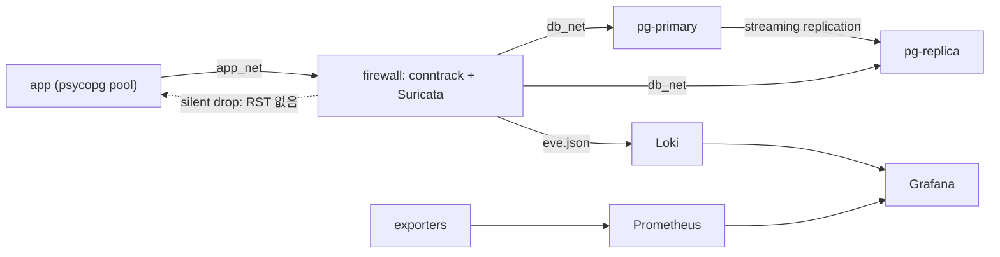

# 0. 설계: 보안장비 silent drop 재현 핸즈온

이 문서는 구현 전 설계다. 아래 시나리오와 수치 기대값은 가설이며, 구현 세션에서 실측으로 확인하거나 고친다.

## 이 핸즈온의 목표

| 항목 | 내용 |
|---|---|
| 검증할 현상 | 보안장비가 RST 없이 패킷을 drop할 때 애플리케이션 커넥션이 오래 응답을 기다리다 실패하고, DB에는 orphan 세션과 재연결 부하가 쌓이는 현상 |
| 쓰는 도구 | iptables/nftables + conntrack, Suricata(inline), PostgreSQL streaming replication, Python psycopg pool, Prometheus, Loki, Grafana |
| 입력 | 커넥션 풀을 쓰는 부하 스크립트, conntrack timeout 설정, Suricata 오탐 rule, primary promote |
| 달성할 것 | 장애 유형마다 "애플리케이션이 실패를 알아차리는 시간"과 "DB 세션 수·CPU 변화"를 대시보드 한 장에서 시간 순으로 대조하고, 완화 설정 전후 차이를 수치로 남김 |

## 재현하려는 현상

TCP 연결을 끊는 정상 경로는 FIN이나 RST다. 상대가 RST를 받으면 커널은 소켓을 즉시 닫고 애플리케이션은 다음 `read`나 `write`에서 바로 오류를 받는다. 반면 stateful firewall이 세션 테이블에서 엔트리를 지우거나 IPS가 flow를 차단하면서 패킷을 조용히 버리면, 양 끝단의 커널은 연결이 살아 있다고 믿는다. 애플리케이션이 보낸 쿼리는 재전송만 반복하고, Linux 기본값(`net.ipv4.tcp_retries2=15`)에서는 약 15분이 지나서야 오류가 된다. 그동안 DB 서버의 backend 프로세스도 클라이언트가 사라진 줄 모르고 세션과 트랜잭션, 락을 그대로 들고 있다.

이 상태에서 애플리케이션 쪽 timeout이나 재시도가 먼저 동작하면 새 커넥션을 계속 열게 되고, DB에는 orphan 세션 위에 새 세션이 쌓인다. `max_connections`가 차면 정상 요청까지 접속이 거부되고, 인증과 backend fork 비용으로 CPU가 오른다. "보안장비가 오탐했는데 DB 부하가 늘었다"는 장애 보고는 대부분 이 인과 사슬로 설명할 수 있다고 가정하고, 이를 재현하는 것이 이 핸즈온의 중심이다.

이 핸즈온은 패킷 drop의 결과를 다루며, 보안장비 제품별 정책 튜닝이나 실제 공격 탐지 정확도는 다루지 않는다.

### 용어

| 용어 | 뜻 | 이 실습의 예 |
|---|---|---|
| silent drop | 차단 사실을 상대에게 알리지 않고 패킷을 버리는 동작 | iptables `DROP`, Suricata `drop` |
| RST | TCP 연결을 즉시 중단하는 제어 패킷 | iptables `REJECT --reject-with tcp-reset` |
| conntrack | Linux netfilter의 연결 추적 테이블. stateful firewall의 세션 테이블 역할 | `nf_conntrack_tcp_timeout_established` |
| orphan 세션 | 클라이언트는 사라졌지만 DB 서버가 아직 유지하는 세션 | `pg_stat_activity`의 `idle`/`idle in transaction` 행 |
| 오탐(false positive) | 정상 트래픽을 공격으로 판정함 | `UNION SELECT`가 들어간 정상 리포트 쿼리 |

## 컴포넌트 역할

| 컴포넌트 | 오픈소스 | 역할 |
|---|---|---|
| app | Python + psycopg pool | 커넥션 풀로 쿼리 부하 발생, 재시도·재연결 동작 |
| firewall | Linux 컨테이너 + iptables/nftables + conntrack | 두 네트워크 사이의 라우터. idle timeout 만료 후 silent drop |
| ips | 같은 컨테이너의 Suricata inline(NFQUEUE) | 오탐 rule로 flow drop |
| pg-primary, pg-replica | PostgreSQL streaming replication | DB 클러스터. failover 시나리오에서 replica promote |
| 관측 | node_exporter, postgres_exporter, Prometheus, Alloy, Loki, Grafana | 재전송, conntrack, 세션 수, Suricata 이벤트 시각화 |

compose 네트워크를 `app_net`과 `db_net`으로 나누고 firewall 컨테이너만 두 네트워크에 붙인다. app은 `db_net` 대역, DB 컨테이너는 `app_net` 대역으로 가는 경로를 각각 firewall로 지정해 요청과 응답이 모두 보안장비를 통과하게 한다. 응답이 Docker bridge로 우회하면 conntrack이 연결을 ESTABLISHED로 인식하지 못하므로, 경로 설정을 위해 app과 DB 컨테이너에도 `NET_ADMIN` capability를 준다.

conntrack 엔트리가 만료됐다고 해서 패킷이 바로 버려지지는 않는다. Linux 기본값 `net.netfilter.nf_conntrack_tcp_loose=1`에서는 만료 뒤 들어온 중간 ACK 패킷으로 엔트리를 다시 만들어 통과시키기 때문이다. 상용 stateful firewall처럼 세션 테이블에 없는 패킷을 버리게 하려면 `nf_conntrack_tcp_loose=0`으로 바꾸고, FORWARD 체인에서 `ESTABLISHED,RELATED`와 SYN만 허용하고 나머지(`ctstate INVALID`, `NEW ! --syn`)는 DROP한다.

## 흐름

정상 경로와 silent drop이 일어나는 위치를 나타낸 구성이다.

## 시나리오 순서

독자가 이미 아는 "방화벽이 막았다"에서 시작해, 그 차단 방식이 RST인지 drop인지에 따라 애플리케이션과 DB가 얼마나 다르게 반응하는지로 거슬러 올라간다.

| 번호 | 시나리오 | 주입하는 장애 | 관측할 것 |
|---|---|---|---|
| 1 | 기능 지도 | 없음 | 전체 경로와 기능별 도구 |
| 2 | RST와 silent drop 비교 | `REJECT --reject-with tcp-reset` 대 `DROP` | 앱 오류까지 걸린 시간, app 쪽 TCP 재전송 횟수 |
| 3 | firewall 세션 idle timeout | `nf_conntrack_tcp_loose=0` 상태에서 established timeout을 60초로 줄이고 풀 커넥션을 유휴 상태로 둠 | conntrack 엔트리 만료 시각과 앱 쿼리 hang 시작 시각 |
| 4 | IPS 오탐 차단 | Suricata에 정상 쿼리를 잡는 drop rule 추가 | 재시도·재연결 폭주, DB 세션 수와 `max_connections`, CPU |
| 5 | primary/replica failover | primary 차단 후 replica promote | old primary로 남은 stale 커넥션, libpq multi-host와 `target_session_attrs` 동작 |
| 6 | 완화 설정 전후 비교 | 시나리오 3, 4를 완화 설정 적용 후 재실행 | 실패 감지 시간 단축, orphan 세션 정리 시간 |

시나리오 6에서 비교할 완화 설정은 클라이언트 쪽 libpq `keepalives_idle`·`tcp_user_timeout`과 psycopg_pool `max_lifetime`·`check`(`ConnectionPool.check_connection`), DB 쪽 `tcp_keepalives_*`·`tcp_user_timeout`·`idle_session_timeout`·`idle_in_transaction_session_timeout`·`client_connection_check_interval`이다. 마지막 설정은 쿼리를 실행하는 중인 backend가 클라이언트가 사라진 것을 감지하게 해, 시나리오 4의 긴 리포트 쿼리처럼 orphan backend가 실행을 계속하는 경우를 다룬다. keepalive 주기를 firewall idle timeout보다 짧게 잡으면 conntrack 엔트리가 만료되지 않는다는 가설도 함께 확인한다.

## 관측 계획

Grafana 대시보드 한 장에 아래 패널을 시간 축으로 맞춰 놓는다. 장애 주입 스크립트가 Grafana annotation API를 호출해 주입 시각을 세로선으로 남기면, 원인 이벤트와 결과 지표를 같은 화면에서 대조할 수 있다.

| 위치 | 수집 | 패널 |
|---|---|---|
| app | `prometheus_client`, app network namespace를 공유하는 node_exporter | 풀 대기 시간, 쿼리 latency, timeout·재연결 횟수, `TcpRetransSegs` |
| firewall | node_exporter(conntrack) | conntrack 엔트리 수 |
| ips | Suricata `eve.json` → Alloy → Loki | drop 이벤트, rule ID |
| DB | postgres_exporter, node_exporter | 상태별 세션 수, 커넥션 수 대 `max_connections`, CPU, replication lag |

데이터소스와 대시보드는 Grafana provisioning으로 넣어 `docker compose up -d` 한 번으로 보이게 한다. 패킷 단위 확인은 firewall 컨테이너의 `tcpdump`와 `conntrack -E`로 보완한다.

## 구현 계획

1. workspace 구조: `compose.yaml`, `docs/setup.md`, 컴포넌트별 디렉터리(`app/`, `firewall/`, `postgres/`, `observability/`)
2. firewall 컨테이너 라우팅과 iptables 기본 정책, Suricata NFQUEUE 연결
3. PostgreSQL primary/replica streaming replication
4. app 부하 스크립트와 메트릭 노출, 관측 스택 provisioning
5. 시나리오 1~6 문서와 장애 주입 스크립트
6. 실측, mermaid 렌더링, knowledge와 `docs/troubleshooting.md` 기록, 루트 README 목차 추가

## 미결정 사항

| 항목 | 후보 | 기본안 |
|---|---|---|
| DB 엔진 | PostgreSQL, MySQL/MariaDB | PostgreSQL |
| 앱 언어 | Python psycopg, Java HikariCP | Python. 운영 재현성이 중요하면 HikariCP |
| failover 방식 | 수동 `pg_ctl promote`, Patroni + etcd | 수동 promote |
| 실행 환경 | 로컬 docker compose, EC2 t4g.medium | 로컬 docker compose |

macOS Docker Desktop에서 컨테이너 안의 iptables와 NFQUEUE가 동작하는지는 구현 첫 단계에서 확인한다. 동작하지 않으면 EC2 t4g.medium으로 실행 환경을 바꾼다.
