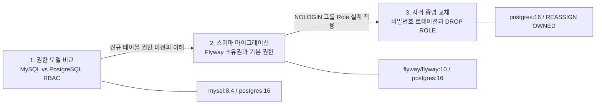
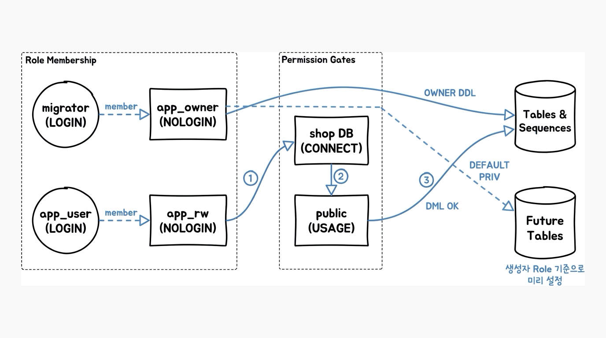

# 1. PostgreSQL RBAC 기능 지도

PostgreSQL을 MySQL과 같은 감각으로 운영하다가 배포 직후 `permission denied`나 `must be owner of table` 오류를 만나는 일이 잦습니다. 원인은 문법 차이가 아니라 **권한을 설계하는 모델 자체가 다르기 때문**입니다. MySQL이 `user@host` 계정에 데이터베이스 단위 와일드카드 권한(`shop.*`)을 얹는 계정 중심 모델이라면, PostgreSQL은 **모든 주체를 Role로 통합하고 객체별 계층 권한과 소유권(Ownership)을 엄격히 분리하는 RBAC(Role-Based Access Control)** 모델입니다.

이 핸즈온은 로컬 Docker 환경에서 MySQL 8.4, PostgreSQL 16, Flyway 10을 직접 실행해 세 가지 핵심 메커니즘을 실험으로 확인합니다. 실습 환경 준비는 [setup.md](setup.md)를 먼저 마칩니다.

## 전체 기능 지도

아래 다이어그램은 이 핸즈온이 다루는 세 가지 기능과 각 시나리오가 어떤 실무 장애로 이어지는지를 한눈에 보여 줍니다.

PostgreSQL RBAC의 네 가지 권한 계층(Cluster → Database → Schema → Table)과 객체 소유권, 미래 객체 기본 권한(`ALTER DEFAULT PRIVILEGES`)의 전체 구조는 아래 그림과 같습니다.

## 시나리오별 목표와 도구

| 시나리오 | 문서 | 다루는 기능 | 사용 도구 | 핵심 검증 포인트 |
| --- | --- | --- | --- | --- |
| 준비 | [setup.md](setup.md) | 로컬 컨테이너 구축 | `docker` CLI, `mysql:8.4`, `postgres:16` | 순수 `docker run`으로 DB 2대와 네트워크 기동 |
| 2 | [2-mysql-vs-postgres-rbac.md](2-mysql-vs-postgres-rbac.md) | 계정 중심 권한 vs RBAC 계층 권한 | `mysql:8.4`, `postgres:16` | `shop.*` 자동 전파 vs `ALTER DEFAULT PRIVILEGES` |
| 3 | [3-flyway-ownership-incident.md](3-flyway-ownership-incident.md) | 마이그레이션 도구와 객체 소유권 | `flyway/flyway:10`, `postgres:16` | `must be owner` 장애 재현, 트랜잭션 DDL 롤백, `SET ROLE app_owner` |
| 4 | [4-password-rotation-incident.md](4-password-rotation-incident.md) | 무중단 비밀번호 로테이션 | `postgres:16` | `DROP ROLE` 의존성 장애, `REASSIGN OWNED` 복구, Blue/Green Role |
| 복습 | [study-guide.html](study-guide.html) | 시각 학습지 | 브라우저(HTML/CSS/JS) | 아키텍처 그림과 3종 인터랙티브 동작 애니메이션 |

## MySQL과 PostgreSQL 권한 용어 대조

두 데이터베이스는 같은 이름의 SQL 키워드를 쓰더라도 실제 동작 범위가 다릅니다. 아래 표의 차이를 먼저 짚고 넘어가면 이후 시나리오에서 발생하는 오류 메시지가 바로 읽힙니다.

| 개념 | MySQL 8.4 | PostgreSQL 16 | 실무에서 헷갈리는 지점 |
| --- | --- | --- | --- |
| 인증 주체 | `USER` (`'name'@'host'` 쌍으로 구분) | `ROLE` (User와 Group 구분 없음, `LOGIN` 속성으로 구분) | PostgreSQL의 `CREATE USER`는 `CREATE ROLE ... LOGIN`의 별칭일 뿐입니다. |
| 스키마와 DB | `DATABASE`와 `SCHEMA`가 동의어 | `DATABASE` 아래에 여러 `SCHEMA`(`public` 등)가 존재 | PostgreSQL에서는 DB `CONNECT`와 Schema `USAGE`를 따로 열어야 테이블에 닿습니다. |
| 미래 테이블 권한 | `GRANT SELECT ON shop.*`가 앞으로 생길 테이블에도 적용 | `GRANT SELECT ON ALL TABLES`는 실행 시점의 기존 테이블에만 적용 | PostgreSQL은 `ALTER DEFAULT PRIVILEGES`를 테이블 생성자 Role 기준으로 미리 걸어야 합니다. |
| DDL 권한 (`ALTER`, `DROP`) | `ALTER`, `DROP` 권한을 `GRANT`로 위임 가능 | 객체의 **Owner**(또는 Owner Role의 멤버, Superuser)만 실행 가능 | PostgreSQL에서는 `GRANT ALL ON TABLE`을 줘도 Owner가 아니면 `ALTER TABLE`이 실패합니다. |
| DDL 트랜잭션 | DDL 실행 시 암묵적 커밋 발생 (부분 적용 위험) | 대부분의 DDL이 트랜잭션 안에서 원자적으로 롤백 가능 | Flyway 마이그레이션 중간에 실패해도 PostgreSQL은 앞선 `CREATE TABLE`까지 되돌립니다. |
| 계정 삭제 | `DROP USER` 시 해당 계정이 만든 테이블이 남아도 삭제 가능 | 소유 객체나 `DEFAULT PRIVILEGES` 의존성이 하나라도 있으면 `DROP ROLE` 거부 | 비밀번호 로테이션 후 옛 계정을 지우려면 소유권을 `NOLOGIN` 그룹 Role로 분리해야 합니다. |

## 참고 문서

1. [PostgreSQL 16 Documentation — Chapter 22. Database Roles](https://www.postgresql.org/docs/16/user-manag.html)
2. [PostgreSQL 16 Documentation — Section 5.7. Privileges](https://www.postgresql.org/docs/16/ddl-priv.html)
3. [MySQL 8.4 Reference Manual — Access Control and Account Management](https://dev.mysql.com/doc/refman/8.4/en/access-control.html)
