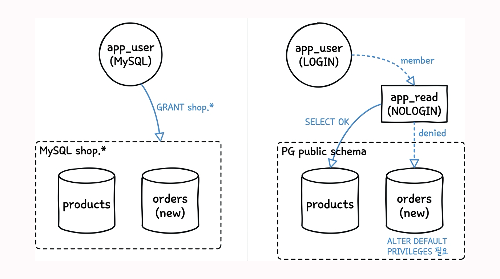
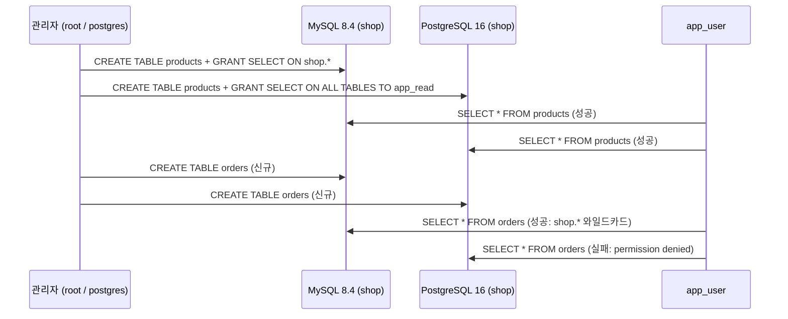

# 2. MySQL과 PostgreSQL 인증·인가 모델 비교

## 이 시나리오의 목표

| 항목 | 내용 |
| --- | --- |
| 기능 | 데이터베이스 계층별 인가와 신규 객체에 대한 기본 권한(`ALTER DEFAULT PRIVILEGES`) 전파 |
| 쓰는 도구 | `mysql:8.4`, `postgres:16` (`docker exec`로 직접 SQL 실행) |
| 입력 | 기존 테이블 `products`, 추가 생성 테이블 `orders`, 기본 권한 설정 후 생성 테이블 `shipments` |
| 작업 | 1. MySQL에서 `shop.*` 권한 부여 후 신규 테이블 조회 확인 2. PostgreSQL에서 `NOLOGIN` 그룹 Role과 `LOGIN` Role 구성 3. 신규 테이블 `orders` 조회 실패 재현 4. `ALTER DEFAULT PRIVILEGES` 적용 후 `shipments`와 `orders` 비교 |
| 달성할 것 | MySQL의 와일드카드 권한과 PostgreSQL RBAC의 시점 고정(snapshot) 권한 차이를 실측 출력으로 설명할 수 있다 |

## 계정 중심 모델과 RBAC 모델의 차이

MySQL은 전통적으로 **계정(`'user'@'host'`) 중심**으로 권한을 관리합니다. MySQL 8부터 Role 문법이 추가되었지만, 실무에서 여전히 가장 널리 쓰이는 패턴은 `'app_user'@'%'`에 `GRANT SELECT, INSERT ON shop.*`처럼 데이터베이스 단위 와일드카드 권한을 주는 방식입니다. 이 와일드카드는 권한 테이블(`mysql.db`)에 패턴으로 저장되므로, 나중에 새로운 테이블 `orders`가 추가되어도 `app_user`는 별도 조치 없이 바로 조회할 수 있습니다.

반면 PostgreSQL은 **User와 Group을 구분하지 않고 모든 주체를 `ROLE`로 통합한 RBAC 모델**입니다. 로그인 가능한 계정(`LOGIN`)과 권한 묶음용 그룹(`NOLOGIN`)이 모두 `pg_roles` 카탈로그의 같은 Role 객체이며, 그룹 Role에 권한을 모으고 로그인 Role에 `GRANT <그룹 Role> TO <로그인 Role>`로 멤버십을 부여해 권한을 상속합니다.



오해하기 쉬운 경계가 하나 있습니다. PostgreSQL의 `GRANT SELECT ON ALL TABLES IN SCHEMA public TO app_read`는 MySQL의 `ON shop.*`처럼 "앞으로 생길 모든 테이블"을 뜻하지 않습니다. 이 명령은 **실행하는 그 순간 `public` 스키마에 존재하는 테이블 목록을 순회하며 개별 테이블 ACL(Access Control List)에 `SELECT`를 기록하는 일회성 매크로**입니다. 따라서 명령 실행 직후에 새로 만든 테이블에는 권한이 전혀 붙지 않습니다.

### 용어

| 용어 | 뜻 | 이 실습의 예 |
| --- | --- | --- |
| `NOLOGIN` Role | 로그인할 수 없는 권한 묶음(그룹) 역할 | `app_read` |
| `LOGIN` Role | 비밀번호 등으로 실제 접속할 수 있는 사용자 역할 | `app_user` |
| `USAGE` (Schema) | 스키마 안의 객체 이름을 탐색하고 접근할 수 있는 관문 권한 | `GRANT USAGE ON SCHEMA public TO app_read` |
| `ALL TABLES IN SCHEMA` | 명령 실행 시점에 이미 존재하는 테이블에만 권한을 일괄 부여하는 문법 | `products`에만 적용되고 이후 생성된 `orders`에는 미적용 |
| `ALTER DEFAULT PRIVILEGES` | 특정 Role이 앞으로 생성할 객체에 자동으로 부여할 기본 권한 규칙 | `FOR ROLE postgres IN SCHEMA public GRANT SELECT ON TABLES TO app_read` |

## PostgreSQL이 계층 권한과 기본 권한을 분리한 이유

권한 범위를 와일드카드로 열어 두면 편하지만, 스키마 안에 민감한 테이블(예: 결제 원장, 감사 로그)이 새로 추가될 때 의도치 않게 기존 조회 계정에 자동 노출됩니다. PostgreSQL은 "이미 있는 객체의 권한"과 "앞으로 특정 Role이 만들 객체의 기본 권한"을 명시적으로 분리해 최소 권한 원칙을 강제합니다.

또한 `ALTER DEFAULT PRIVILEGES`는 반드시 **`FOR ROLE <생성자>`를 기준으로 동작**합니다. `postgres`가 만든 테이블에 대한 기본 권한을 걸어 두었더라도, 다른 계정(`migrator_v1`)이 테이블을 만들면 그 규칙이 적용되지 않습니다. 이 특성이 바로 다음 시나리오에서 다룰 Flyway 마이그레이션 장애의 직접적인 원인이 됩니다.

## 대안 비교

| 방식 | 신규 테이블 자동 권한 | 장점 | 단점 및 주의점 |
| --- | --- | --- | --- |
| MySQL `GRANT ... ON db.*` | 자동 적용 | 초기 설정이 단순하고 배포 후 권한 누락이 없음 | 같은 DB에 새 민감 테이블 추가 시 과다 권한 노출 위험 |
| PostgreSQL `GRANT ... ON ALL TABLES` | 미적용 | 기존 테이블 상태를 명시적으로 통제 | 새 테이블 배포마다 수동 `GRANT` 누락 시 장애 발생 |
| PostgreSQL `ALTER DEFAULT PRIVILEGES` | 지정한 생성자 Role에 한해 자동 적용 | 최소 권한 유지와 자동화를 동시에 달성 | 과거에 이미 만든 테이블에는 소급 적용되지 않으며, 생성자 Role이 바뀌면 무효화됨 |

## 컴포넌트 역할

| 컴포넌트 | 역할 |
| --- | --- |
| `rbac-mysql` (`mysql:8.4`) | 계정 중심 권한과 `shop.*` 와일드카드 자동 전파를 확인하는 비교군 |
| `rbac-postgres` (`postgres:16`) | `NOLOGIN`/`LOGIN` Role 상속, 계층 권한, `ALTER DEFAULT PRIVILEGES`를 검증하는 대상 |

## 흐름

아래 시퀀스는 두 데이터베이스에 같은 순서로 `products` 생성 → 권한 부여 → `orders` 추가 생성을 실행했을 때 인가 결과가 어떻게 갈리는지 보여 줍니다.



## 실습

실습 컨테이너가 아직 실행 중이 아니라면 [setup.md](setup.md)를 따라 `rbac-mysql`과 `rbac-postgres`를 먼저 기동합니다. 명령은 `computer_science/postgresql-rbac` 디렉터리에서 실행합니다.

### 1. MySQL에서 `shop.*` 권한 부여 및 신규 테이블 접근 확인

`rbac-mysql`에 `products` 테이블을 만들고 `app_user@%` 계정에 `shop.*` 권한을 부여한 뒤 권한 목록을 확인합니다.

```bash
docker exec -i rbac-mysql mysql -uroot -prootpass shop <<'SQL'
CREATE TABLE products (
  id INT AUTO_INCREMENT PRIMARY KEY,
  name VARCHAR(100) NOT NULL,
  price INT NOT NULL
);
INSERT INTO products (name, price) VALUES ('Mechanical Keyboard', 120000);

CREATE USER 'app_user'@'%' IDENTIFIED BY 'apppass';
GRANT SELECT, INSERT ON shop.* TO 'app_user'@'%';
SHOW GRANTS FOR 'app_user'@'%';
SQL
```

`SHOW GRANTS` 출력에서 `shop.*` 와일드카드가 계정에 직접 걸린 것을 볼 수 있습니다.

```text
Grants for app_user@%
GRANT USAGE ON *.* TO `app_user`@`%`
GRANT SELECT, INSERT ON `shop`.* TO `app_user`@`%`
```

이제 `root` 계정으로 새 테이블 `orders`를 추가하고, 추가 `GRANT` 없이 `app_user`로 바로 조회합니다.

```bash
docker exec -i rbac-mysql mysql -uroot -prootpass shop <<'SQL'
CREATE TABLE orders (
  id INT AUTO_INCREMENT PRIMARY KEY,
  product_id INT NOT NULL,
  quantity INT NOT NULL
);
INSERT INTO orders (product_id, quantity) VALUES (1, 2);
SQL

docker exec -i rbac-mysql mysql -uapp_user -papppass shop -e "SELECT * FROM orders;"
```

추가 권한 부여 없이도 `orders` 테이블 조회가 바로 통과합니다.

```text
id  product_id  quantity
1   1           2
```

MySQL의 `GRANT SELECT, INSERT ON shop.*`는 테이블 개체가 아니라 데이터베이스 스코프의 와일드카드 규칙으로 평가되기 때문에, 권한 부여 이후에 생긴 `orders` 테이블까지 자동으로 포함합니다.

### 2. PostgreSQL에서 `NOLOGIN` 그룹 Role과 `LOGIN` Role 구성

이번에는 `rbac-postgres`에 같은 `products` 테이블을 만들고, 권한 묶음용 `app_read (NOLOGIN)`와 로그인용 `app_user (LOGIN)`를 분리해 RBAC 구조를 구성합니다.

```bash
docker exec -i rbac-postgres psql -U postgres -d shop <<'SQL'
CREATE TABLE products (
  id SERIAL PRIMARY KEY,
  name VARCHAR(100) NOT NULL,
  price INTEGER NOT NULL
);
INSERT INTO products (name, price) VALUES ('Mechanical Keyboard', 120000);

CREATE ROLE app_read NOLOGIN;
GRANT CONNECT ON DATABASE shop TO app_read;
GRANT USAGE ON SCHEMA public TO app_read;
GRANT SELECT ON ALL TABLES IN SCHEMA public TO app_read;

CREATE ROLE app_user LOGIN PASSWORD 'apppass';
GRANT app_read TO app_user;

\du app_read
\du app_user
SQL
```

`\du` 출력에서 `app_read`는 `Cannot login` 속성을 가진 그룹 Role이고 `app_user`는 로그인 가능한 Role임을 확인할 수 있습니다. (PostgreSQL 16부터 `\du`는 소속 그룹 열을 숨기므로, 멤버십 관계는 `\drg` 명령으로 조회합니다.)

```text
      List of roles
 Role name |  Attributes
-----------+--------------
 app_read  | Cannot login

     List of roles
 Role name | Attributes
-----------+------------
 app_user  |
```

`app_user`로 접속해 기존 테이블 `products`를 조회합니다.

```bash
docker exec -i -e PGPASSWORD=apppass rbac-postgres psql -U app_user -d shop -c "SELECT * FROM products;"
```

`app_read`에서 상속받은 권한으로 `products` 조회에 성공합니다.

```text
 id |        name         | price
----+---------------------+--------
  1 | Mechanical Keyboard | 120000
(1 row)
```

### 3. PostgreSQL 신규 테이블 `orders` 조회 실패 재현

MySQL과 똑같이 관리 계정(`postgres`)으로 새 테이블 `orders`를 생성한 뒤 `app_user`로 조회합니다.

```bash
docker exec -i rbac-postgres psql -U postgres -d shop <<'SQL'
CREATE TABLE orders (
  id SERIAL PRIMARY KEY,
  product_id INTEGER NOT NULL,
  quantity INTEGER NOT NULL
);
INSERT INTO orders (product_id, quantity) VALUES (1, 2);
SQL

docker exec -i -e PGPASSWORD=apppass rbac-postgres psql -U app_user -d shop -c "SELECT * FROM orders;"
```

MySQL과 달리 PostgreSQL은 즉시 권한 오류를 반환합니다.

```text
ERROR:  permission denied for table orders
```

앞서 실행한 `GRANT SELECT ON ALL TABLES IN SCHEMA public TO app_read`는 실행 당시 존재하던 `products`에만 `SELECT` ACL을 기록했기 때문입니다. 그 뒤에 만들어진 `orders`에는 `app_read`에 대한 권한이 없습니다.

### 4. `ALTER DEFAULT PRIVILEGES` 적용과 소급 미적용 확인

앞으로 `postgres`가 `public` 스키마에 만드는 테이블에 `app_read`의 `SELECT` 권한이 자동 부여되도록 `ALTER DEFAULT PRIVILEGES`를 설정하고, 새 테이블 `shipments`를 생성합니다.

```bash
docker exec -i rbac-postgres psql -U postgres -d shop <<'SQL'
ALTER DEFAULT PRIVILEGES FOR ROLE postgres IN SCHEMA public
GRANT SELECT ON TABLES TO app_read;

CREATE TABLE shipments (
  id SERIAL PRIMARY KEY,
  order_id INTEGER NOT NULL,
  status VARCHAR(30) NOT NULL
);
INSERT INTO shipments (order_id, status) VALUES (1, 'READY');
SQL
```

이제 `app_user`로 방금 만든 `shipments`와 그 이전에 만들었던 `orders`를 차례로 조회합니다.

```bash
docker exec -i -e PGPASSWORD=apppass rbac-postgres psql -U app_user -d shop -c "SELECT * FROM shipments;"
docker exec -i -e PGPASSWORD=apppass rbac-postgres psql -U app_user -d shop -c "SELECT * FROM orders;"
```

두 쿼리의 결과가 명확히 갈립니다.

```text
 id | order_id | status
----+----------+--------
  1 |        1 | READY
(1 row)

ERROR:  permission denied for table orders
```

`ALTER DEFAULT PRIVILEGES` 이후에 생성된 `shipments`는 추가 `GRANT` 없이 조회에 성공했지만, 설정 이전에 만들어 둔 `orders`는 여전히 `permission denied`입니다. `ALTER DEFAULT PRIVILEGES`는 미래에 생성되는 객체에만 적용되며 과거 객체에는 소급되지 않기 때문에, 기존 테이블에는 `GRANT SELECT ON ALL TABLES`를, 미래 테이블에는 `ALTER DEFAULT PRIVILEGES`를 항상 쌍으로 실행해야 합니다.

## 부록. 실무에서 얻는 것

- **PostgreSQL 15+의 `public` 스키마 기본 권한 변화**: PostgreSQL 15부터 일반 사용자(`PUBLIC` 역할)의 `public` 스키마 `CREATE` 권한이 기본적으로 제거되었습니다. `USAGE`는 남아 있지만 테이블 생성 권한은 명시적으로 부여해야 하므로, 마이그레이션 계정을 따로 둘 때 `GRANT CREATE ON SCHEMA public`이 빠지지 않도록 점검해야 합니다.
- **시퀀스(`SEQUENCE`) 권한 누락 함정**: `SERIAL`이나 `IDENTITY` 컬럼에 `INSERT`하는 앱 계정은 테이블 `INSERT` 권한만으로는 부족합니다. `GRANT USAGE, SELECT ON ALL SEQUENCES IN SCHEMA public`과 `ALTER DEFAULT PRIVILEGES ... GRANT USAGE, SELECT ON SEQUENCES`를 함께 걸지 않으면 첫 `INSERT`에서 `permission denied for sequence`가 발생합니다.
- **Role 상속(`INHERIT` vs `NOINHERIT`)**: PostgreSQL에서 `CREATE ROLE`의 기본값은 `INHERIT`입니다. 멤버십이 있는 그룹 Role의 권한을 자동으로 물려받으므로 일반 앱 계정은 기본값(`INHERIT`)이 편리합니다. 반면 운영자용 승격 역할(`dba_admin`)은 실수 방지를 위해 `NOINHERIT`로 만들어 필요할 때만 명시적으로 `SET ROLE dba_admin;`을 실행하게 설계하는 편이 안전합니다.

## 참고 문서

1. [PostgreSQL 16 Documentation — ALTER DEFAULT PRIVILEGES](https://www.postgresql.org/docs/16/sql-alterdefaultprivileges.html)
2. [PostgreSQL 16 Documentation — Role Membership](https://www.postgresql.org/docs/16/role-membership.html)
3. [PostgreSQL 15 Release Notes — Remove PUBLIC creation permission on the public schema](https://www.postgresql.org/docs/15/release-15.html)
