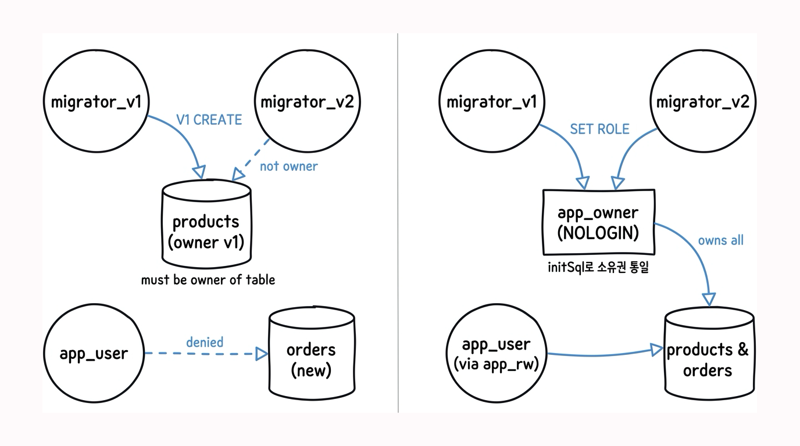
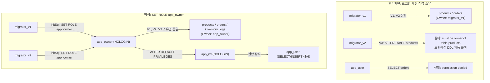

# 3. Flyway 마이그레이션 소유권 장애와 롤백

## 이 시나리오의 목표

| 항목 | 내용 |
| --- | --- |
| 기능 | DB 마이그레이션 도구를 사용할 때 PostgreSQL 객체 소유권(Ownership) 통일, 기본 권한 전파, 실패 시 롤백 |
| 쓰는 도구 | `flyway/flyway:10` (OSS 10.22.0), `postgres:16` |
| 입력 | 읽기 쉬운 4개 SQL 파일(`V1__create_products.sql`, `V2__create_orders.sql`, `V3__add_stock_to_products.sql`, `V4__rollback_orders.sql`) |
| 작업 | 1. 로그인 계정(`migrator_v1`)으로 V1·V2 실행 후 앱 계정 `permission denied` 장애 재현 2. `migrator_v2`로 V3 실행 시 `must be owner of table` 장애와 트랜잭션 DDL 자동 롤백 확인 3. 보상 마이그레이션(V4)으로 이미 적용된 V2 롤백 4. `SET ROLE app_owner`와 `ALTER DEFAULT PRIVILEGES`로 근본 해결 |
| 달성할 것 | Flyway 계정이 바뀌어도 DDL과 앱 조회가 깨지지 않는 RBAC 구조를 구성하고, 마이그레이션 장애 시 롤백 절차를 실행할 수 있다 |

## 마이그레이션 도구와 객체 소유권의 관계

PostgreSQL에서 테이블을 `CREATE TABLE`로 생성하면, 그 명령을 실행한 세션의 **현재 활성 Role(`current_user`)이 테이블의 소유자(Owner)**가 됩니다. `ALTER TABLE`, `DROP TABLE`, `CREATE INDEX` 같은 스키마 변경 DDL은 `GRANT ALL ON TABLE` 권한을 받아도 실행할 수 없으며, 오직 **객체 소유자(또는 소유자 Role의 멤버, Superuser)**만 수행할 수 있습니다.

CI/CD 파이프라인에서 Flyway를 실행할 때 로그인 계정(`migrator_v1`)이 그대로 테이블을 만들면 두 가지 문제가 시간차를 두고 터집니다. 첫째, 새 테이블을 만든 직후 앱 계정(`app_user`)이 그 테이블을 읽지 못합니다. 둘째, 보안 정책으로 마이그레이션 계정을 `migrator_v2`로 교체하거나 다른 팀원이 배포를 실행하면 기존 테이블에 `ALTER TABLE`을 걸지 못해 배포가 중단됩니다.



### 용어

| 용어 | 뜻 | 이 실습의 예 |
| --- | --- | --- |
| Object Owner | 객체의 `ALTER`, `DROP`, `GRANT` 권한을 독점하는 소유 Role | `migrator_v1`(안티패턴) → `app_owner`(정석) |
| `SET ROLE` | 현재 세션의 활성 Role을 자신이 속한 그룹 Role로 전환하는 SQL | `SET ROLE app_owner;` |
| `-initSql` | Flyway가 DB 커넥션을 연 직후 마이그레이션 전에 자동 실행하는 초기화 SQL 옵션 | `-initSql="SET ROLE app_owner;"` |
| 트랜잭션 DDL | DDL 문장도 트랜잭션 안에서 실행해 중간 실패 시 앞선 DDL까지 원자적으로 되돌리는 기능 | V3 실패 시 앞선 `CREATE TABLE inventory_logs` 자동 롤백 |
| 보상 마이그레이션 | 이미 커밋된 마이그레이션을 되돌리기 위해 새 버전 번호로 작성하는 역방향 SQL | `V4__rollback_orders.sql` (`DROP TABLE IF EXISTS orders;`) |

## 공유 소유자 Role(`app_owner`)이 필요한 이유

마이그레이션 계정이 테이블을 직접 소유하면 계정 이름 자체가 스키마 메타데이터에 박제됩니다. 나중에 계정을 교체할 때마다 모든 테이블의 소유자를 수동으로 바꾸지 않으면 `ERROR: must be owner of table`이 발생합니다.

또한 `ALTER DEFAULT PRIVILEGES`는 객체 생성자 Role을 지정해야 합니다. 생성자가 `migrator_v1`에서 `migrator_v2`로 바뀔 때마다 기본 권한 규칙을 다시 걸어 줄 수 없으므로, 모든 마이그레이션 세션이 `SET ROLE app_owner;`로 동일한 **`NOLOGIN` 그룹 Role(`app_owner`)** 명의로 객체를 만들게 고정해야 합니다. 그러면 소유권과 `ALTER DEFAULT PRIVILEGES FOR ROLE app_owner` 규칙이 영구적으로 일관되게 유지됩니다.

## 대안 비교

| 마이그레이션 권한 설계 | 장점 | 단점 및 운영 위험 |
| --- | --- | --- |
| Superuser(`postgres`)로 Flyway 실행 | 소유권·권한 오류가 나지 않음 | SQL 인젝션이나 실수 시 클러스터 전체 파괴 위험, 보안 감사 미통과 |
| 로그인 계정(`migrator_v1`) 직접 소유 | 초기 설정이 단순함 | 계정 교체 시 `must be owner` 장애, 신규 테이블마다 `app_user` 권한 누락 |
| `NOLOGIN` 그룹 Role(`app_owner`) + `SET ROLE` | 계정 교체 무장애, 최소 권한 준수, 기본 권한 자동 전파 | Flyway 설정에 `-initSql="SET ROLE app_owner;"` 한 줄 추가 필요 |

## 컴포넌트 역할

| 컴포넌트 | 역할 |
| --- | --- |
| `flyway/flyway:10` 컨테이너 | `pg-rbac-net` 네트워크에서 `rbac-postgres`에 접속해 SQL 마이그레이션 실행 |
| `flyway/step1` ~ `step3` | 단계별 스키마 변경 SQL(`V1__create_products.sql`, `V2__create_orders.sql`, `V3__add_stock_to_products.sql`) |
| `flyway/rollback` | 이미 적용된 V2를 되돌리는 보상 마이그레이션(`V4__rollback_orders.sql`) |
| `rbac-postgres` (`postgres:16`) | 소유권 오류, 트랜잭션 DDL 롤백, `SET ROLE` 동작을 검증하는 대상 DB |

## 흐름

아래 다이어그램은 `migrator_v1`이 직접 테이블을 소유했을 때 `migrator_v2`가 `V3`을 실행하다 실패하고, `SET ROLE app_owner`로 전환한 뒤 정상 동작하는 차이를 나타냅니다.



## 실습

시나리오 2의 잔여 테이블과 Role을 비우고 시작합니다. 명령은 `computer_science/postgresql-rbac` 디렉터리에서 실행합니다.

### 1. 실습 DB 초기화 및 안티패턴 계정 구성

`shop` 데이터베이스를 초기화한 뒤, 공유 소유자 Role 없이 `migrator_v1`, `migrator_v2`, `app_user`를 직접 생성합니다.

```bash
./scripts/reset-postgres-db.sh

docker exec -i rbac-postgres psql -U postgres -d shop <<'SQL'
CREATE ROLE migrator_v1 LOGIN PASSWORD 'migpass1';
CREATE ROLE migrator_v2 LOGIN PASSWORD 'migpass2';
CREATE ROLE app_user LOGIN PASSWORD 'apppass';

GRANT CONNECT ON DATABASE shop TO migrator_v1, migrator_v2, app_user;
GRANT USAGE, CREATE ON SCHEMA public TO migrator_v1, migrator_v2;
GRANT USAGE ON SCHEMA public TO app_user;
SQL
```

이번 실습에서 실행할 `V1`~`V3` SQL 파일은 각각 10줄 내외로 구성했습니다. 특히 `flyway/step3/V3__add_stock_to_products.sql`은 새 테이블 `inventory_logs`를 먼저 만든 뒤 기존 `products` 테이블에 `stock` 컬럼을 추가하는 두 문장으로 이루어져 있습니다.

```sql
-- flyway/step3/V3__add_stock_to_products.sql
CREATE TABLE inventory_logs (
    id SERIAL PRIMARY KEY,
    product_id INTEGER NOT NULL REFERENCES products(id),
    delta INTEGER NOT NULL,
    logged_at TIMESTAMP NOT NULL DEFAULT NOW()
);

ALTER TABLE products ADD COLUMN stock INTEGER NOT NULL DEFAULT 10;
```

### 2. `migrator_v1`으로 V1·V2 실행 및 앱 계정 `permission denied` 장애 재현

`docker run`으로 `flyway/flyway:10` 컨테이너를 띄워 `migrator_v1` 계정으로 V1(`products`)을 적용합니다.

```bash
docker run --rm --network pg-rbac-net \
  -v "$(pwd)/flyway:/flyway/sql" \
  flyway/flyway:10 \
  -url=jdbc:postgresql://rbac-postgres:5432/shop \
  -user=migrator_v1 -password=migpass1 \
  -locations=filesystem:/flyway/sql/step1 \
  migrate
```

V1이 성공하면 `\dt`로 소유자를 확인하고 `app_user`에 기존 테이블 `SELECT` 권한을 부여합니다.

```bash
docker exec -i rbac-postgres psql -U postgres -d shop <<'SQL'
\dt
GRANT SELECT ON ALL TABLES IN SCHEMA public TO app_user;
SQL
```

출력에서 `products`와 `flyway_schema_history` 모두 소유자가 `migrator_v1`로 기록된 것을 볼 수 있습니다.

```text
                  List of relations
 Schema |         Name          | Type  |    Owner
--------+-----------------------+-------+-------------
 public | flyway_schema_history | table | migrator_v1
 public | products              | table | migrator_v1
(2 rows)
```

이제 `migrator_v1`으로 V2(`orders` 테이블 생성)를 배포한 뒤, 앱 계정 `app_user`로 `products`와 `orders`를 차례로 조회합니다.

```bash
docker run --rm --network pg-rbac-net \
  -v "$(pwd)/flyway:/flyway/sql" \
  flyway/flyway:10 \
  -url=jdbc:postgresql://rbac-postgres:5432/shop \
  -user=migrator_v1 -password=migpass1 \
  -locations=filesystem:/flyway/sql/step1,filesystem:/flyway/sql/step2 \
  migrate

docker exec -i -e PGPASSWORD=apppass rbac-postgres psql -U app_user -d shop -c "SELECT * FROM products;"
docker exec -i -e PGPASSWORD=apppass rbac-postgres psql -U app_user -d shop -c "SELECT * FROM orders;"
```

기존 테이블 `products`는 정상 조회되지만, 방금 Flyway로 배포한 `orders`에서는 권한 오류가 발생합니다.

```text
 id |        name         | price
----+---------------------+--------
  1 | Mechanical Keyboard | 120000
  2 | USB-C Hub           |  45000
(2 rows)

ERROR:  permission denied for table orders
```

Flyway가 새 테이블을 만들 때마다 수동 `GRANT`를 누락하면 배포 직후 애플리케이션 쿼리가 `permission denied`로 깨집니다.

### 3. `migrator_v2`로 V3 실행 시 `must be owner` 장애와 자동 롤백 확인

이번에는 마이그레이션 계정을 `migrator_v2`로 교체했다고 가정합니다. 심지어 관리자가 `migrator_v2`에게 기존 테이블의 `ALL` 권한까지 미리 부여한 상태에서 V3을 실행합니다.

```bash
docker exec -i rbac-postgres psql -U postgres -d shop -c "GRANT ALL ON ALL TABLES IN SCHEMA public TO migrator_v2;"

docker run --rm --network pg-rbac-net \
  -v "$(pwd)/flyway:/flyway/sql" \
  flyway/flyway:10 \
  -url=jdbc:postgresql://rbac-postgres:5432/shop \
  -user=migrator_v2 -password=migpass2 \
  -locations=filesystem:/flyway/sql/step1,filesystem:/flyway/sql/step2,filesystem:/flyway/sql/step3 \
  migrate
```

`GRANT ALL`이 있는데도 V3은 11번째 줄의 `ALTER TABLE products`에서 즉시 실패합니다.

```text
Migrating schema "public" to version "3 - add stock to products"
ERROR: Migration of schema "public" to version "3 - add stock to products" failed! Changes successfully rolled back.
ERROR: Script V3__add_stock_to_products.sql failed
-------------------------------------------
SQL State  : 42501
Error Code : 0
Message    : ERROR: must be owner of table products
Location   : /flyway/sql/step3/V3__add_stock_to_products.sql (/flyway/sql/step3/V3__add_stock_to_products.sql)
Line       : 11
```

실패 직후 테이블 목록과 `flyway_schema_history`를 확인합니다.

```bash
docker exec -i rbac-postgres psql -U postgres -d shop <<'SQL'
\dt
SELECT installed_rank, version, description, installed_by, success
FROM flyway_schema_history
ORDER BY installed_rank;
SQL
```

V3의 첫 번째 문장이었던 `CREATE TABLE inventory_logs`가 흔적도 없이 사라졌고, `flyway_schema_history`도 버전 2 상태를 유지합니다.

```text
                  List of relations
 Schema |         Name          | Type  |    Owner
--------+-----------------------+-------+-------------
 public | flyway_schema_history | table | migrator_v1
 public | orders                | table | migrator_v1
 public | products              | table | migrator_v1
(3 rows)

 installed_rank | version |   description   | installed_by | success
----------------+---------+-----------------+--------------+---------
              1 | 1       | create products | migrator_v1  | t
              2 | 2       | create orders   | migrator_v1  | t
(2 rows)
```

PostgreSQL은 DDL을 트랜잭션 안에서 처리하므로 Flyway가 V3 전체를 원자적으로 롤백했습니다. 만약 `CREATE INDEX CONCURRENTLY`처럼 트랜잭션 밖에서 도는 DDL이 실패해 `flyway_schema_history`에 `success = f` 행이 남았다면, 원인을 고친 뒤 `flyway repair`를 실행해 실패 레코드를 정리해야 다음 마이그레이션이 진행됩니다.

### 4. 이미 적용된 마이그레이션(V2) 롤백 방법

V3처럼 실행 도중 실패한 경우에는 트랜잭션 롤백으로 끝나지만, 이미 배포가 성공해 커밋된 V2(`orders` 테이블)를 장애 대응으로 되돌려야 할 때도 있습니다. Flyway OSS(Community Edition)는 유료 기능인 `flyway undo`를 지원하지 않으며, 실무에서도 이력 삭제보다 **새 버전 번호의 보상 마이그레이션(forward-fix)**을 적용하는 편이 안전합니다.

`flyway/rollback/V4__rollback_orders.sql`은 `DROP TABLE IF EXISTS orders;` 한 줄로 V2를 되돌립니다. `orders`의 소유자인 `migrator_v1`으로 V4를 실행해 롤백합니다.

```bash
docker run --rm --network pg-rbac-net \
  -v "$(pwd)/flyway:/flyway/sql" \
  flyway/flyway:10 \
  -url=jdbc:postgresql://rbac-postgres:5432/shop \
  -user=migrator_v1 -password=migpass1 \
  -locations=filesystem:/flyway/sql/step1,filesystem:/flyway/sql/step2,filesystem:/flyway/sql/rollback \
  migrate

docker exec -i rbac-postgres psql -U postgres -d shop <<'SQL'
\dt
SELECT installed_rank, version, description, installed_by, success
FROM flyway_schema_history
ORDER BY installed_rank;
SQL
```

`orders` 테이블이 제거되고, 롤백 사실 자체가 `version = 4` 이력으로 투명하게 기록됩니다.

```text
                  List of relations
 Schema |         Name          | Type  |    Owner
--------+-----------------------+-------+-------------
 public | flyway_schema_history | table | migrator_v1
 public | products              | table | migrator_v1
(2 rows)

 installed_rank | version |   description   | installed_by | success
----------------+---------+-----------------+--------------+---------
              1 | 1       | create products | migrator_v1  | t
              2 | 2       | create orders   | migrator_v1  | t
              3 | 4       | rollback orders | migrator_v1  | t
(3 rows)
```

### 5. 해결: `SET ROLE app_owner`와 `ALTER DEFAULT PRIVILEGES` 적용

이제 DB를 초기화하고, 소유권을 `app_owner (NOLOGIN)`로 통일하는 정석 RBAC 구조를 만듭니다.

```bash
./scripts/reset-postgres-db.sh

docker exec -i rbac-postgres psql -U postgres -d shop <<'SQL'
CREATE ROLE app_owner NOLOGIN;
CREATE ROLE app_rw NOLOGIN;

GRANT CONNECT ON DATABASE shop TO app_owner, app_rw;
GRANT USAGE, CREATE ON SCHEMA public TO app_owner;
GRANT USAGE ON SCHEMA public TO app_rw;

ALTER DEFAULT PRIVILEGES FOR ROLE app_owner IN SCHEMA public
GRANT SELECT, INSERT, UPDATE, DELETE ON TABLES TO app_rw;

ALTER DEFAULT PRIVILEGES FOR ROLE app_owner IN SCHEMA public
GRANT USAGE, SELECT ON SEQUENCES TO app_rw;

CREATE ROLE migrator_v1 LOGIN PASSWORD 'migpass1';
CREATE ROLE migrator_v2 LOGIN PASSWORD 'migpass2';
CREATE ROLE app_user LOGIN PASSWORD 'apppass';

GRANT app_owner TO migrator_v1, migrator_v2;
GRANT app_rw TO app_user;
SQL
```

`migrator_v1`이 `-initSql="SET ROLE app_owner;"` 옵션으로 V1을 실행하고, 이어서 계정만 `migrator_v2`로 바꿔 V2와 V3을 연속 실행합니다.

```bash
docker run --rm --network pg-rbac-net \
  -v "$(pwd)/flyway:/flyway/sql" \
  flyway/flyway:10 \
  -url=jdbc:postgresql://rbac-postgres:5432/shop \
  -user=migrator_v1 -password=migpass1 \
  -initSql="SET ROLE app_owner;" \
  -locations=filesystem:/flyway/sql/step1 \
  migrate

docker run --rm --network pg-rbac-net \
  -v "$(pwd)/flyway:/flyway/sql" \
  flyway/flyway:10 \
  -url=jdbc:postgresql://rbac-postgres:5432/shop \
  -user=migrator_v2 -password=migpass2 \
  -initSql="SET ROLE app_owner;" \
  -locations=filesystem:/flyway/sql/step1,filesystem:/flyway/sql/step2,filesystem:/flyway/sql/step3 \
  migrate
```

이제 테이블 소유자와 `app_user`의 조회·입력 권한을 확인합니다.

```bash
docker exec -i rbac-postgres psql -U postgres -d shop -c "\dt"

docker exec -i -e PGPASSWORD=apppass rbac-postgres psql -U app_user -d shop <<'SQL'
SELECT id, name, price, stock FROM products;
INSERT INTO orders (product_id, quantity) VALUES (2, 3) RETURNING id, product_id, quantity;
SQL
```

모든 테이블 소유자가 `app_owner`로 통일되었고, `migrator_v2`의 `ALTER TABLE`과 `app_user`의 `SELECT`·`INSERT`가 추가 `GRANT` 없이 한 번에 통과합니다.

```text
                 List of relations
 Schema |         Name          | Type  |   Owner
--------+-----------------------+-------+-----------
 public | flyway_schema_history | table | app_owner
 public | inventory_logs        | table | app_owner
 public | orders                | table | app_owner
 public | products              | table | app_owner
(4 rows)

 id |        name         | price  | stock
----+---------------------+--------+-------
  1 | Mechanical Keyboard | 120000 |    10
  2 | USB-C Hub           |  45000 |    10
(2 rows)

 id | product_id | quantity
----+------------+----------
  2 |          2 |        3
(1 row)

INSERT 0 1
```

`flyway_schema_history`의 소유자까지 `app_owner`가 되었기 때문에, 앞으로 마이그레이션 계정을 `migrator_v3`, `migrator_v4`로 몇 번을 교체해도 소유권 충돌이 발생하지 않습니다.

## 부록. 실무에서 얻는 것

- **Spring Boot / Liquibase에서도 같은 원리가 적용됩니다**: Spring Boot Flyway 설정에서는 `spring.flyway.init-sqls=SET ROLE app_owner;`로 동일한 효과를 냅니다. 마이그레이션 도구가 달라도 PostgreSQL 세션이 객체를 만들기 전에 `SET ROLE`을 실행하는 원칙은 같습니다.
- **`flyway_schema_history` 소유권도 놓치지 말아야 합니다**: V1을 처음 실행할 때 `-initSql`을 빠뜨리면 `flyway_schema_history`만 `migrator_v1` 소유로 남아 나중에 `flyway repair`나 스키마 히스토리 변경 시 권한 문제가 생깁니다. 첫 마이그레이션부터 `-initSql`을 걸어야 합니다.
- **이미 꼬인 운영 DB의 복구**: 운영 환경에서 이미 개인 계정 소유로 테이블이 생겼다면 `REASSIGN OWNED BY migrator_v1 TO app_owner;`로 소유권을 일괄 이전한 뒤 `ALTER DEFAULT PRIVILEGES FOR ROLE app_owner`를 걸어 정상화합니다.

## 참고 문서

1. [Flyway Documentation — initSql Parameter](https://documentation.red-gate.com/fd/init-sql-184127556.html)
2. [Flyway Documentation — Repair Command](https://documentation.red-gate.com/fd/repair-184127461.html)
3. [PostgreSQL 16 Documentation — SET ROLE](https://www.postgresql.org/docs/16/sql-set-role.html)
