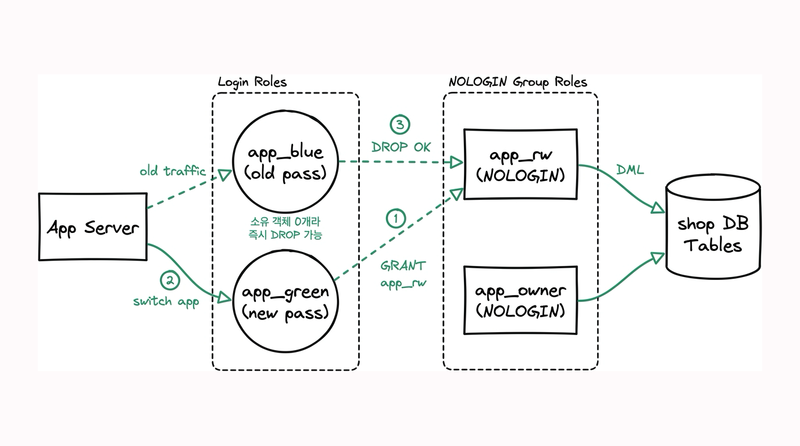
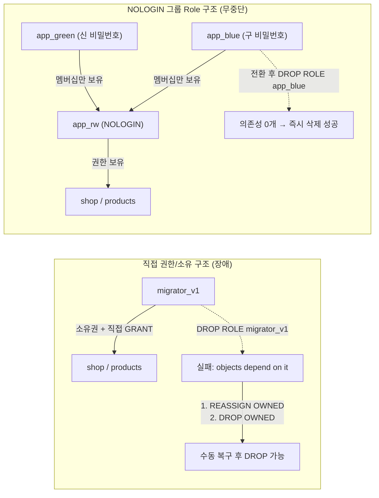

# 4. 비밀번호 로테이션 계정 교체 장애와 Blue/Green Role 패턴

## 이 시나리오의 목표

| 항목 | 내용 |
| --- | --- |
| 기능 | 서비스 무중단 비밀번호 로테이션을 위한 신규 로그인 계정 생성, 트래픽 전환, 기존 계정 안전한 삭제 |
| 쓰는 도구 | `postgres:16` (`docker exec`로 직접 SQL 실행) |
| 입력 | 직접 소유권이 묶인 구 계정(`migrator_v1`), `NOLOGIN` 그룹 Role(`app_owner`, `app_rw`), Blue/Green 로그인 계정(`app_blue`, `app_green`) |
| 작업 | 1. 직접 소유 계정을 `DROP ROLE`할 때 발생하는 의존성 장애 재현 2. `REASSIGN OWNED` → `DROP OWNED` → `DROP ROLE` 안전 복구 절차 검증 3. `NOLOGIN` 그룹 Role 기반 Blue/Green 계정 무중단 교체 및 즉시 삭제 검증 |
| 달성할 것 | PostgreSQL에서 계정 삭제가 막히는 원인을 설명하고, 의존성 0개 상태로 무중단 로테이션이 가능한 RBAC 구조를 설계할 수 있다 |

## 비밀번호 로테이션에 신규 계정을 쓰는 이유와 PostgreSQL의 함정

운영 중인 데이터베이스의 비밀번호를 기존 계정에서 바로 `ALTER ROLE app_user PASSWORD '...'`로 바꾸면, 새 비밀번호가 애플리케이션 서버 전체에 반영되는 짧은 시간 동안 기존 커넥션 풀이 인증 실패(`password authentication failed`)를 일으킵니다. 그래서 AWS Secrets Manager의 Alternating Users 전략이나 HashiCorp Vault 동적 자격 증명(Dynamic Credentials)은 **새 로그인 계정(`green`)을 추가해 앱을 점진적으로 전환한 뒤 옛 계정(`blue`)을 삭제(`DROP ROLE`)**하는 Blue/Green 로테이션 방식을 사용합니다.

MySQL에서는 이 방식이 비교적 수월하지만, PostgreSQL에서는 로그인 계정에 권한이나 객체 소유권이 직접 묶여 있으면 마지막 단계인 **`DROP ROLE`이 의존성 오류로 거부**됩니다.



### 용어

| 용어 | 뜻 | 이 실습의 예 |
| --- | --- | --- |
| Blue/Green 로그인 Role | 비밀번호 로테이션을 위해 번갈아 생성·폐기하는 임시 수명의 `LOGIN` Role | `app_blue` → `app_green` |
| `pg_shdepend` | 클러스터 전역 객체(Role 등)를 참조하는 소유권·권한 의존성 카탈로그 | `DROP ROLE` 시 PostgreSQL이 검사하는 대상 |
| `REASSIGN OWNED` | 특정 Role이 소유한 모든 객체의 소유자를 다른 Role로 이전하는 명령 | `REASSIGN OWNED BY migrator_v1 TO app_owner;` |
| `DROP OWNED` | 특정 Role이 가진 직접 권한을 회수하고, **남아 있는 소유 객체까지 삭제**하는 명령 | 반드시 `REASSIGN OWNED` 뒤에 실행해야 안전 |

## 계정과 권한을 분리해야 하는 이유

PostgreSQL은 Role을 삭제하기 전에 클러스터 전체 데이터베이스의 `pg_shdepend` 카탈로그를 검사합니다. 삭제 대상 Role이 다음 세 가지 중 하나라도 가지고 있으면 `DROP ROLE`은 실패합니다.

1. 테이블, 시퀀스, 뷰, 함수 같은 객체의 소유자(Owner)인 경우
2. 특정 데이터베이스·스키마·테이블에 직접 `GRANT`된 권한을 보유한 경우
3. `ALTER DEFAULT PRIVILEGES` 규칙의 대상(`FOR ROLE` 또는 `TO`)으로 등록된 경우

로그인 계정이 직접 권한과 소유권을 갖지 않고 오직 **`NOLOGIN` 그룹 Role의 멤버십**만 가지도록 설계하면, 위 세 가지 의존성이 모두 0개가 됩니다. 그러면 비밀번호 로테이션 시 신규 계정 생성은 `GRANT app_rw TO app_green;` 한 줄로 끝나고, 전환 후 옛 계정 삭제도 `DROP ROLE app_blue;` 한 줄로 즉시 완료됩니다.

## 대안 비교

| 비밀번호 로테이션 방식 | 무중단 여부 | PostgreSQL 주의점 |
| --- | --- | --- |
| 단일 계정 `ALTER ROLE ... PASSWORD` | 전환 중 인증 오류 발생 위험 | 커넥션 풀 재연결 타이밍에 따라 순단 발생 |
| 직접 소유/권한 계정으로 Blue/Green 교체 | 전환은 가능하나 정리 단계 실패 | `DROP ROLE` 시 의존성 오류, 매번 `REASSIGN OWNED` + `DROP OWNED` 필요 |
| `NOLOGIN` 그룹 Role + Blue/Green 로그인 계정 | 완전 무중단, 자동화 가능 | 소유권·권한·기본 권한은 그룹 Role에만 부여하고 로그인 계정에는 멤버십만 부여 |

## 컴포넌트 역할

| 컴포넌트 | 역할 |
| --- | --- |
| `app_owner` (`NOLOGIN`) | 모든 테이블과 시퀀스의 영구 소유자 Role |
| `app_rw` (`NOLOGIN`) | 애플리케이션 읽기·쓰기 권한을 보유한 그룹 Role |
| `app_blue` / `app_green` (`LOGIN`) | 비밀번호만 교체하고 폐기하는 일회성 로그인 Role |

## 흐름

아래 다이어그램은 로테이션 후 `DROP ROLE`을 실행할 때 직접 소유 계정이 막히는 경로와, `NOLOGIN` 그룹 Role 구조가 즉시 삭제되는 경로를 비교합니다.



## 실습

명령은 `computer_science/postgresql-rbac` 디렉터리에서 실행합니다.

### 1. 직접 소유 계정(`migrator_v1`)의 `DROP ROLE` 장애 재현

DB를 초기화한 뒤, `migrator_v1`에 직접 `CONNECT`·`CREATE` 권한을 주고 `migrator_v1` 계정으로 `products` 테이블을 생성합니다.

```bash
./scripts/reset-postgres-db.sh

docker exec -i rbac-postgres psql -U postgres -d shop <<'SQL'
CREATE ROLE migrator_v1 LOGIN PASSWORD 'old_pass';
GRANT CONNECT ON DATABASE shop TO migrator_v1;
GRANT USAGE, CREATE ON SCHEMA public TO migrator_v1;
SQL

docker exec -i -e PGPASSWORD=old_pass rbac-postgres psql -U migrator_v1 -d shop <<'SQL'
CREATE TABLE products (
  id SERIAL PRIMARY KEY,
  name VARCHAR(100) NOT NULL
);
INSERT INTO products (name) VALUES ('Mechanical Keyboard');
SQL
```

이제 비밀번호 로테이션을 마치고 옛 계정 `migrator_v1`을 삭제합니다.

```bash
docker exec -i rbac-postgres psql -U postgres -d shop -c "DROP ROLE migrator_v1;"
```

PostgreSQL은 의존성 목록을 출력하며 삭제를 거부합니다.

```text
ERROR:  role "migrator_v1" cannot be dropped because some objects depend on it
DETAIL:  privileges for schema public
privileges for database shop
owner of sequence products_id_seq
owner of table products
```

출력의 `DETAIL` 네 줄이 정확히 어떤 의존성 때문에 삭제가 막혔는지 알려 줍니다. 테이블(`products`)과 시퀀스(`products_id_seq`) 소유권뿐만 아니라 `shop` 데이터베이스와 `public` 스키마에 직접 부여된 `GRANT` 권한까지 모두 삭제를 가로막습니다.

### 2. 안전한 복구: `REASSIGN OWNED` 후 `DROP OWNED`

> [!CAUTION]
> **`REASSIGN OWNED` 없이 `DROP OWNED BY migrator_v1;`을 먼저 실행하면 `migrator_v1`이 소유한 `products` 테이블과 데이터가 영구 삭제됩니다.** 반드시 `REASSIGN OWNED`로 소유권을 먼저 넘긴 뒤 `DROP OWNED`로 잔여 권한만 회수해야 합니다.

소유권을 넘겨받을 `app_owner (NOLOGIN)` Role을 만들고 `REASSIGN OWNED` → `DROP OWNED` → `DROP ROLE` 순서로 복구합니다.

```bash
docker exec -i rbac-postgres psql -U postgres -d shop <<'SQL'
CREATE ROLE app_owner NOLOGIN;
REASSIGN OWNED BY migrator_v1 TO app_owner;
DROP OWNED BY migrator_v1;
DROP ROLE migrator_v1;
\dt
SELECT * FROM products;
SQL
```

`products` 데이터 손실 없이 소유자만 `app_owner`로 이전되었고, `migrator_v1`이 깨끗하게 삭제됩니다.

```text
CREATE ROLE
REASSIGN OWNED
DROP OWNED
DROP ROLE
           List of relations
 Schema |   Name   | Type  |   Owner
--------+----------+-------+-----------
 public | products | table | app_owner
(1 row)

 id |        name
----+---------------------
  1 | Mechanical Keyboard
(1 row)
```

이 절차는 객체가 존재하는 **모든 데이터베이스마다** 접속해 반복해야 합니다. 운영 DB가 여러 개면 수동 복구 비용이 커지므로, 처음부터 로그인 계정에 의존성을 남기지 않는 구조가 훨씬 낫습니다.

### 3. 정석: `NOLOGIN` 그룹 Role 기반 Blue/Green 무중단 비밀번호 로테이션

모든 읽기·쓰기 권한을 `app_rw (NOLOGIN)`에 모으고, 기존 운영 계정 `app_blue`와 로테이션용 신규 계정 `app_green`에는 `app_rw` 멤버십만 부여합니다.

```bash
docker exec -i rbac-postgres psql -U postgres -d shop <<'SQL'
CREATE ROLE app_rw NOLOGIN;
GRANT CONNECT ON DATABASE shop TO app_rw;
GRANT USAGE ON SCHEMA public TO app_rw;
GRANT SELECT, INSERT, UPDATE, DELETE ON ALL TABLES IN SCHEMA public TO app_rw;
GRANT USAGE, SELECT ON ALL SEQUENCES IN SCHEMA public TO app_rw;

CREATE ROLE app_blue LOGIN PASSWORD 'blue_pass_v1';
GRANT app_rw TO app_blue;

CREATE ROLE app_green LOGIN PASSWORD 'green_pass_v2';
GRANT app_rw TO app_green;
SQL
```

애플리케이션 설정을 `app_green`으로 교체했다고 가정하고 `app_green`으로 새 상품을 입력해 정상 동작을 확인합니다.

```bash
docker exec -i -e PGPASSWORD=green_pass_v2 rbac-postgres psql -U app_green -d shop \
  -c "INSERT INTO products (name) VALUES ('Ergonomic Mouse') RETURNING *;"
```

별도의 테이블 `GRANT` 없이도 `app_rw`에서 상속받은 권한으로 즉시 `INSERT`에 성공합니다.

```text
 id |      name
----+-----------------
  2 | Ergonomic Mouse
(1 row)

INSERT 0 1
```

이제 트래픽 전환이 끝났으므로 구 계정 `app_blue`를 바로 삭제하고, `app_green`으로 전체 데이터를 조회합니다.

```bash
docker exec -i rbac-postgres psql -U postgres -d shop -c "DROP ROLE app_blue;"
docker exec -i -e PGPASSWORD=green_pass_v2 rbac-postgres psql -U app_green -d shop -c "SELECT * FROM products;"
```

`REASSIGN OWNED`나 `DROP OWNED` 없이 `DROP ROLE app_blue;`가 한 번에 성공합니다.

```text
DROP ROLE
 id |        name
----+---------------------
  1 | Mechanical Keyboard
  2 | Ergonomic Mouse
(2 rows)
```

`app_blue`는 소유 객체도 없고 직접 받은 `GRANT`도 없기 때문입니다. 다음 로테이션 주기에는 다시 `app_blue`를 새 비밀번호로 만들어 `GRANT app_rw TO app_blue;`를 실행하고 `app_green`을 `DROP ROLE`하는 과정을 무중단으로 반복할 수 있습니다.

## 부록. 실무에서 얻는 것

- **활성 세션이 남아 있을 때 `DROP ROLE`**: `app_blue`로 연결된 유휴 커넥션 풀이 남아 있어도 `DROP ROLE`은 실패하지 않지만, 기존 세션은 끊기기 전까지 쿼리를 계속 보낼 수 있습니다. 구 계정을 삭제하기 전에 `ALTER ROLE app_blue NOLOGIN;`으로 신규 로그인을 먼저 차단하고, `pg_stat_activity`에서 활성 세션이 0이 된 것을 확인하거나 `pg_terminate_backend`로 정리한 뒤 `DROP ROLE`을 실행하는 것이 안전합니다.
- **마이그레이션 계정의 로테이션도 같은 패턴을 씁니다**: 시나리오 3의 `migrator_v1`과 `migrator_v2` 역시 `app_owner` 멤버십만 가지고 `-initSql="SET ROLE app_owner;"`로 동작했다면, `migrator_v1`도 소유 객체가 0개이므로 `DROP ROLE migrator_v1;`이 한 번에 성공합니다.
- **AWS Secrets Manager / Vault 연동**: AWS Secrets Manager의 PostgreSQL Multi-User Rotation이나 HashiCorp Vault Database Secrets Engine이 동적 계정을 매시간 발급·회수할 수 있는 이유도 바로 이 `NOLOGIN` 그룹 Role 상속 패턴을 전제로 하기 때문입니다.

## 참고 문서

1. [PostgreSQL 16 Documentation — DROP ROLE](https://www.postgresql.org/docs/16/sql-droprole.html)
2. [PostgreSQL 16 Documentation — REASSIGN OWNED](https://www.postgresql.org/docs/16/sql-reassign-owned.html)
3. [PostgreSQL 16 Documentation — DROP OWNED](https://www.postgresql.org/docs/16/sql-drop-owned.html)
4. [AWS Secrets Manager — Alternating Users Rotation Strategy](https://docs.aws.amazon.com/secretsmanager/latest/userguide/rotating-secrets-two-users.html)
