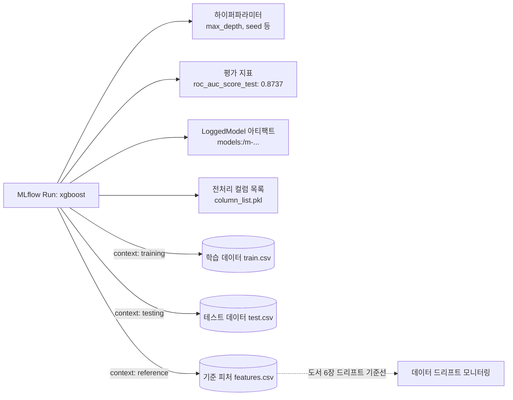
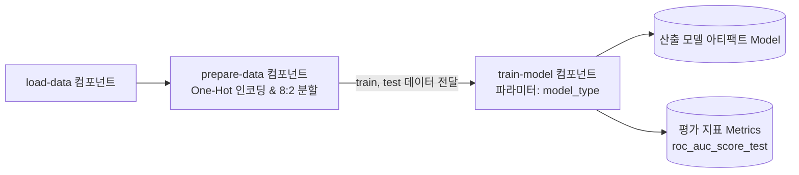

# Lab 1 시나리오 5. 실험 추적(Tracking)과 데이터 계보(Lineage) 관리

## 이 시나리오의 목표

| 항목 | 내용 |
|---|---|
| **입력 특성 (Feature)** | EDA에서 선별한 범주형 8개 컬럼을 One-Hot 인코딩하여 도출한 90개 특성 컬럼 |
| **비교 대상 알고리즘** | Decision Tree (의사결정나무), Random Forest (랜덤 포레스트), XGBoost |
| **핵심 평가 지표** | 테스트 데이터셋 기준 ROC AUC (`roc_auc_score_test`) |
| **주요 작업** | 1. 동일한 훈련/테스트 데이터셋 분할 하에서 3종의 모델 학습<br/>2. 모델별 하이퍼파라미터, 평가 메트릭, 산출 모델, 학습 데이터셋을 단일 Run 단위로 로깅<br/>3. 대시보드에서 모델별 성능 지표를 객관적으로 다차원 비교 |
| **달성 결과** | "이 모델은 정확히 어떤 파라미터와 어떤 데이터셋으로 만들어졌는가?"라는 질문에 투명한 데이터 계보(Lineage)로 입증하고 최적의 후보 모델 선정 |

### 평가 지표 선정 배경: 왜 정확도(Accuracy) 대신 ROC AUC인가?

[시나리오 4](./9-lab1-eda.md)의 EDA에서 확인했듯이, 타깃 레이블은 `<=50K`가 75%, `>50K`가 25%로 구성된 클래스 불균형(Class Imbalance) 데이터셋입니다. 

만약 모든 샘플을 무조건 `<=50K`로만 예측하는 단순한 더미 모델을 만들더라도 산술적인 정확도(Accuracy)는 75%에 달하게 됩니다. 따라서 불균형 데이터셋에서는 양성(`>50K`)과 음성(`<=50K`) 클래스 전반의 분류 임계값 변화에 따른 변별력을 공정하게 측정하는 **ROC AUC(Area Under the ROC Curve)**를 핵심 평가 기준으로 채택합니다.

### 데이터 계보(Lineage)와 실험 재현성

머신러닝 모델의 출력 결과는 소스 코드뿐만 아니라 **학습에 투입된 데이터의 상태**에 의해 완전히 결정됩니다. 특정 Run과 해당 Run이 참조한 원천 데이터셋의 인과 관계를 추적 가능한 형태로 보존하는 것을 **데이터 계보(Data Lineage)**라고 합니다.

도서 4장의 원작 코드는 난수 시드(`random_state`)를 고정하지 않아 실행할 때마다 데이터 분할과 모델 성능 수치가 달라지는 문제가 있었습니다. 본 핸즈온에서는 데이터 분할 및 모든 모델의 시드를 `random_state=42`(XGBoost는 `seed=42`)로 엄격히 통제하여, 차후 언제든지 동일한 데이터로 동일한 모델을 100% 재현(Reproducibility)할 수 있도록 설계했습니다.

---

## 컴포넌트 역할 매핑

| 컴포넌트 | 담당 역할 |
|---|---|
| `mlflow/02-experiments.ipynb` | 동일한 조건에서 3종 모델을 학습하고 MLflow Run에 파라미터/메트릭/데이터셋을 기록 |
| **MLflow Run** | 단일 학습 실행의 메타데이터(파라미터, ROC AUC 지표, 태그, 데이터셋 연결, 컬럼 리스트 아티팩트) 묶음 |
| **MLflow LoggedModel** | 프레임워크별로 직렬화된 실제 모델 파일 아티팩트 (`models:/m-...`) |
| **오브젝트 스토리지 (`mlflow-datasets`)** | 학습용(`train`), 검증용(`test`), 전체 피처(`features`) CSV 파일 영구 보관 |
| **오브젝트 스토리지 (`mlflow-artifacts`)** | 모델 패키지 및 추론 시 One-Hot 컬럼 순서를 보장하는 `column_list.pkl` 보관 |
| `kubeflow/02-experiments.ipynb` | KFP 기반의 `load-data` → `prepare-data` → `train-model` DAG 파이프라인 3회 실행 |
| **KFP Experiment (`income-classifier`)** | 파이프라인 Run들을 묶어 KFP 대시보드 상에서 지표를 비교하는 그룹 단위 |

---

## 데이터 계보 및 메타데이터 연결 구조

하나의 학습 Run이 어떤 메타데이터 및 원천 데이터와 연결되는지를 나타낸 구조입니다. [시나리오 6](./11-lab1-registry-reproducibility.md)에서는 최적 모델로부터 이 그래프를 역추적하여 모델을 재현합니다.



> [!IMPORTANT]
> **전처리 아티팩트 `column_list.pkl`의 중요성**: One-Hot 인코딩 후 생성된 90개 컬럼의 순서 정보가 담겨 있습니다. 추론 시 서빙 엔진에 입력되는 데이터프레임의 컬럼 순서가 학습 시점의 피처 순서와 완벽히 일치해야 모델이 왜곡 없는 올바른 예측을 수행할 수 있습니다.

---

## 실습 1: MLflow 기반 모델 실험 추적 및 지표 비교

### 1. 노트북 실행

JupyterLab에서 `mlflow/02-experiments.ipynb`를 열고 **Run All Cells**를 실행합니다.

학습이 완료되면 마지막 셀에서 3개 모델의 ROC AUC 및 정확도 지표가 내림차순으로 요약 출력됩니다.

```text
  tags.mlflow.runName  metrics.roc_auc_score_test  metrics.test_accuracy
0             xgboost                    0.873681               0.827449
1       random-forest                    0.855955               0.818333
2       decision-tree                    0.819471               0.813526
```

난수 시드가 고정되어 있으므로 재실행하더라도 항상 동일한 지표 결과가 도출됩니다. (단, 재실행 시 새로운 Run ID를 가진 별도의 Run 레코드가 추가 생성됩니다.)

### 2. MLflow 대시보드에서 모델 비교

브라우저(`http://localhost:5000`)의 **income-classifier** 실험 페이지에서 3개의 Run(`xgboost`, `random-forest`, `decision-tree`)을 체크박스로 다중 선택한 후 상단의 **Compare** 버튼을 클릭합니다.

- **차트 및 메트릭 비교**: `roc_auc_score_test` 기준 XGBoost(0.8737) > Random Forest(0.8560) > Decision Tree(0.8195) 순으로 XGBoost의 판별력이 가장 우수함을 시각적으로 확인합니다.
- **파라미터 차이 확인**: 모델별 하이퍼파라미터(`max_depth` 등)의 차이점과 지표 간 상관관계를 종합적으로 비교 분석합니다.

### 3. 데이터셋 계보(Lineage) 확인

가장 높은 점수를 기록한 `xgboost` Run을 클릭하여 상세 페이지로 이동한 후 **Datasets** 섹션을 확인합니다.

- `train`, `test`, `features` 세 가지 데이터셋이 각각 `training`, `testing`, `reference` 컨텍스트로 바인딩되어 있습니다.
- 저장소 경로(`s3://mlflow-datasets/income-classifier/datasets/...`)와 함께 데이터셋의 스키마 및 내용 해시(Digest)가 영구적으로 보존되어 있습니다.

---

## 실습 2: Kubeflow Pipelines 기반 분산 실험 비교

동일한 실험을 KFP의 모듈형 파이프라인으로 전환하여 실행합니다. 데이터 로딩과 전처리는 공통으로 재사용하고, 모델 학습 단계만 파라미터(`model_type`)를 바꾸어 3개의 독립된 파이프라인 Run으로 기동합니다.



### 1. 3종 모델 학습 파이프라인 일괄 제출

JupyterLab에서 `kubeflow/02-experiments.ipynb`를 열고 **Run All Cells**를 실행합니다.

- `income-train` 파이프라인이 KFP 서버에 등록됩니다.
- 루프를 돌며 `decision-tree`, `random-forest`, `xgboost`를 파라미터로 넘겨 3개의 파이프라인 Run을 순차적으로 생성합니다. (약 3분 소요)

실행 결과:
```text
registered income-train version 428aca08-4f7d-46aa-b506-17d0b87e1a33
submitted train-decision-tree 2b52708c-3927-4507-a7d7-cc3d6b50dead
submitted train-random-forest a289f7aa-8da3-4857-b34e-332ef9749c80
submitted train-xgboost 91298509-1b30-488d-816c-1c36a41f2fad
train-decision-tree SUCCEEDED
train-random-forest SUCCEEDED
train-xgboost SUCCEEDED
```

### 2. KFP 대시보드에서 Run 결과 비교

Kubeflow 대시보드(`http://localhost:8080`)의 **Pipelines** → **Experiments** 메뉴에서 `income-classifier`를 열고 3개의 `train-*` Run을 선택한 뒤 **Compare runs**를 클릭합니다.

파이프라인 컴포넌트가 KFP 메트릭으로 기록한 `roc_auc_score_test` 수치가 MLflow 예제의 결과와 정확히 일치하는 것을 확인할 수 있습니다.

| model_type | roc_auc_score_test | test_accuracy |
|---|---|---|
| **xgboost** | **0.873681** | **0.827449** |
| **random-forest** | 0.855955 | 0.818333 |
| **decision-tree** | 0.819471 | 0.813526 |

### 3. 컴포넌트 간 데이터 전달 및 캐싱 확인

`train-xgboost` Run의 실행 그래프에서 `train-model` 노드를 클릭하고 **Input/Output** 탭을 확인합니다.
입력 데이터셋인 `train`, `test`가 선행 컴포넌트인 `prepare-data`의 출력 아티팩트와 연결되어 있음을 확인할 수 있습니다. 특히 두 번째 및 세 번째 Run은 `load-data`와 `prepare-data` 단계를 캐시(Cache)로 재사용하여 불필요한 연산을 건너뛰고 오직 학습 단계만 고속으로 처리합니다.

---

## 부록: 실무 플랫폼 운영 관점의 시사점

- **데이터셋 해시(Digest) 기반 식별**: MLflow는 동일한 이름과 내용 해시를 가진 데이터셋을 중복 업로드하지 않고 단일 참조로 관리합니다. 따라서 스토리지 저장 경로를 단순 Run ID가 아닌 `train-<digest>.csv` 형태로 설계하여 중복 저장을 방지하고 데이터 불변성을 보장합니다.
- **MLflow 3.x의 LoggedModel 아키텍처**: 과거 MLflow는 모델을 일반 Run 아티팩트의 하위 디렉터리로 취급했으나, MLflow 3부터는 독립적인 `LoggedModel` 엔티티(`models:/m-...`)로 분리 관리합니다. 본 실습에서는 향후 모델 레지스트리 승격을 위해 해당 모델 URI를 Run 태그(`model_uri`)에 보존합니다.
- **자동 로깅(Autolog)의 선별적 제어**: `mlflow.xgboost.autolog()` 등 프레임워크별 자동 로깅은 편리하지만 때로는 의도치 않은 대용량 데이터셋이나 불필요한 메트릭을 남깁니다. 플랫폼 엔지니어링 관점에서는 명확한 거버넌스를 위해 `log_datasets=False` 등으로 제어하고 엔지니어가 명시적으로 계보를 관리하는 것이 권장됩니다.
