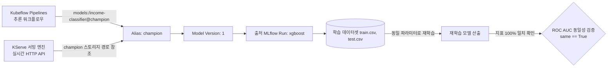
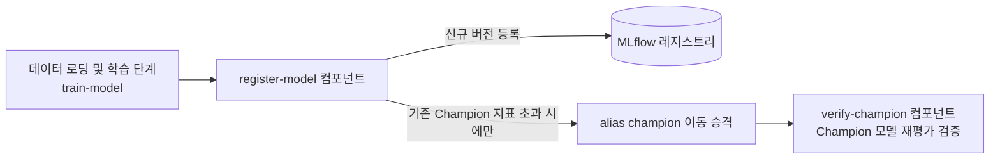

# Lab 1 시나리오 6. Champion 모델 승격과 모델 재현성(Reproducibility) 검증

## 이 시나리오의 목표

| 항목 | 내용 |
|---|---|
| **입력 리소스** | [시나리오 5](./10-lab1-experiment-lineage.md)에서 도출한 3종 모델의 실험 Run 이력 |
| **주요 작업** | 1. 테스트 지표(ROC AUC)가 가장 우수한 XGBoost 모델을 레지스트리에 공식 등록<br/>2. 운영 트래픽을 전담할 배포 별칭인 `@champion` Alias 바인딩<br/>3. `@champion` 메타데이터로부터 출발하여 원천 학습 데이터셋 경로까지 역추적(Lineage Traversal)<br/>4. 기록된 데이터셋과 파라미터만으로 동일 모델을 재학습하여 100% 성능 일치 검증 (`same=True`)<br/>5. 전체 평가 및 승격 과정을 Kubeflow Pipelines로 자동화 |
| **달성 결과** | 외부 서비스가 `models:/income-classifier@champion`이라는 단일 접점으로 모델을 안정적으로 조회하고, 플랫폼에 보존된 계보 기록만으로 모델의 동일성을 완벽히 재현할 수 있음을 입증 |

실험을 통해 아무리 뛰어난 모델을 만들었더라도, "현재 운영 환경에서 사용자에게 서빙할 최종 승인 모델은 무엇인가?"가 시스템적으로 관리되지 않으면 프로덕션 배포는 혼란에 빠집니다.

모델 레지스트리는 바로 이 기준 모델인 **Champion**을 통제하는 거버넌스 센터입니다. 도서 5장의 배치 추론 파이프라인과 6장의 실시간 서빙 엔진은 개발자의 임의 Run ID가 아니라 레지스트리의 `@champion` 주소만을 바라봅니다.

본 시나리오에서는 **MLflow 단독 실습**을 통해 모델 승격과 데이터 계보 기반 재현성 검증을 수행하고, 이어 **Kubeflow 파이프라인 실습**을 통해 "기존 Champion보다 성능이 뛰어날 때만 자동으로 승격"하는 자동화 게이트(Quality Gate)를 구현합니다.

---

## 핵심 이론: Champion 선정과 MLOps 거버넌스

실험실에서 후보 모델을 만드는 것과 운영 환경의 모델을 교체하는 것은 차원이 다른 문제입니다. Champion을 변경하는 것은 곧 사용자가 체감하는 서비스의 예측 동작을 변경하는 운영 배포(Deployment) 작업이기 때문입니다.

### 핵심 용어 정의

| 용어 | 정의 및 플랫폼에서의 의미 | 본 핸즈온 실습 예시 |
|---|---|---|
| **후보 모델 (Candidate)** | 새로 학습되어 레지스트리에 등록되었으나, 아직 운영 검증 전인 신규 버전 | KFP 파이프라인이 등록하는 v2, v3 |
| **Champion** | 현재 프로덕션 환경에서 실제 추론 트래픽을 처리 중인 공인된 버전의 Alias | `income-classifier@champion` |
| **Challenger** | Champion의 성능을 넘어서기 위해 비교 평가(Shadow/Canary) 중인 후보 모델의 Alias | 실무 A/B 테스트에 활용 |
| **품질 평가 기준 (Quality Gate)** | 신규 후보 모델이 Champion으로 승격되기 위해 통과해야 하는 최소 평가 조건 | 동일한 테스트 데이터셋의 ROC AUC가 기존 Champion 이상일 것 |
| **승격 (Promotion)** | 품질 기준을 통과한 신규 버전에 `@champion` Alias를 이동 할당하는 작업 | `set_registered_model_alias` |
| **롤백 (Rollback)** | 신규 모델에 예상치 못한 이상 발생 시 `@champion` Alias를 이전 버전으로 즉시 되돌리는 작업 | 코드 재빌드 없이 Alias 포인터만 즉시 복구 |

### MLOps 플랫폼이 모델 승격 거버넌스를 보장해야 하는 이유

- **투명한 변경 근거 보존**: 엔지니어의 주관적인 감에 의해 모델이 바뀌는 것을 방지합니다. 레지스트리는 모든 버전에 대해 출처 Run ID, 학습 파라미터, 평가 지표를 불변 레코드로 보존합니다.
- **동일한 벤치마크 기준 적용**: 후보 모델과 기존 Champion을 서로 다른 테스트 데이터로 채점하면 지표를 신뢰할 수 없습니다. 본 핸즈온은 고정된 시드(`random_state=42`)를 통해 모든 모델이 동일한 테스트 데이터셋 위에서 공정하게 평가되도록 보장합니다.
- **초고속 무중단 롤백**: 장애 발생 시 모델 파일을 다시 학습하거나 컨테이너를 재빌드할 필요 없이, 레지스트리의 `@champion` Alias 포인터만 직전 버전으로 옮김으로써 수 초 내에 안전하게 롤백할 수 있습니다.
- **배포 프로세스의 코드화**: 사람이 매번 수작업으로 지표를 비교하지 않고, KFP 파이프라인의 `register-model` 컴포넌트처럼 "신규 지표 > 기존 Champion 지표"라는 조건을 코드로 자동 평가합니다.

---

## 아키텍처 및 계보 역추적 흐름

상단은 서빙/파이프라인 클라이언트가 `@champion` Alias를 통해 모델을 로드하는 순방향 경로이며, 하단은 감사(Audit)나 재현성 검증을 위해 Alias로부터 출발하여 원천 데이터셋을 역추적해 재학습하는 역방향 경로입니다.



---

## 실습 1: MLflow 기반 수동 승격 및 재현성 역추적 검증

[시나리오 5](./10-lab1-experiment-lineage.md)에서 생성된 3개 모델 Run이 존재하는 상태에서 진행합니다.

### 1. 최적 모델의 레지스트리 등록 및 Champion 승격

JupyterLab에서 `mlflow/03-registry-lineage.ipynb`를 열고 **Run All Cells**를 실행합니다.
두 번째 셀에서 가장 점수가 높은 XGBoost Run을 탐색하여 `income-classifier` 레지스트리에 Version 1로 등록하고 `@champion` Alias를 부여합니다.

실행 결과:
```text
xgboost aa1496b3a63648318bfb6f123fe8045d 0.8737
registered income-classifier v1 @champion
```

### 2. Alias로부터 원천 데이터셋 계보 역추적

세 번째 셀은 오직 `@champion` Alias 문자열 하나만을 인수로 받아, 해당 버전이 어떤 Run에서 생성되었는지, 학습에 사용된 파라미터와 메트릭이 무엇인지, 원천 데이터셋의 S3 URI가 어디인지 완벽하게 역추적하여 출력합니다.

출력 예시:
```text
model   : income-classifier v1 <- run xgboost aa1496b3a63648318bfb6f123fe8045d
metrics : {'roc_auc_score_train': 0.9002, 'roc_auc_score_test': 0.8737}
params  : {'max_depth': '10', 'seed': '42'}
dataset : training  train    s3://mlflow-datasets/income-classifier/datasets/train-81c28471.csv
dataset : testing   test     s3://mlflow-datasets/income-classifier/datasets/test-845eaa8f.csv
dataset : reference features s3://mlflow-datasets/income-classifier/datasets/features-bef33769.csv
```

### 3. 기록된 데이터셋 기반 모델 재현성(Reproducibility) 검증

마지막 셀은 계보 역추적으로 확인된 S3 경로에서 원본 `train.csv`와 `test.csv`를 직접 다운로드하고, 기록된 동일한 하이퍼파라미터(`max_depth=10`, `seed=42`)로 모델을 처음부터 다시 학습합니다.

```text
logged=0.873681 retrained=0.873681 same=True
```

- 원래 기록된 모델의 점수(`logged`)와 새로 재학습된 모델의 점수(`retrained`)가 소수점 끝자리까지 정확히 일치하여 `same=True`가 반환됩니다.
- 이는 플랫폼의 계보 관리가 정상 작동하며, 모델 개발 과정에 어떠한 암묵적 누락이나 제3의 외부 의존성이 없음을 기술적으로 증명합니다.

### 4. MLflow 레지스트리 웹 UI 확인

브라우저(`http://localhost:5000`)의 **Models** 탭에서 `income-classifier`를 클릭합니다.
Version 1이 등록되어 있고, `champion` 태그가 부착되어 있으며, **Source run** 링크를 클릭하면 출처가 된 `xgboost` Run으로 즉시 이동할 수 있습니다.

---

## 실습 2: Kubeflow Pipelines 기반 자동 승격 및 검증 워크플로우

이번에는 모델 학습부터 평가, 조건부 레지스트리 승격, 그리고 승격된 Champion 모델의 검증까지 전체 흐름을 KFP 파이프라인으로 자동화합니다.



### 1. 자동 승격 파이프라인 등록 및 실행

JupyterLab에서 `kubeflow/03-registry.ipynb`를 열고 **Run All Cells**를 실행합니다.

- `income-register` 파이프라인이 KFP 서버에 등록됩니다.
- 파이프라인 Run이 제출되고 쿠버네티스 상에서 각 컴포넌트 파드가 순차 실행됩니다. (약 2~3분 소요)

실행 결과:
```text
registered income-register version 3b02a1f2-5aab-4d2d-b0b6-cf0c2e794591
submitted register f26f5864-cb82-4fb8-8aa1-05dbaf2a75db
register SUCCEEDED
```

### 2. 조건부 승격 판정 및 검증 결과 확인

KFP 대시보드(`http://localhost:8080`)의 `register` Run 상세 화면에서 컴포넌트 노드들의 로그를 확인합니다.

- **`register-model` 노드 로그**: 신규 파이프라인이 학습한 모델이 Version 2로 등록되었습니다. 하지만 기존 Champion(v1)과 동일한 파라미터의 XGBoost 모델이므로 테스트 지표(0.873681)가 기존 점수를 초과하지 못했습니다. 따라서 Quality Gate 규칙에 의해 `@champion` Alias는 v1에 안전하게 유지됩니다.
- **`verify-champion` 노드 로그**: 현재 `@champion`을 유지 중인 v1 모델 아티팩트를 스토리지에서 다운로드하여 재검증한 결과, 원래 기록된 점수와 완벽히 동일함이 확인되었습니다.

```text
registered v2 score=0.873681 champion=v1 best=0.873681
champion=v1 logged=0.873681 rescored=0.873681
```

MLflow 웹 UI를 새로고침하면 `income-classifier`에 Version 2가 신규 생성되어 있고, 태그에 `kfp_run_id`가 기록되어 있어 해당 버전을 만들어낸 KFP 파이프라인 Run으로 양방향 추적이 가능합니다.

---

## 부록: 실무 플랫폼 운영 관점의 시사점

- **용도 중심의 모델 명명 규칙**: 모델 레지스트리의 이름은 알고리즘 이름(예: `xgboost-model`)이 아니라 비즈니스 도메인 및 용도(예: `income-classifier`)를 기준으로 부여해야 합니다. 이를 통해 내부 알고리즘이 향후 딥러닝이나 LightGBM으로 교체되더라도 외부 API 계약(Contract)을 영구적으로 유지할 수 있습니다.
- **불변 버전과 가변 Alias의 분리 거버넌스**: 파이프라인이 실행될 때마다 산출되는 모든 모델은 불변의 버전 번호(v1, v2, ...)로 빠짐없이 아카이빙하고, 실제 서빙에 영향을 미치는 `@champion` 별칭만 엄격한 자동화 게이트를 통해 선별적으로 부여합니다.
- **장애 분석 및 감사(Audit) 대응**: 운영 중인 모델의 예측 결과에 이상이 발생했을 때, 엔지니어는 `@champion` 별칭에서 시작하여 단 몇 번의 API 호출만으로 "정확히 어떤 데이터셋 버전, 어떤 하이퍼파라미터, 어떤 커밋 코드로 학습되었는가"를 투명하게 규명할 수 있습니다.
