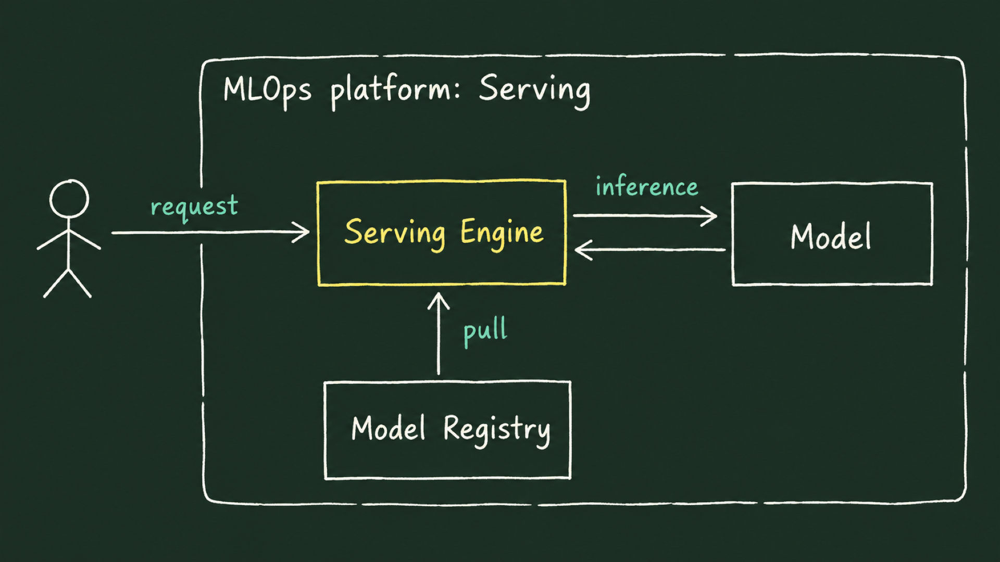
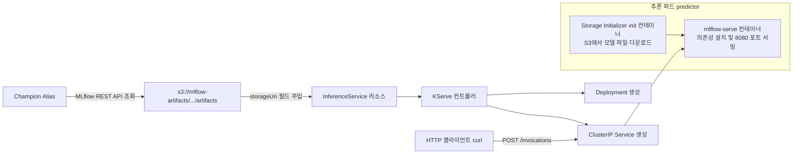

# Lab 1 시나리오 7. 모델 서빙: KServe를 통한 프로덕션 레벨 HTTP API 배포

## 이 시나리오의 목표

| 항목 | 내용 |
|---|---|
| **플랫폼 기능** | 모델 서빙 (Model Serving) |
| **활용 오픈소스** | KServe (Standard / RawDeployment 모드), MLflow ServingRuntime |
| **입력 리소스** | [시나리오 6](./11-lab1-registry-reproducibility.md)에서 `@champion` 별칭이 부여된 `income-classifier` 모델 아티팩트 |
| **주요 작업** | 1. MLflow REST API로 `@champion` 모델이 저장된 실제 S3 스토리지 경로(`storageUri`) 추출<br/>2. KServe `InferenceService` 매니페스트를 적용하여 쿠버네티스 파드로 배포<br/>3. 패키징 시 함께 저장된 샘플 JSON 요청 데이터(`serving_input_example.json`)로 예측 호출 |
| **달성 결과** | 파이썬 노트북 환경에서 로드하여 예측한 값과 정확히 동일한 추론 결과(소수점 16자리)를 반환하는 고가용성 HTTP REST API 구축 |

[시나리오 2](./7-lab1-model-registry.md)에서 모델 레지스트리를 도커 컨테이너 레지스트리에 비유했습니다. 컨테이너 이미지를 빌드하여 레지스트리에 푸시하는 궁극적인 이유가 프로덕션 '배포'이듯, 모델을 실험하고 검증하여 레지스트리에 등록하는 이유 역시 실제 서비스 환경에서의 '추론 서빙'입니다.

본 시나리오에서는 레지스트리에 등록된 최적의 Champion 모델을 쿠버네티스 상에서 안정적인 HTTP 마이크로서비스로 즉시 전환하는 과정을 실습합니다.

---

## 핵심 이론: 모델 서빙(Model Serving)과 서빙 플랫폼의 추상화

학습이 완료된 모델은 디스크에 저장된 정적 파일(아티팩트)에 불과합니다. 데이터 사이언티스트는 주피터 노트북에서 `model.predict()`를 호출하면 그만이지만, 외부 웹 애플리케이션이나 백엔드 서버는 파이썬 객체를 직접 호출할 수 없습니다. 모델 서빙은 이 정적 아티팩트를 네트워크 요청(HTTP/gRPC)을 받아 실시간으로 추론 값을 반환하는 독립된 웹 API 서비스로 승격시키는 작업입니다.



### 서빙 플랫폼(KServe)이 해결하는 실무의 문제점

| 직접 구축 (전통적 방식) | KServe 기반 서빙 플랫폼 |
|---|---|
| 모델마다 Flask/FastAPI 웹 서버 코드를 새로 작성하고 Dockerfile을 빌드 | 모델 저장 경로(`storageUri`)와 형식(`modelFormat`) 선언만으로 자동 서빙 |
| 개발자마다 API 엔드포인트 URL 및 입출력 JSON 스키마 규격이 파편화 | 프로덕션 표준 규격(KServe v2 Data Plane 프로토콜 또는 MLflow 규격)으로 통일 |
| 신규 모델 배포 시마다 도커 이미지를 새로 빌드하고 CI/CD 파이프라인 수행 | `storageUri` 변경만으로 초기화 컨테이너가 새 모델을 다운로드하여 롤링 업데이트 |
| 오토스케일링(HPA), 헬스체크 프로브, GPU 할당 설정을 쿠버네티스 YAML로 매번 수기 작성 | `InferenceService` 매니페스트 필드에서 선언적으로 중앙 제어 |

---

## 컴포넌트 역할 매핑

| 컴포넌트 | 담당 역할 |
|---|---|
| **InferenceService (`income-classifier`)** | "지정된 스토리지 경로의 모델을 지정된 런타임으로 배포하라"는 쿠버네티스 커스텀 리소스 (CR) |
| **Storage Initializer (init 컨테이너)** | 파드 기동 시 지정된 S3 `storageUri`로부터 모델 디렉터리를 다운로드하여 로컬 마운트 볼륨(`/mnt/models`)에 배치 |
| **ServingRuntime (`mlflow-serve`)** | 모델 패키지에 포함된 `requirements.txt` 의존성을 설치하고 `mlflow models serve` 엔진으로 8080 포트에서 HTTP 수신 |
| **Secret / ServiceAccount (`kserve-s3`)** | Storage Initializer가 오브젝트 스토리지(SeaweedFS)에 안전하게 접근하기 위한 자격증명 |

### 아키텍처 및 내부 리소스 변환 흐름

KServe 컨트롤러는 선언된 `InferenceService`를 감지하여 실제 쿠버네티스 파드(Deployment)와 네트워크 엔드포인트(Service)를 자동으로 프로비저닝합니다.



---

## 실무 핵심 교훈: "컨테이너의 Ready 상태가 예측의 정확성을 보장하지 않는다"

본 실습 환경을 구축하는 과정에서 겪었던 매우 중요한 실무 트러블슈팅 사례가 있습니다.

초기에는 KServe에 내장된 사전 빌드 런타임인 `kserve-mlserver`(이미지: `seldonio/mlserver:1.7.1`)를 사용했습니다. 파드는 정상 기동되어 `Ready` 상태가 되었고, HTTP 200 응답과 함께 예측 결과도 에러 없이 반환되었습니다.

하지만 **노트북 환경에서 직접 예측한 값과 서빙 API가 반환한 값을 소수점 단위로 대조했을 때 심각한 오차가 발견**되었습니다.

| 환경 | XGBoost 라이브러리 버전 | 동일한 샘플 3행에 대한 예측 확률 (`>50K`) |
|---|---|---|
| **학습 및 저장 환경 (`mlflow.pyfunc`)** | **3.4.1** | **`[0.3466, 0.2710, 0.2093]` (정상)** |
| `kserve-mlserver` 기본 이미지 | **3.0.2** | `[0.6169, 0.5303, 0.4455]` (오염된 결과) |

- **원인 분석**: 사전 빌드된 서빙 이미지 내부의 XGBoost 버전(3.0.2)이 모델 학습 시점의 버전(3.4.1)보다 낮았습니다. 하위 버전의 C++ 라이브러리가 상위 버전의 모델 가중치 파일(`.ubj`)을 읽으면서 에러는 내지 않았지만, 내부 트리 계산의 바이어스(Logit)가 밀려 전혀 엉뚱한 확률값을 출력했던 것입니다.
- **해결책**: 모델 디렉터리에 함께 동봉된 `requirements.txt`를 실행 시점에 엄격하게 설치하여 구동하는 전용 ServingRuntime(`mlflow-serve`)을 구축하여, 학습 환경과 100% 동일한 실행 환경을 보장하도록 개선했습니다. ([troubleshooting.md](./troubleshooting.md) 22번 참고)

---

## 단계별 실습 절차

로컬 터미널(`mlops/ml-platform-engineering-part2`)에서 실행합니다. MLflow 포트 포워딩(`localhost:5000`)이 유지된 상태여야 하며, `jq` 유틸리티가 필요합니다.

### 1. Champion 모델의 스토리지 URI 조회

MLflow REST API를 호출하여 `@champion` 별칭이 가리키는 실제 S3 아티팩트 저장소 경로를 조회합니다.

```bash
MODEL_ID=$(curl -s "localhost:5000/api/2.0/mlflow/registered-models/alias?name=income-classifier&alias=champion" | jq -r '.model_version.source | sub("models:/";"")')
ARTIFACT_PATH=$(curl -s "localhost:5000/api/2.0/mlflow/logged-models/$MODEL_ID" | jq -r '.model.info.artifact_uri | sub("mlflow-artifacts:/";"")')
echo "s3://mlflow-artifacts/$ARTIFACT_PATH"
```

출력 예시:
```text
s3://mlflow-artifacts/1/models/m-bf03a37fb3b34de292dd57fb330c1a45/artifacts
```

### 2. InferenceService 배포

스토리지 접근 자격증명과 ServingRuntime을 먼저 등록하고, `income-classifier-inferenceservice.yaml`의 `storageUri`를 1번에서 확인한 S3 경로로 치환하여 클러스터에 배포합니다.

```bash
kubectl apply -f manifests/kserve-inference/kserve-s3-secret.yaml \
              -f manifests/kserve-inference/kserve-s3-serviceaccount.yaml \
              -f manifests/kserve-inference/mlflow-serve-servingruntime.yaml

sed "s|storageUri: .*|storageUri: s3://mlflow-artifacts/$ARTIFACT_PATH|" manifests/kserve-inference/income-classifier-inferenceservice.yaml | kubectl apply -f -
```

파드가 기동되고 모델 패키지 의존성을 설치하여 `Ready` 상태가 될 때까지 모니터링합니다. (약 2~3분 소요)

```bash
kubectl -n kubeflow-user-example-com wait isvc/income-classifier --for=condition=Ready --timeout=15m
```

### 3. 프로비저닝된 쿠버네티스 리소스 확인

KServe 컨트롤러가 라벨 기반으로 생성한 리소스들을 조회합니다.

```bash
kubectl -n kubeflow-user-example-com get deploy,pod,svc,hpa -l serving.kserve.io/inferenceservice=income-classifier
```

Deployment, Pod, Service, HPA가 각각 정상 생성되어 동작 중인지 확인합니다.

### 4. 서빙 API 예측 호출 및 정밀도 검증

로컬 테스트를 위해 서빙 Service를 8085 포트로 포트 포워딩합니다.

```bash
kubectl -n kubeflow-user-example-com port-forward svc/income-classifier-predictor 8085:80
```

별도 터미널에서 모델 패키지에 포함되어 있던 요청 예시 파일(`serving_input_example.json`)을 MLflow에서 다운로드하여 KServe 서빙 API의 `/invocations` 엔드포인트로 전송합니다.

```bash
curl -s "localhost:5000/api/2.0/mlflow-artifacts/artifacts/$ARTIFACT_PATH/serving_input_example.json" -o request.json
curl -s -X POST localhost:8085/invocations -H 'Content-Type: application/json' -d @request.json
```

응답 결과:
```text
{"predictions": [0.3465737998485565, 0.2710471451282501, 0.20925606787204742]}
```

반환된 3개 샘플의 고소득(`>50K`) 확률값이 주피터 노트북에서 학습 및 검증할 당시 출력되었던 값과 소수점 끝자리까지 정확하게 일치함을 검증할 수 있습니다.

---

## 부록: 실무 플랫폼 운영 관점의 시사점

- **서빙 파이프라인의 자동화 필요성**: KServe는 MLflow의 `@champion` 별칭 변경을 실시간으로 감지하지 않습니다. 따라서 실무에서는 CI/CD 파이프라인이 Champion 승격을 감지하여 `InferenceService`의 `storageUri`를 새 경로로 자동 패치하는 배포 단계를 둡니다.
- **클라이언트 전처리 부담과 Feature Skew 문제**: 본 서빙 API를 호출하려면 호출자(웹 서비스 등)가 원본 8개 컬럼을 90개의 One-Hot 인코딩 컬럼으로 사전에 변환하여 전달해야 합니다. 만약 호출 클라이언트가 자체적으로 작성한 전처리 로직과 모델 학습 시점의 전처리 로직이 미세하게 어긋나면 심각한 **학습-서빙 왜곡(Training-Serving Skew)**이 발생합니다.
- 다음 시나리오인 **피처 스토어(Feature Store)**가 바로 이 전처리 중복 구현과 데이터 왜곡 문제를 근본적으로 해결하는 방법을 다룹니다.
