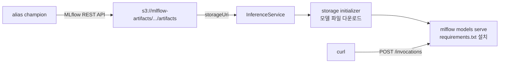
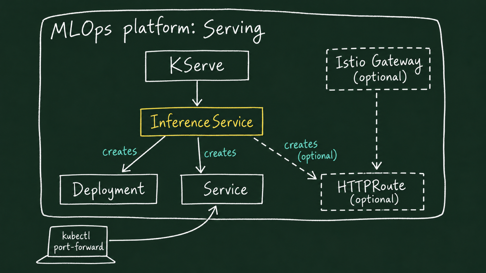

# Lab 1 시나리오 7. 레지스트리의 champion 모델을 KServe로 HTTP API에 올립니다

## 이 시나리오의 목표

| 항목 | 내용 |
|---|---|
| 플랫폼 기능 | 모델 서빙 |
| 오픈소스 | KServe(Standard 모드), MLflow 모델 서버 |
| 입력 | [시나리오 6](./11-lab1-registry-reproducibility.md)에서 `champion`을 붙인 `income-classifier` |
| 작업 | 1. `champion`이 가리키는 모델 파일 경로를 구함 2. InferenceService로 배포 3. 모델과 함께 저장된 요청 예시로 예측 |
| 달성할 것 | 노트북에서 불러온 모델과 같은 예측값을 HTTP API가 돌려줌 |

[시나리오 2](./7-lab1-model-registry.md)에서 모델 레지스트리를 도커 레지스트리에 빗댔습니다. 이미지를 레지스트리에 올리는 이유가 배포이듯, 모델을 등록하는 이유도 서빙입니다. 이 시나리오는 레지스트리에서 모델을 꺼내 Kubernetes Deployment와 Service로 띄웁니다. 책 6장의 서빙에 해당합니다.

## 모델 서빙은 모델을 다른 시스템이 부를 수 있는 API로 바꾸는 일입니다

사용자의 요청은 서빙 엔진이 받고, 서빙 엔진이 모델로 추론한 결과를 돌려줍니다. 서빙 엔진은 모델 레지스트리에서 모델을 받아(pull) 메모리에 올려 둡니다.


학습이 끝난 모델은 파일입니다. 노트북에서는 `load_model(...).predict(...)`로 부르면 되지만, 웹 서비스나 다른 팀의 애플리케이션은 Python 객체를 부를 수 없습니다. 모델 서빙은 이 파일을 HTTP API 뒤에 올려, 요청을 받으면 예측값을 돌려주게 만드는 일입니다.

### 용어

| 용어 | 뜻 | 이 Lab의 예 |
|---|---|---|
| 추론(inference) | 학습한 모델로 새 입력의 예측값을 계산하는 일 | 3명의 `>50K` 확률 계산 |
| 온라인 추론 | 요청이 올 때마다 바로 답하는 방식. 지연 시간이 중요 | KServe API |
| 배치 추론 | 쌓인 데이터를 주기적으로 한꺼번에 예측하는 방식 | 이 Lab은 다루지 않음(책 5장) |
| 엔드포인트(endpoint) | 예측을 요청하는 주소 | `POST /invocations` |
| 모델 서버 | 모델 파일을 읽고 HTTP 요청을 예측 호출로 바꾸는 프로그램 | `mlflow models serve` |
| 서빙 런타임 | 모델 형식마다 어떤 모델 서버 이미지로 띄울지 정한 템플릿 | ServingRuntime `mlflow-serve` |
| predictor | 모델 서버가 도는 파드 | `income-classifier-predictor` |

### MLOps 플랫폼이 서빙을 제공해야 하는 이유

플랫폼이 없으면 모델마다 누군가 Flask 서버를 짜고, Dockerfile을 쓰고, Deployment와 Service를 만들어야 합니다. 데이터 사이언티스트가 하기엔 멀고, 모델마다 모양이 달라져 운영이 어려워집니다.

| 플랫폼 없이 직접 | KServe 같은 서빙 플랫폼 |
|---|---|
| 모델마다 웹 서버 코드와 이미지를 만듦 | "이 경로의 mlflow 모델" 한 줄(`storageUri`, `modelFormat`)로 띄움 |
| 모델마다 API 모양이 다름 | 같은 런타임이면 같은 엔드포인트와 요청 형식 |
| 새 모델로 바꾸려면 이미지를 다시 빌드 | `storageUri`만 바꾸면 새 모델 파일을 받아 다시 뜸 |
| GPU, 오토스케일링, 헬스체크를 직접 구성 | InferenceService 필드로 선언 |

레지스트리와 서빙이 함께 있어야 "실험으로 고른 모델이 사용자에게 닿는다"가 완성됩니다. [시나리오 6](./11-lab1-registry-reproducibility.md)이 `champion`을 정하고, 이 시나리오가 그 `champion`을 API로 올립니다.

## 컴포넌트 역할

| 컴포넌트 | 역할 |
|---|---|
| InferenceService `income-classifier` | "이 경로의 mlflow 모델을 이 런타임으로 띄워라"를 적은 리소스. KServe 컨트롤러가 Deployment, Service를 만듦 |
| storage initializer | predictor 파드의 init 컨테이너. `storageUri`의 모델 파일을 `/mnt/models`로 내려받음 |
| ServingRuntime `mlflow-serve` | 모델의 `requirements.txt`를 설치하고 `mlflow models serve`로 8080 포트에서 서빙 |
| Secret `kserve-s3`, ServiceAccount `kserve-s3` | storage initializer가 쓰는 object storage 계정과 주소 |

## 흐름

KServe는 MLflow를 모릅니다. `models:/income-classifier@champion` 주소를 읽지 못하므로, 사람이(실무에서는 파이프라인이) alias를 object storage 경로로 바꿔 넘깁니다.



## InferenceService 하나가 Deployment, Service, 외부 경로를 만듭니다

KServe에서 사람이 쓰는 리소스는 InferenceService 하나입니다. KServe 컨트롤러가 그 선언을 읽고 실제로 도는 Kubernetes 리소스를 만듭니다. 그림의 실선은 이 Lab에서 만들어지는 리소스이고, 점선(optional)은 설정을 켜면 만들어지는 외부 경로입니다.



적용하면 이 순서로 진행됩니다.

1. KServe 컨트롤러가 InferenceService를 읽고 `modelFormat: mlflow`와 `runtime: mlflow-serve`로 ServingRuntime을 고릅니다.
2. ServingRuntime의 컨테이너 정의와 InferenceService의 `storageUri`를 합쳐 Deployment를 만듭니다. 이 파드는 컨테이너가 두 개입니다.
   - init 컨테이너 `storage-initializer`: ServiceAccount `kserve-s3`에 연결된 Secret의 계정과 주소로 `storageUri`의 모델 파일을 `/mnt/models`에 내려받습니다.
   - `kserve-container`: 패키지를 설치한 뒤 `/mnt/models`를 읽어 8080 포트로 서빙합니다.
3. 같은 이름의 ClusterIP Service와 HPA를 만듭니다.
4. 외부 경로를 만듭니다. `inferenceservice-config`의 `enableGatewayApi`가 `true`면 Gateway API의 HTTPRoute를, 아니면 Ingress를 만듭니다.
5. 파드가 Ready가 되면 InferenceService의 `READY`를 `True`로 바꾸고 주소를 기록합니다.

이 Lab은 맥북에서 port-forward로만 부르므로 `disableIngressCreation: true`로 4번을 껐습니다. 그래서 HTTPRoute는 만들어지지 않고, Deployment, Service, HPA만 생깁니다. 클러스터 안에서는 `status.address.url`(`http://income-classifier-predictor.kubeflow-user-example-com.svc.cluster.local`)로 부릅니다.

### Kubeflow 화면의 게이트웨이로는 모델을 부를 수 없습니다

클러스터에는 Istio Gateway `kubeflow-gateway`가 있지만, 이 게이트웨이는 Kubeflow 화면용입니다. 경로(VirtualService)가 대시보드, Pipelines UI, 노트북, Dex 같은 화면에만 연결돼 있고 `income-classifier`로 가는 경로는 없습니다. 그래서 `http://localhost:8080`(Kubeflow 화면 port-forward)으로는 모델을 부를 수 없고, predictor Service에 직접 port-forward합니다.

| 요청 | 들어가는 곳 | 이 Lab에서 |
|---|---|---|
| Kubeflow 화면 | `istio-ingressgateway` → `kubeflow-gateway` → 화면별 VirtualService | 사용 |
| 모델 예측 | `kubectl port-forward` → predictor Service → 파드 | 사용 |
| 모델 예측(외부 공개) | Istio Gateway → KServe가 만든 HTTPRoute → predictor | 사용 안 함(optional) |

게이트웨이와 경로가 어떻게 연결돼 있는지는 아래 명령으로 봅니다. Istio Gateway는 두 개, Gateway API CRD는 없음, VirtualService는 화면용만 있으면 지금 설정 그대로입니다.

```bash
kubectl get gateways.networking.istio.io -A
kubectl get virtualservices.networking.istio.io -A -o custom-columns=NS:.metadata.namespace,NAME:.metadata.name,GATEWAY:.spec.gateways,PATH:.spec.http[0].match[0].uri.prefix
kubectl get crd | grep gateway.networking.k8s.io || echo "Gateway API CRD 없음"
kubectl -n kubeflow get configmap inferenceservice-config -o jsonpath='{.data.ingress}'
```

## 런타임은 모델이 저장된 환경과 맞아야 합니다

배포판 KServe에는 mlflow 모델을 받는 런타임 `kserve-mlserver`가 이미 있습니다. 처음에는 이 런타임으로 띄웠고, 파드는 Ready가 되고 요청에도 답했습니다. 그런데 같은 요청을 노트북 환경에서 예측한 값과 비교하니 달랐습니다.

| 예측한 곳 | xgboost | 3행 예측값 |
|---|---|---|
| 모델을 저장한 환경(`mlflow.pyfunc.load_model`) | 3.4.1 | 0.3466, 0.2710, 0.2093 |
| `kserve-mlserver`(seldonio/mlserver:1.7.1) | 3.0.2 | 0.6169, 0.5303, 0.4455 |

MLServer 이미지는 xgboost와 mlflow 버전이 고정돼 있습니다. 낮은 버전 xgboost가 새 버전으로 저장한 모델 파일을 오류 없이 읽었지만, 세 행 모두 logit이 같은 크기만큼 밀린 값을 냈습니다. 로그에는 의존성 불일치 경고 한 줄뿐이었습니다. 경위는 [troubleshooting.md](./troubleshooting.md) 22번에 있습니다.

[시나리오 2](./7-lab1-model-registry.md)에서 본 것처럼 MLflow 모델 디렉터리에는 `requirements.txt`와 `python_env.yaml`이 들어 있습니다. 그래서 런타임 `mlflow-serve`는 모델의 Python 버전(3.12)과 같은 이미지에서 그 파일을 설치한 뒤 서빙합니다. 대신 파드가 뜰 때마다 패키지를 설치해 Ready까지 2분쯤 걸립니다. 실무에서는 `mlflow models build-docker`로 모델마다 이미지를 미리 만들어 이 시간을 없애기도 합니다.

## 실습

맥북의 `mlops/ml-platform-engineering-part2` 디렉터리에서 실행합니다. [시나리오 2](./7-lab1-model-registry.md)처럼 MLflow를 `localhost:5000`으로 port-forward한 상태에서 시작합니다. `jq`가 필요합니다.

### 1. champion 모델의 경로를 구합니다

alias가 가리키는 LoggedModel ID를 찾고, 그 모델의 아티팩트 경로를 object storage 경로로 바꿉니다. MLflow 서버는 아티팩트를 `mlflow-artifacts` 버킷에 저장하므로 접두사만 바꾸면 됩니다.

```bash
MODEL_ID=$(curl -s "localhost:5000/api/2.0/mlflow/registered-models/alias?name=income-classifier&alias=champion" | jq -r '.model_version.source | sub("models:/";"")')
ARTIFACT_PATH=$(curl -s "localhost:5000/api/2.0/mlflow/logged-models/$MODEL_ID" | jq -r '.model.info.artifact_uri | sub("mlflow-artifacts:/";"")')
echo "s3://mlflow-artifacts/$ARTIFACT_PATH"
```

LoggedModel ID는 클러스터마다 다릅니다.

```text
s3://mlflow-artifacts/1/models/m-bf03a37fb3b34de292dd57fb330c1a45/artifacts
```

### 2. InferenceService를 배포합니다

런타임, 계정, ServiceAccount를 먼저 만들고, InferenceService의 `storageUri`만 1번의 경로로 바꿔 적용합니다.

```bash
kubectl apply -f manifests/kserve-inference/kserve-s3-secret.yaml -f manifests/kserve-inference/kserve-s3-serviceaccount.yaml -f manifests/kserve-inference/mlflow-serve-servingruntime.yaml
sed "s|storageUri: .*|storageUri: s3://mlflow-artifacts/$ARTIFACT_PATH|" manifests/kserve-inference/income-classifier-inferenceservice.yaml | kubectl apply -f -
```

Ready가 될 때까지 기다립니다. Python 이미지를 받고 패키지를 설치해서 2~4분 걸립니다.

```bash
kubectl -n kubeflow-user-example-com wait isvc/income-classifier --for=condition=Ready --timeout=15m
```

### 3. InferenceService가 만든 리소스를 봅니다

InferenceService가 만든 리소스를 label로 한 번에 조회합니다.

```bash
kubectl -n kubeflow-user-example-com get deploy,pod,svc,hpa -l serving.kserve.io/inferenceservice=income-classifier
```

Deployment, Pod, Service, HPA가 하나씩 보이면 됩니다. 외부 경로는 만들지 않으므로 아래 명령은 `No resources found`를 출력합니다. 이 클러스터에는 Gateway API CRD도 설치하지 않아서 HTTPRoute는 조회 대상조차 없습니다.

```bash
kubectl -n kubeflow-user-example-com get ingress -l serving.kserve.io/inferenceservice=income-classifier
```

predictor 파드의 init 컨테이너와 서빙 컨테이너 이름을 봅니다.

```bash
kubectl -n kubeflow-user-example-com get pod -l serving.kserve.io/inferenceservice=income-classifier -o jsonpath='{range .items[*]}init={.spec.initContainers[*].name} main={.spec.containers[*].name}{"\n"}{end}'
```

```text
init=storage-initializer main=kserve-container
```

### 4. 모델과 함께 저장된 요청 예시로 예측합니다

predictor Service를 맥북의 8085 포트로 엽니다. 8080은 Kubeflow 화면이 쓰고 있을 수 있어 피했습니다.

```bash
kubectl -n kubeflow-user-example-com port-forward svc/income-classifier-predictor 8085:80
```

다른 터미널에서 모델 디렉터리의 `serving_input_example.json`을 MLflow에서 받아 그대로 보냅니다. 학습 데이터 3행을 one-hot 인코딩한 컬럼 90개입니다.

```bash
curl -s "localhost:5000/api/2.0/mlflow-artifacts/artifacts/$ARTIFACT_PATH/serving_input_example.json" -o request.json
curl -s -X POST localhost:8085/invocations -H 'Content-Type: application/json' -d @request.json
```

값은 `>50K`일 확률입니다. 노트북 환경에서 같은 모델로 예측한 값과 같습니다.

```text
{"predictions": [0.3465737998485565, 0.2710471451282501, 0.20925606787204742]}
```

## 부록. 실무에서 얻는 것

- **alias를 옮겨도 서빙은 그대로입니다.** KServe는 MLflow alias를 보지 않습니다. `champion`을 새 버전으로 옮기면 1~2번을 다시 실행해야 새 모델이 뜹니다. 이 연결을 자동화하는 것이 파이프라인의 배포 단계입니다.
- **Ready는 예측이 맞다는 뜻이 아닙니다.** MLServer 런타임은 Ready였고 HTTP 200을 돌려줬지만 값이 틀렸습니다. 배포 후에 기록된 점수나 알려진 입력의 예측값과 비교하는 단계를 둡니다.
- **요청하는 쪽이 컬럼 90개를 만들어야 합니다.** API를 부르는 쪽은 원본 컬럼 8개를 학습 때와 같은 순서와 이름으로 one-hot 인코딩해야 합니다. 학습 코드와 서빙을 부르는 코드가 인코딩을 따로 구현하면 어긋나기 쉽습니다. 다음 시나리오의 피처 스토어가 이 문제를 다룹니다.
- **사용자 namespace의 Istio sidecar를 끕니다.** 이 namespace는 `istio-injection=enabled`입니다. port-forward로만 부르므로 InferenceService에 `sidecar.istio.io/inject: "false"`를 붙였습니다.
