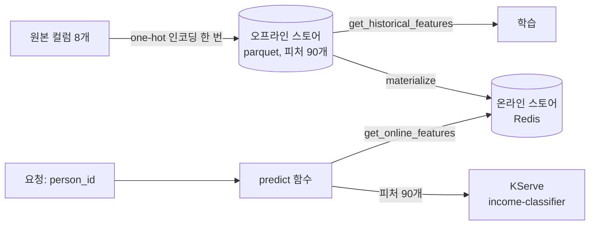

# Lab 1 시나리오 8. 피처 스토어로 학습과 서빙이 같은 피처를 쓰게 합니다

## 이 시나리오의 목표

| 항목 | 내용 |
|---|---|
| 플랫폼 기능 | 피처 스토어 |
| 오픈소스 | Feast 0.67.0, Redis(온라인 스토어), object storage(오프라인 스토어와 레지스트리) |
| 입력 | [시나리오 7](./12-lab1-model-serving.md)의 InferenceService `income-classifier` |
| 작업 | 1. one-hot 인코딩한 피처 90개를 사람(`person_id`)마다 Feast에 등록 2. Redis로 옮김 3. `person_id`만으로 피처를 꺼내 KServe에 예측 요청 4. 학습용으로 꺼낸 값과 서빙용으로 꺼낸 값이 같은지 확인 |
| 달성할 것 | API를 부르는 쪽이 인코딩 코드 없이 `person_id`만으로 예측을 받음 |

## 시나리오 7에서 남은 문제

시나리오 7의 API는 원본 컬럼 8개가 아니라 one-hot 인코딩한 컬럼 90개를 받습니다. API를 부르는 쪽은 학습 코드와 같은 이름, 같은 순서로 인코딩해야 합니다. 학습 코드는 노트북에, 인코딩을 다시 구현한 코드는 서비스에 있으면, 한쪽만 바뀌는 순간 모델은 학습 때와 다른 입력을 받습니다. 이 어긋남을 training-serving skew라고 부르고, 오류 없이 예측값만 틀어진다는 점에서 시나리오 7의 런타임 버전 문제와 닮았습니다.

피처 스토어는 피처를 한 곳에서 정의하고 두 저장소에 같은 값을 둡니다.

| 저장소 | 이 Lab의 구현 | 쓰는 쪽 | 꺼내는 방식 |
|---|---|---|---|
| 오프라인 스토어 | `feature-data-sets` 버킷의 parquet | 학습 | 시점을 지정해 과거 값을 조회(point-in-time join) |
| 온라인 스토어 | Redis | 서빙 | key(`person_id`)로 최신 값을 조회 |

오프라인에서 온라인으로 값을 옮기는 작업을 materialize라고 합니다. 두 저장소의 값은 같은 피처 정의에서 나오므로, 학습과 서빙이 같은 값을 받습니다.

## 컴포넌트 역할

| 컴포넌트 | 역할 |
|---|---|
| `feast/feature_repo/feature_store.yaml` | 레지스트리, 온라인 스토어, 오프라인 스토어 주소 |
| `feast/feature_repo/features.py` | Entity `person`(key `person_id`)과 FeatureView `income_features` 정의 |
| `feature-registry` 버킷의 `income/registry.db` | 어떤 피처가 어디 있는지 적은 레지스트리 파일 |
| `feast/01-feature-store.ipynb` | 피처 테이블을 만들어 등록하고, materialize하고, 서빙과 학습 양쪽에서 꺼냄 |
| Redis(`redis.redis.svc.cluster.local:6379`) | 온라인 스토어. Lab 0에서 설치 |

## 흐름



## 실습

[시나리오 3](./8-lab1-kubeflow-notebook.md)의 노트북에서 실행합니다. 시나리오 7의 InferenceService가 떠 있어야 합니다.

### 1. Feast 전용 커널을 만듭니다

Feast 0.67.0은 pandas를 2.3으로 내립니다. MLflow 노트북의 환경(pandas 3.0)을 건드리지 않으려고 가상환경과 Jupyter 커널을 따로 만듭니다. JupyterLab **Terminal**의 `notebooks` 디렉터리에서 실행합니다.

```bash
python -m venv ~/.venvs/feast
~/.venvs/feast/bin/pip install -r feast/requirements.txt
~/.venvs/feast/bin/python -m ipykernel install --user --name feast --display-name "Python (feast)"
```

### 2. 노트북을 실행합니다

`feast/01-feature-store.ipynb`를 열고 오른쪽 위 커널을 **Python (feast)** 로 바꾼 뒤 **Run All Cells**를 실행합니다. 셀마다 아래를 확인합니다.

- 피처 테이블이 `(30162, 92)`입니다. 피처 90개에 `person_id`, `event_timestamp`를 더한 것입니다.
- `apply`와 `materialize` 뒤 FeatureView `income_features`의 피처가 90개입니다.
- `predict([0, 1, 2])`가 확률 3개를 돌려줍니다. 이 함수에는 인코딩 코드가 없고, Redis에서 꺼낸 피처를 그대로 KServe에 보냅니다.

```text
[0.04711442440748215, 0.6031464338302612, 0.017158422619104385]
```

- 마지막 셀에서 학습용(오프라인)으로 꺼낸 값과 서빙용(온라인)으로 꺼낸 값이 같습니다.

```text
offline == online: True
```

## 부록. 실무에서 얻는 것

- **인코딩한 값을 피처로 저장했습니다.** 원본 컬럼 8개를 저장하고 요청마다 인코딩하는 방법도 있습니다. 그 방법은 인코딩 코드를 서빙 쪽에도 둬야 해서, 이 Lab은 인코딩을 피처를 만들 때 한 번만 하도록 골랐습니다. 대신 범주가 새로 생기면 피처 테이블을 다시 만들고 모델도 다시 학습해야 합니다.
- **schema를 코드에 적지 않았습니다.** `income_features`는 schema 없이 정의해서 Feast가 parquet 컬럼에서 피처 90개를 읽습니다. 컬럼 이름을 두 곳에 적지 않는 대신, parquet이 바뀌면 `apply`를 다시 실행해야 피처 목록이 바뀝니다.
- **Redis는 다시 채울 수 있는 캐시입니다.** Lab 0의 Redis는 PVC가 없어 파드가 재시작하면 비지만, 노트북의 materialize 셀을 다시 실행하면 오프라인 스토어에서 같은 값이 채워집니다. 실무에서는 materialize를 파이프라인이나 스케줄러로 주기 실행합니다.
- **point-in-time join이 학습 데이터의 미래 누수를 막습니다.** `get_historical_features`는 `entity_df`의 시각보다 앞선 피처 값만 붙입니다. 레이블이 생긴 시점 뒤에 계산된 피처가 학습 데이터에 섞이지 않습니다.
- **피처 스토어 S3 주소는 파드 환경 변수에서 읽습니다.** 레지스트리는 `AWS_ENDPOINT_URL`을 읽는 boto3로, 오프라인 스토어는 `FileSource`의 `s3_endpoint_override`로 SeaweedFS에 접속합니다. 오프라인 스토어를 읽으려면 `s3fs`가 따로 필요합니다.
