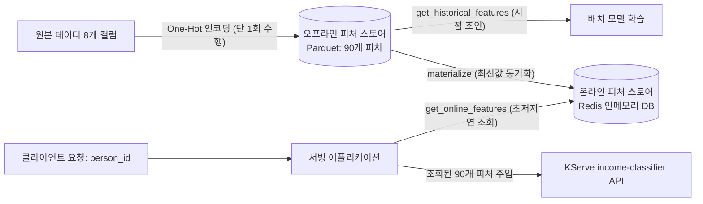

# Lab 1 시나리오 8. 피처 스토어(Feast): 학습-서빙 간 피처 일관성 보장 및 왜곡(Skew) 방지

## 이 시나리오의 목표

| 항목 | 내용 |
|---|---|
| **플랫폼 기능** | 피처 스토어 (Feature Store) |
| **활용 오픈소스** | Feast 0.67.0, Redis (온라인 스토어), SeaweedFS S3 (오프라인 스토어 및 중앙 레지스트리) |
| **입력 리소스** | [시나리오 7](./12-lab1-model-serving.md)에서 배포한 KServe `income-classifier` 추론 엔드포인트 |
| **주요 작업** | 1. One-Hot 인코딩된 90개 피처를 식별자(`person_id`)와 타임스탬프 기준으로 Feast에 등록<br/>2. 오프라인 스토어(Parquet)의 최신 피처를 실시간 온라인 스토어(Redis)로 동기화(`materialize`)<br/>3. API 호출 클라이언트가 90개 컬럼을 몰라도 오직 `person_id`만 전달하여 KServe 추론 수행<br/>4. 학습 시점에 추출된 피처 값과 서빙 시점에 조회된 피처 값이 100% 동일함을 검증 (`offline == online: True`)<br/>5. Feast 웹 UI를 통해 등록된 피처 카탈로그와 데이터 계보 탐색 |
| **달성 결과** | 전처리 로직의 중복 구현을 제거하고, 실무 MLOps의 최대 난제인 **학습-서빙 왜곡(Training-Serving Skew)**을 아키텍처적으로 방지 |

---

## 핵심 이론: 피처 스토어(Feature Store)는 왜 필요한가?

머신러닝 모델의 예측 품질은 학습에 사용된 피처의 품질이 결정합니다. 흔히 "데이터 레이크나 웨어하우스가 있는데 굳이 피처 스토어가 왜 필요한가?"라는 의문을 갖기 쉽습니다. 

데이터 레이크는 가공되지 않은 **원본 데이터(Raw Data)**를 저장하는 곳이고, 피처 스토어는 원본 데이터를 가공하여 모델 입력 규격에 맞춘 **정제된 피처(Feature)**를 관리하는 곳입니다.

| 구분 | 본 핸즈온 실습 예시 | 담당 인프라 |
|---|---|---|
| **원본 데이터 (Raw Data)** | UCI Adult 원본 CSV (`Workclass="State-gov"`, `Education="Bachelors"` 등) | 데이터 레이크, 오브젝트 스토리지 (SeaweedFS) |
| **피처 엔지니어링** | 범주형 컬럼을 수치화하는 One-Hot 인코딩 전처리 파이프라인 | 데이터 파이프라인 (Spark, KFP) |
| **피처 (Feature)** | `Workclass_State-gov=1.0`, `Education_Bachelors=1.0` 등 90개 수치형 벡터 | **피처 스토어 (Feast)** |
| **학습된 모델** | 90개 피처 입력을 받아 연소득 5만 달러 초과 확률을 계산하는 알고리즘 | 모델 레지스트리 (MLflow) |

원본 데이터의 스냅샷 버전 관리는 [시나리오 5](./10-lab1-experiment-lineage.md)의 MLflow 데이터셋 계보가 담당했습니다. 피처 스토어는 그 다음 단계로, **모델이 실제로 입력받는 피처 벡터를 오프라인(학습)과 온라인(서빙) 양쪽에 단일한 진실 공급원(Single Source of Truth)으로 일관되게 제공**하는 역할을 전담합니다.



---

## MLOps 플랫폼이 피처 스토어로 해결하는 4대 실무 난제

### 1. 학습-서빙 왜곡 (Training-Serving Skew) 원천 차단
[시나리오 7](./12-lab1-model-serving.md)의 서빙 API는 원본 8개 컬럼이 아니라 One-Hot 인코딩된 90개 컬럼을 요구합니다. 피처 스토어가 없다면 API를 호출하는 서비스 개발팀이 클라이언트 언어(Java, Go, Node.js 등)로 인코딩 로직을 다시 구현해야 합니다. 

만약 데이터 사이언티스트의 파이썬 코드와 서비스 개발팀의 인코딩 코드가 공백 처리나 범주 순서에서 단 하나라도 어긋나는 순간 모델은 잘못된 입력을 받게 됩니다. 서비스는 에러(HTTP 500) 없이 200 OK를 반환하지만 예측 결과만 조용히 빗나가게 되는데, 이를 **Training-Serving Skew**라고 부릅니다. 피처 스토어는 피처 가공을 중앙에서 1회만 수행하고 양쪽이 동일한 값을 읽어가게 함으로써 이 문제를 근본적으로 방지합니다.

### 2. 시점 기반 조인 (Point-in-Time Join)을 통한 데이터 누수(Leakage) 방지
과거 시점의 대출 연체 여부를 예측하는 모델을 학습할 때, 대출 신청 이후에 발생한 소득 변화나 후속 연체 기록이 학습 데이터셋에 포함되면 모델이 미래 정보를 훔쳐보는 **데이터 누수(Data Leakage)**가 발생합니다. 오프라인 피처 스토어는 모든 피처에 이벤트 발생 시각(`event_timestamp`)을 함께 기록하여, 학습 시점 이전의 유효한 피처 값만을 정확히 조인해 추출합니다.

### 3. 이원화된 워크로드 최적화 (Dual-Storage 아키텍처)
- **오프라인 스토어 (학습)**: 수십만~수억 건의 과거 이력을 처리량(Throughput) 중심으로 대량 조회 (Parquet 파일 기반 S3 스토리지)
- **온라인 스토어 (서빙)**: 단일 사용자 요청에 대해 수 밀리초(ms) 이내의 초저지연(Latency)으로 최신 피처를 단건 조회 (Redis 인메모리 DB)
- **Materialization**: 오프라인 스토어에 적재된 최신 피처 스냅샷을 백그라운드에서 주기적으로 온라인 스토어(Redis)로 동기화합니다.

### 4. 피처 카탈로그 공유 및 재사용
동일한 사용자 피처(예: '최근 7일 구매액')를 추천팀, 이상탐지(FDS)팀, 마케팅팀이 각자 중복 개발하지 않고, 중앙 레지스트리 및 UI에서 검색하여 재사용합니다.

---

## 핵심 용어 정의

| 용어 | 정의 및 플랫폼에서의 의미 | 본 핸즈온 실습 예시 |
|---|---|---|
| **Entity (엔티티)** | 피처가 귀속되는 주체이자 조회의 기준 키 | 사람 (`person`) |
| **Join Key** | 특정 엔티티 인스턴스를 식별하는 고유 ID | `person_id` |
| **Feature View** | 동일한 엔티티에 속한 논리적 피처 컬럼들의 묶음 (테이블 단위) | `income_features` (90개 피처 묶음) |
| **Offline Store** | 학습용 시계열 이력 데이터를 보관하는 대용량 스토리지 | S3 `feature-data-sets/income/features.parquet` |
| **Online Store** | 실시간 서빙 시 ms 단위로 최신값을 읽기 위한 인메모리 스토리지 | Redis (`redis.redis.svc.cluster.local:6379`) |
| **Materialize** | 오프라인 스토어의 최신 피처 상태를 온라인 스토어로 동기화하는 작업 | `materialize_incremental()` |
| **Central Registry** | 엔티티, 피처 뷰, 데이터 소스의 메타데이터 스키마 명세 목록 | S3 `feature-registry/income/registry.db` |

---

## 단계별 실습 절차

[시나리오 3](./8-lab1-kubeflow-notebook.md)의 Kubeflow 노트북 환경에서 진행합니다. ([시나리오 7](./12-lab1-model-serving.md)의 KServe InferenceService가 정상 가동 중이어야 합니다.)

### 1. Feast 전용 독립 가상환경 및 Jupyter 커널 생성

Feast 라이브러리는 하위 버전의 Pandas와 의존성을 가집니다. 기존 MLflow 실습 환경(Pandas 3.x)과의 충돌을 방지하기 위해 전용 가상환경과 Jupyter 커널을 분리 생성합니다.

JupyterLab의 **Terminal**을 열고 `notebooks` 디렉터리에서 실행합니다.

```bash
python -m venv ~/.venvs/feast
~/.venvs/feast/bin/pip install -r feast/requirements.txt
~/.venvs/feast/bin/python -m ipykernel install --user --name feast --display-name "Python (feast)"
```

### 2. Feast 피처 등록 및 온라인 스토어 동기화 실습

JupyterLab 파일 탐색기에서 `feast/01-feature-store.ipynb`를 열고, 우측 상단 커널을 **Python (feast)** 로 선택한 후 **Run All Cells**를 실행합니다.

각 셀의 핵심 검증 사항:
- **피처 테이블 형태**: 30,162행에 대해 90개 피처 + 엔티티 키(`person_id`) + 이벤트 시각(`event_timestamp`)으로 구성된 `(30162, 92)` 테이블 생성
- **스키마 등록 및 동기화**: `store.apply()`로 S3 중앙 레지스트리에 90개 피처가 등록되고, `store.materialize()`를 통해 Redis 온라인 스토어로 최신 피처가 즉시 적재됨
- **인코딩 코드 없는 실시간 추론**: `predict([0, 1, 2])` 함수는 복잡한 One-Hot 인코딩 로직 없이 오직 `person_id`만을 받아 Redis에서 피처 벡터를 조회한 후 KServe 서빙 API로 전달하여 즉시 확률 예측을 반환

```text
[0.04711442440748215, 0.6031464338302612, 0.017158422619104385]
```

- **학습-서빙 피처 일치 검증**: 오프라인 스토어(학습용)에서 추출한 피처 벡터와 온라인 스토어(서빙용)에서 조회한 피처 벡터를 상호 비교한 결과가 완벽히 일치함을 확인

```text
offline == online: True
```

### 3. Feast 웹 UI를 통한 피처 카탈로그 확인

Argo CD가 Lab 0에서 배포한 `feast-ui` 서비스는 노트북과 동일한 S3 중앙 레지스트리 파일(`s3://feature-registry/income/registry.db`)을 공유하므로, 노트북에서 `apply`한 피처가 UI에 즉시 반영됩니다.

로컬 터미널에서 Feast UI 포트 포워딩을 실행합니다.

```bash
kubectl -n feast port-forward svc/feast-ui 8889:80
```

브라우저에서 `http://localhost:8889`에 접속하고 프로젝트 목록에서 **Income**을 선택합니다.
- **Feature Views**: `income_features`를 열어 엔티티(`person`) 및 90개 피처의 스키마와 데이터 소스 연결 확인
- **Features**: 개별 피처의 타입(`DOUBLE`) 및 설명 카탈로그 탐색
- **Lineage**: 데이터 소스(Parquet) → 피처 뷰 → 엔티티로 이어지는 데이터 흐름 시각화 확인

---

## 부록: 실무 플랫폼 운영 관점의 시사점

- **피처 중앙 계산의 장단점**: 본 실습에서는 원본 컬럼 8개를 One-Hot 인코딩한 90개 피처를 오프라인 스토어에 직접 저장했습니다. 이 방식은 서빙 애플리케이션의 실시간 연산 부하와 전처리 코드 중복을 완전히 없애주지만, 새로운 범주(Category)가 등장할 경우 피처 테이블 재생성 및 모델 재학습이 필요합니다.
- **캐시로서의 Redis 온라인 스토어**: 인메모리 Redis는 일종의 고속 서빙 캐시입니다. 만약 Redis 노드가 재시작되어 데이터가 유실되더라도, 백업된 영구 Parquet 오프라인 스토어로부터 `materialize` 명령을 재실행하여 수 초 내에 완벽하게 복구할 수 있습니다.
- **클러스터 내부 S3 엔드포인트 연동**: Feast는 레지스트리 조회 시 `AWS_ENDPOINT_URL` 환경 변수를 활용하고, 오프라인 Parquet 조회 시 `FileSource`의 `s3_endpoint_override` 설정을 통해 클러스터 내부의 S3 호환 스토리지(SeaweedFS)와 안전하게 통신합니다.
