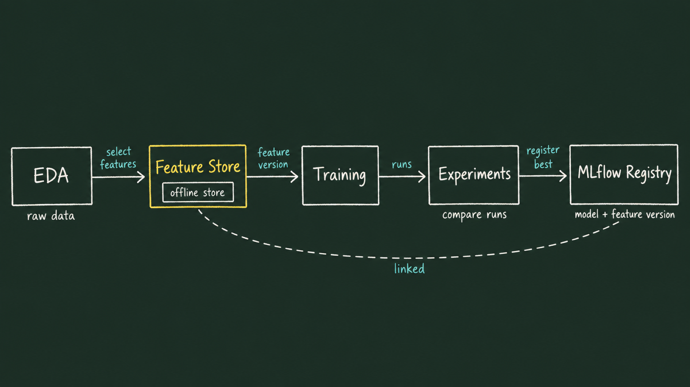
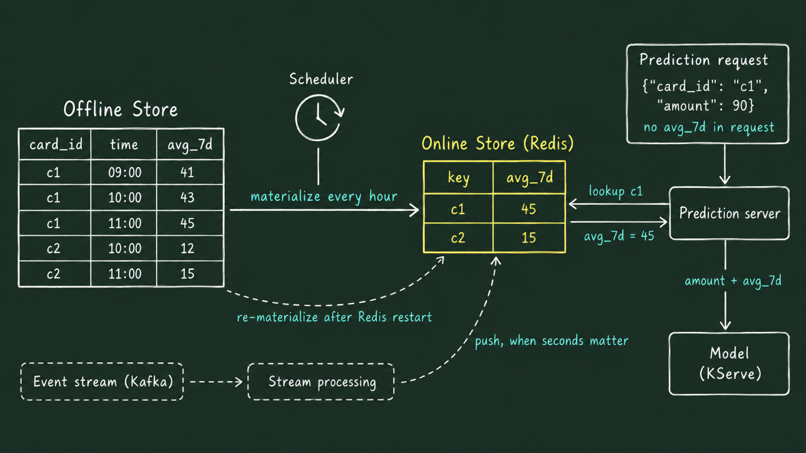
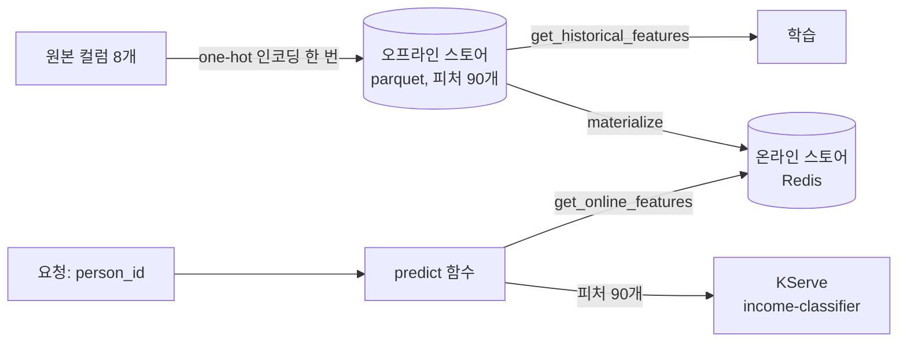

# Lab 1 시나리오 8. 피처 스토어로 학습과 서빙이 같은 피처를 쓰게 합니다

## 이 시나리오의 목표

| 항목 | 내용 |
|---|---|
| 플랫폼 기능 | 피처 스토어 |
| 오픈소스 | Feast 0.67.0, Redis(온라인 스토어), object storage(오프라인 스토어와 레지스트리) |
| 입력 | [시나리오 7](./12-lab1-model-serving.md)의 InferenceService `income-classifier` |
| 작업 | 1. one-hot 인코딩한 피처 90개를 사람(`person_id`)마다 Feast에 등록 2. Redis로 옮김 3. `person_id`만으로 피처를 꺼내 KServe에 예측 요청 4. 학습용으로 꺼낸 값과 서빙용으로 꺼낸 값이 같은지 확인 5. Feast UI에서 등록한 피처를 봄 |
| 달성할 것 | API를 부르는 쪽이 인코딩 코드 없이 `person_id`만으로 예측을 받고, 학습과 서빙이 같은 값을 받는다는 것을 확인 |

## 피처 스토어는 데이터가 아니라 피처를 관리합니다

모델 품질은 학습에 쓴 데이터가 정합니다. 그래서 "학습 데이터를 관리하는 곳이 피처 스토어"라고 이해하기 쉽습니다. 방향은 맞지만 관리하는 대상이 조금 다릅니다. 피처 스토어는 원본 데이터가 아니라, 원본을 모델 입력 모양으로 가공한 **피처**를 관리합니다.

| 단계 | 이 Lab의 예 | 관리하는 곳 |
|---|---|---|
| 원본 데이터(raw data) | UCI Adult CSV. `Workclass` 값이 `State-gov` 같은 문자열 | 데이터 레이크, 웨어하우스, object storage |
| 피처 엔지니어링 | 범주형 컬럼 8개를 one-hot 인코딩 | 피처를 만드는 코드 |
| 피처(feature) | `Workclass_ State-gov = 1.0` 같은 숫자 90개 | **피처 스토어** |
| 모델 | 피처 90개를 받아 `>50K` 확률을 냄 | 모델 레지스트리 |

원본 데이터의 버전 관리(어느 날짜의 CSV로 학습했나)는 [시나리오 5](./10-lab1-experiment-lineage.md)의 MLflow 데이터셋 리니지가 맡았습니다. 피처 스토어는 그다음 단계, "모델이 실제로 받는 입력값"을 학습과 서빙 양쪽에 같은 값으로 제공하는 일을 맡습니다.

플랫폼 안에서 피처 스토어가 놓이는 자리는 아래와 같습니다. EDA로 고른 피처를 피처 스토어에 저장하고, 학습은 피처 스토어에서 특정 버전의 피처를 받아 실험합니다. 가장 좋은 모델을 레지스트리에 등록할 때 어떤 피처 버전으로 학습했는지도 함께 남겨, 모델에서 피처까지 거슬러 갈 수 있게 합니다.



이 Lab의 학습 노트북(시나리오 5)은 아직 이 흐름이 아니라 원본 CSV를 직접 인코딩합니다. 이 시나리오는 피처 스토어의 저장과 조회까지 다루고, 학습을 피처 스토어에 연결하는 일은 실무에서 더할 단계로 남깁니다.

## 용어

| 용어 | 뜻 | 이 Lab의 예 |
|---|---|---|
| 피처(feature) | 모델에 들어가는 입력값 하나 | `Marital-Status_ Married-civ-spouse` |
| 엔티티(entity) | 피처의 주인. 피처를 찾는 기준 | 사람 `person` |
| 엔티티 키(join key) | 엔티티를 구분하는 값 | `person_id` |
| 데이터 소스(data source) | 피처 값이 저장된 원천 | `feature-data-sets` 버킷의 `income/features.parquet` |
| 피처 뷰(feature view) | 같은 엔티티의 피처를 묶은 단위. 테이블 하나에 해당 | `income_features`(피처 90개) |
| 오프라인 스토어(offline store) | 과거 값을 모두 보관하는 저장소. 학습용 | object storage의 parquet |
| 온라인 스토어(online store) | 엔티티마다 최신 값만 두는 빠른 저장소. 서빙용 | Redis |
| materialize | 오프라인 스토어의 최신 값을 온라인 스토어로 옮기는 작업 | `materialize_incremental` |
| 레지스트리(registry) | 어떤 피처가 어디 있는지 적은 목록 | `feature-registry` 버킷의 `income/registry.db` |
| point-in-time join | 학습 데이터를 만들 때 각 행의 시각보다 앞선 피처 값만 붙이는 조회 | `get_historical_features` |
| training-serving skew | 학습 때와 서빙 때 모델이 받는 입력이 달라지는 문제 | 아래 절 |

## MLOps 플랫폼이 피처 스토어를 제공해야 하는 이유

### 1. 학습과 서빙이 같은 피처를 받아야 합니다

[시나리오 7](./12-lab1-model-serving.md)의 API는 원본 컬럼 8개가 아니라 one-hot 인코딩한 컬럼 90개를 받습니다. 피처 스토어가 없으면 API를 부르는 서비스가 인코딩을 다시 구현해야 합니다. 학습 코드는 노트북에, 인코딩을 다시 구현한 코드는 서비스에 있으면, 한쪽만 바뀌는 순간 모델은 학습 때와 다른 입력을 받습니다.

이 어긋남이 training-serving skew입니다. 서비스는 오류 없이 돌아가고 예측값만 틀어집니다. 시나리오 7에서 런타임 버전이 달라 예측이 틀어진 문제와 같은 종류라서, 발견하기 어렵습니다. 피처 스토어는 피처를 한 번만 만들고 학습과 서빙이 같은 값을 꺼내게 해서 이 문제를 구조로 막습니다.

### 2. 학습 데이터에 미래 값이 섞이지 않아야 합니다

"작년 3월에 대출을 신청한 사람이 연체할까"를 학습하려면, 작년 3월 시점의 피처만 써야 합니다. 신청 뒤에 바뀐 소득이나 연체 기록이 섞이면 모델은 학습 때만 잘 맞고 실제로는 틀립니다. 이것을 데이터 누수(leakage)라고 합니다.

오프라인 스토어는 피처 값을 시각과 함께 쌓아 두고, `get_historical_features`가 행마다 그 시각보다 앞선 값만 붙입니다. 사람이 SQL로 매번 시각 조건을 맞추지 않아도 됩니다.

### 3. 서빙은 빠르게, 학습은 많이 읽습니다

학습은 수만 행을 한 번에 읽고, 서빙은 요청 하나에 한 사람의 값을 수 밀리초 안에 읽어야 합니다. 한 저장소로 두 요구를 다 맞추기 어려워서 오프라인 스토어(parquet)와 온라인 스토어(Redis)를 나누고, materialize로 같은 값을 옮깁니다.

| 저장소 | 쓰는 곳 | 담는 값 |
|---|---|---|
| 오프라인 스토어 | 학습 | 키마다 과거 값 전부(시각과 함께, 행 여러 개) |
| 온라인 스토어 | 서빙 | 키마다 지금 값 하나(행 1개) |

온라인 스토어가 쓸모 있는 것은 **예측 요청에 모델이 쓰는 값이 다 들어 있지 않을 때**입니다. 아래는 카드 결제 예입니다. 결제 요청에는 카드 번호와 금액만 있고, 모델이 학습에 쓴 "최근 7일 평균 결제액(`avg_7d`)"은 없습니다. 스케줄러가 오프라인 스토어의 최신 값을 주기적으로 온라인 스토어에 옮겨 두고, 예측 서버가 카드 번호로 그 값을 찾아 요청 값과 함께 모델에 넘깁니다. 초 단위로 최신 값이 필요하면 이벤트 스트림이 온라인 스토어에 바로 넣습니다.



이 Lab의 소득 데이터는 요청하는 쪽이 8개 값을 모두 알 수 있어서, 요청에 값을 담아 보내면 온라인 스토어 없이도 서빙됩니다([시나리오 7](./12-lab1-model-serving.md)). 실습의 `predict(person_id)`는 온라인 스토어가 하는 일을 보이려고 키만 받게 만든 구성입니다.

### 4. 다른 팀과 다른 모델이 피처를 다시 씁니다

`income_features`를 만든 팀이 아니어도, 레지스트리와 UI에서 어떤 피처가 있는지 찾아 자기 모델에 씁니다. 피처를 팀마다 새로 만들면 같은 이름의 피처가 서로 다른 값을 갖게 됩니다.

## 컴포넌트 역할

| 컴포넌트 | 역할 |
|---|---|
| `feast/feature_repo/feature_store.yaml` | 레지스트리, 온라인 스토어, 오프라인 스토어 주소 |
| `feast/feature_repo/features.py` | Entity `person`과 FeatureView `income_features` 정의 |
| `feast/01-feature-store.ipynb` | 피처 테이블을 만들어 등록하고, materialize하고, 서빙과 학습 양쪽에서 꺼냄 |
| Feast UI(`feast` namespace) | 레지스트리에 등록한 엔티티, 피처 뷰, 피처, 데이터 소스, 리니지를 웹 화면으로 보여 줌. Helm chart로 상시 설치 |
| Redis(`redis.redis.svc.cluster.local:6379`) | 온라인 스토어. Lab 0에서 설치 |

## 흐름



## 실습

[시나리오 3](./8-lab1-kubeflow-notebook.md)의 노트북에서 실행합니다. 시나리오 7의 InferenceService가 떠 있어야 합니다.

### 1. Feast 전용 커널을 만듭니다

Feast 0.67.0은 pandas를 2.3으로 내립니다. MLflow 노트북의 환경(pandas 3.0)을 건드리지 않으려고 가상환경과 Jupyter 커널을 따로 만듭니다. JupyterLab **Terminal**의 `notebooks` 디렉터리에서 실행합니다.

```bash
python -m venv ~/.venvs/feast
~/.venvs/feast/bin/pip install -r feast/requirements.txt
~/.venvs/feast/bin/python -m ipykernel install --user --name feast --display-name "Python (feast)"
```

### 2. 노트북을 실행합니다

`feast/01-feature-store.ipynb`를 열고 오른쪽 위 커널을 **Python (feast)** 로 바꾼 뒤 **Run All Cells**를 실행합니다. 셀마다 아래를 확인합니다.

- 피처 테이블이 `(30162, 92)`입니다. 피처 90개에 `person_id`, `event_timestamp`를 더한 것입니다.
- `apply`와 `materialize` 뒤 FeatureView `income_features`의 피처가 90개입니다.
- `predict([0, 1, 2])`가 확률 3개를 돌려줍니다. 이 함수에는 인코딩 코드가 없고, Redis에서 꺼낸 피처를 그대로 KServe에 보냅니다.

```text
[0.04711442440748215, 0.6031464338302612, 0.017158422619104385]
```

- 마지막 셀에서 학습용(오프라인)으로 꺼낸 값과 서빙용(온라인)으로 꺼낸 값이 같습니다.

```text
offline == online: True
```

### 3. Feast UI에서 등록한 피처를 봅니다

Feast UI는 Lab 0에서 플랫폼 구성요소로 설치돼 있습니다. Argo CD Application `feast`가 공식 Helm chart `feast-feature-server`를 UI 모드로 띄우고, 노트북과 같은 레지스트리 파일(`s3://feature-registry/income/registry.db`)을 읽습니다. 그래서 2번에서 `apply`한 피처가 따로 배포하지 않아도 화면에 나타납니다.

맥북 터미널에서 Feast UI Service를 엽니다.

```bash
kubectl -n feast port-forward svc/feast-ui 8889:80
```

`http://localhost:8889`를 열고 프로젝트 **Income**을 고릅니다. 첫 화면에 Feature Views 1, Features 90, Data Sources 1이 보입니다. 왼쪽 메뉴에서 보면 좋은 곳은 세 군데입니다.

- **Feature Views** → `income_features`: 엔티티 `person`과 피처 90개, 데이터 소스 경로
- **Features**: 피처 이름과 타입(`DOUBLE`). 다른 팀은 여기서 쓸 피처를 찾습니다.
- **Lineage**: 데이터 소스 → 피처 뷰 → 엔티티의 연결

## 부록. 실무에서 얻는 것

- **인코딩한 값을 피처로 저장했습니다.** 원본 컬럼 8개를 저장하고 요청마다 인코딩하는 방법도 있습니다. 그 방법은 인코딩 코드를 서빙 쪽에도 둬야 해서, 이 Lab은 인코딩을 피처를 만들 때 한 번만 하도록 골랐습니다. 대신 범주가 새로 생기면 피처 테이블을 다시 만들고 모델도 다시 학습해야 합니다.
- **schema를 코드에 적지 않았습니다.** `income_features`는 schema 없이 정의해서 Feast가 parquet 컬럼에서 피처 90개를 읽습니다. 컬럼 이름을 두 곳에 적지 않는 대신, parquet이 바뀌면 `apply`를 다시 실행해야 피처 목록이 바뀝니다.
- **UI는 레지스트리만 읽습니다.** Feast UI 파드는 `feature_store.yaml`의 레지스트리 경로로 object storage를 읽을 뿐, 피처 값이나 Redis에는 접근하지 않습니다. 노트북이 `apply`하면 UI가 레지스트리를 다시 읽어 새 피처 뷰를 보여 줍니다.
- **Redis는 다시 채울 수 있는 캐시입니다.** Lab 0의 Redis는 PVC가 없어 파드가 재시작하면 비지만, 노트북의 materialize 셀을 다시 실행하면 오프라인 스토어에서 같은 값이 채워집니다. 실무에서는 materialize를 파이프라인이나 스케줄러로 주기 실행합니다.
- **피처 스토어 S3 주소는 파드 환경 변수에서 읽습니다.** 레지스트리는 `AWS_ENDPOINT_URL`을 읽는 boto3로, 오프라인 스토어는 `FileSource`의 `s3_endpoint_override`로 SeaweedFS에 접속합니다. 오프라인 스토어를 읽으려면 `s3fs`가 따로 필요합니다.
