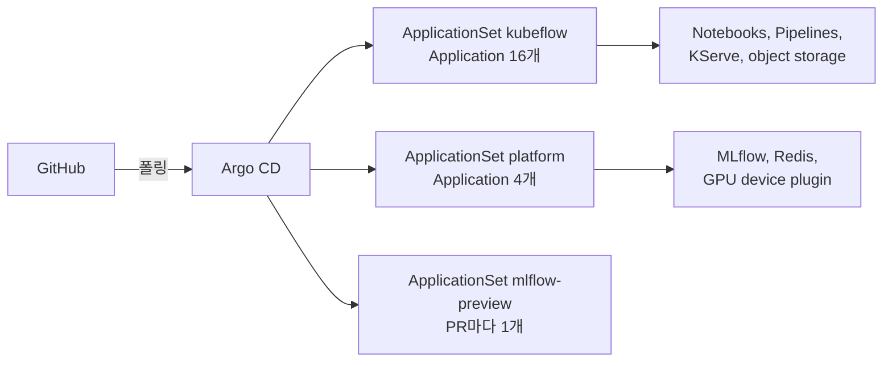

# Lab 0 시나리오 1. 모델 수명주기의 단계마다 맡을 컴포넌트를 한 번에 세웁니다

## 이 시나리오의 목표

ML 플랫폼은 도구 하나가 아닙니다. 모델 하나가 실험에서 서빙까지 가는 동안 단계마다 다른 컴포넌트가 질문 하나씩을 맡습니다. 이 시나리오에서는 그 컴포넌트들을 Argo CD로 한 번에 설치하고, 어떤 컴포넌트가 어떤 질문을 맡는지 확인합니다.

책 4~6장은 모두 이 플랫폼이 떠 있다는 전제로 시작합니다. 끝나면 Argo CD Application 20개가 Synced, Healthy이고 Kubeflow 화면에 로그인할 수 있습니다.

## 컴포넌트 역할

| 컴포넌트 | 맡는 질문 | 쓰는 장 |
|---|---|---|
| Argo CD | 클러스터가 Git과 같은가 | 부록 A |
| Kubeflow Central Dashboard, Dex | 사용자가 한 화면에서 로그인하고 도구를 고를 수 있나 | 전체 |
| Kubeflow Notebooks | 데이터 사이언티스트에게 노트북 환경을 줄 수 있나 | 4장 |
| MLflow, PostgreSQL | 어떤 실험이 가장 좋았고, 그 모델은 어디 있나 | 4장, 5장 |
| object storage(SeaweedFS) | 데이터셋, 피처 파일, 모델 파일을 어디에 두나 | 4~6장 |
| Redis | 추론할 때 피처를 밀리초 안에 줄 수 있나 | 4장 Feast |
| Kubeflow Pipelines | 데이터 읽기부터 결과 저장까지 같은 순서로 반복되나 | 5장 |
| KServe | 모델이 요청에 답하나 | 6장 |
| NVIDIA device plugin | 여러 파드가 GPU 한 장을 나눠 쓸 수 있나 | 4장, 6장 |

Istio, cert-manager, oauth2-proxy는 Kubeflow가 동작하려고 함께 설치하는 기반입니다. 실습에서 직접 다루지는 않습니다.

## 흐름

GitHub에서 클러스터까지 설치가 흐르는 길입니다. ApplicationSet 3개가 Application 20개를 만듭니다.



## 실습

[setup.md](./setup.md)의 up을 끝낸 뒤 맥북에서 실행합니다. 이미지 pull을 포함해 약 20분 걸립니다.

### 1. Application 20개가 Synced, Healthy인지 봅니다

KFP가 설치하는 `applications.app.k8s.io` CRD와 짧은 이름 `app`이 겹쳐서, 전체 리소스 이름으로 조회합니다.

```bash
kubectl -n argocd get applications.argoproj.io
```

모두 끝나면 아래처럼 보입니다. `kf-`로 시작하는 16개가 Kubeflow 구성요소입니다.

```text
NAME                      SYNC STATUS   HEALTH STATUS
kf-cert-manager           Synced        Healthy
kf-dashboard              Synced        Healthy
kf-istio                  Synced        Healthy
kf-kserve                 Synced        Healthy
kf-notebooks              Synced        Healthy
kf-pipelines              Synced        Healthy
...
kubeflow-user-resources   Synced        Healthy
mlflow                    Synced        Healthy
nvidia-device-plugin      Synced        Healthy
redis                     Synced        Healthy
```

10분이 넘어도 `Degraded`나 `Progressing`이 남으면 [troubleshooting.md](./troubleshooting.md)의 11번(Istio보다 먼저 뜬 파드)을 먼저 봅니다.

### 2. object storage 버킷을 확인합니다

KFP를 설치한 뒤 PostSync hook Job이 버킷을 만듭니다. 책 코드가 쓰는 버킷 5개와 KFP 기본 버킷 `mlpipeline`이 보이면 됩니다.

```bash
kubectl -n kubeflow logs job/create-buckets | tail -6
```

```text
2026-10-31 07:26:08 feature-data-sets
2026-10-31 07:26:19 feature-registry
2026-10-31 07:26:29 inference-datasets
2026-10-31 07:25:47 mlflow-artifacts
2026-10-31 07:25:57 mlflow-datasets
2026-10-31 05:56:12 mlpipeline
```

### 3. Kubeflow 화면에 로그인합니다

Istio ingress gateway에 port-forward를 띄우고 `http://localhost:8080`을 엽니다.

```bash
kubectl -n istio-system port-forward svc/istio-ingressgateway 8080:80
```

**Sign In**을 누르면 Dex 로그인 화면이 나옵니다. 배포판 기본 계정 `user@example.com`과 배포판 README에 적힌 기본 비밀번호로 로그인합니다. 왼쪽 메뉴에 **Notebooks**, **Pipelines**, **KServe Endpoints**가 보이면 됩니다.

### 4. MLflow 화면을 엽니다

다른 터미널에서 port-forward를 띄우고 `http://localhost:5000`을 엽니다. `Default` experiment가 보이면 Lab 1을 시작할 수 있습니다.

```bash
kubectl -n mlflow port-forward svc/mlflow-service 5000:5000
```

## 부록. 실무에서 얻는 것

- **플랫폼은 다시 만들 수 있어야 합니다.** 이 Lab은 k3s를 한 번 지우고 다시 설치했고, `scripts/up.sh` 한 번으로 같은 상태로 돌아왔습니다.
- **업스트림 매니페스트를 조합하면 맞물리지 않는 곳이 생깁니다.** Kubeflow 배포판은 namespace마다 같은 namespace 안의 통신만 허용하는 NetworkPolicy를 겁니다. 그래서 `mlflow` namespace의 MLflow가 object storage에 접근하지 못했습니다. k3s의 CNI 경로도 Istio CNI의 기본값과 달랐습니다. 플랫폼 엔지니어의 일은 설치보다 조합한 컴포넌트를 맞물리게 하는 쪽에 가깝습니다.
- **object storage가 컴포넌트를 잇습니다.** MLflow가 저장한 모델 파일을 KServe가 읽고, Feast가 올린 피처 파일을 KFP가 읽습니다. 파드가 모두 Running이어도 endpoint나 계정이 틀리면 5장 파이프라인이 4장 모델을 읽지 못합니다.
