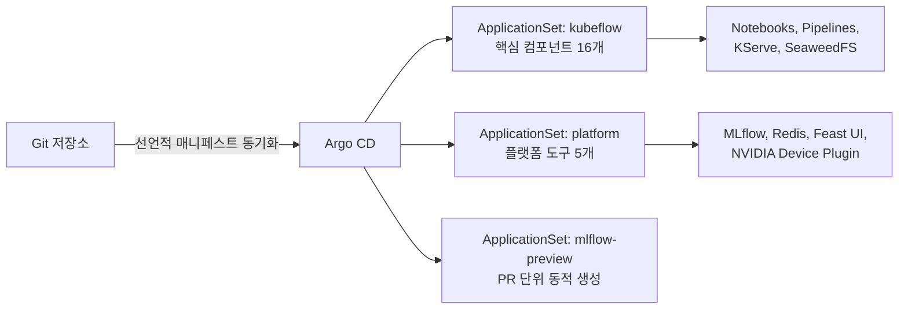

# Lab 0 시나리오 1. ML 수명주기 전 단계를 지원하는 MLOps 플랫폼 일괄 배포

## 이 시나리오의 목표

MLOps 플랫폼은 단일 소프트웨어가 아니라, 머신러닝 모델의 전체 수명주기(데이터 분석, 실험, 학습, 패키징, 서빙, 모니터링)를 뒷받침하는 여러 전문 도구들의 유기적인 결합체입니다. 

본 시나리오에서는 모델 생애주기의 각 단계별 질문과 요구사항을 해결하는 플랫폼 컴포넌트들을 Argo CD를 통해 선언적으로 일괄 배포하고, 각 컴포넌트가 담당하는 역할을 확인합니다.

실습을 완료하면 Argo CD Application 21개가 모두 정상(`Synced`, `Healthy`) 상태로 동기화되고, 중앙 대시보드(Kubeflow Central Dashboard)와 MLflow에 접속할 수 있는 기본 플랫폼 환경이 준비됩니다.

## 플랫폼 컴포넌트 역할 매핑

| 컴포넌트 | 플랫폼 엔지니어링 관점의 핵심 질문 | 연계 실습 |
|---|---|---|
| **Argo CD** | 클러스터 상태가 Git 저장소의 선언적 정의와 일치하는가? | 인프라 전반 |
| **Kubeflow Central Dashboard, Dex** | 사용자가 단일 진입점(SSO)에서 도구들을 통합 접근할 수 있는가? | 전체 UI |
| **Kubeflow Notebooks** | 데이터 사이언티스트에게 격리되고 표준화된 개발 환경을 제공할 수 있는가? | 4장, Lab 1-3 |
| **MLflow, PostgreSQL** | 어떤 실험이 가장 우수했고, 해당 모델 파일은 어디에 버전 관리되는가? | 4장, 5장, Lab 1-2, 5, 6 |
| **SeaweedFS (S3 호환 스토리지)** | 데이터셋, 피처 파케이, 모델 아티팩트 파일을 어디에 영구 보관하는가? | 4~6장 스토리지 |
| **Redis** | 실시간 추론 시 밀리초(ms) 단위의 초저지연 피처 조회가 가능한가? | 4장 Feast, Lab 1-8 |
| **Kubeflow Pipelines (KFP)** | 데이터 전처리부터 모델 평가까지 정해진 DAG 워크플로우로 재현 실행되는가? | 5장, Lab 1-4, 5, 6 |
| **KServe** | 학습된 모델을 프로덕션 규격의 고성능 HTTP 추론 API로 즉시 서빙할 수 있는가? | 6장, Lab 1-7 |
| **NVIDIA Device Plugin** | 단일 GPU 하드웨어를 여러 작업(노트북, 서빙 등)이 나누어 활용할 수 있는가? | Lab 0-2 |

> [!NOTE]
> Istio, cert-manager, oauth2-proxy는 Kubeflow 플랫폼 내부의 서비스 메시 및 보안 통신을 위한 기반 인프라이며, 사용자가 직접 매니페스트를 다룰 필요는 없습니다.

## 배포 아키텍처 흐름

Argo CD가 Git 저장소를 감시하며 3개의 ApplicationSet을 통해 총 21개의 애플리케이션을 자동으로 배포 및 동기화합니다.



## 단계별 실습 절차

[setup.md](./setup.md)의 스크립트 실행이 완료된 후, 로컬 환경에서 아래 절차를 진행합니다. (컨테이너 이미지 다운로드를 포함해 약 15~20분 소요)

### 1. 전체 Application 동기화 및 헬스 상태 확인

Kubeflow Pipelines가 생성하는 `applications.app.k8s.io` CRD와의 이름 충돌을 방지하기 위해 전체 리소스 명칭(`applications.argoproj.io`)으로 조회합니다.

```bash
kubectl -n argocd get applications.argoproj.io
```

모든 애플리케이션이 아래와 같이 `Synced` 및 `Healthy`로 출력되는지 확인합니다. (`kf-` 접두사 16개는 Kubeflow 기반 컴포넌트입니다.)

```text
NAME                      SYNC STATUS   HEALTH STATUS
kf-cert-manager           Synced        Healthy
kf-dashboard              Synced        Healthy
kf-istio                  Synced        Healthy
kf-kserve                 Synced        Healthy
kf-notebooks              Synced        Healthy
feast                     Synced        Healthy
kf-pipelines              Synced        Healthy
...
kubeflow-user-resources   Synced        Healthy
mlflow                    Synced        Healthy
nvidia-device-plugin      Synced        Healthy
redis                     Synced        Healthy
```

> [!TIP]
> 10분 이상 `Degraded` 또는 `Progressing` 상태가 지속될 경우 [troubleshooting.md](./troubleshooting.md)의 11번(Istio 준비 전 파드 기동 타이밍 이슈)을 확인하세요.

### 2. 오브젝트 스토리지 초기 버킷 생성 확인

KFP 배포 완료 후 PostSync 훅으로 실행된 Job이 필수 버킷들을 자동 생성합니다. 실습에 필요한 5개 버킷과 KFP 기본 버킷(`mlpipeline`)이 정상 생성되었는지 로그로 확인합니다.

```bash
kubectl -n kubeflow logs job/create-buckets | tail -6
```

출력 예시:
```text
2026-10-31 07:26:08 feature-data-sets
2026-10-31 07:26:19 feature-registry
2026-10-31 07:26:29 inference-datasets
2026-10-31 07:25:47 mlflow-artifacts
2026-10-31 07:25:57 mlflow-datasets
2026-10-31 05:56:12 mlpipeline
```

### 3. Kubeflow 대시보드 접속 및 로그인

Istio Ingress Gateway로 포트 포워딩을 열고 웹 브라우저에서 `http://localhost:8080`에 접속합니다.

```bash
kubectl -n istio-system port-forward svc/istio-ingressgateway 8080:80
```

- 브라우저에서 **Sign In**을 클릭하여 Dex 인증 화면으로 이동합니다.
- 기본 계정(`user@example.com` / 기본 패스워드)으로 로그인합니다.
- 좌측 네비게이션 메뉴에 **Notebooks**, **Pipelines**, **KServe Endpoints** 항목이 노출되는지 확인합니다.

### 4. MLflow 대시보드 접속

별도 터미널 세션에서 MLflow 서비스 포트 포워딩을 실행하고 `http://localhost:5000`에 접속합니다.

```bash
kubectl -n mlflow port-forward svc/mlflow-service 5000:5000
```

MLflow 웹 UI에 기본 실험(`Default`)이 표시되면 플랫폼 인프라가 정상 가동 중이며, Lab 1 실습을 진행할 수 있습니다.
