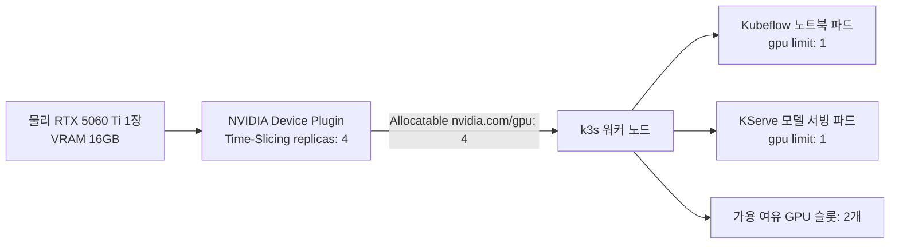

# Lab 0 시나리오 2. GPU 타임슬라이싱(Time-Slicing)을 통한 단일 GPU 자원 공유

## 이 시나리오의 목표

쿠버네티스는 기본적으로 물리 GPU 장치를 단일 파드에 독점 할당합니다. 하지만 온프레미스 실습 서버에 단일 GPU(예: RTX 5060 Ti 16GB)만 탑재된 환경에서는, 노트북 파드가 GPU를 점유하는 순간 이후 파이프라인이나 서빙 파드가 GPU 자원을 확보하지 못하고 무한정 `Pending` 상태에 빠지게 됩니다.

본 시나리오에서는 단일 물리 GPU를 쿠버네티스 상에서 논리적으로 4개의 GPU 자원처럼 인식시키는 **GPU 타임슬라이싱(Time-Slicing)** 기법을 적용합니다. 이를 통해 노드가 `nvidia.com/gpu: 4` 용량을 제공하게 만들고, 노트북·파이프라인·서빙 파드가 동시에 GPU를 공유할 수 있도록 합니다.

## 쿠버네티스 GPU 공유 기술 비교

| 방식 | 동작 원리 및 특징 | 본 핸즈온 적용 여부 |
|---|---|---|
| **MIG (Multi-Instance GPU)** | 하드웨어 수준에서 연산 코어와 VRAM을 물리적으로 격리 분할 | 엔터프라이즈 GPU(A100/H100 등) 전용으로, 소비자용(RTX) 미지원 |
| **DRA (Dynamic Resource Allocation)** | ResourceClaim을 통해 세밀한 GPU 자원 슬라이스를 선언 | Kubeflow 및 KServe가 표준 `nvidia.com/gpu` limit 방식을 요구하여 호환성 한계 |
| **Time-Slicing (타임슬라이싱)** | 소프트웨어 인터리빙으로 시간축에 따라 GPU를 여러 파드가 교대로 실행 | **최종 채택** (단일 GPU 노드에서 완벽한 호환성 제공) |

> [!WARNING]
> 타임슬라이싱은 연산 시간을 분할할 뿐, GPU VRAM(메모리)을 물리적으로 격리하지 않습니다. 노드의 16GB VRAM을 모든 파드가 공유하므로, 한 파드가 메모리를 과도하게 점유하면 다른 파드에서 Out-of-Memory(OOM)가 발생할 수 있습니다. 따라서 배포 모델의 메모리 사용량을 고려해 배치 사이즈를 조절해야 합니다.

## 컴포넌트 구성 요소

| 컴포넌트 | 담당 역할 |
|---|---|
| **k3s `--default-runtime=nvidia`** | 클러스터의 모든 파드가 기본으로 NVIDIA Container Runtime을 사용하도록 지정 |
| **NVIDIA Device Plugin** | 노드의 GPU를 감지하여 쿠버네티스 Kubelet에 `nvidia.com/gpu` 자원으로 등록 |
| **Time-Slicing 설정 (`replicas: 4`)** | 1장의 물리 GPU를 4개의 가상 GPU 리소스로 확장 등록 |
| **파드 리소스 스펙 (`nvidia.com/gpu: 1`)** | 파드가 분할된 4개의 가상 슬롯 중 1개를 정상 요청하도록 처리 |

## GPU 리소스 할당 아키텍처



## 단계별 실습 절차

[2-lab0-platform-install.md](./2-lab0-platform-install.md)에서 `nvidia-device-plugin` 애플리케이션이 정상 배포된 상태에서 진행합니다.

### 1. 노드의 할당 가능 GPU 수량 확인

노드가 Kubelet에 등록한 가상 GPU 수량을 쿼리합니다.

```bash
kubectl get node -o jsonpath='{.items[0].status.allocatable.nvidia\.com/gpu}'; echo
```

- 타임슬라이싱이 적용된 경우: `4` 출력
- 기본 설정(미적용)인 경우: `1` 출력

### 2. GPU 파드 내부의 실제 장치 및 메모리 인식 확인

> [!NOTE]
> 본 단계는 [시나리오 3 (Kubeflow Notebooks)](./8-lab1-kubeflow-notebook.md)에서 GPU 1개를 요청해 `income-notebook` 파드를 생성한 이후에 확인합니다. (Lab 0 진행 시점에는 건너뛰고 3번 노드 자원 확인으로 진행해도 무방합니다.)

```bash
kubectl -n kubeflow-user-example-com exec income-notebook-0 -c income-notebook -- nvidia-smi --query-gpu=name,memory.total --format=csv
```

출력 예시:
```text
name, memory.total [MiB]
NVIDIA GeForce RTX 5060 Ti, 16311 MiB
```

파드는 논리적으로 4개 중 1개의 가상 GPU 슬롯을 할당받았지만, 물리 메모리는 16GB 전체를 공유하며 바라보고 있음을 확인할 수 있습니다.

### 3. 노드 잔여 GPU 자원 현황 모니터링

노드 전체의 GPU 총량(Capacity/Allocatable)과 파드들에 할당된 수량을 비교합니다.

```bash
kubectl describe node | grep -E "^\s+nvidia.com/gpu"
```

출력 예시:
```text
  nvidia.com/gpu:     4
  nvidia.com/gpu:     4
  nvidia.com/gpu     1              1
```

노트북 파드가 1개를 점유하더라도 나머지 3개의 GPU 슬롯이 유지되므로, 향후 KServe 서빙 및 파이프라인 파드가 대기 없이 즉시 배치될 수 있습니다.

## 부록: 타임슬라이싱 매니페스트 설정

NVIDIA Device Plugin은 공식 Helm 차트 0.20.1 버전을 사용하며, 설정값은 `manifests/nvidia-device-plugin/nvidia-device-plugin-values.yaml`에 정의되어 있습니다.

```yaml
config:
  map:
    default: |-
      version: v1
      sharing:
        timeSlicing:
          resources:
          - name: nvidia.com/gpu
            replicas: 4
  default: default
gfd:
  enabled: false
nfd:
  enabled: false
```
