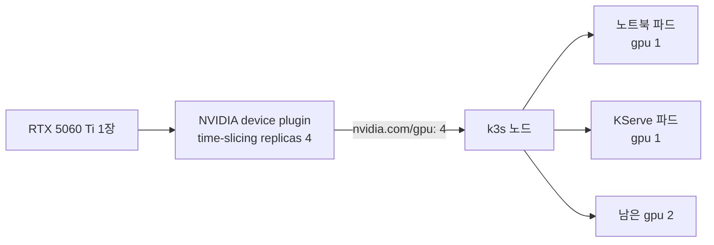

# Lab 0 시나리오 2. GPU 한 장을 노트북과 서빙이 나눠 씁니다

## 이 시나리오의 목표

Kubernetes는 기본으로 GPU를 파드 하나에 통째로 줍니다. 이 실습 호스트에는 GPU(RTX 5060 Ti 16GB)가 한 장뿐이라, 노트북 하나가 GPU를 잡으면 6장 KServe 서빙과 5장 파이프라인은 GPU를 받지 못하고 `Pending`에 머뭅니다.

이 시나리오에서는 GPU 한 장을 Kubernetes에 4개처럼 알리는 time-slicing을 켭니다. 끝나면 노드가 `nvidia.com/gpu: 4`를 알리고, 노트북이 GPU 하나를 써도 나머지 3개가 남습니다.

## GPU를 나누는 방법 세 가지

| 방법 | 동작 | 이 Lab에서 |
|---|---|---|
| MIG | GPU를 하드웨어로 나눔. 메모리도 격리 | RTX 5060 Ti가 지원하지 않음 |
| DRA | ResourceClaim으로 GPU를 요청 | Kubeflow Notebook 화면과 KServe가 `nvidia.com/gpu` limit으로 요청해서 맞지 않음 |
| time-slicing | GPU 하나를 시간으로 나눠 여러 파드가 번갈아 씀 | 사용 |

time-slicing은 메모리를 나누지 않습니다. 16GB를 모든 파드가 같이 쓰므로, 한 파드가 메모리를 다 쓰면 다른 파드가 실패할 수 있습니다. 6장에서 서빙할 모델 크기는 이 16GB 안에서 고릅니다.

## 컴포넌트 역할

| 컴포넌트 | 역할 |
|---|---|
| k3s `--default-runtime=nvidia` | 모든 파드를 NVIDIA container runtime으로 띄움. Kubeflow Notebook과 KServe 파드는 `runtimeClassName`을 지정하지 않기 때문 |
| NVIDIA device plugin | 노드의 GPU를 `nvidia.com/gpu` 자원으로 kubelet에 알림 |
| time-slicing 설정 `replicas: 4` | GPU 한 장을 4개로 알림 |
| 파드의 `nvidia.com/gpu: 1` limit | 4개 중 하나를 요청 |

## 흐름



## 실습

[2-lab0-platform-install.md](./2-lab0-platform-install.md)에서 `nvidia-device-plugin` Application이 Healthy인 상태에서 시작합니다.

### 1. 노드가 GPU 4개를 알리는지 봅니다

```bash
kubectl get node -o jsonpath='{.items[0].status.allocatable.nvidia\.com/gpu}'; echo
```

`4`가 나오면 time-slicing이 켜진 것입니다. time-slicing을 끄면 `1`입니다.

### 2. GPU를 쓰는 파드에서 GPU가 보이는지 봅니다

[6-lab1-kubeflow-notebook.md](./6-lab1-kubeflow-notebook.md)에서 GPU 1개를 요청한 노트북을 만든 뒤 실행합니다.

```bash
kubectl -n kubeflow-user-example-com exec income-notebook-0 -c income-notebook -- nvidia-smi --query-gpu=name,memory.total --format=csv
```

```text
name, memory.total [MiB]
NVIDIA GeForce RTX 5060 Ti, 16311 MiB
```

파드는 GPU 4개 중 하나를 받았지만 보이는 메모리는 16GB 전체입니다. time-slicing이 메모리를 나누지 않는다는 뜻입니다.

### 3. 남은 GPU를 봅니다

노드의 GPU 용량과 이미 할당된 수를 봅니다. 앞의 두 줄은 Capacity와 Allocatable이고, 마지막 줄이 할당된 수입니다.

```bash
kubectl describe node | grep -E "^\s+nvidia.com/gpu"
```

노트북 하나가 떠 있을 때의 결과입니다. 4개 중 1개가 할당됐고, 나머지 3개를 서빙과 파이프라인이 씁니다.

```text
  nvidia.com/gpu:     4
  nvidia.com/gpu:     4
  nvidia.com/gpu     1              1
```

## 부록. 설정 파일

device plugin은 Helm chart 0.20.1을 kustomize `helmCharts`로 불러 씁니다. time-slicing 설정은 `manifests/nvidia-device-plugin/nvidia-device-plugin-values.yaml`에 있습니다.

```yaml
config:
  map:
    default: |-
      version: v1
      sharing:
        timeSlicing:
          resources:
          - name: nvidia.com/gpu
            replicas: 4
  default: default
gfd:
  enabled: false
nfd:
  enabled: false
affinity: null
```

chart의 기본 affinity는 Node Feature Discovery(NFD)가 붙이는 label이 있는 노드에만 파드를 띄웁니다. NFD를 설치하지 않으므로 `affinity: null`로 지웁니다. 그대로 두면 device plugin 파드가 어느 노드에도 뜨지 않습니다.

`replicas`를 4로 둔 이유는 동시에 GPU를 쓸 파드 수입니다. 노트북 1~2개, KServe 1개, 파이프라인 1개를 넉넉히 받습니다. 숫자를 키워도 GPU 성능이 늘지는 않고, 나눠 쓰는 파드 수만 늘어납니다.
