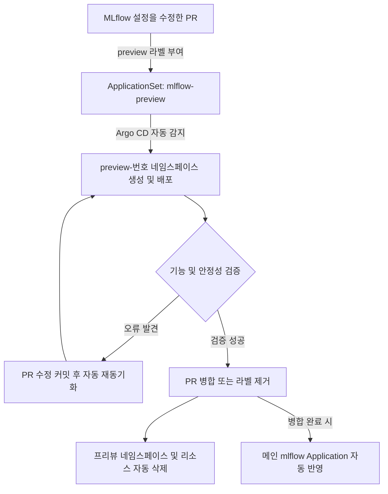

# Lab 0 시나리오 3. 플랫폼 안정성을 위한 PR 단위 프리뷰(Preview) 환경 격리

## 이 시나리오의 목표

공유 ML 플랫폼에서 MLflow는 모든 데이터 사이언티스트의 실험 이력과 모델 레지스트리가 집중되는 핵심 허브입니다. 5장의 파이프라인과 6장의 추론 서빙 역시 MLflow로부터 모델을 동적으로 조회하므로, MLflow의 설정 오류나 장애는 전체 머신러닝 워크플로우의 중단으로 이어집니다.

본 시나리오에서는 플랫폼 구성 변경 사항이 메인(Production) 환경에 병합(Merge)되기 전에, Pull Request(PR) 단위로 완전히 격리된 임시 검증 환경을 동적으로 띄워 사전에 안전성을 검증하는 **PR 프리뷰(Preview) 환경** 구축 패턴을 실습합니다.

PR에 `preview` 라벨을 부여하면 Argo CD가 이를 감지하여 `preview-<PR 번호>` 네임스페이스에 독립된 MLflow 인스턴스를 자동으로 배포하며, 검증 완료 후 라벨을 제거하거나 PR이 닫히면 관련 네임스페이스와 자원을 자동으로 깔끔하게 회수합니다.

## 컴포넌트 역할 매핑

| 컴포넌트 | 담당 역할 |
|---|---|
| **GitHub PR & `preview` 라벨** | 프리뷰 환경을 생성/회수할 대상을 제어하는 사용자 트리거 |
| **Argo CD ApplicationSet (`mlflow-preview`)** | GitHub API(Pull Request Generator)를 주기적으로 폴링하여 `preview` 라벨이 지정된 열린 PR 감지 |
| **Argo CD Application (`mlflow-preview-<번호>`)** | 해당 PR의 최신 커밋 매니페스트(`manifests/mlflow`)를 `preview-<번호>` 네임스페이스에 동적 배포 |
| **프리뷰 MLflow & PostgreSQL** | 변경된 리소스/설정 스펙으로 구동되는 독립된 임시 테스트 인스턴스 |
| **오브젝트 스토리지 (SeaweedFS)** | `mlflow-artifacts` 버킷을 공유하여 스토리지 읽기/쓰기 권한 검증 |

## 프리뷰 환경 수명주기 아키텍처



## 단계별 실습 절차

[2-lab0-platform-install.md](./2-lab0-platform-install.md)에서 메인 `mlflow` 애플리케이션이 `Healthy` 상태인 것을 확인한 후 진행합니다. (Argo CD Generator 폴링 주기에 따라 생성 및 삭제에 약 2~3분이 소요됩니다.)

### 1. 설정 변경 브랜치 PR 생성 및 프리뷰 라벨 부여

`manifests/mlflow/mlflow-values.yaml`의 메모리/CPU 자원 스펙(`resources`)을 조정한 브랜치를 원격에 푸시하고, PR을 생성한 후 `preview` 라벨을 부여합니다.

```bash
gh pr edit <PR 번호> --add-label preview
```

### 2. 동적 프리뷰 Application 배포 상태 확인

Argo CD가 생성한 프리뷰 애플리케이션과 전용 네임스페이스 내 파드들의 기동 상태를 모니터링합니다.

```bash
kubectl -n argocd get applications.argoproj.io mlflow-preview-<PR 번호>
kubectl -n preview-<PR 번호> get pods
```

> [!NOTE]
> MLflow 컨테이너 초기 기동 시 데이터베이스(PostgreSQL) 파드가 준비되는 동안 로그에 일시적으로 `Connection refused`가 나타날 수 있으나, 내장된 재시도(Retry) 로직을 통해 자동으로 정상 연결됩니다.

### 3. 프리뷰 MLflow의 오브젝트 스토리지 입출력 검증

프리뷰 인스턴스 파드 내부에서 S3 호환 오브젝트 스토리지(`mlflow-artifacts` 버킷)로의 파일 업로드, 다운로드 및 삭제가 정상 동작하는지 테스트합니다.

```bash
kubectl -n preview-<PR 번호> exec deploy/mlflow-service -- python -c "
import boto3, os
s3 = boto3.client('s3', endpoint_url=os.environ['MLFLOW_S3_ENDPOINT_URL'])
s3.put_object(Bucket='mlflow-artifacts', Key='preview-check/ok.txt', Body=b'ok')
print(s3.get_object(Bucket='mlflow-artifacts', Key='preview-check/ok.txt')['Body'].read())
s3.delete_object(Bucket='mlflow-artifacts', Key='preview-check/ok.txt')"
```

`b'ok'`가 출력되면 스토리지 연동 및 권한 설정에 이상이 없음을 의미합니다.

### 4. 라벨 회수 및 프리뷰 환경 자동 정리 확인

테스트가 끝나면 PR에서 `preview` 라벨을 제거하고, 관련 네임스페이스와 리소스가 완전히 삭제되는지 확인합니다.

```bash
gh pr edit <PR 번호> --remove-label preview
kubectl get ns preview-<PR 번호>
```

잠시 후 `Error from server (NotFound): namespaces "preview-<PR 번호>" not found` 메시지가 확인되면 리소스가 안전하게 회수된 것입니다.

## 부록: 프리뷰 환경의 검증 범위와 의의

- **검증 가능한 영역**: 새로운 설정값(메모리 Limit, 환경 변수 등) 하에서 MLflow 파드가 크래시 없이 정상 기동하는지, 오브젝트 스토리지와 정상 통신하는지 사전 검증.
- **검증의 한계점**: 임시 DB는 비어있는 상태이므로, 대규모 이력 데이터가 누적된 운영 DB에서의 스키마 마이그레이션 성능까지 완벽히 모사하지는 못함.
- **선택적 프리뷰 전략**: 제한된 단일 노드 자원을 고려해 전체 클러스터가 아닌 변경 빈도가 잦고 임팩트가 큰 MLflow 컴포넌트를 타깃으로 경량 격리 환경을 구축.
