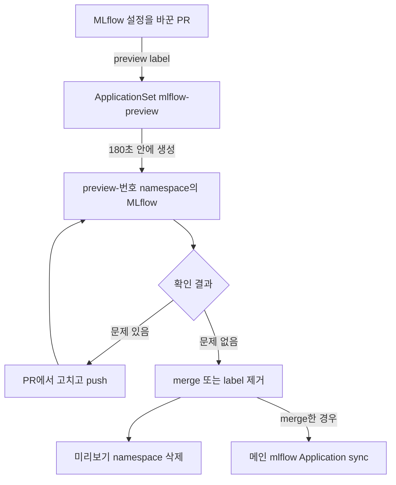

# Lab 0 시나리오 3. 공유 플랫폼을 바꾸기 전에 PR마다 미리보기 환경에서 확인합니다

## 이 시나리오의 목표

이 시나리오는 책에 없습니다. 책은 플랫폼을 설치하는 데서 멈추고, 설치한 플랫폼을 안전하게 바꾸는 방법은 다루지 않아서 더했습니다.

MLflow에는 데이터 사이언티스트 전원의 실험 기록과 model registry가 모입니다. 5장 파이프라인과 6장 서빙도 MLflow에서 모델을 꺼냅니다. 그래서 MLflow 설정을 잘못 고치면 실험 기록과 추론이 함께 멈춥니다. 이 Lab에서도 MLflow가 메모리 부족(OOMKilled)으로 재시작을 반복한 적이 있었고, 그동안 메인 MLflow를 쓸 수 없었습니다.

PR 미리보기는 merge 전에 바뀐 MLflow를 별도 namespace에 띄워 보는 장치입니다. PR에 `preview` label을 붙이면 `preview-<PR 번호>` namespace에 MLflow가 뜨고, label을 떼거나 PR이 닫히면 namespace째 지워집니다.

## 컴포넌트 역할

| 컴포넌트 | 역할 |
|---|---|
| GitHub PR과 `preview` label | 어떤 변경을 미리 볼지 사람이 고르는 스위치 |
| ApplicationSet `mlflow-preview` | GitHub API를 180초마다 토큰 없이 조회해 `preview` label이 붙은 열린 PR 목록을 만듦 |
| Application `mlflow-preview-<번호>` | PR의 마지막 commit으로 `manifests/mlflow`를 `preview-<번호>` namespace에 배포 |
| 미리보기 MLflow, PostgreSQL | 바뀐 설정으로 뜬 MLflow. 빈 DB로 시작 |
| object storage(SeaweedFS) | 메인과 같은 `mlflow-artifacts` 버킷을 같이 씀 |

## 흐름

문제가 있으면 메인 환경에 닿기 전에 PR에서 고칩니다.



## 실습

[2-lab0-platform-install.md](./2-lab0-platform-install.md)에서 `mlflow` Application이 Healthy인 상태에서 시작합니다. generator가 180초마다 조회하므로 생성과 삭제에 각각 최대 3분 걸립니다.

### 1. MLflow 설정을 바꾼 PR에 label을 붙입니다

`manifests/mlflow/mlflow-values.yaml`의 `resources` 값을 바꾼 브랜치를 push하고 PR을 연 뒤 `preview` label을 붙입니다.

```bash
gh pr edit <PR 번호> --add-label preview
```

### 2. 미리보기 MLflow가 뜨는지 봅니다

3분 안에 Application이 Synced, Healthy가 되고 파드 2개가 Running이 되는지 봅니다.

```bash
kubectl -n argocd get applications.argoproj.io mlflow-preview-<PR 번호>
kubectl -n preview-<PR 번호> get pods
```

MLflow 로그에 PostgreSQL `Connection refused`가 몇 번 찍힐 수 있습니다. 두 파드가 동시에 시작해서 생기는 로그이고, MLflow가 재시도해 접속합니다.

### 3. 미리보기 MLflow가 object storage를 쓸 수 있는지 봅니다

미리보기 MLflow 파드에서 `mlflow-artifacts` 버킷에 객체를 쓰고 읽은 뒤 지웁니다. `b'ok'`가 출력되면 됩니다.

```bash
kubectl -n preview-<PR 번호> exec deploy/mlflow-service -- python -c "
import boto3,os
s3=boto3.client('s3',endpoint_url=os.environ['MLFLOW_S3_ENDPOINT_URL'])
s3.put_object(Bucket='mlflow-artifacts',Key='preview-check/ok.txt',Body=b'ok')
print(s3.get_object(Bucket='mlflow-artifacts',Key='preview-check/ok.txt')['Body'].read())
s3.delete_object(Bucket='mlflow-artifacts',Key='preview-check/ok.txt')"
```

### 4. label을 떼고 미리보기 환경이 지워지는지 봅니다

label을 떼고 3분 뒤 Application과 namespace가 없어졌는지 봅니다.

```bash
gh pr edit <PR 번호> --remove-label preview
kubectl get ns preview-<PR 번호>
```

`namespaces "preview-<PR 번호>" not found`가 나오면 됩니다.

## 부록. 미리보기가 증명하는 범위

- **증명하는 것:** 새 설정으로 MLflow가 뜨는지, 메모리가 충분한지, object storage에 접근하는지.
- **증명하지 못하는 것:** 미리보기 PostgreSQL은 빈 DB라서, 실험 데이터가 쌓인 DB에서 버전 업그레이드 migration이 성공하는지는 알 수 없습니다. 버킷도 메인과 같이 쓰므로 완전히 격리된 환경은 아닙니다.
- **MLflow 하나만 복제하는 이유:** 전체 플랫폼을 PR마다 복제하면 단일 노드 메모리가 모자랍니다. 자주 바뀌고 깨졌을 때 영향이 큰 컴포넌트를 골랐습니다.

## 부록. namespace까지 지워지는 원리

Argo CD의 `CreateNamespace=true`로 만든 namespace는 Application을 지워도 남습니다. 그래서 `manifests/mlflow`가 Namespace 리소스를 직접 갖고, 미리보기 Application은 `spec.source.kustomize.namespace`로 namespace를 `preview-<번호>`로 덮어씁니다. kustomize는 이때 Namespace 리소스의 이름도 바꿉니다. Application이 Namespace를 소유하므로, Application이 지워질 때 finalizer가 namespace까지 지웁니다.

MLflow Helm chart가 만드는 리소스에는 namespace가 없습니다. ApplicationSet 템플릿의 `destination.namespace`가 그 리소스를 `preview-<번호>`에 넣습니다. Namespace 리소스에는 `mlops-part2/s3-access: "true"` label이 그대로 남아서, 미리보기 MLflow도 object storage의 NetworkPolicy를 통과합니다.

## 부록. 실행 기록

MLflow를 Helm chart로 바꾸기 전에 PR #1359로 확인한 결과입니다. label을 붙이고 1분 48초 뒤에 Healthy가 됐고, label을 떼고 2분 15초 뒤 Application과 namespace가 지워졌습니다. Helm chart로 바꾼 뒤에는 `preview-<번호>` namespace 렌더링 결과만 확인했습니다. 클러스터에서 다시 실행하지는 않았습니다.
