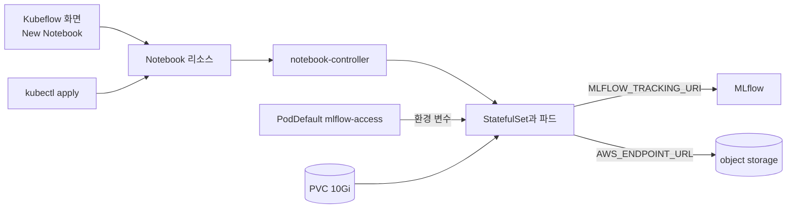

# Lab 1 시나리오 1. 노트북 환경도 플랫폼이 제공합니다

## 이 시나리오의 목표

책 4장 노트북은 맥북의 Jupyter에서 돌고, 첫 셀에 MinIO 계정과 MLflow 주소를 직접 적습니다. 혼자 공부할 때는 괜찮지만, 노트북을 동료에게 넘기거나 5장 파이프라인으로 옮기면 주소와 계정을 다시 고쳐야 합니다.

ML 플랫폼은 데이터 사이언티스트가 일하는 환경까지 제공합니다. 이 시나리오에서는 Kubeflow Notebooks로 클러스터 안에 노트북 서버를 만듭니다. 플랫폼이 MLflow와 object storage(SeaweedFS) 접속 정보를 환경 변수로 넣어 주므로, 노트북 코드에는 주소와 계정이 한 줄도 없습니다. 끝나면 GPU 1개와 10Gi 디스크를 가진 노트북에서 Lab 1 코드를 실행할 준비가 됩니다.

## 컴포넌트 역할

| 컴포넌트 | 역할 |
|---|---|
| Kubeflow Central Dashboard | 노트북을 만들고 접속하는 화면 |
| Notebook 리소스 | 노트북 한 개의 이미지, CPU, 메모리, GPU, 디스크를 적은 선언 |
| notebook-controller | Notebook 리소스를 보고 StatefulSet, Service, Istio VirtualService를 만듦 |
| PodDefault `mlflow-access` | 노트북을 만들 때 고르는 설정. 파드에 MLflow와 object storage 접속 정보를 넣음 |
| PVC | `/home/jovyan`에 붙는 디스크. 파드가 다시 떠도 노트북 파일이 남음 |
| profile namespace `kubeflow-user-example-com` | 사용자 `user@example.com`의 작업 공간 |

## 흐름



## 실습

[2-lab0-platform-install.md](./2-lab0-platform-install.md)의 3번처럼 Kubeflow 화면에 로그인한 상태에서 시작합니다. 노트북은 화면이나 kubectl 중 하나로 만듭니다. 둘 다 같은 Notebook 리소스를 만듭니다.

### 1-A. Kubeflow 화면에서 노트북을 만듭니다

왼쪽 메뉴 **Notebooks** → **New Notebook**에서 아래 값을 넣고 **Launch**를 누릅니다.

| 항목 | 값 |
|---|---|
| Name | `income-notebook` |
| Image | `jupyter-scipy:v1.11.0` |
| CPU, Memory | 기본값 |
| GPUs | Number 1, Vendor NVIDIA |
| Workspace Volume | 기본값(새 PVC) |
| Configurations | **MLflow와 object storage(SeaweedFS) 접속 정보** |

### 1-B. kubectl로 노트북을 만듭니다

화면 대신 매니페스트로 같은 노트북을 만듭니다. PVC 10Gi와 Notebook 리소스를 적용합니다.

```bash
kubectl apply -f manifests/kubeflow-notebook/
```

### 2. 만들어진 리소스를 봅니다

notebook-controller가 Notebook 하나로 만든 리소스를 봅니다. 파드가 `2/2`인 이유는 노트북 컨테이너와 Istio sidecar가 함께 떠서입니다.

```bash
kubectl -n kubeflow-user-example-com get notebook,sts,pod,pvc
```

```text
NAME                                    AGE
notebook.kubeflow.org/income-notebook   137m
NAME                               READY   AGE
statefulset.apps/income-notebook   1/1     137m
NAME                    READY   STATUS    RESTARTS   AGE
pod/income-notebook-0   2/2     Running   0          137m
NAME                                              STATUS   CAPACITY   STORAGECLASS
persistentvolumeclaim/income-notebook-workspace   Bound    10Gi       local-path
```

### 3. 접속 정보와 GPU가 들어왔는지 봅니다

PodDefault가 넣은 환경 변수를 봅니다. 노트북 코드는 이 값만 읽습니다.

```bash
kubectl -n kubeflow-user-example-com exec income-notebook-0 -c income-notebook -- env | grep -E "^(MLFLOW_TRACKING_URI|AWS_ENDPOINT_URL)="
```

```text
AWS_ENDPOINT_URL=http://seaweedfs.kubeflow.svc.cluster.local:8333
MLFLOW_TRACKING_URI=http://mlflow-service.mlflow.svc.cluster.local:5000
```

GPU가 보이는지는 [3-lab0-gpu-time-slicing.md](./3-lab0-gpu-time-slicing.md)의 2번 명령으로 봅니다.

### 4. 노트북 코드를 받습니다

화면에서 노트북의 **CONNECT**를 누르고 JupyterLab의 **Terminal**을 엽니다. 저장소에서 `notebooks/` 디렉터리만 받고 패키지를 설치합니다.

```bash
git clone --depth 1 --filter=blob:none --sparse https://github.com/choisungwook/portfolio.git
cd portfolio && git sparse-checkout set mlops/ml-platform-engineering-part2/notebooks
cd mlops/ml-platform-engineering-part2/notebooks && pip install -r requirements.txt
```

이 실습이 master에 merge되기 전이면 `git clone`에 `--branch feat/ml-platform-part2-lab0`을 붙입니다.

데이터 로딩 함수를 점검합니다. `ok 30162`가 출력되면 다음 시나리오로 넘어갑니다.

```bash
python income.py
```

## 부록. 실무에서 얻는 것

- **노트북 코드와 접속 정보를 나눕니다.** MLflow 클라이언트는 `MLFLOW_TRACKING_URI`를, boto3는 `AWS_ENDPOINT_URL`을 스스로 읽습니다. 같은 코드가 노트북, KFP 컴포넌트, CI에서 그대로 돌아갑니다.
- **클러스터 안 주소를 씁니다.** 노트북이 Service DNS로 접속하므로 port-forward를 띄워 둘 필요가 없고, 5장 KFP 컴포넌트와 같은 주소를 씁니다.
- **클라이언트 버전도 맞춥니다.** `requirements.txt`가 MLflow 클라이언트를 서버와 같은 3.17.2로 고정합니다.
- **PodDefault는 profile namespace마다 있어야 합니다.** 사용자가 늘면 profile마다 PodDefault와 Secret을 만들어야 합니다. 이 Lab은 사용자가 한 명이라 `manifests/kubeflow/user-resources/`에 한 벌만 둡니다.
