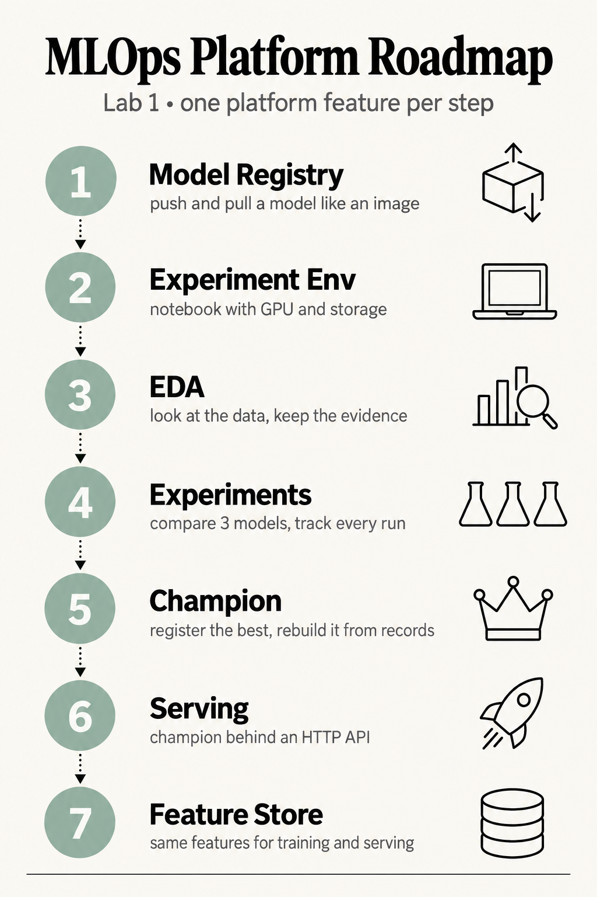
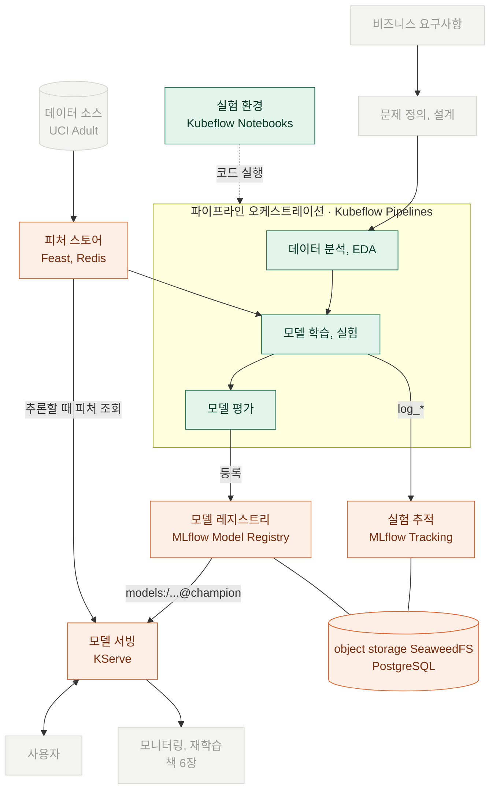

# Lab 1 시나리오 1. MLOps 플랫폼이 제공하는 기능을 오픈소스로 하나씩 만들어 봅니다

## Lab 1은 도구가 아니라 플랫폼 기능을 따라갑니다

Lab 0은 플랫폼을 설치했습니다. Lab 1은 그 플랫폼이 AI 엔지니어에게 무엇을 제공하는지를 기능 단위로 실습합니다. Kubeflow와 MLflow는 공부 대상이 아니라 기능을 만드는 부품입니다. 같은 기능을 다른 오픈소스로 바꿀 수 있고, 이 Lab이 고른 조합은 책 4~6장의 조합을 따른 것입니다.

Lab 1에서 실습하는 기능을 순서대로 그린 로드맵입니다.

## 플랫폼 기능 지도

모델이 요구사항에서 출발해 사용자에게 닿기까지 거치는 단계와, 각 단계를 맡는 플랫폼 기능을 그렸습니다. 초록은 노트북에서 직접 실행하는 단계, 주황은 플랫폼이 기록하고 보관하는 기능, 회색은 이 Lab에서 다루지 않는 단계입니다.

기능마다 맡은 오픈소스와 실습하는 시나리오입니다.

| 플랫폼 기능 | 엔지니어가 얻는 것 | 오픈소스 | 시나리오 |
|---|---|---|---|
| 모델 레지스트리 | 모델을 이름과 버전으로 올리고 꺼냄 | MLflow Model Registry | [2](./7-lab1-model-registry.md), [6](./11-lab1-registry-reproducibility.md) |
| 실험 환경 | GPU, 저장소, 접속 정보가 준비된 노트북 | Kubeflow Notebooks | [3](./8-lab1-kubeflow-notebook.md) |
| 데이터 분석(EDA) | 분석 결과와 원본 데이터를 남김 | MLflow, Kubeflow Pipelines | [4](./9-lab1-eda.md) |
| 실험 추적 | 파라미터, 점수, 학습 데이터를 run으로 비교 | MLflow Tracking | [5](./10-lab1-experiment-lineage.md) |
| 파이프라인 오케스트레이션 | 같은 작업을 같은 순서로 반복 실행 | Kubeflow Pipelines | [4](./9-lab1-eda.md)~[6](./11-lab1-registry-reproducibility.md) |
| 모델 서빙 | 등록한 모델을 HTTP API로 제공 | KServe | [7](./12-lab1-model-serving.md) |
| 피처 스토어 | 학습과 추론에 같은 피처를 제공 | Feast, Redis | [8](./13-lab1-feature-store.md) |

## 모델 레지스트리부터 시작하는 이유

플랫폼이 모델을 다루는 방식은 컨테이너 이미지를 다루는 방식과 닮았습니다. 애플리케이션 팀은 이미지를 도커 레지스트리에 `push`하고, 배포하는 쪽은 `image:tag`로 `pull`합니다. 누가 어느 노트북에서 이미지를 빌드했는지 몰라도 배포할 수 있습니다.

모델도 같습니다. 학습한 사람의 노트북에만 있는 모델 파일은 서빙 쪽이 가져갈 방법이 없습니다. 모델 레지스트리는 모델을 `models:/<이름>@<alias>` 주소로 올리고 꺼내게 해 줍니다. 서빙, 파이프라인, 다른 팀은 이 주소 하나만 압니다.

그래서 Lab 1은 레지스트리를 먼저 써 봅니다. 그다음 "레지스트리에 올릴 모델은 어떻게 만드는가"로 거슬러 올라가 실험 환경, EDA, 실험 비교를 차례로 실습합니다.

1. [모델 레지스트리에 모델을 올리고 꺼내기](./7-lab1-model-registry.md)
2. [실험 환경 만들기](./8-lab1-kubeflow-notebook.md)
3. [데이터를 들여다보고 결과 남기기(EDA)](./9-lab1-eda.md)
4. [모델 3개를 같은 조건으로 비교하기](./10-lab1-experiment-lineage.md)
5. [가장 좋은 모델을 등록하고 다시 만들기](./11-lab1-registry-reproducibility.md)
6. [champion 모델을 KServe로 서빙하기](./12-lab1-model-serving.md)
7. [피처 스토어로 학습과 서빙에 같은 피처 주기](./13-lab1-feature-store.md)
