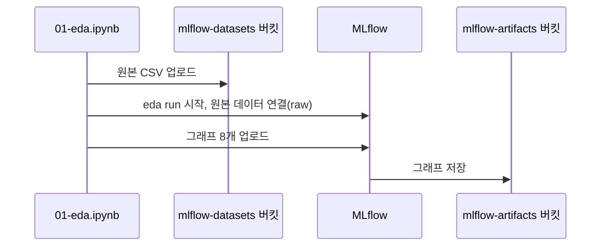

# Lab 1 시나리오 2. 모델을 만들기 전에 데이터를 들여다보고 그 결과를 남깁니다

## EDA란

EDA(Exploratory Data Analysis, 탐색적 데이터 분석)는 모델을 만들기 전에 데이터를 표와 그래프로 훑어보는 작업입니다. 어떤 컬럼이 있는지, 값이 어떻게 퍼져 있는지, 예측하려는 값과 관계가 있어 보이는 컬럼이 무엇인지를 봅니다. 여기서 본 것이 어떤 컬럼을 피처로 쓸지 정하는 근거가 됩니다.

## 이 시나리오의 목표

| 항목 | 내용 |
|---|---|
| 데이터 | UCI Adult. 1994년 미국 인구조사에서 뽑은 성인 데이터. 결측(`?`)이 있는 행을 지운 30,162행 |
| 컬럼 | 범주형 8개(직업군, 학력, 결혼 상태, 직종, 가족 관계, 인종, 성별, 출신 국가)와 정답 `Target` |
| 예측할 값 | 연소득이 5만 달러를 넘는지(`>50K`) 아닌지(`<=50K`) |
| EDA 작업 | 1. 행 수와 정답 비율 확인 2. 컬럼마다 범주 개수 확인 3. 컬럼마다 범주별 `>50K` 비율을 막대그래프 8개로 그림 |
| 달성할 것 | 소득을 가르는 컬럼을 찾고, 그 근거(그래프)와 원본 데이터를 MLflow run 하나에 남김 |

EDA 결과가 노트북 출력에만 있으면 커널을 다시 시작하는 순간 사라집니다. 책 4.3절은 그래프를 MLflow run의 아티팩트로 올립니다. 이 Lab은 원본 데이터도 object storage(SeaweedFS)에 올리고 run에 연결해, 다음 시나리오의 실험이 어느 데이터에서 출발했는지 추적할 수 있게 합니다.

## 컴포넌트 역할

| 컴포넌트 | 역할 |
|---|---|
| `01-eda.ipynb` | 데이터를 읽고 그래프 8개를 그린 뒤 `eda` run으로 기록 |
| MLflow | run과 데이터셋 정보를 PostgreSQL에 저장하고, 그래프 파일을 object storage로 넘김 |
| object storage `mlflow-artifacts` 버킷 | 그래프 파일. MLflow 서버만 씀 |
| object storage `mlflow-datasets` 버킷 | 원본 데이터 CSV. 노트북이 직접 씀 |

## 흐름



## 실습

[6-lab1-kubeflow-notebook.md](./6-lab1-kubeflow-notebook.md)에서 노트북 코드를 받은 상태에서 시작합니다. 맥북에서 MLflow 화면도 엽니다.

```bash
kubectl -n mlflow port-forward svc/mlflow-service 5000:5000
```

### 1. 노트북을 실행합니다

JupyterLab에서 `01-eda.ipynb`를 열고 **Run All Cells**를 실행합니다. 셀마다 아래를 확인합니다.

- 두 번째 셀: 데이터가 `(30162, 9)`입니다. 30,162행에 컬럼 9개입니다.
- 세 번째 셀(`describe`): `Target`의 최빈값은 `<=50K`이고 22,654행입니다. 나머지 7,508행(약 25%)이 `>50K`입니다. 정답이 한쪽으로 치우쳐 있어서, 다음 시나리오는 정확도와 함께 ROC AUC를 봅니다.
- 마지막 셀: run ID, 원본 데이터 경로, 그래프 8개의 경로를 출력합니다.

```text
raw    : s3://mlflow-datasets/income-classifier/raw/income_data.csv
artifacts: ['eda_plots/Education.png', 'eda_plots/Marital-Status.png', ...]
```

### 2. 그래프에서 소득을 가르는 컬럼을 찾습니다

`http://localhost:5000`에서 **income-classifier** experiment의 `eda` run을 열고 **Artifacts** 탭의 `eda_plots/Marital-Status.png`를 봅니다.

| 결혼 상태 | `>50K` 비율 |
|---|---|
| `Married-civ-spouse` | 45.5% |
| `Divorced` | 10.7% |
| `Never-married` | 4.8% |

결혼 상태 하나로 소득 구간이 크게 갈립니다. 이런 관찰이 다음 시나리오에서 이 컬럼을 피처로 쓰는 근거가 되고, 그 근거가 run에 남습니다.

### 3. 원본 데이터가 run에 연결됐는지 봅니다

같은 run의 **Datasets** 영역에 `income_data`가 context `raw`로 연결돼 있으면 됩니다.

## 부록. 실무에서 얻는 것

- **MLflow는 모델만 기록하는 도구가 아닙니다.** 그래프, 리포트, 원본 데이터 경로도 run에 남깁니다. 같은 experiment를 열면 다른 사람이 EDA부터 이어받습니다.
- **그래프를 올릴 때 S3 계정이 필요 없습니다.** MLflow가 아티팩트를 중계(proxied artifact)하도록 설정해서, 노트북은 파일을 MLflow에 보내고 MLflow가 버킷에 씁니다.
- **데이터셋은 복사되지 않습니다.** `log_input`은 데이터의 경로, 내용 해시(digest), 스키마만 저장합니다. 원본 파일을 지우면 기록은 남아도 데이터는 되살릴 수 없습니다.
- **`Native_country`는 범주가 41개입니다.** 다음 시나리오에서 one-hot 인코딩하면 컬럼이 크게 늘어납니다. EDA에서 범주 개수를 먼저 보는 이유입니다.
