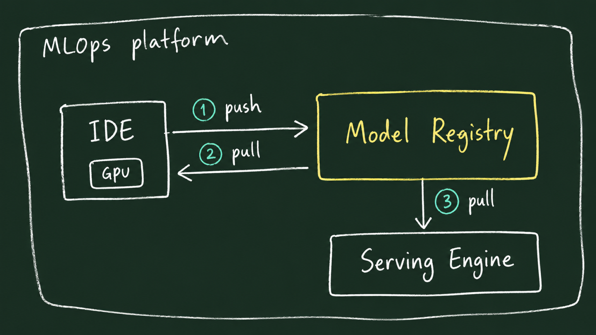

# Lab 1 시나리오 2. 모델 레지스트리: 도커 이미지처럼 모델 등록 및 관리(Push & Pull)

## 이 시나리오의 목표

| 항목 | 내용 |
|---|---|
| **플랫폼 기능** | 모델 레지스트리 (Model Registry) |
| **활용 오픈소스** | MLflow Model Registry |
| **주요 작업** | 1. 초경량 모델을 학습하여 레지스트리에 `quickstart-model`로 등록(Push)<br/>2. 서빙/소비 관점에서 `models:/quickstart-model@champion` 주소로 모델을 조회해 추론 수행(Pull)<br/>3. 새 버전을 등록했을 때 코드 수정 없이 Alias가 가리키는 버전이 교체되는지 확인 |
| **달성 결과** | 모델을 소비하는 애플리케이션이나 배포 시스템이 학습 코드와 실험 Run ID에 의존하지 않고, 레지스트리의 모델 이름과 Alias만으로 원하는 최적 모델을 로드할 수 있음을 검증 |

[시나리오 1](./6-lab1-mlops-platform.md)에서 모델 레지스트리를 컨테이너 도커 레지스트리에 빗대어 설명했습니다. 

본 시나리오에서는 이 비유를 직접 코드로 실행해 봅니다. 복잡한 튜닝 모델이 아니라 scikit-learn 기본 데이터셋으로 빠르게 학습한 경량 모델을 사용해 레지스트리의 등록(Push)과 호출(Pull) 메커니즘을 먼저 익힙니다. (실제 프로젝트 모델은 시나리오 3~6에서 개발합니다.)

## 도커 레지스트리와 모델 레지스트리의 개념 비교

데이터 사이언티스트의 개발 환경(노트북)에서 학습 완료된 모델을 레지스트리에 업로드(Push)하면, 추론 엔진(KServe)이나 다른 애플리케이션은 레지스트리에서 해당 모델을 다운로드(Pull)하여 실행합니다. 본 시나리오에서는 ①과 ②의 Push/Pull 흐름을 실습하고, [시나리오 7](./12-lab1-model-serving.md)에서 이를 KServe 서빙 엔진과 연계합니다.



| 도커 레지스트리 (Docker Registry) | MLflow Model Registry | 설명 |
|---|---|---|
| **저장소 이름** (예: `myapp`) | **Registered Model 명칭** (예: `quickstart-model`) | 관리할 모델의 논리적 대표 이름 |
| **이미지 Digest** (`sha256:...`) | **Model Version** (`1`, `2`, ...) | 등록 시마다 1씩 증가하는 불변의 고유 식별자 |
| **도커 태그** (`stable`, `latest`) | **Model Alias** (`champion`, `challenger`) | 특정 버전을 가리키며 유동적으로 이동 가능한 배포 별칭 |
| `docker push myapp:stable` | `log_model(...)` 후 `set_registered_model_alias` | 모델 파일 및 메타데이터 업로드 및 별칭 지정 |
| `docker pull myapp:stable` | `mlflow.pyfunc.load_model("models:/quickstart-model@champion")` | 모델 이름과 별칭을 통한 무중단 모델 조회 및 로드 |

> [!NOTE]
> **도커 Tag와 MLflow Version의 차이점**: 도커 태그는 이미지를 푸시하는 개발자가 임의로 지정할 수 있지만, MLflow의 버전 번호(Version)는 레지스트리가 등록 순서에 따라 자동으로 부여하는 불변값입니다. 운영자는 오직 **Alias**만을 제어하며, Alias의 대상을 변경하면 모델을 호출하는 클라이언트 코드의 수정 없이 배포 모델을 즉시 전환할 수 있습니다.

## Alias(별칭)와 Tag(태그)의 역할 분담

소프트웨어 배포에서 `stable`, `canary`를 사용하듯, MLOps에서는 `champion`, `challenger` 패턴을 주로 사용합니다.

- **Champion**: 현재 실제 운영 환경에서 트래픽을 처리하고 있는 검증된 기준 모델 (소프트웨어의 `stable` / `prod`)
- **Challenger**: Champion의 자리를 대체하기 위해 새로운 가설이나 최신 데이터로 학습되어 성능을 겨루는 후보 모델 (소프트웨어의 `canary` / `rc`)

| 구분 | 종류 | 가리키는 대상 및 성격 | 소프트웨어 배포 비교 |
|---|---|---|---|
| `champion` | **Alias** | 현재 운영(Serving) 트래픽을 처리 중인 단일 버전을 가리킴 | `stable`, `production` 태그 |
| `challenger` | **Alias** | Champion과 성능을 비교 평가 중인 후보 버전을 가리킴 | `canary`, `rc` 태그 |
| `validation_status: approved` | **Tag** | 버전의 검증 상태나 부가 메타데이터 (여러 버전에 다중 지정 가능) | 이미지 Label, 서명 메타데이터 |
| `Version 1, 2, ...` | **Version** | 레지스트리가 등록 순으로 부여하는 불변의 정수 식별자 | 불변 이미지 Digest (SHA) |

과거 MLflow는 `Staging`, `Production` 같은 정적 `Stage` 방식을 사용했으나, 이는 버전당 하나의 상태만 가질 수 있어 "운영 중인 모델"과 "경쟁 중인 다수의 후보 모델"을 세밀하게 제어하기 어려웠습니다. 이에 따라 MLflow 2.9부터 유연한 **Alias**와 **Tag** 체계로 공식 개편되었습니다.

## MLflow 모델의 패키징 구조: 단순 가중치 파일 이상의 아티팩트

머신러닝 모델은 본질적으로 "학습을 통해 도출된 파라미터(가중치)"와 "해당 값을 사용하는 모델 구조(설정)"의 조합입니다.

| 모델 계열 | 학습된 값 (파라미터) | 모델 구조 및 환경 설정 |
|---|---|---|
| **신경망 / LLM** | 계층별 가중치 행렬 (`.safetensors`, `.bin`) | 레이어 수, 임베딩 차원 등의 아키텍처 설정 (`config.json`) |
| **로지스틱 회귀 (본 시나리오)** | 30개 피처의 회귀 계수(Weights) 및 절편(Intercept) | 입력 피처 컬럼 순서, 스케일링 정보 |
| **XGBoost (시나리오 5)** | 생성된 다수 트리의 노드 분기 조건 및 리프 노드 출력값 | `max_depth`, `learning_rate` 등 하이퍼파라미터 |

MLflow에서 관리하는 모델은 단순한 단일 압축 파일이 아니라 표준화된 디렉터리 패키지입니다. 실제 가중치 파일 외에도, 다른 환경에서 모델을 독립적으로 로드하고 추론을 재현할 수 있는 메타데이터가 함께 번들링됩니다.

```text
MLmodel                     어떤 프레임워크로 로드할지(flavor) 및 입력/출력 데이터 스키마(signature) 정의
model.ubj                   XGBoost 또는 scikit-learn이 직렬화한 모델 가중치 파일
python_env.yaml, conda.yaml 재현 실행에 필요한 Python 및 라이브러리 의존성 버전 명세
requirements.txt            (예: xgboost==3.4.1, scikit-learn==1.5.0 등)
input_example.json          모델 입력 검증용 샘플 데이터 (3행)
serving_input_example.json  KServe 등 서빙 API 호출 시 전송할 JSON 요청 본문 템플릿
```

특히 `MLmodel` 파일의 **Flavor** 설정이 핵심입니다. 예를 들어 XGBoost 모델은 네이티브 `xgboost` flavor와 함께 범용 `python_function (pyfunc)` flavor를 동시에 지원합니다. `pyfunc` 인터페이스 덕분에 클라이언트나 서빙 프레임워크는 내부 구현체와 무관하게 일관된 `model.predict(df)` 함수 호출로 추론을 수행할 수 있습니다.

## Hugging Face Hub와 MLflow Model Registry 비교

두 시스템 모두 모델을 버전화하여 관리한다는 기본 개념은 같으나, 플랫폼 아키텍처 관점에서 지향점이 다릅니다.

| 비교 항목 | Hugging Face Hub | MLflow Model Registry |
|---|---|---|
| **모델 포맷** | `model.safetensors`, `config.json` 등 라이브러리 고유 포맷 중심 | 프레임워크 고유 파일 + `MLmodel` 규격 및 표준 의존성 정의 |
| **버전 관리 체계** | Git Commit, Branch, Tag (`revision`) 기반 | 순차 정수 Version 및 배포 제어용 Alias (`champion` 등) |
| **학습 계보 연계** | 모델 카드(Model Card)에 사람이 마크다운으로 기술 | 특정 Run ID와 양방향 자동 연결 (파라미터, 지표, 데이터셋 완벽 추적) |
| **주요 활용 목적** | 오픈소스 파운데이션 모델 공유 및 커뮤니티 배포 | 사내 MLOps 파이프라인에서 실험부터 서빙까지 통제되는 엔터프라이즈 거버넌스 |
| **배포 및 운영** | 관리형 SaaS 서비스 중심 | 사내 쿠버네티스 인프라에 직접 설치 및 통제 가능 |

## 단계별 실습 절차

로컬 터미널 환경에서 실행합니다. 모델 아티팩트는 MLflow 서버가 백엔드 오브젝트 스토리지로 프록시 중계하므로, 로컬 PC에 별도의 클라우드 S3 인증 정보를 둘 필요가 없습니다.

### 1. MLflow 포트 포워딩 연결

터미널 세션에서 MLflow 서비스 포트 포워딩을 유지합니다.

```bash
kubectl -n mlflow port-forward svc/mlflow-service 5000:5000
```

### 2. 모델 학습 및 레지스트리 등록 (Push)

새 터미널을 열고 `mlops/ml-platform-engineering-part2` 디렉터리에서 스크립트를 실행합니다. (스크립트에 명시된 `mlflow`, `scikit-learn` 의존성은 uv가 자동으로 격리 환경에 설치합니다.)

```bash
uv run --python 3.12 scripts/registry_quickstart.py push
```

실행 결과:
```text
pushed quickstart-model v1 @champion
```

레지스트리에 `quickstart-model` 모델이 등록되고 Version 1이 생성되며, 배포 별칭인 `@champion`이 Version 1에 바인딩됩니다.

### 3. 모델 조회 및 추론 실행 (Pull)

`pull` 명령은 학습 코드나 세부 Run ID를 전혀 몰라도, 오직 모델 명칭과 Alias(`models:/quickstart-model@champion`)만으로 모델을 로드하여 3개 샘플 데이터에 대한 예측을 수행합니다.

```bash
uv run --python 3.12 scripts/registry_quickstart.py pull
```

실행 결과:
```text
pulled models:/quickstart-model@champion (v1) predict=[0, 0, 0]
```

### 4. 신규 버전 등록 및 무중단 Alias 전환 확인

동일한 push와 pull 명령을 한 번 더 실행해 봅니다.

```bash
uv run --python 3.12 scripts/registry_quickstart.py push
uv run --python 3.12 scripts/registry_quickstart.py pull
```

실행 결과:
```text
pushed quickstart-model v2 @champion
pulled models:/quickstart-model@champion (v2) predict=[0, 0, 0]
```

- 신규 모델이 푸시되면서 Version 2가 생성되고, `@champion` Alias가 Version 2로 자동 갱신되었습니다.
- **핵심 포인트**: `pull` 명령의 소스 코드는 단 한 줄도 바뀌지 않았음에도, 클라이언트는 자동으로 최신 승인 모델(v2)을 내려받아 실행합니다.
- 브라우저(`http://localhost:5000`)의 **Models** 탭에서 `quickstart-model`을 확인하면 Version 1과 2가 생성되어 있고, `champion` 태그가 Version 2에 부착된 것을 시각적으로 확인할 수 있습니다.

## 부록: 실무 플랫폼 운영 팁

- **클라이언트 환경의 멀티파트 프록시 설정**: MLflow 3.x 서버는 대용량 파일 다운로드 시 스토리지 직접 접근용 Presigned URL을 클라이언트에 반환합니다. 하지만 쿠버네티스 내부 스토리지 URL은 로컬 개발 PC에서 직접 접근할 수 없으므로, 스크립트에서 `MLFLOW_ENABLE_PROXY_MULTIPART_DOWNLOAD=false` 환경 변수를 주어 모든 트래픽이 MLflow 서버를 경유하도록 설정했습니다. ([troubleshooting.md](./troubleshooting.md) 21번 참고)
- **실험용 모델 네임스페이스 분리**: 본 퀵스타트 실습에서는 후속 실습(`income-classifier`)과의 버전 번호 충돌을 방지하기 위해 `quickstart-model`이라는 독립된 등록 모델명을 사용했습니다.
