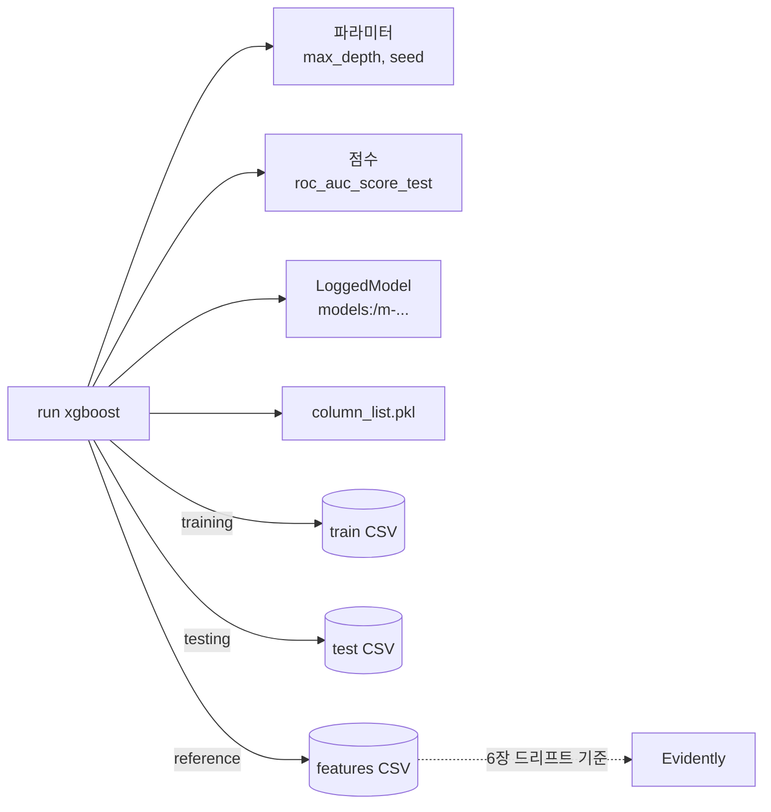

# Lab 1 시나리오 3. 모델 3개를 같은 조건으로 비교하고 학습 데이터까지 연결합니다

## 이 시나리오의 목표

EDA에서 본 컬럼으로 소득 구간(`>50K`)을 맞히는 모델 3개를 학습하고, MLflow로 비교해 가장 좋은 모델을 고릅니다.

| 항목 | 내용 |
|---|---|
| 입력 | 범주형 8개 컬럼을 one-hot 인코딩한 컬럼 90개 |
| 모델 | Decision Tree, Random Forest, XGBoost |
| 비교 기준 | 테스트 데이터의 ROC AUC(`roc_auc_score_test`). 정답이 25:75로 치우쳐 있어 정확도만으로는 부족함 |
| 달성할 것 | run마다 파라미터, 점수, 모델, 학습에 쓴 데이터를 남겨 "이 모델은 어느 데이터로 만들었나"에 run 하나로 답함 |

run과 그 run이 쓴 데이터를 잇는 기록을 리니지(lineage)라고 합니다. 책 4.4~4.6절은 `mlflow.log_input`으로 학습, 테스트, 피처 데이터셋을 run에 연결합니다. 6장 드리프트 감지는 여기서 남긴 피처 데이터셋을 기준 분포로 씁니다.

책은 `random_state`를 고정하지 않아서 다시 돌리면 점수가 바뀝니다. 이 Lab은 분할과 모델 모두 `random_state=42`(XGBoost는 `seed=42`)로 고정해, 다음 시나리오에서 같은 모델을 다시 만들 수 있게 합니다.

## 컴포넌트 역할

| 컴포넌트 | 역할 |
|---|---|
| `02-experiments.ipynb` | 같은 분할로 모델 3개를 학습하고 run 3개를 기록 |
| MLflow run | 파라미터, 점수, tag `model_uri`, 데이터셋 연결, 아티팩트 `column_list.pkl` |
| MLflow LoggedModel | 학습한 모델 파일. run과 연결되지만 따로 저장 |
| object storage `mlflow-datasets` 버킷 | 학습, 테스트, 피처 데이터 CSV |
| object storage `mlflow-artifacts` 버킷 | 모델 파일과 `column_list.pkl` |

## 흐름

run 하나가 무엇과 연결되는지 그렸습니다. 다음 시나리오는 이 그래프를 거꾸로 따라갑니다.



## 실습

[7-lab1-eda.md](./7-lab1-eda.md)에서 MLflow 화면을 연 상태에서 시작합니다.

### 1. 노트북을 실행합니다

JupyterLab에서 `02-experiments.ipynb`를 열고 **Run All Cells**를 실행합니다. 마지막 셀이 run 3개를 점수 순으로 보여 줍니다.

```text
  tags.mlflow.runName  metrics.roc_auc_score_test  metrics.test_accuracy
0             xgboost                    0.873681               0.827449
1       random-forest                    0.855955               0.818333
2       decision-tree                    0.819471               0.813526
```

`random_state`를 고정했으므로 다시 실행해도 점수가 같습니다.

### 2. MLflow 화면에서 run을 비교합니다

**income-classifier** experiment에서 run 3개를 선택하고 **Compare**를 누릅니다. `roc_auc_score_test`와 파라미터 차이를 한 화면에서 봅니다. XGBoost가 가장 높습니다.

### 3. 학습 데이터 연결을 봅니다

`xgboost` run을 열고 **Datasets** 영역을 봅니다. `train`, `test`, `features` 데이터셋이 context `training`, `testing`, `reference`로 연결돼 있고, 경로는 `s3://mlflow-datasets/income-classifier/datasets/` 아래입니다.

## 부록. 실무에서 얻는 것

- **전처리 결과도 모델과 함께 남깁니다.** `column_list.pkl`은 one-hot 인코딩 뒤 컬럼 90개의 순서입니다. 5장 추론 코드가 이 순서로 컬럼을 만들지 못하면 모델이 엉뚱한 입력을 받습니다.
- **리니지는 데이터를 내용 해시로 식별합니다.** MLflow는 이름과 digest가 같은 데이터셋을 experiment 안에 한 번만 저장하고, 처음 기록한 경로를 계속 씁니다. 그래서 업로드 경로를 run ID가 아니라 `train-<digest>.csv`처럼 digest로 정했습니다. 경위는 [troubleshooting.md](./troubleshooting.md)의 9번에 있습니다.
- **autolog가 무엇을 남기는지 알고 씁니다.** `mlflow.xgboost.autolog()`는 학습 데이터를 경로 없는 데이터셋으로도 기록합니다. 리니지는 직접 관리하므로 `log_datasets=False`로 껐습니다.
- **MLflow 3부터 모델은 run 아티팩트가 아닙니다.** `log_model`은 모델을 LoggedModel(`models:/m-...`)로 따로 저장합니다. 등록할 때 쓰려고 그 URI를 run tag `model_uri`로 남깁니다.
