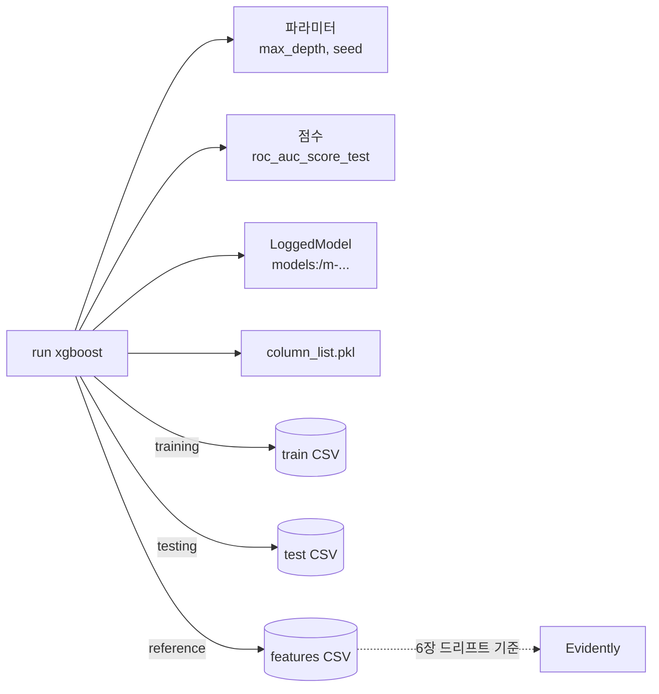
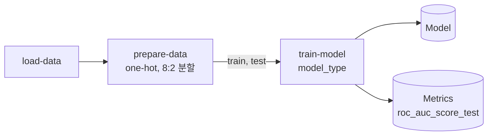

# Lab 1 시나리오 3. 모델 3개를 같은 조건으로 비교하고 학습 데이터까지 연결합니다

## 이 시나리오의 목표

EDA에서 본 컬럼으로 소득 구간(`>50K`)을 맞히는 모델 3개를 학습하고, MLflow로 비교해 가장 좋은 모델을 고릅니다.

| 항목 | 내용 |
|---|---|
| 입력 | 범주형 8개 컬럼을 one-hot 인코딩한 컬럼 90개 |
| 모델 | Decision Tree, Random Forest, XGBoost |
| 비교 기준 | 테스트 데이터의 ROC AUC(`roc_auc_score_test`). 정답이 25:75로 치우쳐 있어 정확도만으로는 부족함 |
| 달성할 것 | run마다 파라미터, 점수, 모델, 학습에 쓴 데이터를 남겨 "이 모델은 어느 데이터로 만들었나"에 run 하나로 답함. 같은 비교를 Kubeflow Pipelines로도 실행 |

run과 그 run이 쓴 데이터를 잇는 기록을 리니지(lineage)라고 합니다. 책 4.4~4.6절은 `mlflow.log_input`으로 학습, 테스트, 피처 데이터셋을 run에 연결합니다. 6장 드리프트 감지는 여기서 남긴 피처 데이터셋을 기준 분포로 씁니다.

책은 `random_state`를 고정하지 않아서 다시 돌리면 점수가 바뀝니다. 이 Lab은 분할과 모델 모두 `random_state=42`(XGBoost는 `seed=42`)로 고정해, 다음 시나리오에서 같은 모델을 다시 만들 수 있게 합니다.

**MLflow 예제**는 노트북 한 번 실행으로 run 3개를 MLflow에 남깁니다. **Kubeflow 예제**는 학습 파이프라인 하나를 `model_type` 파라미터만 바꿔 run 3개로 실행하고, KFP 화면에서 비교합니다. 책 5장이 말하는 KFP experiment가 이것입니다.

## 컴포넌트 역할

| 컴포넌트 | 역할 |
|---|---|
| `02-experiments.ipynb` | 같은 분할로 모델 3개를 학습하고 run 3개를 기록 |
| MLflow run | 파라미터, 점수, tag `model_uri`, 데이터셋 연결, 아티팩트 `column_list.pkl` |
| MLflow LoggedModel | 학습한 모델 파일. run과 연결되지만 따로 저장 |
| object storage `mlflow-datasets` 버킷 | 학습, 테스트, 피처 데이터 CSV |
| object storage `mlflow-artifacts` 버킷 | 모델 파일과 `column_list.pkl` |
| `pipelines/train_pipeline.py` | Kubeflow 예제. `load-data` → `prepare-data` → `train-model` 파이프라인을 run 3개로 제출 |
| KFP experiment `income-classifier` | 파이프라인 run을 묶는 단위. 화면에서 run끼리 점수를 비교 |
| KFP Metrics 아티팩트 | `train-model`이 남기는 `roc_auc_score_test`, `test_accuracy` |

## 흐름

run 하나가 무엇과 연결되는지 그렸습니다. 다음 시나리오는 이 그래프를 거꾸로 따라갑니다.



## MLflow 예제

[7-lab1-eda.md](./7-lab1-eda.md)에서 MLflow 화면을 연 상태에서 시작합니다.

### 1. 노트북을 실행합니다

JupyterLab에서 `02-experiments.ipynb`를 열고 **Run All Cells**를 실행합니다. 마지막 셀이 run 3개를 점수 순으로 보여 줍니다.

```text
  tags.mlflow.runName  metrics.roc_auc_score_test  metrics.test_accuracy
0             xgboost                    0.873681               0.827449
1       random-forest                    0.855955               0.818333
2       decision-tree                    0.819471               0.813526
```

`random_state`를 고정했으므로 다시 실행해도 점수가 같습니다. 다만 다시 실행하면 같은 이름의 run이 하나씩 더 생깁니다. run 이름은 중복될 수 있는 라벨이고, MLflow는 run ID로 run을 구분합니다. 버전 번호는 다음 시나리오에서 모델 레지스트리에 등록할 때 붙습니다.

### 2. MLflow 화면에서 run을 비교합니다

**income-classifier** experiment에서 run 3개를 선택하고 **Compare**를 누릅니다. `roc_auc_score_test`와 파라미터 차이를 한 화면에서 봅니다. XGBoost가 가장 높습니다.

### 3. 학습 데이터 연결을 봅니다

`xgboost` run을 열고 **Datasets** 영역을 봅니다. `train`, `test`, `features` 데이터셋이 context `training`, `testing`, `reference`로 연결돼 있고, 경로는 `s3://mlflow-datasets/income-classifier/datasets/` 아래입니다.

## Kubeflow 예제

[7-lab1-eda.md](./7-lab1-eda.md)의 Kubeflow 예제처럼 노트북 터미널의 `pipelines` 디렉터리에서 시작합니다. 파이프라인 정의는 하나이고, run마다 `model_type`만 다릅니다.



### 1. run 3개를 제출합니다

`model_type`을 `decision-tree`, `random-forest`, `xgboost`로 바꿔 3번 제출하고 모두 끝날 때까지 기다립니다. 3분쯤 걸립니다.

```bash
python train_pipeline.py
```

run 3개가 모두 `SUCCEEDED`면 됩니다.

```text
submitted train-decision-tree 2b52708c-3927-4507-a7d7-cc3d6b50dead
submitted train-random-forest a289f7aa-8da3-4857-b34e-332ef9749c80
submitted train-xgboost 91298509-1b30-488d-816c-1c36a41f2fad
train-decision-tree SUCCEEDED
train-random-forest SUCCEEDED
train-xgboost SUCCEEDED
```

### 2. KFP 화면에서 run을 비교합니다

**Pipelines** → **Experiments**에서 `income-classifier`를 열고 `train-` run 3개를 선택한 뒤 **Compare runs**를 누릅니다. 파라미터 `model_type`과 Scalar metrics를 한 표에서 봅니다. 점수는 MLflow 예제와 같습니다.

| model_type | roc_auc_score_test | test_accuracy |
|---|---|---|
| xgboost | 0.873681 | 0.827449 |
| random-forest | 0.855955 | 0.818333 |
| decision-tree | 0.819471 | 0.813526 |

### 3. KFP에서 학습 데이터 연결을 봅니다

`train-xgboost` run에서 `train-model` 노드를 누르고 **Input/Output** 탭을 봅니다. 입력 `train`, `test`가 `prepare-data`의 출력이고, 경로는 `mlpipeline` 버킷의 `private-artifacts/kubeflow-user-example-com/` 아래입니다. 두 번째와 세 번째 run의 `load-data`, `prepare-data`는 캐시를 써서 첫 run과 같은 데이터를 가리킵니다.

## 부록. 실무에서 얻는 것

- **같은 비교를 두 도구가 다르게 기록합니다.** MLflow는 run에 데이터셋을 직접 연결하고(`log_input`), KFP는 컴포넌트 사이 입출력 연결로 데이터의 출처를 남깁니다. 실무에서는 KFP 컴포넌트 안에서 MLflow에 기록해 둘을 같이 씁니다. 다음 시나리오의 Kubeflow 예제가 그렇게 합니다.
- **파라미터만 바꾼 run은 파이프라인을 다시 만들 필요가 없습니다.** 파이프라인 정의는 하나이고 실행할 때 `model_type`만 넘깁니다. 화면의 **Create run**에서도 같은 값을 넣어 실행할 수 있습니다.

- **전처리 결과도 모델과 함께 남깁니다.** `column_list.pkl`은 one-hot 인코딩 뒤 컬럼 90개의 순서입니다. 5장 추론 코드가 이 순서로 컬럼을 만들지 못하면 모델이 엉뚱한 입력을 받습니다.
- **리니지는 데이터를 내용 해시로 식별합니다.** MLflow는 이름과 digest가 같은 데이터셋을 experiment 안에 한 번만 저장하고, 처음 기록한 경로를 계속 씁니다. 그래서 업로드 경로를 run ID가 아니라 `train-<digest>.csv`처럼 digest로 정했습니다. 경위는 [troubleshooting.md](./troubleshooting.md)의 9번에 있습니다.
- **autolog가 무엇을 남기는지 알고 씁니다.** `mlflow.xgboost.autolog()`는 학습 데이터를 경로 없는 데이터셋으로도 기록합니다. 리니지는 직접 관리하므로 `log_datasets=False`로 껐습니다.
- **MLflow 3부터 모델은 run 아티팩트가 아닙니다.** `log_model`은 모델을 LoggedModel(`models:/m-...`)로 따로 저장합니다. 등록할 때 쓰려고 그 URI를 run tag `model_uri`로 남깁니다.
