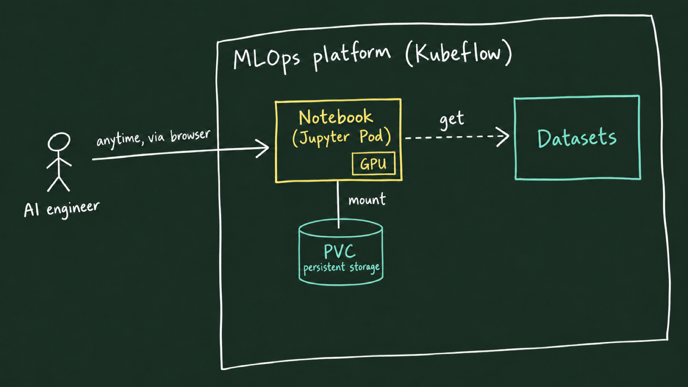
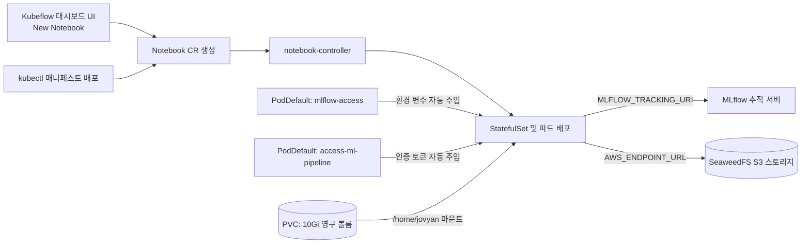

# Lab 1 시나리오 3. 표준화된 개발 환경: Kubeflow Notebooks와 플랫폼 연동

## 이 시나리오의 목표

[시나리오 2](./7-lab1-model-registry.md)에서는 준비된 모델을 레지스트리에 등록하는 기본 메커니즘을 확인했습니다. 하지만 실무에서 레지스트리에 등록할 만한 고품질 모델을 개발하려면, 먼저 데이터 사이언티스트가 데이터를 분석하고 다양한 가설을 실험할 수 있는 **표준화된 개발 환경**이 필수적입니다.

본 시나리오부터 시나리오 6까지는 실제 모델을 탐색, 학습, 검증하여 레지스트리에 등록하기까지의 엔드투엔드 수명주기를 다룹니다.



### 개인 로컬 노트북의 한계와 플랫폼 기반 노트북의 가치

도서 4장의 예제 코드는 로컬 PC의 Jupyter 환경에서 실행되며, 코드 첫 셀에 오브젝트 스토리지(MinIO) 계정과 MLflow 주소를 직접 하드코딩합니다. 개인적인 학습 단계에서는 문제가 없지만, 다음과 같은 실무적 한계가 발생합니다.

- **보안 및 자격증명 유출**: 소스 코드나 노트북 파일에 접속 주소와 비밀번호가 평문으로 노출됩니다.
- **환경 불일치 및 재현성 부재**: 협업 동료에게 노트북을 전달하거나 KFP 파이프라인으로 전환할 때 주소, 인증 정보, 패키지 버전을 매번 수작업으로 수정해야 합니다.
- **하드웨어 자원 격리 불가**: 로컬 PC의 사양에 따라 대용량 데이터 처리나 GPU 활용이 제약됩니다.

MLOps 플랫폼은 쿠버네티스 기반의 **Kubeflow Notebooks**를 통해 데이터 사이언티스트에게 표준 개발 환경을 제공합니다. 플랫폼의 `PodDefault` 메커니즘이 MLflow 및 오브젝트 스토리지(SeaweedFS) 접속 정보를 환경 변수로 자동 주입하므로, 노트북 소스 코드에는 어떠한 인프라 주소나 자격증명도 하드코딩할 필요가 없습니다.

## 컴포넌트 역할 매핑

| 컴포넌트 | 담당 역할 |
|---|---|
| **Kubeflow Central Dashboard** | 웹 브라우저 상에서 노트북 인스턴스를 셀프서비스로 생성하고 접속하는 통합 UI |
| **Notebook 커스텀 리소스 (CR)** | 노트북 파드의 베이스 이미지, CPU, 메모리, GPU, 디스크 용량 명세 |
| **notebook-controller** | Notebook CR을 감지하여 StatefulSet, Service, Istio VirtualService를 자동 생성 및 관리 |
| **PodDefault `mlflow-access`** | 노트북 생성 시 선택하는 설정. 파드에 MLflow 및 오브젝트 스토리지 접속 정보 자동 주입 |
| **PodDefault `access-ml-pipeline`** | 노트북에서 Kubeflow Pipelines API 서버로 파이프라인을 제출할 수 있는 인증 토큰 자동 주입 |
| **영구 볼륨 (PVC)** | 컨테이너가 재시작되어도 작업 파일이 보존되도록 `/home/jovyan`에 마운트되는 10Gi 영구 디스크 |
| **프로필 네임스페이스 (`kubeflow-user-example-com`)** | 사용자(`user@example.com`) 단위로 완전히 격리된 멀티테넌트 작업 공간 |

## 아키텍처 흐름



## 단계별 실습 절차

[2-lab0-platform-install.md](./2-lab0-platform-install.md)에서 Kubeflow 대시보드에 로그인한 상태에서 시작합니다. 노트북은 웹 UI 또는 `kubectl` 매니페스트 중 편한 방법으로 생성할 수 있습니다.

### 1-A. 웹 UI에서 노트북 생성

좌측 메뉴의 **Notebooks** → **New Notebook**을 클릭하고 아래 설정을 입력한 후 **Launch**를 클릭합니다.

| 설정 항목 | 입력값 | 설명 |
|---|---|---|
| **Name** | `income-notebook` | 노트북 인스턴스 명칭 |
| **Image** | `jupyter-scipy:v1.11.0` | 데이터 사이언스 기본 툴셋이 포함된 Jupyter 이미지 |
| **CPU / Memory** | 기본값 | 필요한 리소스 할당 |
| **GPUs** | Number: `1`, Vendor: `NVIDIA` | 타임슬라이싱된 가상 GPU 1슬롯 요청 |
| **Workspace Volume** | 기본값 (신규 PVC 10Gi) | 영구 저장 공간 |
| **Configurations** | `mlflow-access`, `access-ml-pipeline` 체크 | MLflow 연동 환경 변수 및 파이프라인 API 접근 권한 주입 |

### 1-B. kubectl 명령으로 노트북 생성

웹 UI 대신 선언적 매니페스트를 적용하여 동일한 사양의 노트북을 생성할 수 있습니다.

```bash
kubectl apply -f manifests/kubeflow-notebook/
```

### 2. 생성된 쿠버네티스 리소스 확인

notebook-controller가 생성한 StatefulSet, Pod, PVC 리소스를 확인합니다. 파드가 `2/2 Ready`로 표시되는 것은 Jupyter 노트북 컨테이너와 Istio 사이드카 프록시가 함께 기동되었기 때문입니다.

```bash
kubectl -n kubeflow-user-example-com get notebook,sts,pod,pvc
```

출력 예시:
```text
NAME                                    AGE
notebook.kubeflow.org/income-notebook   137m
NAME                               READY   AGE
statefulset.apps/income-notebook   1/1     137m
NAME                    READY   STATUS    RESTARTS   AGE
pod/income-notebook-0   2/2     Running   0          137m
NAME                                              STATUS   CAPACITY   STORAGECLASS
persistentvolumeclaim/income-notebook-workspace   Bound    10Gi       local-path
```

### 3. 주입된 환경 변수 및 GPU 할당 검증

PodDefault에 의해 MLflow 및 스토리지 연결 환경 변수가 파드 내부에 성공적으로 주입되었는지 확인합니다.

```bash
kubectl -n kubeflow-user-example-com exec income-notebook-0 -c income-notebook -- env | grep -E "^(MLFLOW_TRACKING_URI|AWS_ENDPOINT_URL)="
```

출력 예시:
```text
AWS_ENDPOINT_URL=http://seaweedfs.kubeflow.svc.cluster.local:8333
MLFLOW_TRACKING_URI=http://mlflow-service.mlflow.svc.cluster.local:5000
```

> [!TIP]
> 파드 내부의 GPU 인식 상태는 [3-lab0-gpu-time-slicing.md](./3-lab0-gpu-time-slicing.md)의 2번 단계에서 실행했던 `nvidia-smi` 명령으로 확인할 수 있습니다.

### 4. 실습 코드 다운로드 및 의존성 패키지 설치

Kubeflow 대시보드에서 `income-notebook`의 **CONNECT** 버튼을 클릭하여 JupyterLab 환경으로 진입한 후, **Terminal**을 엽니다. 저장소의 `notebooks/` 디렉터리만을 다운로드(Sparse checkout)하고 필요한 라이브러리를 설치합니다.

```bash
git clone --depth 1 --filter=blob:none --sparse https://github.com/choisungwook/portfolio.git
cd portfolio && git sparse-checkout set mlops/ml-platform-engineering-part2/notebooks
cd mlops/ml-platform-engineering-part2/notebooks && pip install -r requirements.txt
```

노트북 디렉터리는 학습 목적별로 분리되어 있습니다:

| 디렉터리 | 주요 내용 |
|---|---|
| `mlflow/` | 주피터 셀 단위로 직접 학습을 실행하고 MLflow에 파라미터/메트릭을 기록하는 노트북 (도서 4장) |
| `kubeflow/` | KFP 파이프라인 DAG를 정의하여 쿠버네티스 파드로 분산 제출하는 노트북 (도서 5장) |
| `feast/` | 피처 스토어 정의 및 온라인/오프라인 피처 조회 실습 노트북 (시나리오 8) |

데이터 전처리 및 로딩 모듈이 정상 동작하는지 테스트합니다. `ok 30162`가 출력되면 정상입니다.

```bash
cd mlflow && python income.py
```

## 부록: 실무 플랫폼 운영 관점의 시사점

- **환경 변수를 통한 인프라 결합도 분리**: 애플리케이션 코드는 `MLFLOW_TRACKING_URI`와 `AWS_ENDPOINT_URL` 환경 변수만을 바라보므로, 동일한 파이썬 코드가 로컬, 노트북, KFP 파이프라인 파드, CI/CD 러너 등 실행 환경이 바뀌어도 수정 없이 그대로 구동됩니다.
- **클러스터 내부 Service DNS 활용**: 모든 통신이 쿠버네티스 내부 DNS(`*.svc.cluster.local`)로 이루어지므로, 외부 포트 포워딩에 의존하지 않고 안전하고 빠른 내부 네트워크를 활용합니다.
- **라이브러리 버전 일치**: `requirements.txt`에 MLflow 클라이언트 버전을 서버 버전(3.17.2)과 엄격히 일치시켜 클라이언트-서버 간 API 프로토콜 불일치 문제를 예방합니다.
- **멀티테넌트 환경에서의 자격증명 관리**: 실무에서는 데이터 사이언티스트마다 할당된 쿠버네티스 프로필 네임스페이스에 PodDefault와 Secret을 자동 프로비저닝하여 사용자 간의 자원과 권한을 엄격히 격리합니다.
