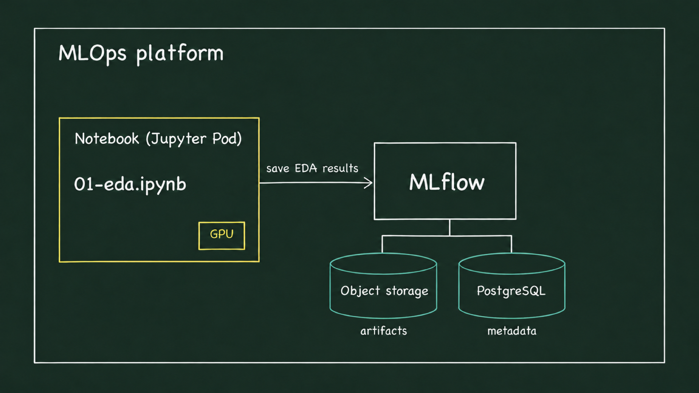
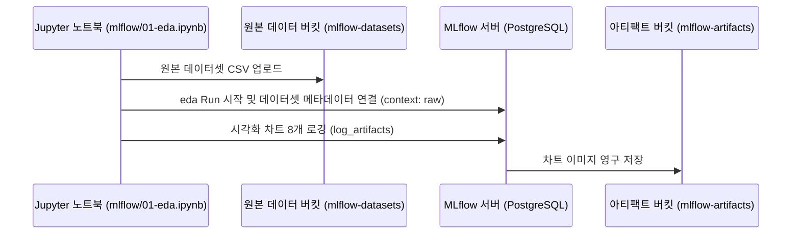
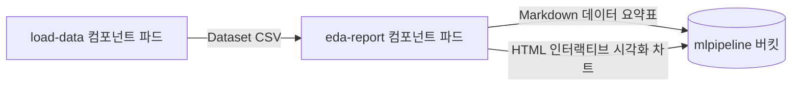

# Lab 1 시나리오 4. 탐색적 데이터 분석(EDA)과 Kubeflow Pipelines 기반 실행 자동화

## 이 시나리오의 목표

| 항목 | 내용 |
|---|---|
| **분석 데이터셋** | UCI Adult Census Dataset (1994년 미국 인구조사 데이터, 결측치 제거 후 30,162행) |
| **특성 컬럼** | 범주형 피처 8개(직업군, 학력, 혼인 상태, 직종, 가족 관계, 인종, 성별, 출신 국가) 및 타깃 레이블 `Target` |
| **예측 목표** | 연간 소득 5만 달러 초과 여부 (`>50K` vs `<=50K`) 이진 분류 |
| **주요 작업** | 1. 데이터 전체 행 수 및 클래스 불균형(Class Imbalance) 비율 확인<br/>2. 컬럼별 고유 범주 수 및 소득 5만 달러 초과 비율 시각화<br/>3. 시각화 차트와 원본 데이터셋 메타데이터를 플랫폼에 영구 기록 |
| **달성 결과** | 소득을 결정짓는 핵심 유의 피처를 파악하고, 그 근거(차트)와 데이터셋 계보를 MLflow Run 및 Kubeflow Pipelines 아티팩트로 영구 보존 |

탐색적 데이터 분석(EDA, Exploratory Data Analysis)은 본격적인 모델 설계에 앞서 데이터의 통계적 분포와 결측치, 타깃 레이블과의 상관관계를 시각화하고 탐색하는 기초 단계입니다. 

일반적인 데이터 사이언스 작업에서는 EDA 결과가 개인 노트북의 메모리나 임시 출력 셀에만 머물러, 커널이 재시작되면 분석 근거가 쉽게 유실됩니다. 본 시나리오에서는 **EDA 결과 차트와 원본 데이터셋의 계보를 MLOps 플랫폼에 영구 보존**하는 두 가지 접근법을 실습합니다.

- **MLflow 방식 (도서 4장)**: 노트북 셀에서 직접 EDA를 수행하고, 생성된 분석 차트와 데이터 경로를 MLflow Run의 아티팩트 및 데이터셋으로 기록합니다.
- **Kubeflow Pipelines 방식 (도서 5장)**: 동일한 데이터 수집 및 EDA 리포트 생성 로직을 독립된 컨테이너 파이프라인(DAG)으로 분리하여 재현 가능한 워크플로우로 실행합니다.

---

## 핵심 이론: MLflow와 Kubeflow Pipelines(KFP)의 역할 분담

두 도구 모두 "실험(Experiment)"과 "실행(Run)"이라는 용어를 사용하지만, 시스템 관점에서 담당하는 책임 영역은 명확히 구분됩니다.

| 비교 항목 | MLflow Tracking & Registry | Kubeflow Pipelines (KFP) |
|---|---|---|
| **핵심 역할** | 파라미터, 평가 지표, 모델 아티팩트, 데이터 계보의 **기록 및 보관** | 컨테이너 기반 워크플로우(DAG)의 **스케줄링 및 순차 실행** |
| **코드 실행 위치** | 코드가 동작하는 위치(로컬 노트북, CI 러너 등). 자체 실행 엔진 없음 | 단계(Component)마다 쿠버네티스 파드를 동적 프로비저닝하여 실행 |
| **단계 간 데이터 전달** | 직접적인 데이터 파이프라인 중계 기능 없음 | 파이프라인 아티팩트(S3)를 통해 앞 단계 출력을 다음 단계 입력으로 전달 |
| **계보 추적 (Lineage)** | `log_input()`을 통해 특정 Run에 데이터셋 버전과 해시를 바인딩 | 파이프라인 DAG 정의에 따라 컴포넌트 간 입출력 관계가 자동 기록됨 |
| **모델 레지스트리** | 내장 지원 (Version, Alias, Tag 기반 거버넌스) | 모델 레지스트리 미제공 (학습 컴포넌트 내부에서 MLflow로 등록 연계) |

> [!NOTE]
> MLflow와 KFP는 대체 관계가 아니라 상호보완적 관계입니다. 복잡한 워크플로우의 실행과 자원 격리는 **Kubeflow Pipelines**가 맡고, 각 단계에서 산출되는 실험 지표와 최종 모델 패키징은 **MLflow**가 전담하는 구조가 널리 쓰입니다.

### KFP 핵심 용어 정리

| 용어 | 정의 및 역할 | 본 핸즈온 실습 예시 |
|---|---|---|
| **Pipeline** | 여러 컴포넌트의 의존 관계(DAG)와 실행 순서를 정의한 워크플로우 청사진 | `income-eda`, `income-train` |
| **Pipeline Version** | 파이프라인 정의가 변경될 때마다 등록되는 불변의 설계도 판본 | `income-eda-20261101-151500` |
| **Run** | 특정 파이프라인 버전에 구체적인 파라미터를 입력하여 쿠버네티스 상에서 1회 실행한 인스턴스 | `eda`, `train-xgboost` |
| **Experiment** | 논리적으로 연관된 여러 Run들을 그룹화하여 관리하는 최상위 폴더 | `income-classifier` |
| **Recurring Run** | Cron 주기나 정해진 인터벌에 따라 파이프라인 Run을 주기적으로 생성하는 스케줄러 | 배치 추론 및 정기 재학습 파이프라인에 활용 |

### 파이프라인 오케스트레이션 도입의 장단점(Trade-off)

- **장점**:
  - **자원 최적화**: 전처리 단계는 가벼운 CPU 파드로 실행하고, 모델 학습 단계만 GPU 파드를 동적 할당할 수 있습니다.
  - **재현성과 캐싱(Caching)**: 동일한 파라미터와 입력 데이터로 실행된 단계는 이전 캐시 결과를 재사용하여 실행 시간을 대폭 단축합니다.
  - **팀 간 공유**: 노트북 환경이 없는 동료나 CI/CD 파이프라인도 UI 또는 API 호출만으로 동일한 작업을 완벽히 재현할 수 있습니다.
- **감수해야 할 오버헤드**:
  - 단계마다 파드가 새로 스케줄링되고 베이스 이미지와 의존성 패키지를 내려받으므로, 노트북 셀 실행(수 초)에 비해 실행 준비 시간(1~2분)이 소요됩니다.
  - 각 컴포넌트 파드는 격리된 무상태(Stateless) 컨테이너로 동작하므로, 로컬 파일이나 전역 변수를 공유할 수 없고 반드시 오브젝트 스토리지를 통해 직렬화된 아티팩트로 데이터를 주고받아야 합니다.

---

## 아키텍처 및 데이터 흐름

### MLflow 기반 EDA 흐름

노트북에서 생성된 분석 차트는 MLflow 프록시를 통해 `mlflow-artifacts` 버킷에 저장되고, 실험 메타데이터는 PostgreSQL에 기록됩니다.





### Kubeflow Pipelines 기반 EDA 흐름

파이프라인의 각 단계는 독립된 파드로 실행되며, 데이터 교환은 `mlpipeline` 아티팩트 스토리지를 경유합니다.



---

## 실습 1: MLflow 기반 탐색적 데이터 분석

[시나리오 3](./8-lab1-kubeflow-notebook.md)에서 생성한 JupyterLab 환경에서 실습을 진행합니다. 로컬 터미널에서 MLflow 포트 포워딩을 유지합니다.

```bash
kubectl -n mlflow port-forward svc/mlflow-service 5000:5000
```

### 1. 노트북 실행

JupyterLab에서 `mlflow/01-eda.ipynb`를 열고 **Run All Cells**를 실행합니다.

- **데이터셋 크기 확인**: 30,162행, 9개 컬럼 (`(30162, 9)`)
- **타깃 레이블 불균형 확인**: `<=50K`가 22,654건(약 75%), `>50K`가 7,508건(약 25%)으로 클래스 불균형이 존재합니다. 따라서 후속 실험에서는 단순 정확도(Accuracy)뿐만 아니라 **ROC AUC** 지표를 핵심 평가지표로 함께 모니터링해야 합니다.
- **아티팩트 업로드 확인**: 마지막 셀 출력에서 S3 버킷 경로와 8개 시각화 이미지 업로드가 표시됩니다.

```text
raw      : s3://mlflow-datasets/income-classifier/raw/income_data.csv
artifacts: ['eda_plots/Education.png', 'eda_plots/Marital-Status.png', ...]
```

### 2. MLflow 대시보드에서 분석 결과 검토

브라우저(`http://localhost:5000`)에서 **income-classifier** 실험의 `eda` Run을 선택하고 **Artifacts** 탭의 `eda_plots/Marital-Status.png`를 확인합니다.

| 혼인 상태 (`Marital-Status`) | 연소득 5만 달러 초과(`>50K`) 비율 |
|---|---|
| **Married-civ-spouse (기혼 유배우자)** | **45.5%** |
| **Divorced (이혼)** | **10.7%** |
| **Never-married (미혼)** | **4.8%** |

혼인 상태에 따라 고소득자 비율의 격차가 매우 크게 나타남을 확인할 수 있습니다. 이러한 정량적 관찰 결과가 다음 단계에서 해당 컬럼을 핵심 피처로 선정하는 데이터 기반의 명확한 근거가 됩니다.

### 3. 데이터셋 계보 바인딩 확인

동일한 Run의 **Datasets** 탭을 열어 `income_data`가 `raw` 컨텍스트로 정상 연결되어 있는지 확인합니다.

---

## 실습 2: Kubeflow Pipelines 기반 EDA 자동화

동일한 분석 과정을 재현 가능한 파이프라인으로 전환하여 실행합니다.

### 1. 파이프라인 등록 및 실행

JupyterLab에서 `kubeflow/01-eda.ipynb`를 열고 **Run All Cells**를 실행합니다.

- `register()` 함수가 파이프라인 청사진(`income-eda`)을 Kubeflow Pipelines 서버에 등록합니다.
- 마지막 셀이 등록된 파이프라인 버전으로 `income-classifier` 실험 하위에 `eda` Run을 제출하고 완료될 때까지 모니터링합니다.

실행 결과:
```text
registered income-eda version b2861889-4c95-4013-992a-84162a1cb7a8
submitted eda fee73804-6dd3-4c33-82d9-a5ef59ca9183
eda SUCCEEDED
```

### 2. Kubeflow 대시보드 시각화 결과 확인

Kubeflow 웹 UI(`http://localhost:8080`)의 좌측 메뉴 **Pipelines** → **Runs**로 이동하여 방금 완료된 `eda` Run을 클릭합니다.

- DAG 그래프에서 `eda-report` 노드를 클릭하고 우측 패널의 **Visualization** 탭을 확인합니다.
- 파이프라인 컴포넌트가 자동 렌더링한 마크다운 통계 테이블과 시각화 차트들이 브라우저 상에 정상 표시됩니다.
- 출신 국가(`Native_country`) 컬럼의 고유 범주 수가 41개에 달함을 확인할 수 있으며, 이는 후속 시나리오에서 One-Hot 인코딩 적용 시 컬럼 차원 수가 크게 증가하는 배경이 됩니다.

---

## 부록: 실무 플랫폼 운영 관점의 시사점

- **저장소별 관심사의 분리**: MLflow는 실험 단위의 메타데이터 및 차트 보관에 집중하고, KFP는 아티팩트 간의 입출력 연결 계보와 실행 상태 추적에 집중합니다.
- **컴포넌트 수준 캐싱(Caching)**: KFP 파이프라인은 입력 데이터나 컴포넌트 코드가 변경되지 않은 경우 `load-data` 단계를 자동으로 캐시 처리하여 불필요한 중복 연산을 방지합니다.
- **데이터셋 등록(`log_input`)의 동작 원리**: MLflow의 `log_input`은 원본 대용량 데이터를 직접 복사하는 것이 아니라, 스토리지 URI, 데이터 스키마, 내용 해시(Digest)만을 메타데이터로 기록하므로 스토리지 낭비 없이 완벽한 계보를 제공합니다.
