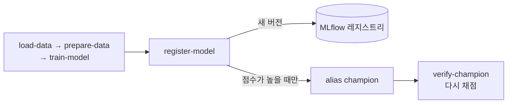

# Lab 1 시나리오 4. 가장 좋은 모델을 등록하고, 기록만으로 같은 모델을 다시 만듭니다

## 이 시나리오의 목표

| 항목 | 내용 |
|---|---|
| 입력 | 앞 시나리오의 run 3개 |
| 작업 | 1. 점수가 가장 높은 run의 모델을 레지스트리에 등록 2. 별칭(alias) `champion`을 붙임 3. alias에서 출발해 학습 데이터까지 거꾸로 따라감 4. 기록된 데이터로 다시 학습해 점수 비교 |
| 달성할 것 | 모델을 쓰는 쪽이 `models:/income-classifier@champion` 하나로 모델을 꺼내고, 기록만으로 같은 모델을 다시 만들 수 있음을 확인. 등록과 확인을 Kubeflow Pipelines로 자동화 |

모델 레지스트리는 "지금 쓸 모델이 무엇인가"를 정하는 곳입니다. 책 5장 추론 파이프라인과 6장 서빙은 run ID가 아니라 레지스트리에서 모델을 꺼냅니다. 책은 `Production` stage를 쓰지만 MLflow 3에서는 stage 대신 alias를 씁니다.

**MLflow 예제**는 노트북에서 사람이 최고 run을 골라 등록합니다. **Kubeflow 예제**는 학습, 등록, champion 확인을 파이프라인 하나로 묶습니다. 이 클러스터의 Kubeflow에는 모델 레지스트리가 없어서, 책 5장처럼 파이프라인은 KFP가 돌리고 모델 버전은 MLflow 레지스트리에 둡니다.

## 컴포넌트 역할

| 컴포넌트 | 역할 |
|---|---|
| `03-registry-lineage.ipynb` | 최고 run을 등록하고, 리니지를 따라가고, 다시 학습해 점수를 비교 |
| Registered model `income-classifier` | 버전 목록과 alias를 가진 이름 |
| Model version | LoggedModel 하나를 가리키는 번호. 출처 run을 기억 |
| Alias `champion` | 모델을 쓰는 쪽이 아는 유일한 이름 |
| Kubeflow Pipelines(Lab 3), KServe(Lab 4) | `models:/income-classifier@champion`으로 모델을 꺼내는 쪽 |
| `pipelines/register_pipeline.py` | Kubeflow 예제. 학습 → `register-model` → `verify-champion` 파이프라인을 제출 |
| PodDefault `mlflow-access` | `register-model`, `verify-champion` 파드에 label `mlflow-access: "true"`를 붙여 MLflow 주소와 계정을 넣음 |

## 흐름

위쪽은 쓰는 쪽이 alias로 모델을 꺼내는 방향이고, 아래쪽은 이 노트북이 리니지를 거꾸로 따라가 다시 학습하는 방향입니다.

```mermaid
flowchart LR
  KFP[Kubeflow Pipelines<br/>Lab 3] -->|models:/income-classifier@champion| Alias[alias champion]
  KS[KServe<br/>Lab 4] -->|models:/income-classifier@champion| Alias
  Alias --> V[version 1]
  V --> Run[run xgboost]
  Run --> DS[(train, test 데이터)]
  DS -->|다시 내려받아 학습| Re[재학습 모델]
  Re -->|ROC AUC 비교| Check{같은 점수?}
```

## MLflow 예제

[8-lab1-experiment-lineage.md](./8-lab1-experiment-lineage.md)의 run 3개가 있는 상태에서 시작합니다.

### 1. 최고 모델을 등록합니다

JupyterLab에서 `03-registry-lineage.ipynb`를 열고 **Run All Cells**를 실행합니다. 두 번째 셀이 최고 run을 등록하고 alias를 붙입니다.

```text
xgboost aa1496b3a63648318bfb6f123fe8045d 0.8737
registered income-classifier v1 @champion
```

### 2. alias에서 학습 데이터까지 따라갑니다

세 번째 셀이 alias 하나에서 출발해 run, 점수, 파라미터, 데이터셋을 출력합니다.

```text
model   : income-classifier v1 <- run xgboost aa1496b3a63648318bfb6f123fe8045d
metrics : {'roc_auc_score_train': 0.9002, 'roc_auc_score_test': 0.8737}
params  : {'max_depth': '10', 'seed': '42'}
dataset : training  train    s3://mlflow-datasets/income-classifier/datasets/train-81c28471.csv
dataset : testing   test     s3://mlflow-datasets/income-classifier/datasets/test-845eaa8f.csv
dataset : reference features s3://mlflow-datasets/income-classifier/datasets/features-bef33769.csv
```

### 3. 다시 학습해 점수를 비교합니다

마지막 셀이 기록된 경로에서 데이터를 받아 같은 모델 정의로 다시 학습합니다. `same=True`가 나오면 기록만으로 모델을 다시 만들 수 있다는 뜻입니다.

```text
logged=0.873681 retrained=0.873681 same=True
```

### 4. MLflow 화면에서 레지스트리를 봅니다

`http://localhost:5000`의 **Models** 탭에서 `income-classifier`를 엽니다. Version 1에 alias `champion`이 붙어 있고, **Source run** 링크가 `xgboost` run으로 이어집니다.

## Kubeflow 예제

MLflow 예제로 `champion`이 v1에 붙은 상태에서 시작합니다. 파이프라인은 학습한 모델을 run마다 새 버전으로 등록하고, 점수가 지금 `champion`보다 높을 때만 alias를 옮깁니다. 마지막 단계가 `champion`을 내려받아 다시 채점합니다.



### 1. 파이프라인을 제출합니다

노트북 터미널의 `pipelines` 디렉터리에서 실행합니다. 2~3분 걸립니다.

```bash
python register_pipeline.py
```

`SUCCEEDED`가 나오면 됩니다.

```text
submitted register f26f5864-cb82-4fb8-8aa1-05dbaf2a75db
register SUCCEEDED
```

### 2. 등록 결과와 champion을 봅니다

KFP 화면의 `register` run에서 `register-model`과 `verify-champion` 노드의 **Logs** 탭을 봅니다. 같은 XGBoost라 점수가 v1과 같으므로, 버전은 v2로 올라가고 `champion`은 v1에 남습니다. v1을 다시 채점한 점수도 기록과 같습니다.

```text
registered v2 score=0.873681 champion=v1 best=0.873681
champion=v1 logged=0.873681 rescored=0.873681
```

MLflow 화면의 **Models** → `income-classifier`에 Version 2가 생겼고, 출처 run `kfp-xgboost`에는 tag `kfp_run_id`로 KFP run ID가 남아 있습니다. 파이프라인을 다시 실행하면 v3, v4로 계속 올라갑니다.

## 부록. 실무에서 얻는 것

- **버전은 자동으로, alias는 조건부로 옮깁니다.** 파이프라인이 만든 모든 모델은 버전으로 남기고, 쓰는 쪽에 영향을 주는 `champion`은 점수 비교를 통과할 때만 옮깁니다. 사람이 하던 판단을 파이프라인의 규칙으로 바꾼 것입니다.
- **두 도구의 기록을 ID로 잇습니다.** MLflow run의 tag `kfp_run_id`로 "이 모델 버전을 만든 파이프라인 실행"을 찾고, KFP run에서 학습 데이터 아티팩트까지 따라갑니다.

- **alias는 모델을 쓰는 쪽과의 약속입니다.** 쓰는 쪽은 버전 번호도 run ID도 모르고 `@champion`만 압니다. 새 모델이 더 좋으면 alias를 새 버전으로 옮기고, 되돌릴 때도 alias만 옮깁니다. 쓰는 쪽 코드는 바뀌지 않습니다.
- **리니지는 장애 대응 도구입니다.** 서빙 중인 모델의 예측이 이상하면 alias에서 출발해 "어느 데이터와 파라미터로 만들었나"를 API 몇 번으로 확인합니다.
- **재현성은 다시 만들어 봐야 증명됩니다.** `random_state`를 고정하지 않았거나 데이터 경로가 지워졌다면 3번에서 실패합니다.
- **등록 이름은 알고리즘이 아니라 용도로 짓습니다.** 책은 `random-forest-classifier`로 등록하지만 이 Lab에서는 XGBoost가 이겼습니다. 알고리즘이 바뀌어도 쓰는 쪽이 같은 이름을 쓰도록 `income-classifier`로 등록했습니다.
