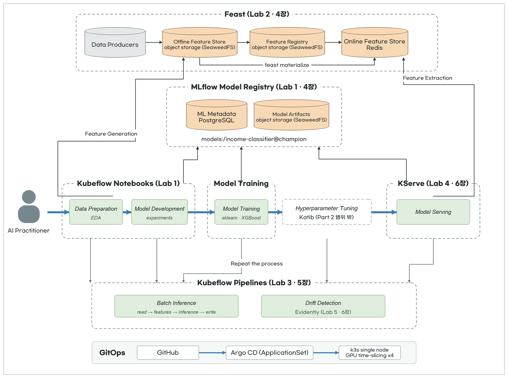
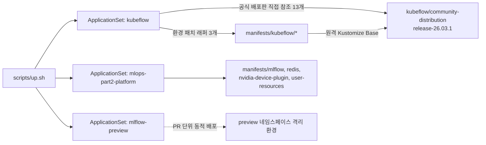

# 실습 환경 준비 및 전체 배포

Ubuntu(amd64, NVIDIA GPU 1장 탑재) 단일 서버에 경량 쿠버네티스(k3s)를 구성하고, 로컬 PC에서 `kubectl`과 Argo CD를 통해 GitOps 방식으로 MLOps 플랫폼 컴포넌트를 선언적으로 배포합니다.

## 전체 아키텍처 및 ML 수명주기



위 다이어그램은 Kubeflow 공식 AI 수명주기 모델을 기반으로 설계되었습니다. 중앙 라인은 모델이 데이터 준비부터 서빙까지 거치는 단계이며, 상단은 단계 간 공유 스토리지, 하단은 재현 가능한 실행을 지원하는 오케스트레이션 레이어입니다.

| 수명주기 단계 | 플랫폼 컴포넌트 | 연계 실습 |
|---|---|---|
| **Data Preparation & Model Development** | Kubeflow Notebooks (탐색적 데이터 분석 및 실험 코드 작성) | Lab 1-3, 도서 4장 |
| **Model Training** | 노트북 및 파이프라인 상의 scikit-learn, XGBoost 모델 학습 (MLflow 로깅) | Lab 1-4, 도서 4장 |
| **Model Registry** | MLflow Model Registry (PostgreSQL 메타데이터 + SeaweedFS 아티팩트) | Lab 1-2, 6, 도서 4장 |
| **Feature Store** | Feast (오프라인: S3 Parquet, 온라인: Redis, 웹 UI: Helm 차트) | Lab 1-8, 도서 4장 |
| **Workflow Orchestration** | Kubeflow Pipelines (EDA, 학습, 모델 승격을 DAG로 자동 반복) | Lab 1-4~6, 도서 5장 |
| **Model Serving** | KServe (Standard 모드, `mlflow-serve` 전용 ServingRuntime) | Lab 1-7, 도서 6장 |
| **Hyperparameter Tuning** | Katib (Part 2 학습 범위 밖이므로 리소스 최적화를 위해 미설치) | 범위 외 |

인프라 하단은 GitOps 배포 경로를 나타냅니다. Argo CD ApplicationSet이 Git 저장소의 `manifests/`를 읽어 k3s 클러스터에 배포하며, 단일 GPU(RTX 5060 Ti 16GB)는 타임슬라이싱을 통해 4개의 가상 슬롯으로 분할되어 노트북, 서빙, 파이프라인 파드가 충돌 없이 공유합니다.

---

## 사전 준비 (Ubuntu 호스트)

### 1. NVIDIA 드라이버 및 컨테이너 툴킷 확인
Ubuntu 서버에 NVIDIA 드라이버와 NVIDIA Container Toolkit이 사전 설치되어 있어야 합니다. 호스트 터미널에서 GPU 인식이 정상적인지 확인합니다.

```bash
nvidia-smi --query-gpu=name,memory.total --format=csv
```

### 2. k3s 클러스터 설치 (GPU 런타임 활성화)
아래 명령으로 k3s v1.36.5 버전을 설치합니다. 옵션별 적용 이유는 다음과 같습니다.

| 설치 옵션 | 적용 사유 |
|---|---|
| `--disable=traefik` | Kubeflow 플랫폼이 자체 Istio Ingress Gateway를 사용하므로 기본 인그레스 비활성화 |
| `--tls-san <Ubuntu IP>` | 외부 로컬 PC에서 쿠버네티스 API 서버에 안전하게 접속할 수 있도록 서버 IP를 TLS 인증서에 포함 |
| `--write-kubeconfig-mode=644` | 비루트(Non-root) 사용자도 `kubeconfig` 파일을 읽을 수 있도록 권한 부여 |
| `--default-runtime=nvidia` | Kubeflow Notebook과 KServe 파드가 `runtimeClassName` 명시 없이도 GPU를 자동 인식하도록 기본 런타임 지정 |

```bash
curl -sfL https://get.k3s.io | INSTALL_K3S_VERSION=v1.36.5+k3s1 sh -s - server \
  --disable=traefik \
  --tls-san <Ubuntu IP> \
  --write-kubeconfig-mode=644 \
  --default-runtime=nvidia
```

### 3. 로컬 PC의 kubeconfig 설정
로컬 PC(맥북 등)에서 Ubuntu의 kubeconfig 파일을 복사해 오고, 엔드포인트 주소를 서버 외부 IP로 치환합니다.

```bash
ssh <Ubuntu 사용자>@<Ubuntu IP> cat /etc/rancher/k3s/k3s.yaml | sed 's/127.0.0.1/<Ubuntu IP>/' > ~/.kube/config-k3s
```

기존 클러스터와의 컨텍스트 이름 충돌을 방지하기 위해 컨텍스트 명칭을 `k3s-ubuntu`로 변경하고 접속을 확인합니다.

```bash
export KUBECONFIG=~/.kube/config:~/.kube/config-k3s
kubectl config rename-context default k3s-ubuntu
kubectx k3s-ubuntu && kubectl get nodes
```

---

## 플랫폼 전체 배포 (Up)

`scripts/up.sh` 스크립트를 실행하면 Argo CD v3.5.6을 설치하고, Kustomize가 Helm 차트를 파싱할 수 있도록 `--enable-helm` 플래그를 활성화한 뒤, `manifests/argocd/`에 정의된 3개의 ApplicationSet을 클러스터에 배포합니다.

```bash
cd mlops/ml-platform-engineering-part2 && ./scripts/up.sh
```

> [!NOTE]
> ApplicationSet은 기본적으로 원격 `master` 브랜치를 바라봅니다. 머지 전 개발 브랜치에서 테스트하려면 `kubeflow-applicationset.yaml`과 `platform-applicationset.yaml` 매니페스트 내의 `targetRevision`을 해당 작업 브랜치명으로 지정하세요.

### Argo CD 관리자 대시보드 접속
포트 포워딩을 열고 웹 브라우저에서 `https://localhost:8081`에 접속하여 관리자 ID `admin`으로 로그인합니다.

```bash
kubectl -n argocd port-forward svc/argocd-server 8081:443
```

초기 관리자 비밀번호 확인:
```bash
kubectl -n argocd get secret argocd-initial-admin-secret -o jsonpath='{.data.password}' | base64 -d; echo
```

---

## 리소스 회수 및 삭제 (Down)

배포된 ApplicationSet을 삭제하면 Argo CD의 Finalizer에 의해 연관된 하위 Application 및 쿠버네티스 리소스들이 역순으로 자동 정리됩니다.

```bash
cd mlops/ml-platform-engineering-part2 && kubectl delete -f manifests/argocd/
```

호스트 상의 k3s 클러스터 자체를 완전히 삭제하려면 Ubuntu 서버에서 `/usr/local/bin/k3s-uninstall.sh`를 실행합니다.

---

## 부록: 선언적 매니페스트 및 GitOps 아키텍처

### 저장소 디렉터리 구조

```text
mlops/ml-platform-engineering-part2/
├── scripts/up.sh                        # Argo CD 초기화 및 ApplicationSet 일괄 적용 스크립트
├── notebooks/                           # Lab 1 핸즈온 주피터 노트북
│   ├── mlflow/                          # MLflow 기반 학습 및 실험 추적 예제 (도서 4장)
│   ├── kubeflow/                        # Kubeflow Pipelines 파이프라인 자동화 예제 (도서 5장)
│   └── feast/                           # Feast 피처 스토어 정의 및 연동 예제 (시나리오 8)
└── manifests/
    ├── argocd/
    │   ├── kubeflow-applicationset.yaml        # Kubeflow 배포판 핵심 컴포넌트 16개 관리
    │   ├── platform-applicationset.yaml        # MLflow, Redis, GPU, 사용자 설정 등 4개 컴포넌트 관리
    │   └── mlflow-preview-applicationset.yaml  # PR 단위 격리 프리뷰 환경 자동 생성
    ├── kubeflow/                        # 공식 배포판을 오버라이드한 Kustomize 래퍼
    │   ├── istio-install/               # Istio CNI 호스트 경로를 k3s 환경에 맞게 패치
    │   ├── pipelines/                   # KFP 스토리지 버킷 생성 Job 및 S3 NetworkPolicy 추가
    │   ├── kserve/                      # KServe Standard 모드 전환 및 불필요 인그레스 비활성화
    │   └── user-resources/              # 사용자 네임스페이스용 PodDefault(mlflow-access) 및 Secret
    ├── kubeflow-notebook/               # 사용자가 직접 생성/관리하는 Notebook 및 PVC 스펙
    ├── kserve-inference/                # KServe InferenceService 및 mlflow-serve ServingRuntime 스펙
    ├── mlflow/                          # 커뮤니티 Helm 차트 기반 MLflow + PostgreSQL 구성
    ├── nvidia-device-plugin/            # 타임슬라이싱(4분할) 설정이 포함된 NVIDIA Device Plugin
    ├── redis/                           # Feast 실시간 온라인 스토어 매니페스트
    └── feast/                           # Feast 웹 UI 배포용 Helm 차트 매니페스트
```

### ApplicationSet을 통한 계층적 배포 구조



### 공식 배포판 오버라이드(Patch) 주요 내역

| Kustomize 래퍼 | 변경 사항 | 적용 사유 |
|---|---|---|
| `kubeflow/istio-install` | `istio-cni-node`의 볼륨 마운트 경로를 k3s 전용 경로(`/var/lib/rancher/k3s/...`)로 수정 | k3s는 기본 CNI 바이너리 위치가 표준 쿠버네티스와 다름 |
| `kubeflow/pipelines` | 버킷 생성 Job 및 S3 접근 허용 `NetworkPolicy` 추가 | 원작 코드 버킷 5개 자동 생성 및 MLflow 네임스페이스 간 스토리지 통신 허용 |
| `kubeflow/kserve` | `inferenceservice-config`의 배포 모드를 `Standard`로 설정하고 Ingress 생성 억제 | Knative 의존성을 제거하고 경량 쿠버네티스 자원 최적화 |
| `kubeflow/user-resources` | PodDefault(`mlflow-access`, `access-ml-pipeline`) 추가 | 노트북 파드에 MLflow 접속 주소와 파이프라인 인증 토큰을 자동 주입 |
