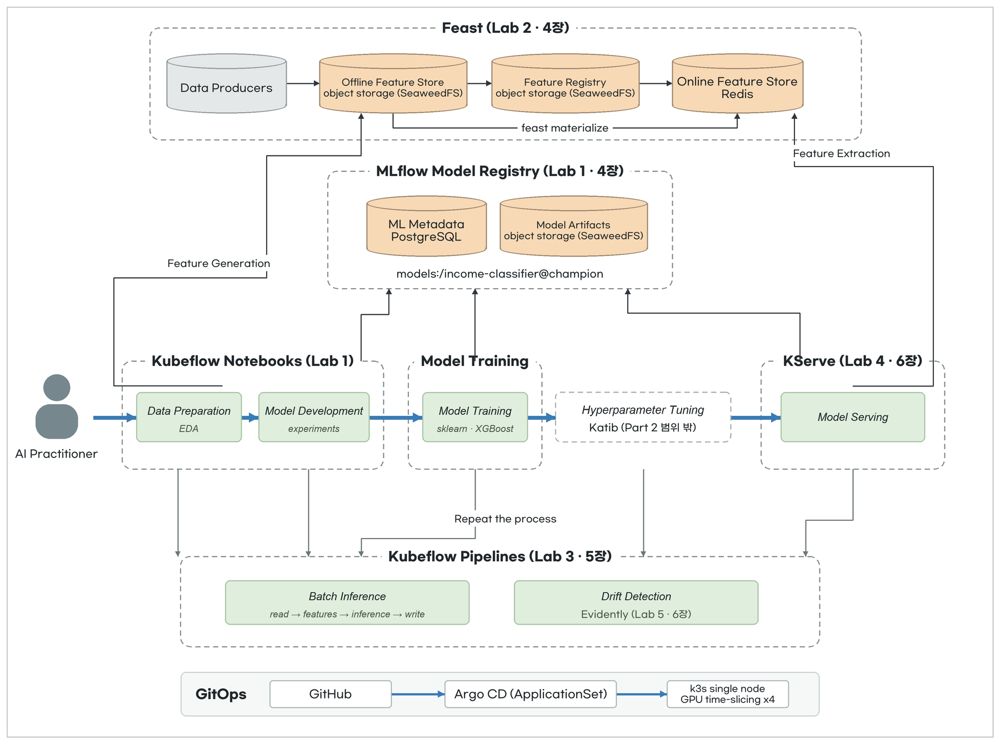
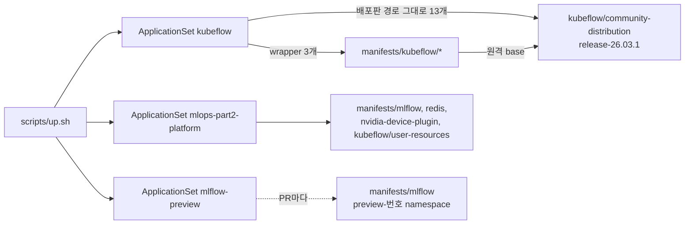

# 실습 환경 준비

Ubuntu(amd64, NVIDIA GPU 1장) 한 대에 k3s를 설치하고, 맥북에서 kubectl로 Argo CD를 설치합니다. 플랫폼 구성요소는 Argo CD가 GitHub에서 읽어 설치합니다.

## 아키텍처



그림은 Kubeflow 공식 문서의 AI lifecycle 그림과 같은 구도입니다. 가운데 줄이 모델 하나가 데이터 준비부터 서빙까지 가는 단계이고, 위쪽은 단계들이 함께 쓰는 저장소, 아래쪽은 단계를 반복 실행하는 오케스트레이터입니다.

| lifecycle 단계 | 이 실습의 구성요소 | Lab, 책 |
|---|---|---|
| Data Preparation, Model Development | Kubeflow Notebooks. EDA와 실험 코드 | Lab 1, 4장 |
| Model Training | 노트북에서 sklearn, XGBoost 학습. 결과는 MLflow로 | Lab 1, 4장 |
| Model Registry | MLflow. 메타데이터는 PostgreSQL, 모델 파일은 object storage(SeaweedFS) | Lab 1, 4장 |
| Feature Store | Feast. 오프라인 스토어는 object storage, 온라인 스토어는 Redis | Lab 2, 4장 |
| Repeat the process | Kubeflow Pipelines. 배치 추론과 드리프트 감지를 같은 순서로 반복 | Lab 3, 5장. Lab 5, 6장 |
| Model Serving | KServe Standard 모드 | Lab 4, 6장 |
| Hyperparameter Tuning | Katib. Part 2 범위 밖이라 설치하지 않음 | 없음 |

맨 아래 띠는 설치 경로입니다. Argo CD ApplicationSet이 GitHub의 `manifests/`를 읽어 k3s에 올립니다. GPU(RTX 5060 Ti 16GB)는 time-slicing으로 4개처럼 나눠 노트북, 서빙, 파이프라인이 같이 씁니다.

## 사전 준비

Ubuntu에 NVIDIA 드라이버와 NVIDIA Container Toolkit이 설치돼 있어야 합니다. 호스트에서 `nvidia-smi`가 GPU를 보여 주는지 먼저 확인합니다.

```bash
nvidia-smi --query-gpu=name,memory.total --format=csv
```

k3s를 설치합니다. 옵션마다 이유가 있습니다.

| 옵션 | 이유 |
|---|---|
| `--disable=traefik` | Kubeflow는 Istio ingress gateway를 씀 |
| `--tls-san <Ubuntu IP>` | 맥북에서 API 서버에 접속할 수 있게 IP를 인증서에 넣음 |
| `--write-kubeconfig-mode=644` | sudo 없이 kubeconfig를 복사함 |
| `--default-runtime=nvidia` | Kubeflow Notebook과 KServe 파드는 `runtimeClassName`을 지정하지 않음. 기본 런타임이 nvidia여야 GPU를 씀 |

```bash
curl -sfL https://get.k3s.io | INSTALL_K3S_VERSION=v1.36.5+k3s1 sh -s - server --disable=traefik --tls-san <Ubuntu IP> --write-kubeconfig-mode=644 --default-runtime=nvidia
```

맥북에서 kubeconfig를 가져오고 `server` 주소를 Ubuntu IP로 바꿉니다.

```bash
ssh <Ubuntu 사용자>@<Ubuntu IP> cat /etc/rancher/k3s/k3s.yaml | sed 's/127.0.0.1/<Ubuntu IP>/' > ~/.kube/config-k3s
```

kubeconfig의 컨텍스트 이름은 `default`라서 다른 클러스터와 헷갈립니다. 기본 kubeconfig와 함께 읽게 하고 이름을 바꿉니다. `export`는 `~/.zshrc`에 넣어 둡니다.

```bash
export KUBECONFIG=~/.kube/config:~/.kube/config-k3s
kubectl config rename-context default k3s-ubuntu
```

kubectx로 k3s 클러스터를 고르고 노드가 보이는지 확인합니다.

```bash
kubectx k3s-ubuntu && kubectl get nodes
```

## up

`scripts/up.sh`가 Argo CD v3.5.6을 설치하고, kustomize가 Helm chart를 렌더링하도록 `--enable-helm`을 켠 뒤 `manifests/argocd/`의 ApplicationSet 3개를 적용합니다.

```bash
cd mlops/ml-platform-engineering-part2 && ./scripts/up.sh
```

ApplicationSet은 master 브랜치를 읽습니다. master에 merge되기 전이면 `kubeflow-applicationset.yaml`과 `platform-applicationset.yaml`에서 이 저장소를 가리키는 `revision`, `targetRevision`을 작업 브랜치로 바꿉니다.

Argo CD 화면은 port-forward로 엽니다. `https://localhost:8081`에 ID `admin`으로 로그인합니다.

```bash
kubectl -n argocd port-forward svc/argocd-server 8081:443
```

초기 admin 비밀번호는 다른 터미널에서 직접 읽습니다.

```bash
kubectl -n argocd get secret argocd-initial-admin-secret -o jsonpath='{.data.password}' | base64 -d; echo
```

## down

ApplicationSet을 지우면 Application이 지워지고, 각 Application의 finalizer가 그 리소스를 지웁니다. k3s까지 지우려면 Ubuntu에서 `/usr/local/bin/k3s-uninstall.sh`를 실행합니다.

```bash
cd mlops/ml-platform-engineering-part2 && kubectl delete -f manifests/argocd/
```

## 부록. Argo CD가 설치하는 것과 kustomize 구조

up이 적용하는 파일은 ApplicationSet 3개입니다. ApplicationSet이 Application을 만들고, 각 Application이 kustomization 하나를 렌더링해 설치합니다.

### 디렉터리 구조

```text
mlops/ml-platform-engineering-part2/
├── scripts/up.sh                        # Argo CD 설치, --enable-helm, manifests/argocd/ 적용
├── notebooks/                           # Lab 1 노트북. Kubeflow Notebook 터미널에서 clone
└── manifests/
    ├── argocd/
    │   ├── kubeflow-applicationset.yaml        # Kubeflow 배포판 구성요소 16개
    │   ├── platform-applicationset.yaml        # MLflow, Redis, GPU, 사용자 설정 4개
    │   └── mlflow-preview-applicationset.yaml  # PR마다 manifests/mlflow
    ├── kubeflow/                        # 배포판을 고쳐 쓰는 wrapper kustomization
    │   ├── istio-install/               # Istio CNI 경로를 k3s 경로로 patch
    │   ├── pipelines/                   # KFP + 버킷 생성 Job + object storage 접근 허용 NetworkPolicy
    │   ├── kserve/                      # Standard 모드, Ingress 생성 끔
    │   └── user-resources/              # PodDefault mlflow-access와 Secret
    ├── kubeflow-notebook/               # Argo CD 밖. kubectl로 만드는 Notebook과 PVC
    ├── mlflow/                          # Helm chart(helmCharts) + PostgreSQL
    ├── nvidia-device-plugin/            # Helm chart(helmCharts) + time-slicing values
    └── redis/                           # Feast 온라인 스토어
```

### ApplicationSet 세 개가 Application을 만듭니다

| ApplicationSet | generator | 만드는 Application |
|---|---|---|
| `kubeflow` | list. 배포판 저장소의 경로 16개 | `kf-cert-manager`, `kf-istio`, `kf-dex`, `kf-dashboard`, `kf-notebooks`, `kf-pipelines`, `kf-kserve` 등 |
| `mlops-part2-platform` | list. 이 저장소의 디렉터리 4개 | `nvidia-device-plugin`, `mlflow`, `redis`, `kubeflow-user-resources` |
| `mlflow-preview` | pullRequest. `preview` label이 붙은 열린 PR | `mlflow-preview-<PR 번호>` |



배포판의 `example/kustomization.yaml`은 구성요소 경로를 `resources`에 한 줄씩 나열합니다. `kubeflow` ApplicationSet은 그 한 줄을 `elements` 한 줄로 옮겼습니다. 배포판을 그대로 쓰는 경로는 배포판 저장소를 직접 가리키고, 고쳐야 하는 경로만 이 저장소의 wrapper를 가리킵니다. wrapper는 배포판 경로를 원격 base로 불러 patch를 겹칩니다.

ApplicationSet은 Application 사이의 순서를 보장하지 않습니다. cert-manager, Istio, profile controller가 먼저 떠야 하는 Application은 `retry`(최대 20회, backoff 최대 5분)로 순서를 맞춥니다.

### 배포판을 고친 곳

| wrapper | 바꾼 것 | 이유 |
|---|---|---|
| `kubeflow/istio-install` | DaemonSet `istio-cni-node`의 hostPath를 `/var/lib/rancher/k3s/data/cni`, `/var/lib/rancher/k3s/agent/etc/cni/net.d`로 | k3s는 CNI 바이너리와 설정을 `/opt/cni/bin`, `/etc/cni/net.d`에 두지 않음 |
| `kubeflow/pipelines` | 버킷 생성 PostSync Job과 NetworkPolicy `seaweedfs-allow-s3-clients` 추가 | 책 코드의 버킷 5개. `mlops-part2/s3-access: "true"` label namespace(MLflow)가 8333 포트에 접근 |
| `kubeflow/kserve` | ConfigMap `inferenceservice-config`의 `deploy`를 Standard로, `ingress`의 `disableIngressCreation`을 true로 | Knative를 설치하지 않음. 값이 JSON 문자열이라 `ingress` 전체를 옮기고 한 키만 바꿈 |
| `kubeflow/user-resources` | PodDefault `mlflow-access`와 Secret 추가. 배포판 경로가 아니라 `mlops-part2-platform`이 설치 | 노트북 파드에 MLflow와 object storage 접속 정보를 넣음 |

wrapper 하나는 아래처럼 생겼습니다. 배포판 경로를 원격 resource로 불러오고 patch 하나를 겹칩니다.

```yaml
resources:
- https://github.com/kubeflow/community-distribution//common/istio/istio-install/overlays/oauth2-proxy?ref=release-26.03.1

patches:
- target:
    kind: DaemonSet
    name: istio-cni-node
    namespace: kube-system
  patch: |-
    ...
          volumes:
          - name: cni-bin-dir
            hostPath:
              path: /var/lib/rancher/k3s/data/cni
          - name: cni-net-dir
            hostPath:
              path: /var/lib/rancher/k3s/agent/etc/cni/net.d
```

### Helm chart도 kustomize로 감쌉니다

MLflow와 NVIDIA device plugin은 Helm chart를 kustomize의 `helmCharts`로 불러옵니다. Argo CD에서 Helm Application과 kustomize Application을 섞지 않고, PR 미리보기가 `kustomize.namespace` 한 줄로 namespace를 바꾸게 하려는 선택입니다. Argo CD가 렌더링하려면 `argocd-cm`에 `kustomize.buildOptions: --enable-helm`이 있어야 하고, `up.sh`가 켭니다.

```yaml
namespace: mlflow
resources:
- mlflow-namespace.yaml
- mlflow-postgres-deployment.yaml
helmCharts:
- name: mlflow
  repo: https://community-charts.github.io/helm-charts
  version: 1.11.7
  releaseName: mlflow
  valuesFile: mlflow-values.yaml
```

Helm chart가 만드는 리소스에는 namespace가 없습니다. 그래서 `mlops-part2-platform` ApplicationSet은 템플릿에 `destination.namespace`를 둡니다.

### 모든 Application에 같은 sync 설정

| 설정 | 이유 |
|---|---|
| `automated.prune`, `automated.selfHeal` | Git에서 지운 리소스는 클러스터에서도 지우고, 손으로 바꾼 값은 Git 값으로 되돌림 |
| `ServerSideApply=true` | Istio, KFP, KServe CRD가 client-side apply의 annotation 크기 제한(262KB)을 넘음 |
| `SkipDryRunOnMissingResource=true` | 같은 sync에서 만들 CRD의 리소스가 dry-run에서 실패하지 않게 함 |
| `ignoreDifferences`와 `RespectIgnoreDifferences=true` | 다른 controller가 채우는 필드(aggregated ClusterRole의 rules, istiod가 고치는 webhook)를 차이로 보지 않고 덮어쓰지도 않음 |
| finalizer `resources-finalizer.argocd.argoproj.io` | Application을 지우면 그 리소스도 지움. down이 이 동작을 씀 |
