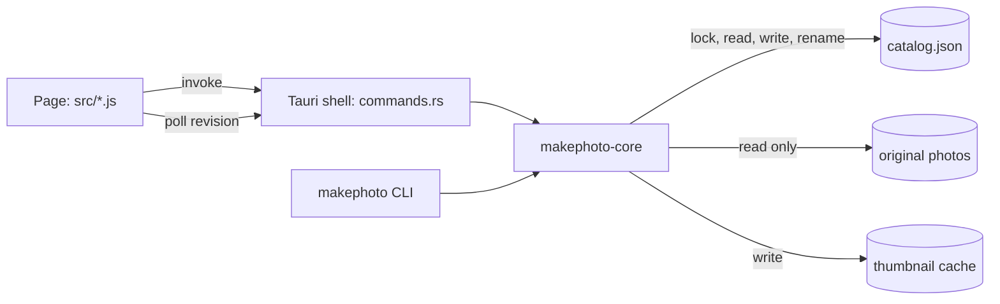

# Architecture

## Processes and crates

The app and the CLI meet only at the catalog file:

| Path | Role |
|---|---|
| `workspace/src-tauri/crates/core` | Catalog, edit, decode, develop, geometry, look, auto, render. No tauri dependency |
| `workspace/src-tauri/crates/cli` | clap front end; `run(argv) -> exit code`, plus the `makephoto` binary |
| `workspace/src-tauri/src/main.rs` | Starts the CLI when the first argument is a known subcommand, the window otherwise |
| `workspace/src-tauri/src/commands.rs` | The page's command surface and a small in-memory cache of decoded previews |
| `workspace/src/` | Plain HTML, CSS and JS, no build step. Scripts share state only through `window.mp` |

## The shared catalog

- `catalog::default_path()` is the single answer to "where is the catalog": `MAKEPHOTO_CATALOG`, else `~/Library/Application Support/io.akbun.makephoto/catalog.json`. The app does not use Tauri's path API for it, so the two callers cannot drift.
- `Store::update` takes an exclusive lock on `catalog.lock`, reads, applies the change, bumps `revision`, writes a temp file and renames it over the catalog. Readers never lock; a rename is atomic.
- The page polls `catalog_revision` every two seconds and reloads the view when it moved. That is how a CLI edit appears in the open app. The editor then resets that photo's undo history to the new edit.

## Edit model and pipeline

An `Edit` is a dozen numbers plus an optional crop and look id (`edit.rs`). `FIELDS` lists each number's range; the CLI prints it and `sanitized()` clamps anything that arrives from outside.

`render::render(source, edit)` is the only pipeline. Preview, thumbnail, export and the CLI's render all go through it:

1. Geometry first, so color work only touches surviving pixels: quarter turns, then straighten and crop in one inverse-mapped bilinear pass. Straightening scales in by `inscribed_scale` so no empty corner appears. The crop is in fractions of that straightened frame.
2. Color (`develop.rs`): white balance, exposure, a highlight roll-off, the shadow and highlight bumps and the contrast S curve are all per-channel functions of an 8-bit input, folded into three 256-entry tables per edit. Vibrance, saturation and the film look are per-pixel math after that. Rows run in parallel with rayon.
3. Grain is keyed to a grid of the long edge divided by 1800, so a preview and a full export show the same grain.

## Decoding

`decode.rs` reads JPEG, PNG, TIFF, WebP, BMP and GIF in process, applying EXIF orientation. HEIC and camera RAW go through `/usr/bin/sips`, macOS's own image engine, into a temporary TIFF that is deleted when the decode returns. Previews are decoded once at 2048 px on the long edge and kept for the last six photos.

## Auto mode

`auto::run(source, edit, kinds)` works on a 640 px copy. Each kind zeroes its own sliders, renders the rest of the current edit, measures, and sets only its own sliders, in a fixed order: level, color, brightness, light, contrast, vivid. Corrections stop part of the way (see the ADR). Level searches ±10° for the angle at which edge energy collects into single rows or columns and refuses to act unless that peak is 1.4 times the median; hills and trees stay as they are.

## Page to Rust surface

| Command | Returns |
|---|---|
| `bootstrap` | view, settings, looks, field ranges, catalog path, CLI path, version |
| `catalog_state`, `catalog_revision` | view; revision number |
| `import_paths`, `remove_photos`, `tag_photos`, `rename_tag`, `rate_photos`, `relink_folder`, `save_edit` | the whole new view |
| `render_preview(id, edit, maxEdge)` | JPEG bytes of an unsaved edit |
| `auto_adjust(id, edit, kinds)` | suggested edit and notes, not saved |
| `thumbnails(ids)` | cache paths, served through the asset protocol |
| `export_photos(ids, dir)` | written paths and failures |
| `save_settings` | settings |

Every mutating command returns the full view and the page redraws from it. The asset protocol scope is only the thumbnail cache; originals reach the page as rendered JPEG bytes, so no photo folder is ever granted to the webview.
