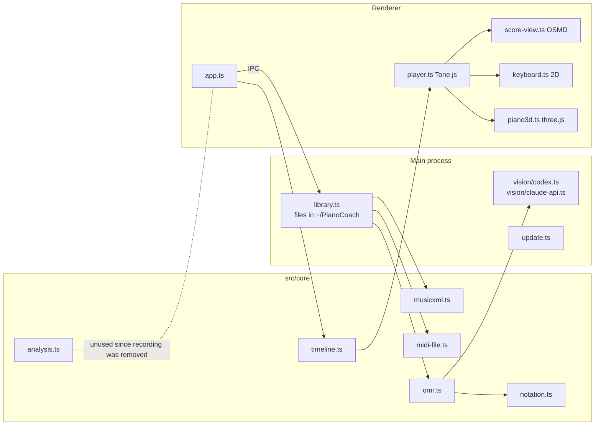

# 0.1.0 learning notes

How the first version is put together, and why each piece sits where it does.

## Shape of the app

Everything that decides something about music lives in `workspace/src/core/` and imports neither Electron nor the DOM. Main and the renderer are thin shells around it, so the parts that must be right (parsing, timing, judging) run in plain `node --test`.

How the pieces connect:

## Reading a photo

The model never writes MusicXML. It writes a few characters per note (`E5/q`, `[C4+E4]/h~`), and `notation.ts` turns them into notes. That split matters because the parser can check what the model cannot promise: every voice has to fill the measure, every token has to be readable. `omr.ts` sends the problems back once or twice and keeps whatever still fails, marked, so the review panel shows exactly where to look. Raw answers are cached by page hash, provider, model and prompt version, so retries and the evaluation script do not spend the plan or the API budget twice.

Pitch is read "as printed" on purpose. The model only copies what it sees; the key signature and the rule that an accidental lasts to the barline are applied in code, where they cannot be forgotten halfway down a page.

## From score to sound

A Score keeps the page as written. `timeline.ts` unrolls repeats and endings, merges tied notes, and turns ticks into milliseconds at tempo 1. Everything that moves in time (player, cursor, keyboard, analysis) reads the timeline, so they cannot drift apart.

`player.ts` schedules notes a quarter second ahead on the audio clock and reports the position every frame. The cursor and both keyboards are painted from that position, which is why they follow the sound and not the frame rate.

## Judging a take (built, then unplugged)

Recording was removed from the app before release, so nothing calls the analyzer now; it stays in core with its tests. `analysis.ts` groups expected notes that start together into chords, does the same for your note-ons within 50 ms, and aligns the two sequences with Needleman-Wunsch. A pair with the same pitches is correct, a pair with different pitches is a wrong note, and an unpaired note is missed or extra. Because the alignment cost is mostly pitch, one wrong note does not shift every later note into a mistake. Stops are gaps more than twice as long as written and over 600 ms; rushing and dragging come from a line fitted over the last eight matched chords.

## The 3D piano

`piano3d.ts` takes the same list of lit keys the 2D canvas draws, so nothing upstream knew a second view was added. Each mark also says how far its note has sounded; a finger lifts at 80%, which is what makes a repeated note look struck twice. Fingers are two segments with a middle joint placed by the triangle rule: the shorter the distance from knuckle to tip, the higher the joint, so curling and stretching come from geometry rather than animation curves. Hands pick fingers from the score's fingering, or else move only as far as they must and use the nearest free finger, which is roughly what a player does.

## Fingering for every note

Most scores print fingering for a few notes, often only in the right hand. `core/fingering.ts` fills the rest right after the timeline is built, so the 2D keyboard, the 3D numbers and the 3D hands all read one `finger` per note instead of each guessing. It models the hand as five fingers on neighboring white keys and moves it only as far as the next notes need; printed numbers re-anchor the hand. It knows nothing about thumb-under or crossings, which is why it sits behind one function a real fingering engine can replace.

## Updates in a monorepo

The repository releases many products, so "latest release" is not this app. Both platforms list the releases and take the first tag starting with `akbun-piano-teacher-v`. macOS swaps the unsigned `.app` from the dmg with a detached script; Windows points electron-updater at that tag's download folder.
