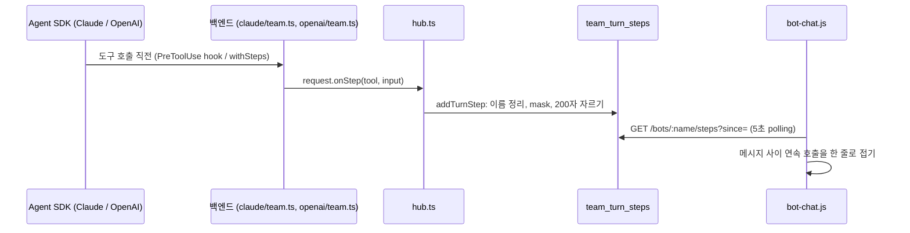
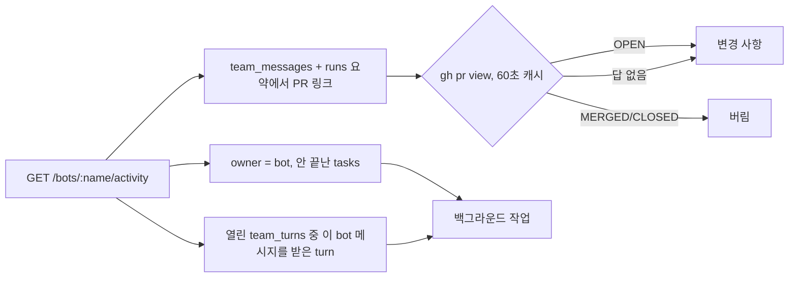

# akbun-taskq 0.28.0 학습 노트

0.28.0은 bot이 일하는 동안 무엇을 하는지 대화창에서 보이게 만든 버전이다. 화면 몇 군데를 손보고 bot별 Limits를 없앴지만, 구조가 바뀐 곳은 세 군데다. 도구 호출을 기록하는 길, bot 대화 오른쪽 열이 데이터를 모으는 길, 업데이트 설치가 진행률을 알리는 길이다. 아래는 각각 왜 그 자리를 골랐는지를 중심으로 정리했다.

## 도구 호출을 대화에 보이기

이전에는 bot의 turn 안에서 일어나는 일이 대화에 남지 않았다. 사용자는 bot이 `send_message`로 말을 걸어올 때까지 "작업 중… 42s"만 봤다. Claude Desktop처럼 "실행함 Bash git fetch…"를 보이려면 먼저 호출을 어딘가에 남겨야 했다.

처음 떠올린 자리는 `src/team/bot-gate.ts`였다. 모든 bot 런타임이 도구를 부르기 전에 이 gate를 거치기 때문이다. 하지만 gate는 백엔드마다 부르는 자리가 다르고(Claude는 PreToolUse hook, OpenAI는 taskq가 만든 로컬 도구 안), gate 자체는 정책 판정만 하는 순수 함수라 DB를 알게 하고 싶지 않았다. 그래서 `TurnRequest`에 선택적 callback `onStep(tool, input)` 하나를 더하고, 각 백엔드가 호출 직전에 부르게 했다. hub는 turn을 시작할 때 이 callback을 "지금 turn의 행으로 `team_turn_steps`에 쓰기"로 채운다.

호출 기록이 지나가는 길:

저장하는 값은 일부러 작게 했다. 명령에는 토큰이 섞일 수 있어서 원문 전체를 두지 않고, 사람이 알아보는 입력 하나(command, file_path, pattern 등)를 `mask()`한 뒤 200자로 자른다. `send_message`는 메시지 자체가 이미 대화에 있으니 남기지 않는다. 새 push 경로(SSE)를 만들지 않고 이미 있는 5초 polling에 얹은 것도 같은 이유다. 실행 중 묶음의 경과 초는 서버가 아니라 기존 작업 바의 1초 타이머가 같이 고친다.

빈틈도 있다. Kiro는 kiro-cli가 별도 프로세스에서 도구를 돌려 taskq가 호출 시점을 볼 수 없고, OpenAI bot에 붙인 MCP server 도구는 SDK runner가 직접 불러 `withSteps`를 거치지 않는다. 결정과 이유는 [turn steps 결정](../../knowledge/decisions/2026-11-turn-steps-in-conversation.md)에 있다.

## bot 대화 오른쪽 열

오른쪽 열은 "이 bot이 연 PR 중 아직 열린 것"과 "백그라운드 작업"을 보인다. taskq에는 PR을 따로 저장하는 표가 없어서, 작업 공간 화면이 이미 쓰던 방법을 따랐다. 대화와 작업 요약에 나온 `github.com/.../pull/N` 링크를 찾고, 열렸는지는 `gh pr view`에 묻는다. gh 호출은 느리고 비싸서 60초 캐시를 두고 화면은 15초에 한 번만 읽는다. gh가 없거나 답을 못 하면 링크를 버리지 않고 상태를 `unknown`으로 보인다.

하위 세션은 "이 bot이 보낸 메시지를 지금 turn에 받아 들고 일하는 다른 bot"으로 정의했다. `team_messages.turn_id`가 메시지를 받아 간 turn을 가리키므로 새 기록 없이 query 하나로 나온다.

이 열을 넣으면서 오래된 버그 하나가 드러났다. `.layout`과 `.main`의 padding 때문에 대화 화면이 창보다 몇 px 길어 문서 전체가 스크롤됐고, 대화를 끝까지 내리면 그 스크롤이 페이지로 넘어가 오른쪽 파일 창까지 같이 움직였다. 대화 화면 높이를 창 높이에서 위아래 padding을 뺀 값으로 맞추고 각 열에 `overscroll-behavior: contain`을 줘서 열마다 따로 스크롤하게 했다.

## 업데이트 설치 진행률

`POST /update`는 내려받기와 압축 풀기가 끝날 때까지 응답하지 않는 요청이라, 그 요청만으로는 중간 상태를 알릴 수 없다. 그래서 `installUpdate`가 응답 본문을 chunk 단위로 읽으며 모듈 변수 하나에 받은 바이트를 더하고, UI는 설치 요청이 도는 동안 `GET /update/progress`를 0.25초마다 읽어 막대를 채운다. 설치는 한 번에 하나뿐이라 전역 변수 하나로 충분했다. GitHub가 길이를 주지 않으면 퍼센트 대신 움직이는 막대와 받은 MB를 보인다.

## 지운 것: bot별 Limits

bot 설정의 Limits에는 "turn당 모델 턴 수" 칸 하나만 남아 있었다. 0.26.0에서 사용량 제한을 없앤 뒤로 이 칸을 bot마다 다르게 둘 이유가 쓰이지 않았고, 거의 쓰지 않는 칸이 설정 화면의 판단만 늘렸다. 그래서 코드, API, 화면에서 걷어 내고 migration 012가 `team_agents.turn_max_turns` 열을 지운다. 모든 bot은 `taskq.config.json`의 `bots.turnMaxTurns`를 따른다.

## 화면에서 바뀐 것

- 창 역할을 하는 dialog 6개에 닫기와 내리기 버튼을 붙였다. dialog를 하나씩 고치지 않고 `ui/js/core/window-controls.js`가 시작할 때 목록의 dialog에 버튼을 끼워 넣는다. 내리기는 dialog를 닫되 내용을 비우지 않고 칩을 남기는 방식이라 각 화면의 상태 관리를 건드리지 않는다.
- 대화 머리글 버튼의 툴팁은 JS 없이 `data-tip`, `data-keys` 속성과 `::after`로 그린다. 단축키 ⇧⌘F가 기존 대화 찾기 ⌘F와 겹쳐서 찾기 쪽이 Shift를 무시하도록 고쳤다.
- task 상태보드는 상태 목록을 `BOARD_ROWS` 두 줄로 바꾸고 열 사이에 화살표를 끼웠다. 카드는 열과 같은 회색이라 구별이 안 돼서 흰 타일로 바꿨다.
- 모델 메뉴에서 "기본 모델"을 빼고, 모델을 바꾸기 전에 비용 경고를 묻는다. 바꾸면 서버가 `PUT /bots/:name`에서 "Model changed" 메모를 먼저 남기고, 원래 하던 skill·plugin 다시 불러오기 메모가 뒤따른다.
