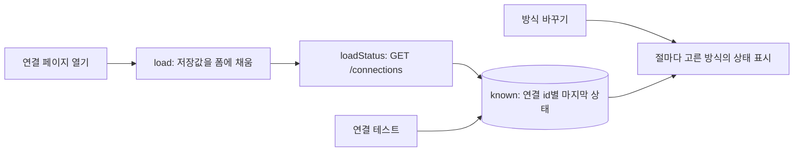

# akbun-taskq 0.28.1 학습 노트

0.28.1은 설정 > 연결 화면이 열 때마다 초기화되던 문제 하나를 고친 버전이다. 서버는 바꾸지 않았고 `ui/js/views/connections.js`만 고쳤다.

## 무엇이 초기화됐나

0.27.0에서 연결 카드 목록을 없애고 절마다 "연결 테스트" 버튼을 두면서, 화면은 테스트를 누르기 전까지 상태를 보이지 않게 됐다. 게다가 페이지를 열 때마다 두 가지를 일부러 지웠다. 하나는 절마다의 결과 칸이고, 다른 하나는 OpenAI 방식 선택이다. OpenAI 방식은 서버 어디에도 저장되지 않아서, 열 때마다 OpenAI bot이 쓰는 방식으로 다시 맞추도록 `dataset.loaded` 표시를 지우고 있었다. 사용자 입장에서는 방금 고른 방식과 확인한 결과가 매번 사라지는 셈이었다.

## 고친 방식

서버의 `GET /connections`는 모든 연결의 검사 결과를 이미 1분 동안 캐시해 두고 사이드바의 상태 점에 쓰고 있었다. 새 API를 만들지 않고 이 결과를 화면의 출발점으로 썼다.

연결 페이지를 열 때 상태가 채워지는 순서:

- `known`은 연결 id(`claude:api`, `openai:chatgpt` 같은 값)별 마지막 상태다. 페이지를 열면 서버 캐시로 채우고, 여기서 테스트를 돌리면 그 결과로 덮는다. 방식을 바꾸면 그 방식의 id로 찾아 바로 보인다.
- OpenAI 방식은 처음 한 번만 bot에서 정하고, 그 뒤로는 사용자가 고른 값을 그대로 둔다. 페이지를 다시 불러오면(앱 재시작) 다시 bot 기준으로 정해진다. 서버에 저장하지 않은 것은 이 선택이 "어느 칸을 채울지"만 정할 뿐 실행에 쓰이는 값이 아니기 때문이다.
- 지우기를 누르면 저장값이 바뀌므로 `known`도 비우고 서버 상태를 다시 읽는다.
- 저장값을 읽지 못하면(`load()`가 false) 상태를 읽지 않는다. 읽으면 절마다 보인 오류를 빈 칸이나 "연결됨"으로 덮어, 폼이 비어 있다는 사실이 사라지기 때문이다. 테스트가 도는 절도 "Testing…"을 그대로 둔다.
- "마지막 결과가 남는다"는 것은 클라이언트가 아니라 서버의 1분 캐시 덕분이다. 1분이 지나면 새 검사 결과로 바뀐다. Claude 방식은 저장값이라 열 때마다 저장한 방식으로 돌아오고, 유지되는 것은 저장하지 않는 OpenAI 방식 선택뿐이다.
