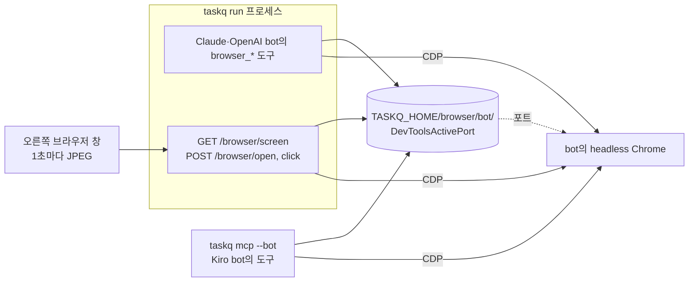

# akbun-taskq 0.29.0 학습 노트

0.29.0은 bot에게 손을 두 개 더 준 버전이다. 하나는 웹 브라우저이고, 다른 하나는 CSV·Excel·PowerPoint 파일이다. 둘 다 bot의 team 도구로 들어갔고, 그러려고 도구 handler가 비동기를 돌려줄 수 있게 먼저 바꿨다.

## 도구 handler를 비동기로

지금까지 team 도구는 SQLite만 만져서 모두 동기 함수였다. 브라우저는 Chrome의 응답을, 파일 도구는 zip을 읽고 쓰는 시간을 기다려야 해서 `TeamTool.handler`가 Promise도 돌려줄 수 있게 넓혔다. 도구를 부르는 곳 세 군데(Claude in-process MCP의 `call`, OpenAI의 `teamTool`, Kiro가 쓰는 `taskq mcp --bot`의 서버)에 `await` 하나씩만 더하면 됐다. 기존 동기 도구는 그대로이고, 테스트 helper 세 곳만 반환값을 동기 결과로 캐스팅했다.

## 브라우저: Playwright 없이 CDP로

Claude Desktop의 브라우저처럼 "세션이 조종하는 브라우저를 사용자가 옆에서 본다"를 만들려면, 브라우저를 taskq가 소유해야 한다. 예전 브라우저 창은 사용자 페이지 안의 iframe이라 bot이 손댈 수 없었고, 남의 사이트는 frame을 막기도 했다.

Playwright를 넣는 대신, 이미 깔려 있는 Chrome을 `--remote-debugging-port=0`으로 띄우고 DevTools 프로토콜(CDP)을 Node 내장 WebSocket으로 직접 말한다. bun 단일 바이너리로 배포하므로 브라우저 다운로드와 큰 라이브러리를 피하는 편이 낫다고 봤다. 필요한 명령은 `Page.navigate`, `Runtime.evaluate`, `Input.dispatchMouseEvent`, `Input.insertText`, `Page.captureScreenshot` 다섯 개뿐이다.

한 bot의 브라우저를 여러 프로세스가 같이 보는 구조:

- Chrome은 열린 포트를 프로필 폴더의 `DevToolsActivePort`에 쓴다. 그래서 어느 프로세스든 그 파일만 읽으면 같은 브라우저에 붙는다. Codex(ChatGPT 방식)와 Kiro bot은 도구가 `taskq mcp --bot`이라는 별도 프로세스에서 돌기 때문에 이 방식이 꼭 필요했다.
- 연결은 호출마다 열고 닫는다. 오래 붙어 있는 연결을 관리하지 않아도 되고, 서버가 재시작해도 상태가 꼬이지 않는다.
- 페이지 요소는 `browser_read`가 `data-taskq-ref="e1"` 같은 속성을 붙여 돌려주고, 클릭과 입력은 그 ref의 화면 좌표에 실제 마우스·키 입력을 보낸다. DOM의 `click()`을 부르는 것보다 사람이 누르는 것에 가깝다.
- 보기(`GET /browser`)는 브라우저를 켜지 않는다. 오른쪽 창을 열었다는 이유만으로 Chrome이 뜨면 안 되기 때문이다.

Chrome 수명은 생각보다 까다로웠다. 처음에는 `taskq run`이 끝날 때 `Browser.close`를 보내게 했는데, 데모를 SIGKILL로 끄니 Chrome이 고아로 남았다. macOS에는 부모가 죽으면 자식도 죽이는 장치가 없어서, Chrome을 작은 셸이 띄우고 그 셸이 2초마다 taskq 프로세스가 살아 있는지 확인해 없으면 Chrome을 끝내게 했다. 정상 종료에서는 여전히 `Browser.close`로 프로필을 저장하며 닫는다. 여기서 한 번 더 걸렸다. Codex와 Kiro의 `taskq mcp --bot`은 turn 하나 동안만 살아서, 그 프로세스가 띄운 Chrome은 turn이 끝나자마자 꺼졌다. 그래서 감시 대상을 "Chrome을 띄운 프로세스"가 아니라 `taskq run` 서버로 바꾸고, 서버가 MCP 프로세스에 자기 pid를 `TASKQ_OWNER_PID`로 넘긴다. 셸 문자열에 들어가는 값은 정수로 검사한 pid뿐이다.

UI는 화면 그림을 토큰과 함께 fetch해 `blob:` URL로 보인다. UI의 CSP가 `default-src 'self'`라 이 그림이 처음에 깨졌고, `img-src 'self' blob:`을 더했다. iframe이 사라졌으니 외부 frame 허용은 지웠다.

## CSV·Excel·PowerPoint

경로 규칙 하나로 세 형식을 묶었다. 절대 경로는 사용자가 지정한 파일이라 그 파일을 계속 고치고, 상대 경로는 공용 폴더의 파일이라 없으면 새로 만든다(`..`로 공용 폴더를 벗어나면 거부). 이 도구들은 Claude Code의 sandbox 밖인 taskq 프로세스에서 파일을 쓰므로, sandbox를 켠 bot은 공용 폴더 안의 파일만 쓰게 막았다.

- CSV는 RFC 4180 파서를 직접 썼다. 따옴표, 쉼표, 줄바꿈이 든 칸만 처리하면 되는 작은 문제라 라이브러리를 넣지 않았다.
- Excel은 exceljs다. 셀만 바꾸는 `xlsx_set_cells`가 파일을 통째로 다시 쓰지 않고 읽어서 그 셀만 고치므로 서식, 열 너비, 다른 시트가 남는다.
- PowerPoint는 두 갈래다. 새 덱은 pptxgenjs로 만든다. 기존 덱은 pptxgenjs가 열 수 없어서, pptx가 zip 안의 XML이라는 점을 이용해 jszip으로 직접 고친다. 글자 바꾸기는 `<a:t>` 텍스트 run 안에서만 하고, 슬라이드 추가는 기존 슬라이드 하나를 레이아웃·그림 관계째 복사한 뒤(발표자 노트 관계는 빼고) `presentation.xml`, 관계 파일, `[Content_Types].xml`에 등록한다. 이렇게 하면 회사 템플릿 같은 원래 디자인이 그대로 남는다. 대신 한 문장이 여러 run으로 쪼개져 있으면 찾지 못하므로, 도구 설명에서 `pptx_read`가 보인 문단 단위로 찾으라고 안내한다.
