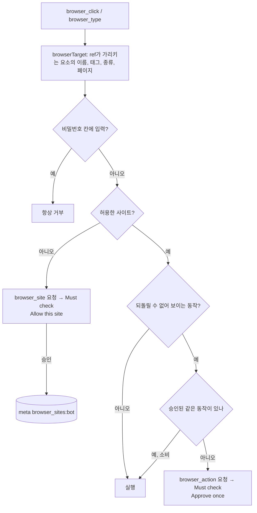

# akbun-taskq 0.30.0 학습 노트

0.29.0에서 bot이 브라우저를 조종하게 됐지만, 클릭과 입력은 아무 확인 없이 실행됐다. 도구 설명에 "사겠다·보내겠다는 클릭 전에는 사용자에게 물어보라"고 적어 두었을 뿐이라 모델이 그 문장을 지키는지에 달려 있었다. 0.30.0은 그 약속을 코드의 게이트로 바꿨다.

## 어디에 게이트를 두었나

taskq에는 이미 bot 승인 장치가 있다. Bash의 `git push` 같은 명령은 `bot-gate.ts`가 막고 `bot_approvals`에 요청을 남기며, 사용자가 Must check에서 "Approve once"를 누르면 그 명령이 정확히 한 번 실행된다. 브라우저 도구는 taskq 자신의 team 도구라 이 gate를 거치지 않으므로, 같은 요청 표와 Must check를 쓰되 판단은 `tools-browser.ts`의 `gate()`에서 한다.

클릭 하나가 실행되기까지:

## 두 종류의 승인을 나눈 이유

Claude Desktop의 브라우저는 사이트마다 한 번 허락을 받는다. 클릭마다 묻는다면 사용자는 몇 번 만에 내용을 읽지 않고 승인부터 누르게 되고, 그러면 승인은 아무것도 막지 못한다. 그래서 평범한 클릭은 사이트 단위로 한 번만 묻고, 정말 되돌릴 수 없는 동작만 따로 한 번씩 묻는다.

- 사이트 승인은 "한 번 실행"이 아니라 "이 사이트를 허용"이다. 그래서 `decideApprovalRequest`가 `browser_site` 요청을 승인할 때 host를 허용 목록에 넣고 요청은 바로 `used`로 닫는다. bot에게 가는 메시지도 "이 명령을 한 번 실행해도 된다"가 아니라 "페이지를 다시 읽고 이어서 하라"로 바꿨다.
- 동작 승인은 ref가 아니라 "버튼 이름과 페이지 주소"로 동작을 부른다. ref(`e5`)는 페이지를 다시 읽을 때마다 바뀌기 때문에, 승인한 뒤 bot이 다시 읽어도 같은 동작으로 맞아야 한다.
- "되돌릴 수 없어 보이는가"는 버튼 이름과 링크를 영어·한국어 단어 목록(`IRREVERSIBLE_ACTION`)에 맞춰 본다. 명령어 ask-first 규칙과 마찬가지로 사고를 막는 장치이지 경계는 아니다. 버튼 이름은 무엇이든 될 수 있기 때문이다.
- 처음 만든 게이트에는 구멍이 두 개 있었고 리뷰에서 잡혔다. 하나는 이스케이프 실수였다. 페이지에서 돌릴 스크립트를 JS template literal로 만들면서 `\s`를 한 번만 이스케이프해, 페이지에서는 `/s+/g`가 돌았고 "Subscribe"가 "Sub cribe"가 되어 단어 목록을 피해 갔다. 다른 하나는 메시지 칸이다. Enter로 보내는 채팅·댓글 칸은 이름이 "Message"라서 단어 목록에 걸리지 않는다. 그래서 여러 줄 입력이나 편집 가능한 상자에서 Enter는 늘 묻고, 한 줄 칸이면 그 칸의 form이 누를 제출 버튼 이름까지 보게 했다.
- 일회성 승인은 결정 후 15분 안에만 쓴다. 같은 "Delete" 버튼이 행마다 있는 목록에서, 어제 승인한 것이나 다른 행을 위해 승인한 것이 나중에 쓰이지 않게 하려는 것이다.
- 사이트는 호스트와 포트로 구분한다. 개발 서버 하나를 허용했다고 같은 컴퓨터의 다른 포트 서비스까지 허용되면 안 되기 때문이다.
- 페이지를 열고 읽는 것과, 사용자가 오른쪽 창에서 직접 누르는 클릭은 막지 않는다. 사람이 하는 행동을 사람에게 다시 묻는 것은 의미가 없다.
