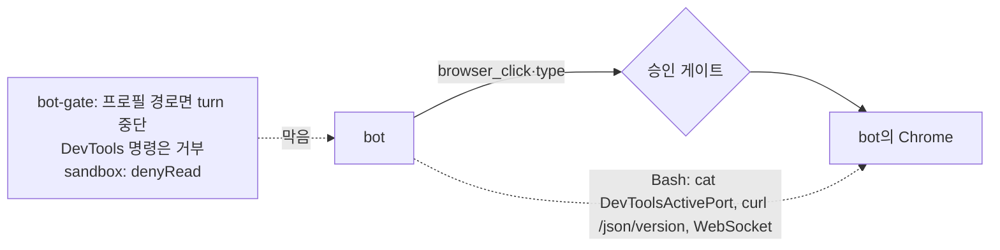

# akbun-taskq 0.30.1 학습 노트

0.30.0의 승인 게이트는 bot의 `browser_click`과 `browser_type` 도구 안에 있다. 그런데 bot이 그 도구를 쓰지 않고 브라우저에 닿는 길이 하나 남아 있었다. 0.30.1은 그 길을 막았다.

## 우회 경로

taskq는 bot마다 Chrome을 `--remote-debugging-port=0`으로 띄우고, Chrome은 열린 포트를 프로필 폴더의 `DevToolsActivePort`에 쓴다. 서버와 Kiro·Codex의 MCP 프로세스가 같은 브라우저를 찾으려면 필요한 구조다. 하지만 셸을 쓸 수 있고 sandbox가 꺼진 bot도 같은 파일을 읽을 수 있고, 그러면 그 포트에 WebSocket을 열어 `Input.dispatchMouseEvent`를 직접 보낼 수 있다. 게이트를 거치지 않으니 사용자가 로그인해 둔 세션 위에서 아무 승인 없이 누르고 입력하게 된다.

## 막은 방식과 고르지 않은 방식

가장 확실한 방법은 TCP 포트를 아예 없애는 `--remote-debugging-pipe`다. 하지만 파이프는 Chrome을 띄운 프로세스만 쓸 수 있어서, 서버와 Kiro·Codex의 MCP 프로세스가 같은 브라우저를 보는 구조를 다시 짜야 한다. 그래서 taskq가 자기 데이터 폴더를 지키는 방식을 그대로 따랐다.

- 브라우저 프로필 폴더를 데이터 폴더와 같은 "taskq 자신"으로 다룬다. 파일 도구 쪽은 처음에 따로 검사를 썼다가, 리뷰에서 `~/...` 경로와 Glob 패턴을 놓친다는 지적을 받았다. 데이터 폴더를 지키는 `tamperOf`가 이미 `~`를 펼치고 패턴을 경로로 읽기 때문에, 거기에 브라우저 폴더를 더하는 쪽으로 바꿨다. 덕분에 task worker도 같은 보호를 받는다. 셸 명령은 글자로 보므로 `~/.taskq/browser`, `$HOME/...`, `$TASKQ_HOME/browser` 같은 표기도 목록에 넣었고, 같은 구멍이 있던 데이터 폴더와 plugin 복사본도 함께 막았다.
- 포트는 `lsof`로도 찾을 수 있으므로, 파일만 막아서는 부족하다. 그래서 DevTools에 붙을 때 쓰는 글자(`DevToolsActivePort`, `:포트/json`, `devtools/page/`, `Input.dispatchMouseEvent`, `connectOverCDP`, `browserWSEndpoint` 등)가 들어간 명령은 거부한다. 처음에는 `remote-debugging`도 넣었는데, 그러면 Chrome을 다루는 저장소에서 코드를 grep하거나 커밋 메시지에 그 단어를 쓰는 것까지 막혀서 뺐다. 포트를 찾는 것보다 붙는 것을 막는 편이 오탐이 적다.
- sandbox를 켠 bot은 `denyRead`에 프로필 폴더를 더해 읽기 자체를 막는다.

글자로 검사하는 방식은 변수나 스크립트 파일로 우회할 수 있다. 그래서 이것은 사고와 손쉬운 우회를 막는 층이고, 경계는 sandbox다. 기존 데이터 폴더 보호와 같은 수준이다.
