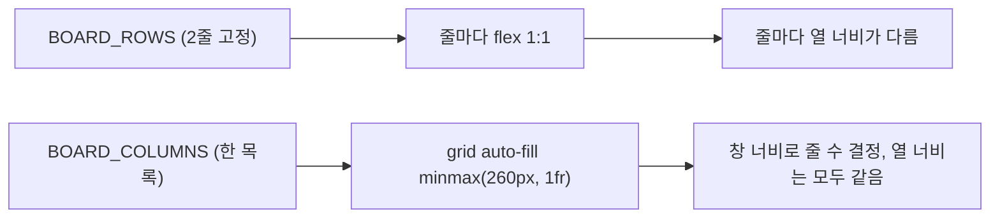

# akbun-taskq 0.30.2 학습 노트

화면만 고친 버전이다. 두 곳 모두 이미 있는 규칙을 다른 화면에도 적용했고, 새 구조는 만들지 않았다.

## 작업 상세를 설정 창의 규칙으로

작업 상세는 기본 `dialog`의 720px 너비와 `dialog-body`의 16px 여백을 그대로 쓰고 있었고, 절 제목이 H3이라 본문과 크기 차이가 거의 없었다. 설정 창은 이미 "창을 거의 채우고, 가운데 820px 기둥에 H1 제목과 H2 절을 20px 간격으로 놓는" 규칙을 갖고 있다. 그래서 `panels.css`에 같은 크기·여백 값을 `dialog[data-area="task-detail"]`로 옮기고, `task-detail.js`의 제목을 `.page-title`(H1), 절 제목을 `.section-title`(H2)로 바꿨다. 헤더 크기와 구분선은 `base.css`의 공용 클래스에서 오므로 새 스타일을 정의하지 않았다. worktree 패널이 붙는 넓은 상세는 기둥만 1240px로 넓힌다.

생성 시각은 API가 이미 `created_at`을 돌려주고 있어서 표시만 더했다.

## 보드: 줄을 데이터가 아니라 창이 정한다

이전에는 `BOARD_ROWS`가 열을 4개와 3개 두 줄로 나눴고 줄마다 flex로 너비를 나눠 가졌다. 둘째 줄에 접힌 실패·취소 열이 더 붙어 있어서 두 줄의 열 너비가 서로 달랐다.

이제 열 목록 하나를 grid의 `auto-fill`로 흘려 보낸다. 화살표를 열 사이 별도 항목으로 두면 줄이 바뀌는 자리에서 어긋나므로, 화살표와 열을 `.board-step` 하나로 묶고 첫 열과 접힌 열에도 빈 화살표 칸을 둬서 모든 열의 너비가 같게 맞췄다. 카드 목록은 `max-height: min(60vh, 640px)`에서 열 안 스크롤로 바뀐다.
