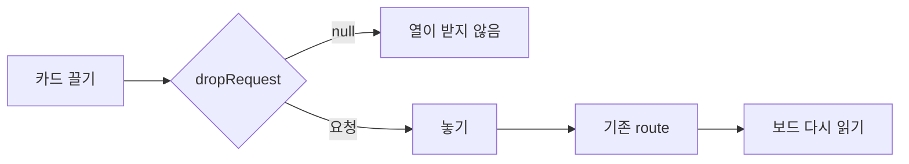

# akbun-taskq 0.31.0 학습 노트

이번 버전은 상태보드와 작업 상세를 손보면서, 사용자가 화면에서 하던 일을 막거나 더 쉽게 만드는 변경을 여럿 묶었다. 새 서버 구조는 다시 시작 하나뿐이고, 나머지는 이미 있던 API를 화면에서 더 잘 쓰게 만들었다.

## 드래그앤드롭은 기존 이동만 쓴다

카드를 아무 열에나 놓아 상태를 직접 쓰게 하면, 실행 중이나 승인 대기처럼 runner만 만들어야 하는 상태를 사람이 만들 수 있다. 그래서 놓을 수 있는 칸을 `ui/js/pure/board-drop.js`의 `dropRequest(task, to)`가 정하고, 그 결과는 언제나 이미 있는 route(`run`, `resume`, `done`, `retry`, `cancel`, `PATCH status: ready`) 중 하나다. 결과가 `null`이면 `dragover`에서 `preventDefault`를 하지 않아 브라우저가 놓기를 거부한다. 순수 함수라 DOM 없이 `test/board-drop.test.ts`로 검사한다.

## 실행에는 agent가 있어야 한다

시작 버튼은 원래 owner와 관계없는 일회성 실행이었다. 사용자는 맡은 agent가 없는 task가 실행되면 안 된다고 정했고, 그래서 `prepareRun`에서 owner가 없으면 `OperatorError`를 던진다. 화면에서 버튼을 끄는 것만으로는 CLI와 MCP의 `task_run`이 남으므로 서버에서 막았다. 큐의 자동 실행은 별도 설정(`queue_autorun`)이라 건드리지 않았다.

수정 잠금도 같은 방식이다. `PATCH /tasks/:id`가 `running`, `needs_approval`에서 제목과 의도 변경을 409로 거절하고, 화면의 수정 버튼은 같은 목록으로 꺼진다.

## 오류 아이콘과 실행 이력

보드가 task마다 run을 따로 묻지 않도록 `listTasks`에 마지막 run의 `outcome`을 서브쿼리로 붙였다(`last_outcome`). 이력 창은 이미 상세 응답에 있는 runs를 쓰고, `listRunsOfTask`에 `bot` 열만 더했다. bot이 없는 run은 시작 버튼으로 돈 runner 실행이다.

## 다시 시작은 같은 pid로

업데이트는 실행 파일을 바꾸기만 하고, 새 코드는 프로세스를 다시 띄워야 돈다. 새 자식을 띄우고 끝내면 데스크톱 앱이 들고 있는 pid와 stdout이 끊겨, 앱을 닫아도 새 서버가 남는다. Node 24의 `process.execve`는 프로세스 이미지만 바꾸므로 pid와 stdout이 그대로다. 그래서 `POST /update/restart`는 답을 먼저 보내고, `run.ts`가 bot·브라우저·job·runner·서버·DB를 닫은 뒤 `relaunch()`로 execve한다. 토큰은 처음에 환경 변수로 넘겼는데, 리뷰에서 변수를 지워도 프로세스의 첫 환경은 `ps eww`로 계속 읽힌다는 지적을 받았다. 같은 사용자로 도는 bot의 셸이 그 토큰으로 승인 API를 부를 수 있으므로, bot이 닿지 못하게 막아 둔 데이터 폴더에 0600 파일(`data/restart-token`)로 넘기고 새 프로세스가 한 번 읽고 지우게 바꿨다. 1분이 지난 파일은 쓰지 않는다. 그래서 열린 페이지는 sessionStorage의 토큰 그대로 새로 고치기만 하면 된다. 다만 옛 프로세스는 bot과 run을 멈추는 몇 초 동안 계속 응답하므로, 페이지는 설치 진행 상태가 `done`(옛 프로세스)에서 `idle`(새 프로세스)로 바뀐 것을 보고서야 새로 고친다. execve가 없는 런타임에서는 같은 stdout을 쓰는 자식을 띄우는 길로 내려가고, 그때는 앱 종료가 새 프로세스를 멈추지 못한다는 한계를 코드 주석에 남겼다.

## 모델 이름의 버전

SDK의 `supportedModels()`는 별칭 행(`opus`)의 `displayName`을 "Opus"처럼 계열만 준다. 같은 행의 `resolvedModel`(예: `claude-opus-5-5`)에서 버전을 읽어 붙이는 `modelName()`을 `src/team/model-name.ts`에 두었다. 이름에 이미 숫자가 있거나 id에서 버전을 읽을 수 없으면 그대로 둔다.
