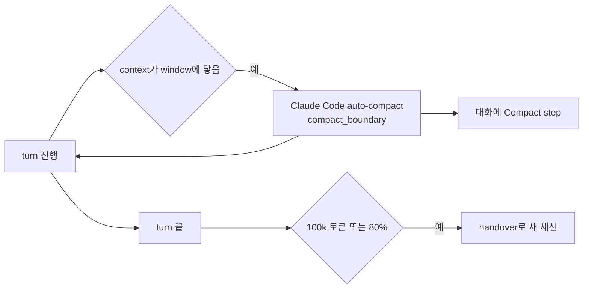

# akbun-taskq 0.32.0 학습 노트

긴 bot 세션이 context window를 다 채우면 다음 turn이 "prompt is too long"으로 실패하고, 사용자가 세션을 비우기 전까지 그 bot은 아무 일도 하지 못했다. taskq에는 이미 100,000 토큰이나 window의 80%에서 새 세션으로 넘기는 handover가 있지만, 그것은 turn이 끝난 뒤에 판단한다. 한 turn 안에서 도구 결과가 쌓여 window를 넘으면 handover가 끼어들 틈이 없다.

## 어디에서 켜는가

Claude Code에는 context가 차면 앞부분을 요약하는 auto-compact가 있다. 기본값은 켜짐이지만 사용자 설정(`autoCompactEnabled`)으로 끌 수 있고, task worker는 사용자 설정을 읽으므로(`settingSources: ['user']`) 그 값을 따라간다. Agent SDK의 `Options.settings`는 flag settings로 들어가 사용자 설정보다 우선한다. 그래서 `src/agents/claude/compaction.ts`의 `{ autoCompactEnabled: true }`를 bot turn과 task worker 두 곳에 넘겼다.

언제 압축할지는 정하지 않았다. 퍼센트를 바꾸는 환경 변수는 문서마다 설명이 달라 낮추는 것만 된다는 보고도 있고, SDK가 공식으로 노출하는 것은 켜고 끄는 값과 window 크기뿐이다. Claude Code가 모델마다 맞춘 window를 쓰게 두고, 비용을 줄이는 이른 정리는 기존 handover가 맡는다.

## 보이게 하기

압축이 일어나면 SDK가 `compact_boundary` 시스템 메시지를 보낸다. `runTurn`이 이것을 `onStep('Compact', ...)`로 넘겨 기존 turn step 기록(`team_turn_steps`)에 남긴다. bot이 앞의 일을 덜 기억하는 이유가 대화에 그대로 보인다.
