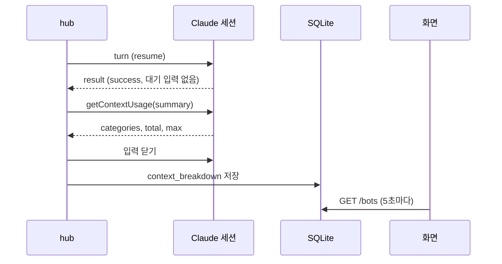

# akbun-taskq 0.34.0 학습 노트

bot 대화의 오른쪽 열은 0.28.0부터 PR과 백그라운드 작업을 보였다. 이번 버전은 Claude Desktop의 오른쪽 열처럼 맨 위에 컨텍스트를, 변경 사항에 작업 폴더의 줄 수를 더했다.

## 컨텍스트 구성은 turn이 끝날 때 받아 둔다

Agent SDK의 `Query.getContextUsage()`는 열려 있는 세션에만 물을 수 있다. bot은 turn마다 세션을 resume해서 열고 닫으므로, 화면이 원할 때 물을 세션이 없다. 그래서 turn이 잘 끝나는 그 결과 메시지에서, 입력을 닫기 전에 한 번 묻고 그 답을 `team_agents.context_breakdown`(JSON, 마이그레이션 013)에 저장한다. 화면은 이미 5초마다 읽는 `GET /bots`에서 그 값을 꺼내 그린다.

`detail: 'full'`은 항목마다 토큰 계산 API를 부르므로 turn마다 비용과 시간이 더 든다. `summary`는 마지막 응답의 usage와 로컬 추정으로 답하므로 이것을 썼다. 3초 안에 답하지 않으면 그 turn의 값은 버리고, 패널은 기존의 크기(`context_tokens`/`context_window`)만 보인다. 세션을 비우거나 SDK를 바꾸면 크기와 함께 지운다. 실패한 turn처럼 크기만 오고 구성이 없으면 이전 구성도 지워, 한 turn의 크기 아래 다른 turn의 항목이 보이지 않게 했다.

리뷰에서 하나를 더 고쳤다. 전에는 결과 메시지와 입력 닫기 사이가 동기 코드였는데, 구성을 묻는 await가 들어가면서 그 3초 사이에 hub가 진행 중인 turn에 메시지를 밀어 넣을 수 있게 됐다. 기다리기 전에 계산한 "대기 입력 없음"으로 입력을 닫으면 그 메시지는 읽힘으로 찍힌 채 답을 받지 못한다. 그래서 await 뒤에 대기 입력을 다시 세고, 있으면 turn을 이어 간다.

## 변경 사항의 줄 수

bot의 작업 폴더가 git 저장소 안에 있으면 `GET /bots/:name/activity`가 `HEAD`와의 차이를 센다. `git diff --numstat HEAD`로 커밋하지 않은 수정을, `git ls-files --others`로 추적하지 않는 새 파일을 센다. 패널이 15초마다 묻기 때문에 서버를 멈추는 동기 호출 대신 `execFile`로 부른다. 폴더가 git 밖이면 `changes`는 null이고 그 행은 보이지 않는다.
